# purrimer-build

Generates the Purrimer design system's styles and components for seven targets from one `tokens.json`, with Jinja2
templates.

| Target | Output | What you get |
| --- | --- | --- |
| `css` | `css/` | `purrimer.css` (custom properties, fonts, base styles) and `purrimer-components.css` (`pm-*` classes) |
| `svelte` | `svelte/` | Svelte 5 components (runes, snippets), theme store, tokens and icons as TypeScript |
| `solid` | `solid/` | Solid 2 components (`@solidjs/web`), theme helpers, tokens and icons as TypeScript |
| `qtwidgets` | `qtwidgets/purrimer_qt/` | A PySide6 package: one QSS file per theme, `theme`, `icons`, `tokens` and widget classes |
| `qtquick` | `qtquick/Purrimer/` | A QML module: `Purrimer` and `Octicons` singletons and one `.qml` file per component |
| `avalonia` | `avalonia/Purrimer/` | Avalonia 12 resources, theme variants, icon geometries, control themes and control classes |
| `slint` | `slint/` | Slint globals (`Purrimer`, `PurrimerMotion`, `PurrimerIcons`) and one `.slint` file per component |

Every target covers the same 25 components: Icon, Button, IconButton, TextField, Checkbox, Radio, Toggle, Select,
Label, Chip, Banner, ProgressBar, Card, Dialog, AppBar, BottomNav, BottomSheet, ListItem, ListSection, FAB, Snackbar,
SearchBar, SegmentedControl, Tabs and Avatar. The themes are Blanc (default), Noir, Latte and Mocha.

## Components

Each component has a page in [docs/components](docs/components/README.md) with its props and a working example for
every target, screenshotted in Blanc and Noir. The gallery shows the CSS target in Blanc.

<!-- gallery:start -->

<table>
<tr>
<td align="center" valign="top"><a href="docs/components/Icon.md">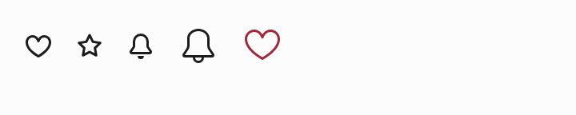<br><b>Icon</b></a></td>
<td align="center" valign="top"><a href="docs/components/Button.md">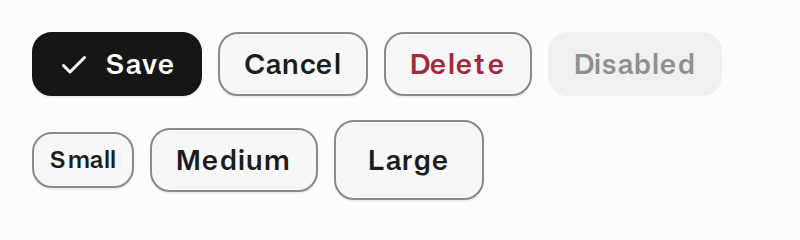<br><b>Button</b></a></td>
<td align="center" valign="top"><a href="docs/components/IconButton.md">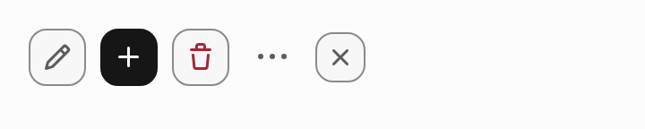<br><b>IconButton</b></a></td>
</tr>
<tr>
<td align="center" valign="top"><a href="docs/components/TextField.md">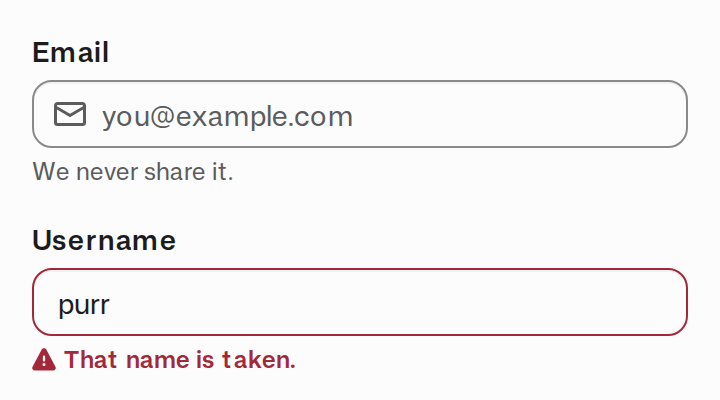<br><b>TextField</b></a></td>
<td align="center" valign="top"><a href="docs/components/Checkbox.md">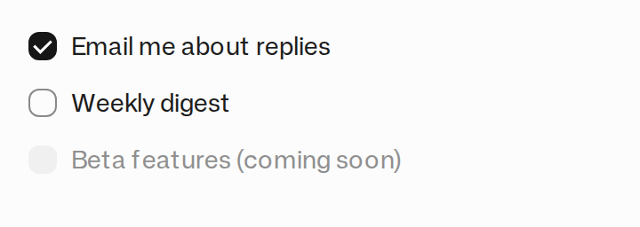<br><b>Checkbox</b></a></td>
<td align="center" valign="top"><a href="docs/components/Radio.md">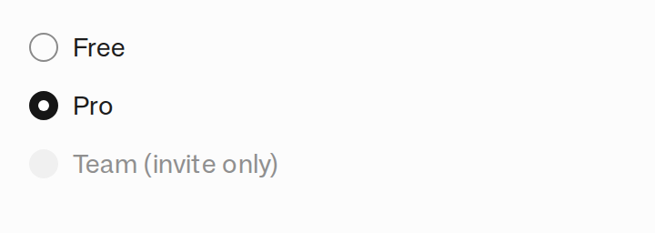<br><b>Radio</b></a></td>
</tr>
<tr>
<td align="center" valign="top"><a href="docs/components/Toggle.md">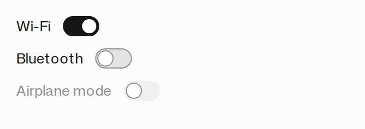<br><b>Toggle</b></a></td>
<td align="center" valign="top"><a href="docs/components/Select.md">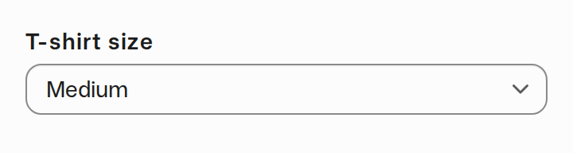<br><b>Select</b></a></td>
<td align="center" valign="top"><a href="docs/components/Label.md">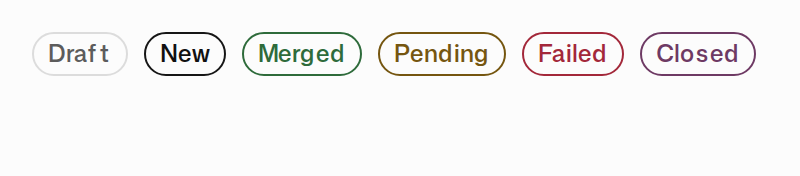<br><b>Label</b></a></td>
</tr>
<tr>
<td align="center" valign="top"><a href="docs/components/Chip.md">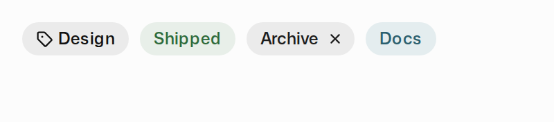<br><b>Chip</b></a></td>
<td align="center" valign="top"><a href="docs/components/Banner.md">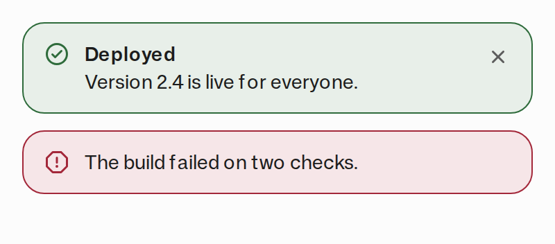<br><b>Banner</b></a></td>
<td align="center" valign="top"><a href="docs/components/ProgressBar.md">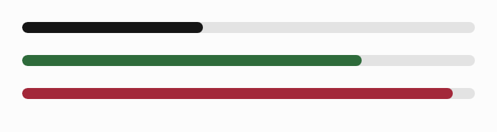<br><b>ProgressBar</b></a></td>
</tr>
<tr>
<td align="center" valign="top"><a href="docs/components/Card.md">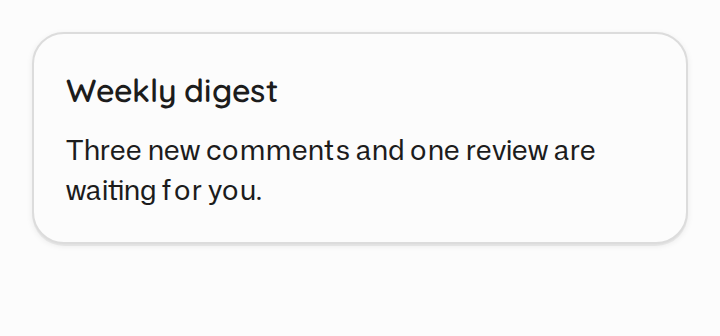<br><b>Card</b></a></td>
<td align="center" valign="top"><a href="docs/components/Dialog.md">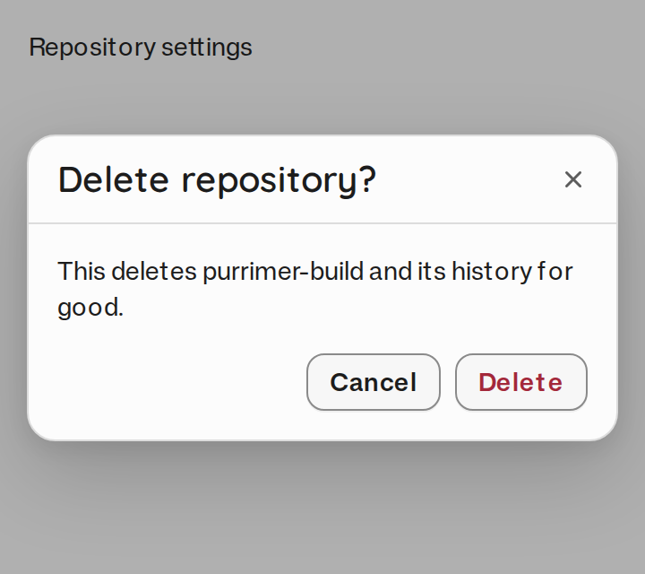<br><b>Dialog</b></a></td>
<td align="center" valign="top"><a href="docs/components/AppBar.md">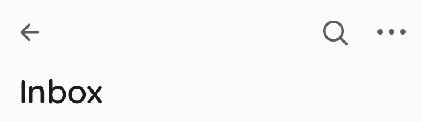<br><b>AppBar</b></a></td>
</tr>
<tr>
<td align="center" valign="top"><a href="docs/components/BottomNav.md">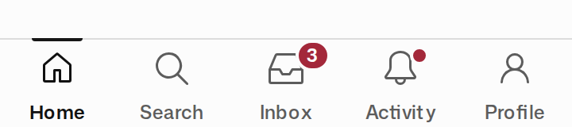<br><b>BottomNav</b></a></td>
<td align="center" valign="top"><a href="docs/components/BottomSheet.md">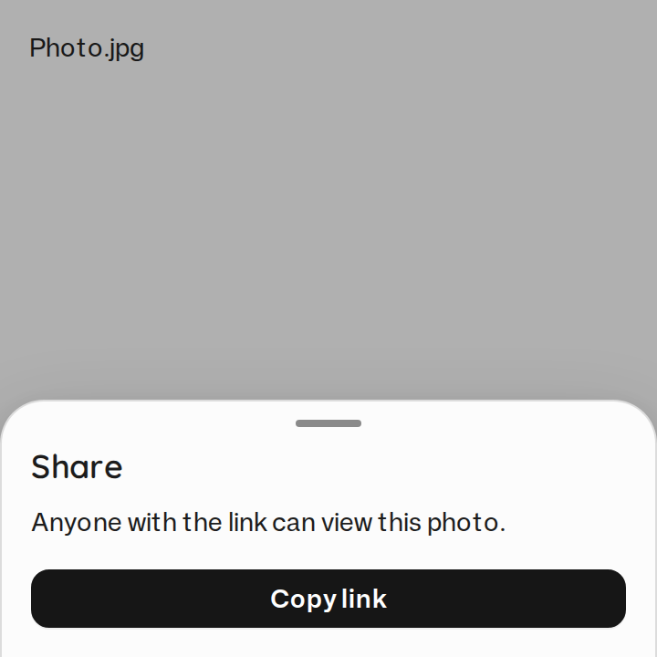<br><b>BottomSheet</b></a></td>
<td align="center" valign="top"><a href="docs/components/ListItem.md">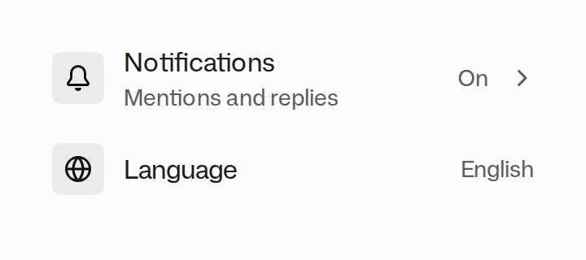<br><b>ListItem</b></a></td>
</tr>
<tr>
<td align="center" valign="top"><a href="docs/components/ListSection.md">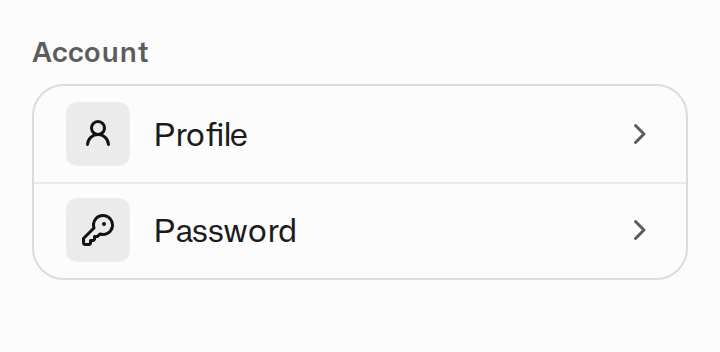<br><b>ListSection</b></a></td>
<td align="center" valign="top"><a href="docs/components/FAB.md">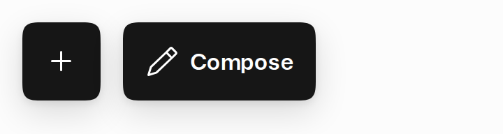<br><b>FAB</b></a></td>
<td align="center" valign="top"><a href="docs/components/Snackbar.md">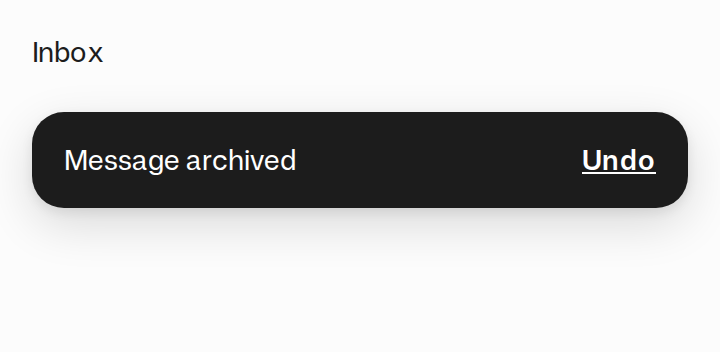<br><b>Snackbar</b></a></td>
</tr>
<tr>
<td align="center" valign="top"><a href="docs/components/SearchBar.md">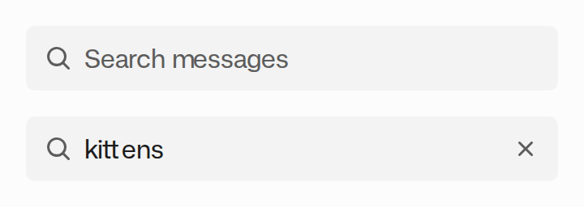<br><b>SearchBar</b></a></td>
<td align="center" valign="top"><a href="docs/components/SegmentedControl.md">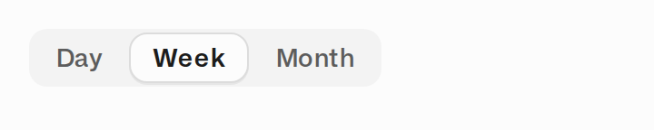<br><b>SegmentedControl</b></a></td>
<td align="center" valign="top"><a href="docs/components/Tabs.md">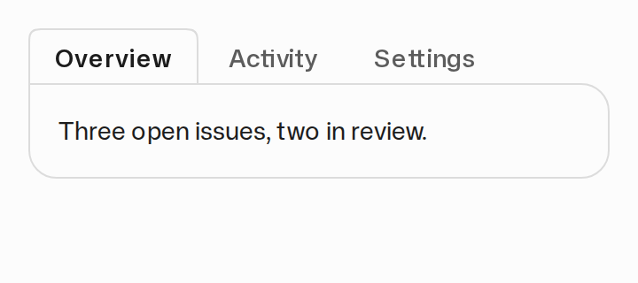<br><b>Tabs</b></a></td>
</tr>
<tr>
<td align="center" valign="top"><a href="docs/components/Avatar.md">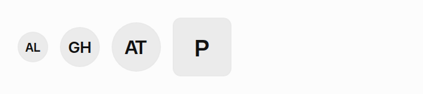<br><b>Avatar</b></a></td>
</tr>
</table>

<!-- gallery:end -->

## Install

The project uses [uv](https://docs.astral.sh/uv/).

```sh
uv sync
uv run purrimer --help
```

To install the command for your user: `uv tool install .` (or `uv tool install git+https://github.com/Advik-B/purrimer-build`).

## Build

```sh
uv run purrimer build --clean
uv run purrimer build --targets css,svelte --out web-dist
uv run purrimer build --only Button,Card --targets qtquick
```

| Option | Default | Meaning |
| --- | --- | --- |
| `--tokens` | `tokens/tokens.json` | Token file exported from the Purrimer design system |
| `--fonts` | `tokens/fonts` | Variable WOFF2 fonts named in the token file |
| `--out` | `dist` | Output folder |
| `--targets` | `all` | Comma-separated targets |
| `--only` | | Comma-separated component names |
| `--clean` | | Delete the output folder first |
| `--avalonia-namespace` | `Purrimer.Avalonia` | C# namespace of the generated Avalonia classes |
| `--avalonia-assembly` | `Purrimer.Avalonia` | Assembly name in `avares://` URIs |

`purrimer components` prints which targets each component supports. The source of truth for tokens is the design
system; copy its `tokens.json` and fonts into `tokens/` when they change.

## Using the output

**CSS.** Link `css/purrimer.css` and `css/purrimer-components.css`, copy `fonts/woff2/`, and set `data-theme` on
`<html>` to `noir`, `light` (Latte) or `dark` (Mocha). Without the attribute you get Blanc.

**Svelte and Solid.** Copy the folder into your source tree, import `purrimer.css` and `purrimer-components.css` once
at the app root, and import components from its `index.ts`. Solid targets 2.x (`jsxImportSource: "@solidjs/web"`).

**PySide6.**

```python
from purrimer_qt import apply
from purrimer_qt.components import Button, TextField

apply(app, "noir")  # or "light" (Latte), "dark" (Mocha)
layout.addWidget(Button("Save", "primary", leading_icon="check"))
```

Painted widgets repaint when `theme.changed` fires. Native widgets get their look from the QSS file.

**Qt Quick.** Add `qtquick/` to the QML import path and `import Purrimer`. Set `Purrimer.theme` to `"noir"`,
`"light"` or `"dark"`. Card, FAB
and Dialog shadows use `RectangularShadow`, so Qt 6.9 or later is required.

**Avalonia.** Add `avalonia/Purrimer/` to the project (fonts as `AvaloniaResource`), then merge
`Purrimer.axaml`, `Icons.axaml` and `Controls.axaml` into `Application.Resources`. Switch themes with
`RequestedThemeVariant = PurrimerThemes.Noir`. The built-in Button, CheckBox, RadioButton, ToggleSwitch, ProgressBar
and TabControl get Purrimer as their default theme; the other components are `pm:` controls.

**Slint.** Import from `slint/purrimer-components.slint` and set `Purrimer.theme = PurrimerTheme.noir` (or `latte`,
`mocha`). Icons are path commands such as `PurrimerIcons.search-16`. Set
`default-font-family: Purrimer.text-body-medium.font-family` on your `Window` so plain `Text` uses Mona Sans.

**Overlays.** Dialog, BottomSheet and Snackbar on Avalonia and Slint, and BottomSheet and Snackbar on PySide6, draw
inside their parent: place them last in a panel that covers the window or screen. The PySide6 Dialog is a `QDialog`;
show it with `open()` or `exec()`. On Qt Quick all three are popups on the window overlay.

## Adding a component

A component is a folder under `src/purrimer_build/templates/components/` with a `component.toml` and one template per
layer:

| Layer file | Used by |
| --- | --- |
| `web.css.j2` | css, svelte, solid |
| `svelte.svelte.j2` | svelte |
| `solid.tsx.j2` | solid |
| `pyside.py.j2` | qtwidgets |
| `qml.qml.j2` | qtquick |
| `avalonia.axaml.j2` | avalonia |
| `avalonia.cs.j2` | avalonia, only when Avalonia has no matching control |
| `slint.slint.j2` | slint |

```sh
uv run purrimer new DatePicker --group Forms
uv run purrimer components
```

Add `examples/DatePicker/` too, with one example per target (see [Examples and screenshots](#examples-and-screenshots));
the tests fail without it. A target skips a component that lacks its layers and says so in the build output. Pass `--components-dir path` to
keep components outside this repository; a folder there with the same name as a built-in one replaces it.

## Template rules

- Refer to tokens with the `tok` filter: `{{ "bgColor-default" | tok }}`. Each target renders it in its own syntax
  (`var(--bgColor-default)`, `Purrimer.bgColorDefault`, `{DynamicResource PmBgColorDefault}`, and so on). An unknown
  token name fails the build.
- `px("name")` and `ms("name")` give raw numbers. Avalonia templates also have `tokx(name, suffix)` for keys such as
  `PmTextTitleSmallFontSize` and `font("sans")` for font families.
- Jinja comments are `{## ##}`, because Svelte uses `{#if}`.
- Never write `{{` in generated code. In JSX use `{ {` or a named object.
- `c` is the component: `c.name`, `c.summary`, `c.spec.props.<prop>.default`.
- Every generated file starts with the "Generated by purrimer-build" note; the tests check for it.

## Checks

```sh
uv run ruff check
uv run ruff format --check
uv run pytest
```

The tests build every target once and check names, coverage and output, plus the bugs that the examples below
turned up.

## Examples and screenshots

`examples/<Name>/` holds one small example per target: `css.html`, `svelte.svelte`, `solid.tsx`, `qtwidgets.py`,
`qtquick.qml`, `avalonia.axaml` and `slint.slint`, plus `example.toml` with the frame size. `scripts/showcase.py`
builds every target, runs each example on its real toolkit and screenshots it in Blanc and Noir:

```sh
uv sync --group showcase
uv run scripts/showcase.py build
uv run scripts/showcase.py run                      # all targets; or --targets svelte,slint --only Button,Card
uv run scripts/showcase.py docs                     # docs/components/*.md and the README gallery
```

| Target | Checked with | Fails on |
| --- | --- | --- |
| css, svelte, solid | `svelte-check`, `tsc` with Solid 2.0.3, Vite, Playwright and Chromium | console errors or warnings, failed requests, `pm-*` classes with no CSS rule |
| qtwidgets | PySide6 6.12, offscreen | any Qt warning |
| qtquick | `pyside6-qmllint`, PySide6 6.12 in a window | any QML warning, the software renderer (it drops shadows) |
| avalonia | `dotnet build -warnaserror`, Avalonia 12.1.5 headless with Skia | XAML errors, Avalonia warnings such as binding errors |
| slint | `slint-viewer` 1.18 `--check` and `--screenshot` | any diagnostic |

Every screenshot must also be more than one flat colour. The run needs Node 24, the .NET 10 SDK and `slint-viewer`
on `PATH`. Screenshots land in `showcase/out/`; only CI writes `docs/screenshots/`, so that pixels do not change
with the machine. On every push to `master`, the Showcase workflow runs all of this on Linux and commits the new
screenshots and docs; on pull requests it only runs the checks.

## Licences

See [NOTICE.md](NOTICE.md) for Octicons and the fonts, including the reserved font name caveat for Mona Sans and
Quicksand.
