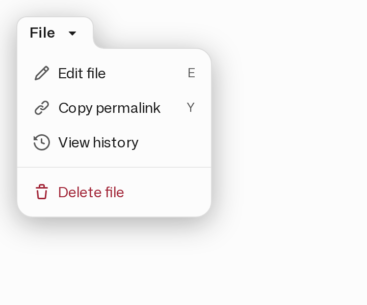
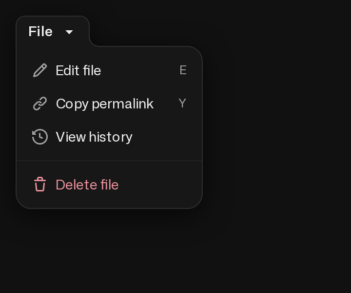
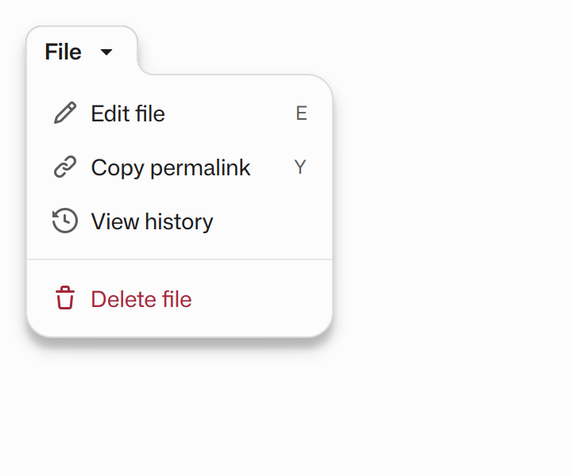
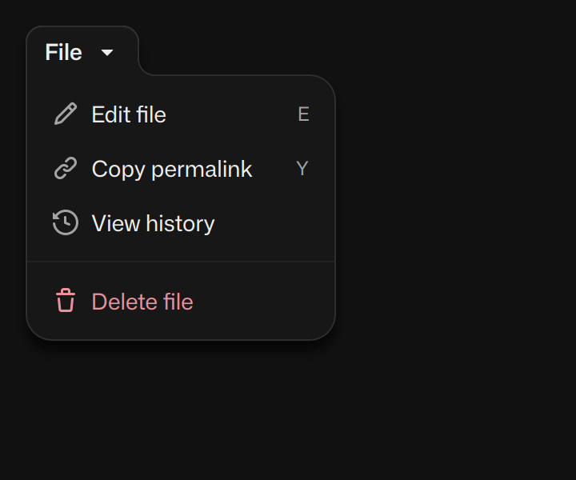
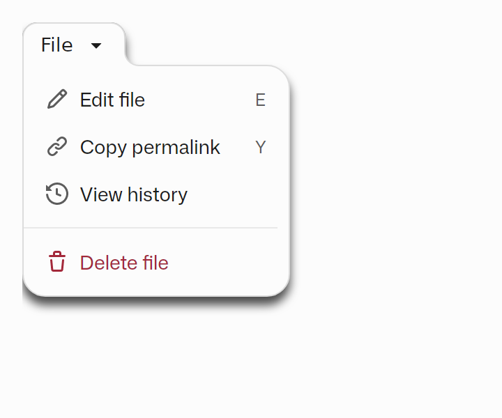
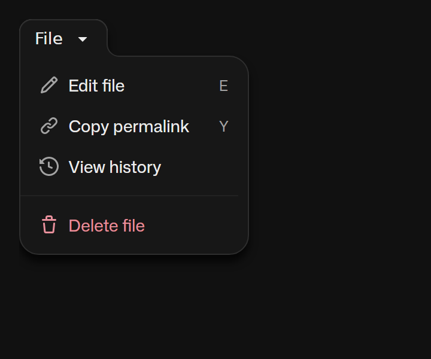
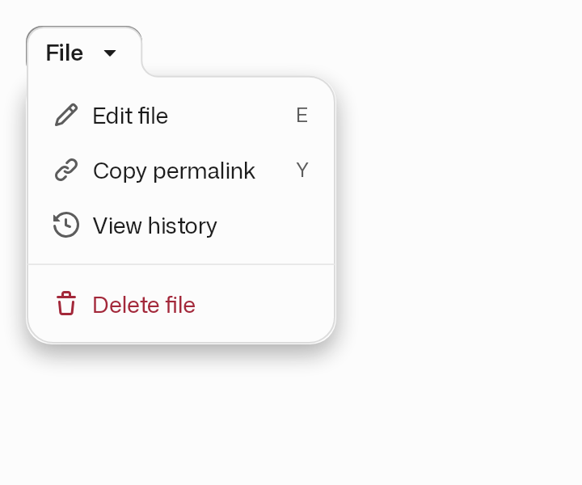
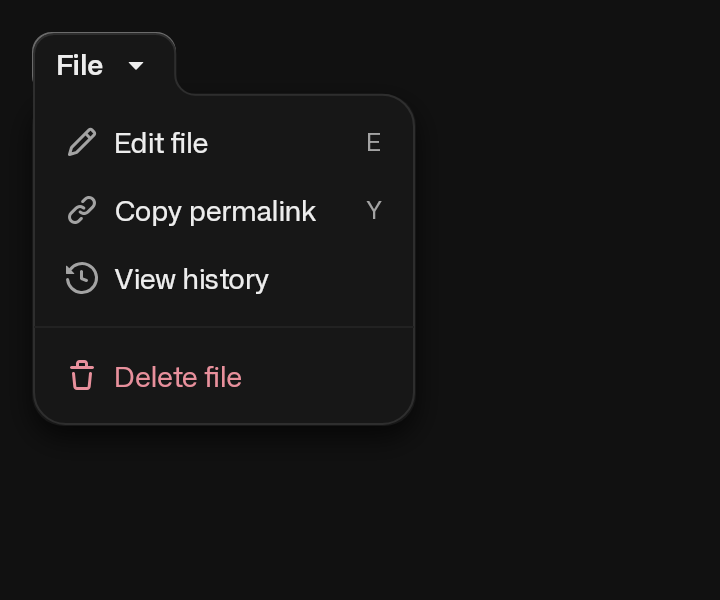

<!-- Generated by scripts/showcase.py from examples/ and component.toml. Do not edit by hand. -->

# ActionMenu

A button that opens a menu of actions; open, the button and the menu are one shape.

Actions · [All components](README.md)

## Props

| Prop | Type | Default | Values | Description |
| --- | --- | --- | --- | --- |
| `label` | string |  |  | The button's text, or the accessible name of an icon-only anchor. |
| `icon` | icon |  |  | Octicon for an icon-only anchor, such as kebab-horizontal for row overflow menus. |
| `variant` | enum | `"default"` | `default`, `primary`, `invisible` | Anchor style when closed; open, it always takes the overlay's fill. |
| `items` | list |  |  | Rows in ActionList's shape. |
| `closeOnSelect` | bool | `true` |  | Close after a pick. |
| `open` | bool | `false` |  | Open state; set it to show the menu from the start. |

Names follow the web targets. Qt Widgets takes `snake_case` arguments, Qt Quick `camelCase` properties, Avalonia `PascalCase` properties and Slint `kebab-case` properties; each example below shows the spelling for its target.

## Examples

Each example is run as it is shown here, on every push, and the screenshots are taken from that run (left Blanc, right Noir).

### CSS

 

```html
<div style="display: flex; gap: 16px; align-items: flex-start">
  <div class="pm-action-menu pm-action-menu--open">
    <button type="button" class="pm-action-menu__anchor" aria-haspopup="menu" aria-expanded="true">File<svg viewBox="0 0 16 16" aria-hidden="true"><path d="m4.427 7.427 3.396 3.396a.25.25 0 0 0 .354 0l3.396-3.396A.25.25 0 0 0 11.396 7H4.604a.25.25 0 0 0-.177.427Z"></path></svg></button>
    <div class="pm-action-menu__overlay">
      <ul class="pm-action-list" role="menu">
      <li class="pm-action-list__item" role="menuitem" tabindex="0"><span class="pm-action-list__leading"><svg viewBox="0 0 16 16" aria-hidden="true"><path d="M11.013 1.427a1.75 1.75 0 0 1 2.474 0l1.086 1.086a1.75 1.75 0 0 1 0 2.474l-8.61 8.61c-.21.21-.47.364-.756.445l-3.251.93a.75.75 0 0 1-.927-.928l.929-3.25c.081-.286.235-.547.445-.758l8.61-8.61Zm.176 4.823L9.75 4.81l-6.286 6.287a.253.253 0 0 0-.064.108l-.558 1.953 1.953-.558a.253.253 0 0 0 .108-.064Zm1.238-3.763a.25.25 0 0 0-.354 0L10.811 3.75l1.439 1.44 1.263-1.263a.25.25 0 0 0 0-.354Z"></path></svg></span><span class="pm-action-list__content">Edit file</span><span class="pm-action-list__trailing">E</span></li>
      <li class="pm-action-list__item" role="menuitem" tabindex="0"><span class="pm-action-list__leading"><svg viewBox="0 0 16 16" aria-hidden="true"><path d="m7.775 3.275 1.25-1.25a3.5 3.5 0 1 1 4.95 4.95l-2.5 2.5a3.5 3.5 0 0 1-4.95 0 .751.751 0 0 1 .018-1.042.751.751 0 0 1 1.042-.018 1.998 1.998 0 0 0 2.83 0l2.5-2.5a2.002 2.002 0 0 0-2.83-2.83l-1.25 1.25a.751.751 0 0 1-1.042-.018.751.751 0 0 1-.018-1.042Zm-4.69 9.64a1.998 1.998 0 0 0 2.83 0l1.25-1.25a.751.751 0 0 1 1.042.018.751.751 0 0 1 .018 1.042l-1.25 1.25a3.5 3.5 0 1 1-4.95-4.95l2.5-2.5a3.5 3.5 0 0 1 4.95 0 .751.751 0 0 1-.018 1.042.751.751 0 0 1-1.042.018 1.998 1.998 0 0 0-2.83 0l-2.5 2.5a1.998 1.998 0 0 0 0 2.83Z"></path></svg></span><span class="pm-action-list__content">Copy permalink</span><span class="pm-action-list__trailing">Y</span></li>
      <li class="pm-action-list__item" role="menuitem" tabindex="0"><span class="pm-action-list__leading"><svg viewBox="0 0 16 16" aria-hidden="true"><path d="m.427 1.927 1.215 1.215a8.002 8.002 0 1 1-1.6 5.685.75.75 0 1 1 1.493-.154 6.5 6.5 0 1 0 1.18-4.458l1.358 1.358A.25.25 0 0 1 3.896 6H.25A.25.25 0 0 1 0 5.75V2.104a.25.25 0 0 1 .427-.177ZM7.75 4a.75.75 0 0 1 .75.75v2.992l2.028.812a.75.75 0 0 1-.557 1.392l-2.5-1A.751.751 0 0 1 7 8.25v-3.5A.75.75 0 0 1 7.75 4Z"></path></svg></span><span class="pm-action-list__content">View history</span></li>
      <li class="pm-action-list__divider" role="separator"></li>
      <li class="pm-action-list__item pm-action-list__item--danger" role="menuitem" tabindex="0"><span class="pm-action-list__leading"><svg viewBox="0 0 16 16" aria-hidden="true"><path d="M11 1.75V3h2.25a.75.75 0 0 1 0 1.5H2.75a.75.75 0 0 1 0-1.5H5V1.75C5 .784 5.784 0 6.75 0h2.5C10.216 0 11 .784 11 1.75ZM4.496 6.675l.66 6.6a.25.25 0 0 0 .249.225h5.19a.25.25 0 0 0 .249-.225l.66-6.6a.75.75 0 0 1 1.492.149l-.66 6.6A1.748 1.748 0 0 1 10.595 15h-5.19a1.75 1.75 0 0 1-1.741-1.575l-.66-6.6a.75.75 0 1 1 1.492-.15ZM6.5 1.75V3h3V1.75a.25.25 0 0 0-.25-.25h-2.5a.25.25 0 0 0-.25.25Z"></path></svg></span><span class="pm-action-list__content">Delete file</span></li>
      </ul>
    </div>
  </div>
</div>
```

### Svelte

 

```svelte
<script lang="ts">
  import { ActionMenu } from "$lib/purrimer";

  let open = $state(true);
</script>

<ActionMenu
  label="File"
  bind:open
  items={[
    { label: "Edit file", leadingIcon: "pencil", trailingText: "E" },
    { label: "Copy permalink", leadingIcon: "link", trailingText: "Y" },
    { label: "View history", leadingIcon: "history" },
    { divider: true },
    { label: "Delete file", leadingIcon: "trash", variant: "danger" },
  ]}
  onselect={(item) => console.log("picked", item.label)}
/>
```

### Solid

 

```tsx
import { ActionMenu } from "~/purrimer";

export default function Example() {
  return (
    <ActionMenu
      label="File"
      open
      items={[
        { label: "Edit file", leadingIcon: "pencil", trailingText: "E" },
        { label: "Copy permalink", leadingIcon: "link", trailingText: "Y" },
        { label: "View history", leadingIcon: "history" },
        { divider: true },
        { label: "Delete file", leadingIcon: "trash", variant: "danger" },
      ]}
      onSelect={(item) => console.log("picked", item.label)}
    />
  );
}
```

### Qt Widgets (PySide6)

 

```python
from purrimer_qt.components import ActionMenu
from purrimer_qt.components.action_list import ActionDivider, ActionItem
from PySide6.QtWidgets import QHBoxLayout, QWidget


def example() -> QWidget:
    items = [
        ActionItem("Edit file", leading_icon="pencil", trailing_text="E"),
        ActionItem("Copy permalink", leading_icon="link", trailing_text="Y"),
        ActionItem("View history", leading_icon="history"),
        ActionDivider(),
        ActionItem("Delete file", leading_icon="trash", danger=True),
    ]
    row = QWidget()
    layout = QHBoxLayout(row)
    layout.setContentsMargins(0, 0, 0, 0)
    menu = ActionMenu("File", items, open=True)
    menu.triggered.connect(lambda index: print("picked", items[index].label))
    layout.addWidget(menu)
    layout.addStretch()
    return row
```

### Qt Quick

 

```qml
import QtQuick
import Purrimer

Item {
    width: 328
    height: 268
    ActionMenu {
        label: "File"
        open: true
        items: [
            { label: "Edit file", leadingIcon: "pencil", trailingText: "E" },
            { label: "Copy permalink", leadingIcon: "link", trailingText: "Y" },
            { label: "View history", leadingIcon: "history" },
            { divider: true },
            { label: "Delete file", leadingIcon: "trash", variant: "danger" }
        ]
        onTriggered: (index, item) => console.log("picked", item.label)
    }
}
```

### Avalonia

 

```xml
<UserControl xmlns="https://github.com/avaloniaui"
             xmlns:pm="using:Purrimer.Avalonia">
  <pm:ActionMenu Label="File" IsOpen="True" VerticalAlignment="Top">
    <pm:ActionListItem Label="Edit file" LeadingIcon="pencil" TrailingText="E" />
    <pm:ActionListItem Label="Copy permalink" LeadingIcon="link" TrailingText="Y" />
    <pm:ActionListItem Label="View history" LeadingIcon="history" />
    <pm:ActionListDivider />
    <pm:ActionListItem Label="Delete file" LeadingIcon="trash" Variant="danger" />
  </pm:ActionMenu>
</UserControl>
```

### Slint

 

```slint
import { ActionMenu, PurrimerIcons } from "purrimer-components.slint";

export component Example inherits HorizontalLayout {
    alignment: start;
    VerticalLayout {
        alignment: start;
        ActionMenu {
            label: "File";
            open-on-start: true;
            items: [
                { label: "Edit file", leading-icon: PurrimerIcons.pencil-16, trailing-text: "E" },
                { label: "Copy permalink", leading-icon: PurrimerIcons.link-16, trailing-text: "Y" },
                { label: "View history", leading-icon: PurrimerIcons.history-16 },
                { divider: true },
                { label: "Delete file", leading-icon: PurrimerIcons.trash-16, danger: true },
            ];
            triggered(index) => { debug("picked", index); }
        }
    }
}
```

