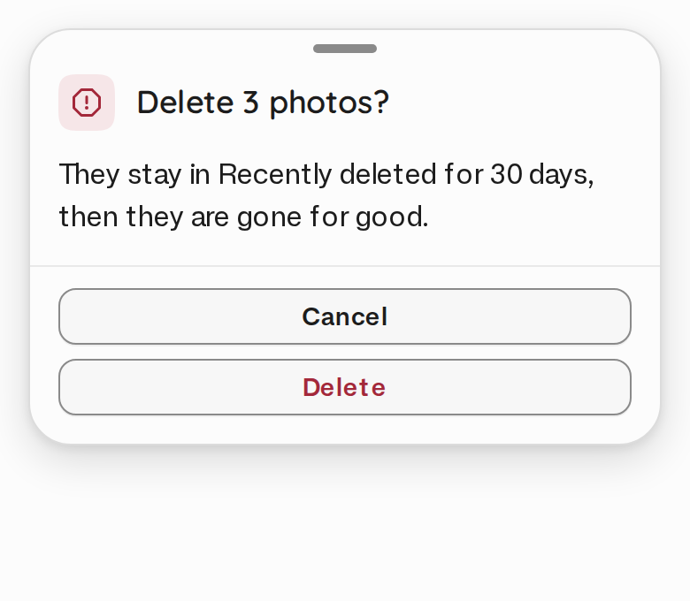
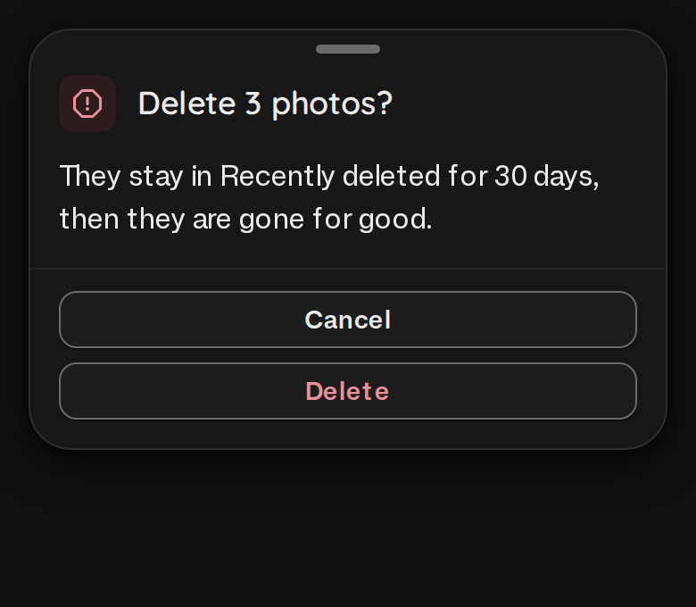
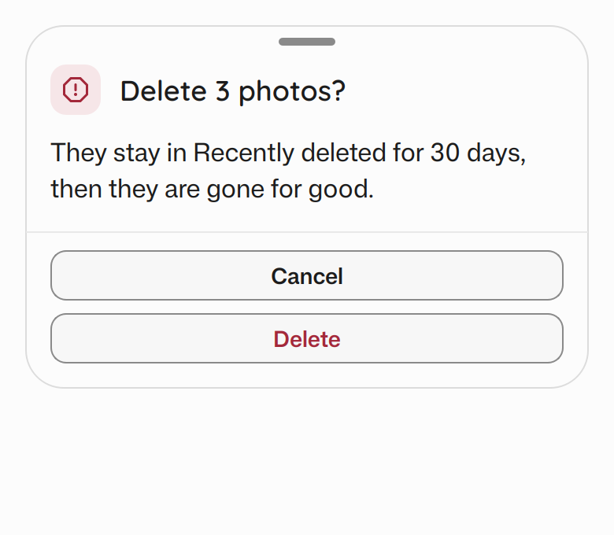
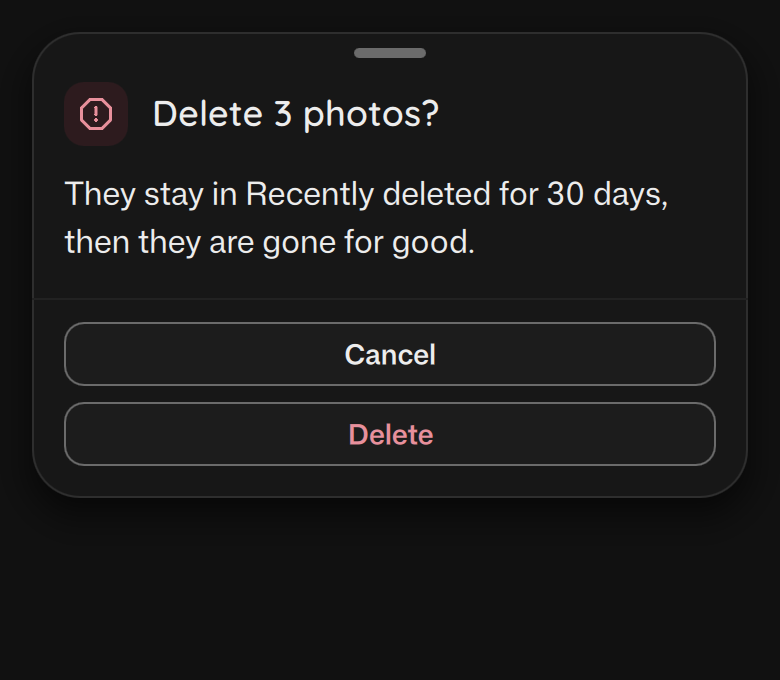
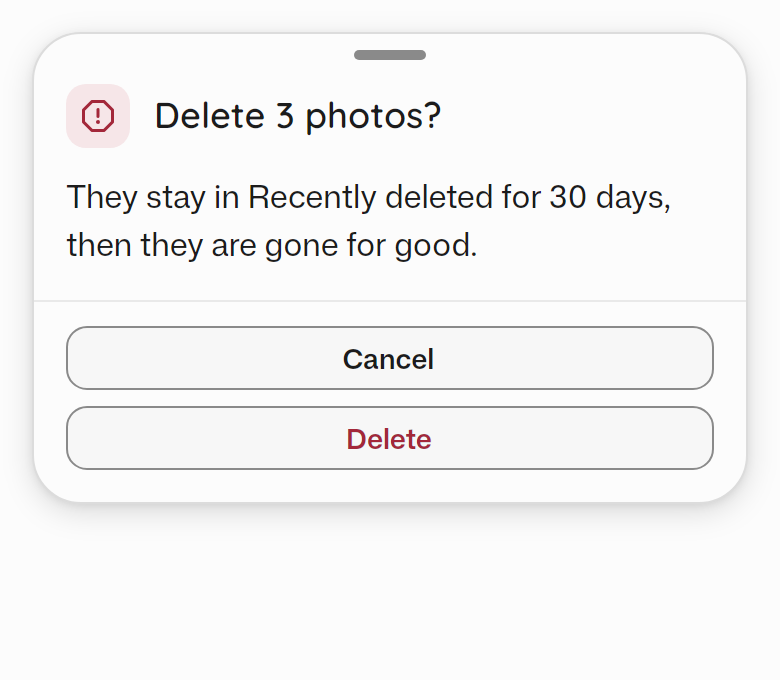
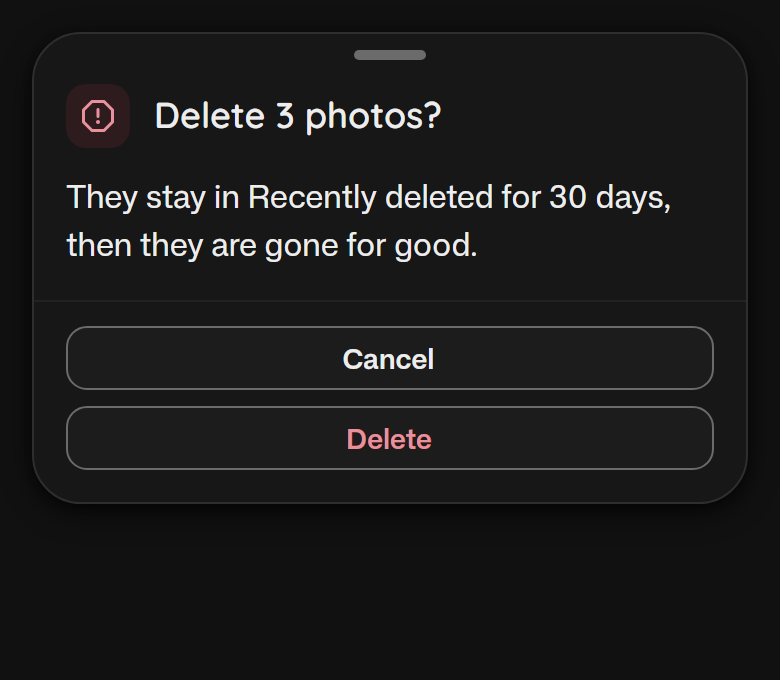
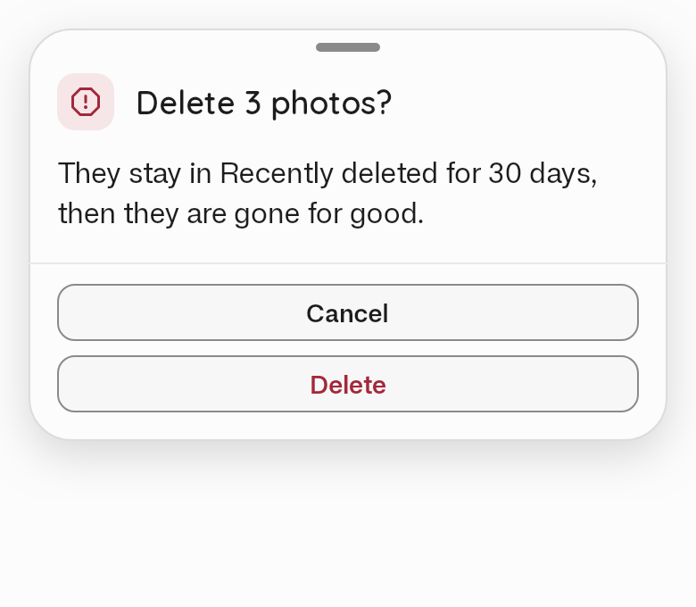
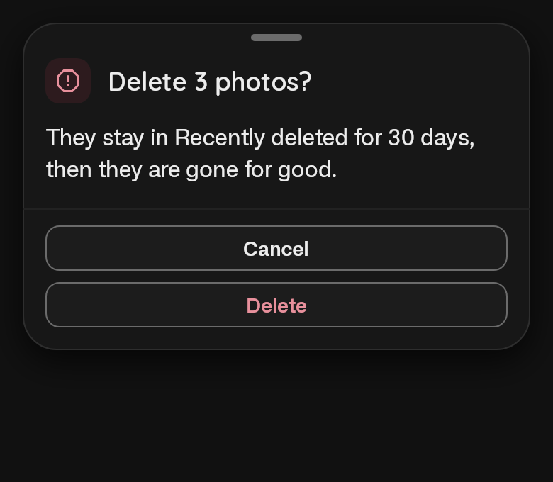

<!-- Generated by scripts/showcase.py from examples/ and component.toml. Do not edit by hand. -->

# AlertSheet

A short decision in a bottom sheet: a title with a status icon, a message and stacked buttons, the accepting one last.

Mobile · [All components](README.md)

## Props

| Prop | Type | Default | Values | Description |
| --- | --- | --- | --- | --- |
| `open` | bool | `false` |  | Whether the sheet is shown. |
| `title` | string |  |  | The question or warning. |
| `message` | string |  |  | 16px text under the title. |
| `icon` | string |  |  | information, warning, critical, question, or any Octicon. |
| `tone` | enum |  | ``, `accent`, `info`, `success`, `attention`, `danger`, `neutral` | Tile colour for a custom icon; the four named icons pick their own. |
| `buttons` | list |  |  | Buttons top to bottom: { label, variant? }. Put help and reset first, destructive and rejecting next, the accepting one last. |
| `dismissible` | bool | `true` |  | Dragging, the scrim and Escape close it. Off, only a button does. |
| `inline` | bool | `false` |  | Draws the sheet in place, for docs and previews. |

Names follow the web targets. Qt Widgets takes `snake_case` arguments, Qt Quick `camelCase` properties, Avalonia `PascalCase` properties and Slint `kebab-case` properties; each example below shows the spelling for its target.

## Examples

Each example is run as it is shown here, on every push, and the screenshots are taken from that run (left Blanc, right Noir).

### CSS

 

```html
<div class="pm-sheet pm-sheet--inline" role="dialog" aria-labelledby="delete-title">
  <div class="pm-sheet__handle">
    <span class="pm-sheet__grabber" aria-hidden="true"></span>
    <div class="pm-sheet__head">
      <div class="pm-sheet__title-row">
        <span class="pm-sheet__tile pm-sheet__tile--danger" aria-hidden="true"><svg class="pm-icon" width="16" height="16" viewBox="0 0 16 16"><path d="M4.47.22A.749.749 0 0 1 5 0h6c.199 0 .389.079.53.22l4.25 4.25c.141.14.22.331.22.53v6a.749.749 0 0 1-.22.53l-4.25 4.25A.749.749 0 0 1 11 16H5a.749.749 0 0 1-.53-.22L.22 11.53A.749.749 0 0 1 0 11V5c0-.199.079-.389.22-.53Zm.84 1.28L1.5 5.31v5.38l3.81 3.81h5.38l3.81-3.81V5.31L10.69 1.5ZM8 4a.75.75 0 0 1 .75.75v3.5a.75.75 0 0 1-1.5 0v-3.5A.75.75 0 0 1 8 4Zm0 8a1 1 0 1 1 0-2 1 1 0 0 1 0 2Z"/></svg></span>
        <h2 class="pm-sheet__title" id="delete-title">Delete 3 photos?</h2>
      </div>
    </div>
  </div>
  <div class="pm-sheet__body">
    <div class="pm-alert-sheet__body">
      <p class="pm-alert-sheet__message">They stay in Recently deleted for 30 days, then they are gone for good.</p>
    </div>
  </div>
  <div class="pm-sheet__actions">
    <button type="button" class="pm-button pm-button--block">Cancel</button>
    <button type="button" class="pm-button pm-button--danger pm-button--block">Delete</button>
  </div>
</div>
```

### Svelte

 

```svelte
<script lang="ts">
  import { AlertSheet } from "$lib/purrimer";
</script>

<AlertSheet
  inline
  icon="critical"
  title="Delete 3 photos?"
  message="They stay in Recently deleted for 30 days, then they are gone for good."
  buttons={[{ label: "Cancel" }, { label: "Delete", variant: "danger" }]}
  onbutton={(i) => console.log("button", i)}
/>
```

### Solid

 

```tsx
import { AlertSheet } from "~/purrimer";

export default function Example() {
  return (
    <AlertSheet
      open
      inline
      icon="critical"
      title="Delete 3 photos?"
      message="They stay in Recently deleted for 30 days, then they are gone for good."
      buttons={[{ label: "Cancel" }, { label: "Delete", variant: "danger" }]}
      onButton={(i) => console.log("button", i)}
    />
  );
}
```

### Qt Widgets (PySide6)

 

```python
from purrimer_qt.components import AlertSheet
from PySide6.QtWidgets import QVBoxLayout, QWidget


def example() -> QWidget:
    page = QWidget()
    layout = QVBoxLayout(page)
    layout.setContentsMargins(0, 0, 0, 0)
    # inline draws the sheet in place, for docs; drop it and call open() in an app.
    sheet = AlertSheet(
        page,
        "Delete 3 photos?",
        "They stay in Recently deleted for 30 days, then they are gone for good.",
        icon="critical",
        buttons=[("Cancel", "default"), ("Delete", "danger")],
        inline=True,
    )
    sheet.button_clicked.connect(lambda i: print("button", i))
    layout.addWidget(sheet)
    layout.addStretch()
    return page
```

### Qt Quick

 

```qml
import QtQuick
import Purrimer

Item {
    width: 358
    height: 300
    // inline draws the sheet in place, for docs; drop it and call open() in an app.
    AlertSheet {
        inline: true
        icon: "critical"
        title: "Delete 3 photos?"
        message: "They stay in Recently deleted for 30 days, then they are gone for good."
        buttons: [{ label: "Cancel" }, { label: "Delete", variant: "danger" }]
        onButtonClicked: (index) => console.log("button", index)
    }
}
```

### Avalonia

 

```xml
<UserControl xmlns="https://github.com/avaloniaui"
             xmlns:pm="using:Purrimer.Avalonia">
  <!-- IsInline draws the sheet in place, for docs; in an app, put it last in a panel that covers the screen. -->
  <pm:AlertSheet IsInline="True" IconName="critical" Title="Delete 3 photos?"
                 Message="They stay in Recently deleted for 30 days, then they are gone for good.">
    <pm:AlertSheet.Buttons>
      <pm:AlertSheetButton Label="Cancel" />
      <pm:AlertSheetButton Label="Delete" Variant="danger" />
    </pm:AlertSheet.Buttons>
  </pm:AlertSheet>
</UserControl>
```

### Slint

 

```slint
import { AlertSheet, PurrimerIcons } from "purrimer-components.slint";

export component Example inherits VerticalLayout {
    alignment: start;
    // inline draws the sheet in place, for docs; in an app, put it last in an element that covers the screen.
    AlertSheet {
        inline: true;
        icon: PurrimerIcons.stop-16;
        tone: "danger";
        title: "Delete 3 photos?";
        message: "They stay in Recently deleted for 30 days, then they are gone for good.";
        actions: [{ label: "Cancel" }, { label: "Delete", variant: "danger" }];
    }
}
```

