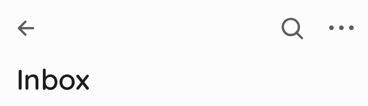
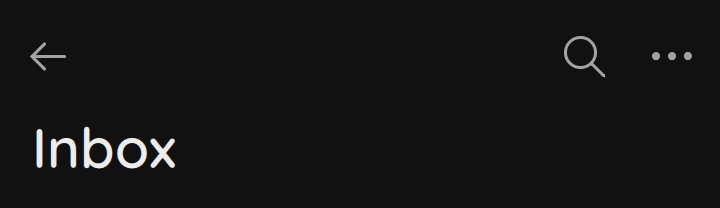
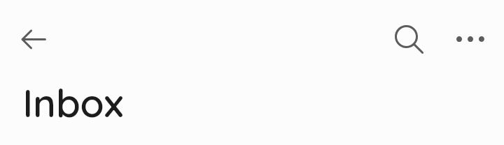

<!-- Generated by scripts/showcase.py from examples/ and component.toml. Do not edit by hand. -->

# AppBar

The bar at the top of a mobile screen: back, title and up to two actions.

Mobile · [All components](README.md)

## Props

| Prop | Type | Default | Values | Description |
| --- | --- | --- | --- | --- |
| `title` | string |  |  | Screen title. |
| `back` | bool | `false` |  | Shows the back button. |
| `large` | bool | `false` |  | Large title under the bar, for top-level screens. |
| `elevated` | bool | `false` |  | Hairline and shadow, for when content scrolls under it. |

Names follow the web targets. Qt Widgets takes `snake_case` arguments, Qt Quick `camelCase` properties, Avalonia `PascalCase` properties and Slint `kebab-case` properties; each example below shows the spelling for its target.

## Examples

Each example is run as it is shown here, on every push, and the screenshots are taken from that run (left Blanc, right Noir).

### CSS

 

```html
<div>
  <header class="pm-appbar">
    <button type="button" class="pm-icon-button pm-icon-button--invisible pm-appbar__back" aria-label="Back" title="Back"><svg class="pm-icon" width="16" height="16" viewBox="0 0 16 16" aria-hidden="true"><path d="M7.78 12.53a.75.75 0 0 1-1.06 0L2.47 8.28a.75.75 0 0 1 0-1.06l4.25-4.25a.751.751 0 0 1 1.042.018.751.751 0 0 1 .018 1.042L4.81 7h7.44a.75.75 0 0 1 0 1.5H4.81l2.97 2.97a.75.75 0 0 1 0 1.06Z"/></svg></button>
    <h1 class="pm-appbar__title"></h1>
    <div class="pm-appbar__actions">
      <button type="button" class="pm-icon-button pm-icon-button--invisible" aria-label="Search" title="Search"><svg class="pm-icon" width="16" height="16" viewBox="0 0 16 16" aria-hidden="true"><path d="M10.68 11.74a6 6 0 0 1-7.922-8.982 6 6 0 0 1 8.982 7.922l3.04 3.04a.749.749 0 0 1-.326 1.275.749.749 0 0 1-.734-.215ZM11.5 7a4.499 4.499 0 1 0-8.997 0A4.499 4.499 0 0 0 11.5 7Z"/></svg></button>
      <button type="button" class="pm-icon-button pm-icon-button--invisible" aria-label="More" title="More"><svg class="pm-icon" width="16" height="16" viewBox="0 0 16 16" aria-hidden="true"><path d="M8 9a1.5 1.5 0 1 0 0-3 1.5 1.5 0 0 0 0 3ZM1.5 9a1.5 1.5 0 1 0 0-3 1.5 1.5 0 0 0 0 3Zm13 0a1.5 1.5 0 1 0 0-3 1.5 1.5 0 0 0 0 3Z"/></svg></button>
    </div>
  </header>
  <h1 class="pm-appbar-large">Inbox</h1>
</div>
```

### Svelte

 

```svelte
<script lang="ts">
  import { AppBar } from "$lib/purrimer";
</script>

<div>
  <AppBar
    title="Inbox"
    back
    large
    actions={[
      { icon: "search", label: "Search", onclick: () => console.log("search") },
      { icon: "kebab-horizontal", label: "More" },
    ]}
    onback={() => history.back()}
  />
</div>
```

### Solid

 

```tsx
import { AppBar } from "~/purrimer";

export default function Example() {
  return (
    <div>
      <AppBar
        title="Inbox"
        back
        large
        actions={[
          { icon: "search", label: "Search", onClick: () => console.log("search") },
          { icon: "kebab-horizontal", label: "More" },
        ]}
        onBack={() => history.back()}
      />
    </div>
  );
}
```

### Qt Widgets (PySide6)

 

```python
from purrimer_qt.components import AppBar
from PySide6.QtWidgets import QVBoxLayout, QWidget


def example() -> QWidget:
    screen = QWidget()
    layout = QVBoxLayout(screen)
    layout.setContentsMargins(0, 0, 0, 0)
    bar = AppBar("Inbox", back=True, large=True, actions=[("search", "Search"), ("kebab-horizontal", "More")])
    bar.actionClicked.connect(lambda index: print("action", index))
    layout.addWidget(bar)
    layout.addStretch()
    return screen
```

### Qt Quick

 

```qml
import QtQuick
import Purrimer

Item {
    AppBar {
        width: parent.width
        title: "Inbox"
        back: true
        large: true
        actions: [{ icon: "search", label: "Search" }, { icon: "kebab-horizontal", label: "More" }]
        onActionClicked: index => console.log("action", index)
    }
}
```

### Avalonia

 

```xml
<UserControl xmlns="https://github.com/avaloniaui"
             xmlns:pm="using:Purrimer.Avalonia">
  <pm:AppBar Title="Inbox" ShowBack="True" IsLarge="True" VerticalAlignment="Top">
    <StackPanel Orientation="Horizontal">
      <pm:IconButton IconName="search" Label="Search" Classes="invisible large" IconSize="24" />
      <pm:IconButton IconName="kebab-horizontal" Label="More" Classes="invisible large" IconSize="24" />
    </StackPanel>
  </pm:AppBar>
</UserControl>
```

### Slint

 

```slint
import { AppBar, PurrimerIcons } from "purrimer-components.slint";

export component Example inherits VerticalLayout {
    alignment: start;
    AppBar {
        title: "Inbox";
        back: true;
        large: true;
        actions: [
            { icon: PurrimerIcons.search-24, label: "Search" },
            { icon: PurrimerIcons.kebab-horizontal-24, label: "More" },
        ];
        action-clicked(index) => { debug("action", index); }
    }
}
```

