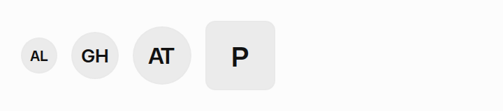
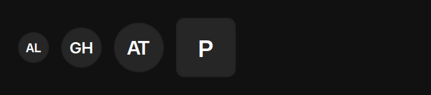
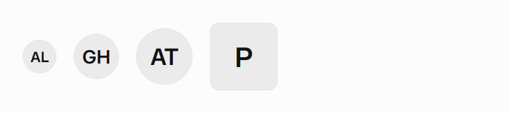
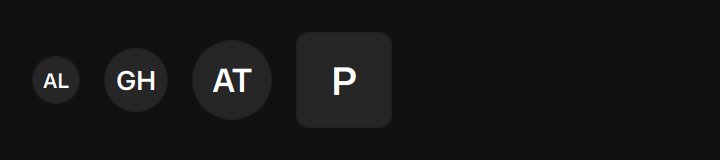
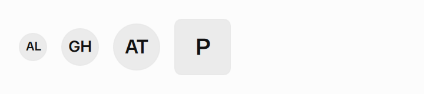
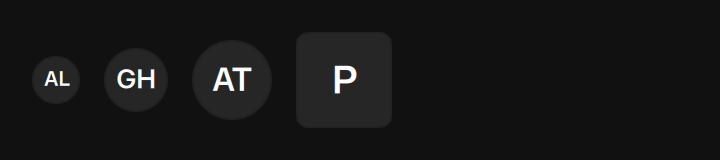
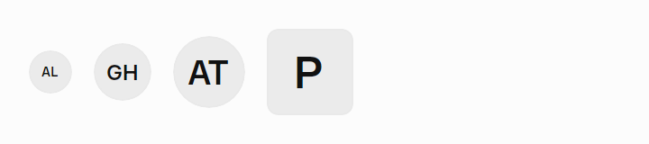
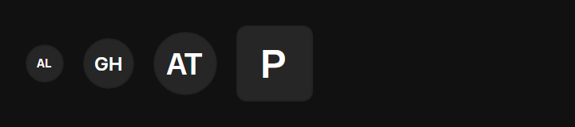
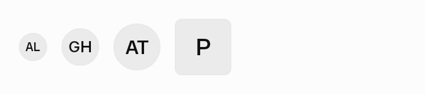
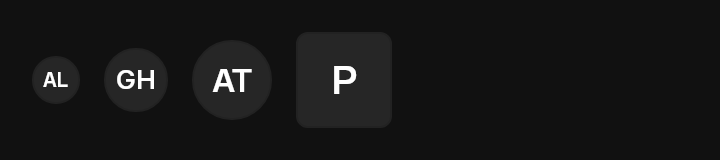

<!-- Generated by scripts/showcase.py from examples/ and component.toml. Do not edit by hand. -->

# Avatar

A person's picture, or their initials on a tinted circle.

People · [All components](README.md)

## Props

| Prop | Type | Default | Values | Description |
| --- | --- | --- | --- | --- |
| `name` | string |  |  | Full name, used for initials and the accessible name. |
| `src` | string |  |  | Image URL or path. |
| `size` | int | `32` |  | Diameter: 20, 24, 32, 40 or 48. |
| `square` | bool | `false` |  | Rounded square, for organisations and apps. |

Names follow the web targets. Qt Widgets takes `snake_case` arguments, Qt Quick `camelCase` properties, Avalonia `PascalCase` properties and Slint `kebab-case` properties; each example below shows the spelling for its target.

## Examples

Each example is run as it is shown here, on every push, and the screenshots are taken from that run (left Blanc, right Noir).

### CSS

 

```html
<div style="display: flex; gap: 12px; align-items: center">
  <span class="pm-avatar" style="width: 24px; height: 24px; font-size: 10px" role="img" aria-label="Ada Lovelace">AL</span>
  <span class="pm-avatar" style="width: 32px; height: 32px; font-size: 13px" role="img" aria-label="Grace Hopper">GH</span>
  <span class="pm-avatar" style="width: 40px; height: 40px; font-size: 16px" role="img" aria-label="Alan Turing">AT</span>
  <span class="pm-avatar pm-avatar--square" style="width: 48px; height: 48px; font-size: 19px" role="img" aria-label="Purrimer">P</span>
</div>
```

### Svelte

 

```svelte
<script lang="ts">
  import { Avatar } from "$lib/purrimer";
</script>

<!-- Pass src for a picture; the initials show until it loads, or if it fails. -->
<div style="display: flex; gap: 12px; align-items: center">
  <Avatar name="Ada Lovelace" size={24} />
  <Avatar name="Grace Hopper" />
  <Avatar name="Alan Turing" size={40} />
  <Avatar name="Purrimer" size={48} square />
</div>
```

### Solid

 

```tsx
import { Avatar } from "~/purrimer";

// Pass src for a picture; the initials show until it loads, or if it fails.
export default function Example() {
  return (
    <div style={{ display: "flex", gap: "12px", "align-items": "center" }}>
      <Avatar name="Ada Lovelace" size={24} />
      <Avatar name="Grace Hopper" />
      <Avatar name="Alan Turing" size={40} />
      <Avatar name="Purrimer" size={48} square />
    </div>
  );
}
```

### Qt Widgets (PySide6)

 

```python
from purrimer_qt.components import Avatar
from PySide6.QtCore import Qt
from PySide6.QtWidgets import QHBoxLayout, QWidget


def example() -> QWidget:
    # Pass pixmap=QPixmap(path) for a picture.
    row = QWidget()
    layout = QHBoxLayout(row)
    layout.setContentsMargins(0, 0, 0, 0)
    layout.setSpacing(12)
    layout.setAlignment(Qt.AlignmentFlag.AlignVCenter)
    layout.addWidget(Avatar("Ada Lovelace", size=24))
    layout.addWidget(Avatar("Grace Hopper"))
    layout.addWidget(Avatar("Alan Turing", size=40))
    layout.addWidget(Avatar("Purrimer", size=48, square=True))
    layout.addStretch()
    return row
```

### Qt Quick

 

```qml
import QtQuick
import Purrimer

// Set source for a picture.
Row {
    spacing: 12
    Avatar { name: "Ada Lovelace"; size: 24; anchors.verticalCenter: parent.verticalCenter }
    Avatar { name: "Grace Hopper"; anchors.verticalCenter: parent.verticalCenter }
    Avatar { name: "Alan Turing"; size: 40; anchors.verticalCenter: parent.verticalCenter }
    Avatar { name: "Purrimer"; size: 48; square: true }
}
```

### Avalonia

 

```xml
<UserControl xmlns="https://github.com/avaloniaui"
             xmlns:pm="using:Purrimer.Avalonia">
  <!-- Set Source for a picture. -->
  <StackPanel Orientation="Horizontal" Spacing="12">
    <pm:Avatar DisplayName="Ada Lovelace" Size="24" VerticalAlignment="Center" />
    <pm:Avatar DisplayName="Grace Hopper" VerticalAlignment="Center" />
    <pm:Avatar DisplayName="Alan Turing" Size="40" VerticalAlignment="Center" />
    <pm:Avatar DisplayName="Purrimer" Size="48" IsSquare="True" />
  </StackPanel>
</UserControl>
```

### Slint

 

```slint
import { Avatar } from "purrimer-components.slint";

// Slint cannot split strings, so pass the initials too. Set source for a picture.
export component Example inherits HorizontalLayout {
    spacing: 12px;
    alignment: start;
    Avatar { name: "Ada Lovelace"; initials: "AL"; size: 24px; y: 12px; }
    Avatar { name: "Grace Hopper"; initials: "GH"; y: 8px; }
    Avatar { name: "Alan Turing"; initials: "AT"; size: 40px; y: 4px; }
    Avatar { name: "Purrimer"; initials: "P"; size: 48px; square: true; }
}
```

