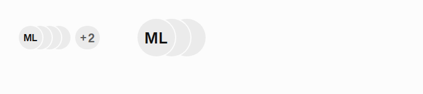
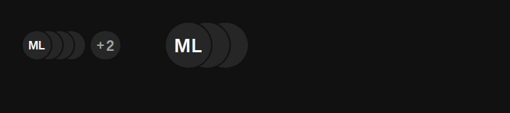
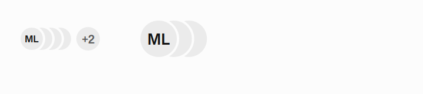
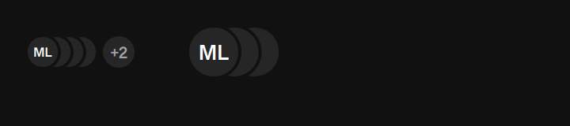
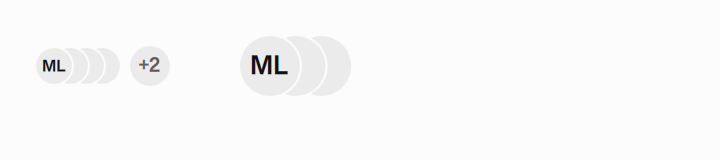
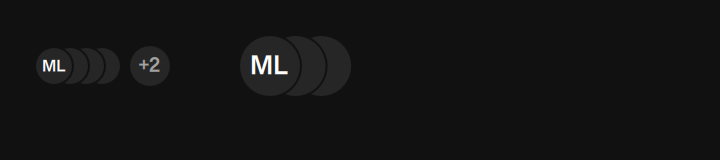
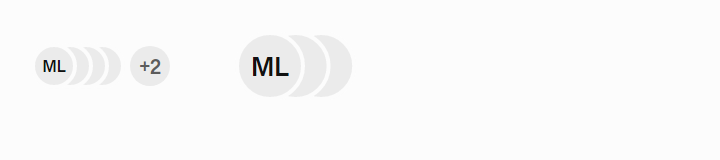
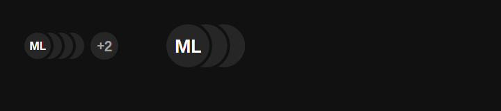
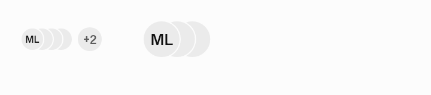
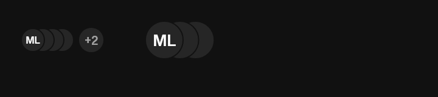

<!-- Generated by scripts/showcase.py from examples/ and component.toml. Do not edit by hand. -->

# AvatarStack

Overlapping avatars for the people on an item; the stack spreads out on hover and focus.

People · [All components](README.md)

## Props

| Prop | Type | Default | Values | Description |
| --- | --- | --- | --- | --- |
| `people` | list |  |  | Names, first on top; the web targets also take { name, src }. |
| `max` | int | `4` |  | Avatars shown before the rest collapse into a "+N" avatar. |
| `size` | int | `20` |  | Avatar diameter in px. |

Names follow the web targets. Qt Widgets takes `snake_case` arguments, Qt Quick `camelCase` properties, Avalonia `PascalCase` properties and Slint `kebab-case` properties; each example below shows the spelling for its target.

## Examples

Each example is run as it is shown here, on every push, and the screenshots are taken from that run (left Blanc, right Noir).

### CSS

 

```html
<div style="display: flex; gap: 32px; align-items: center">
  <span class="pm-avatar-stack" role="group" tabindex="0" aria-label="6 people" style="--pm-av: 20px"><span class="pm-avatar-stack__person" role="img" aria-label="Mona Lisa" style="width: 20px; height: 20px; font-size: 8px; z-index: 5">ML</span><span class="pm-avatar-stack__person" role="img" aria-label="Hubot" style="width: 20px; height: 20px; font-size: 8px; z-index: 4">H</span><span class="pm-avatar-stack__person" role="img" aria-label="Ada Lovelace" style="width: 20px; height: 20px; font-size: 8px; z-index: 3">AL</span><span class="pm-avatar-stack__person" role="img" aria-label="Octo Cat" style="width: 20px; height: 20px; font-size: 8px; z-index: 2">OC</span><span class="pm-avatar-stack__person pm-avatar-stack__more" aria-label="2 more" style="height: 20px; font-size: 10px">+2</span></span>
  <span class="pm-avatar-stack" role="group" tabindex="0" aria-label="3 people" style="--pm-av: 32px"><span class="pm-avatar-stack__person" role="img" aria-label="Mona Lisa" style="width: 32px; height: 32px; font-size: 13px; z-index: 4">ML</span><span class="pm-avatar-stack__person" role="img" aria-label="Hubot" style="width: 32px; height: 32px; font-size: 13px; z-index: 3">H</span><span class="pm-avatar-stack__person" role="img" aria-label="Ada Lovelace" style="width: 32px; height: 32px; font-size: 13px; z-index: 2">AL</span></span>
</div>
```

### Svelte

 

```svelte
<script lang="ts">
  import { AvatarStack } from "$lib/purrimer";

  const people = ["Mona Lisa", "Hubot", "Ada Lovelace", "Octo Cat", "Grace Hopper", "Linus Torvalds"];
</script>

<div style="display: flex; gap: 32px; align-items: center">
  <AvatarStack {people} />
  <AvatarStack people={people.slice(0, 3)} size={32} />
</div>
```

### Solid

 

```tsx
import { AvatarStack } from "~/purrimer";

const people = ["Mona Lisa", "Hubot", "Ada Lovelace", "Octo Cat", "Grace Hopper", "Linus Torvalds"];

export default function Example() {
  return (
    <div style={{ display: "flex", gap: "32px", "align-items": "center" }}>
      <AvatarStack people={people} />
      <AvatarStack people={people.slice(0, 3)} size={32} />
    </div>
  );
}
```

### Qt Widgets (PySide6)

 

```python
from purrimer_qt.components import AvatarStack
from PySide6.QtCore import Qt
from PySide6.QtWidgets import QHBoxLayout, QWidget

PEOPLE = ["Mona Lisa", "Hubot", "Ada Lovelace", "Octo Cat", "Grace Hopper", "Linus Torvalds"]


def example() -> QWidget:
    row = QWidget()
    layout = QHBoxLayout(row)
    layout.setContentsMargins(0, 0, 0, 0)
    layout.setSpacing(32)
    layout.addWidget(AvatarStack(PEOPLE), alignment=Qt.AlignmentFlag.AlignVCenter)
    layout.addWidget(AvatarStack(PEOPLE[:3], size=32), alignment=Qt.AlignmentFlag.AlignVCenter)
    layout.addStretch()
    return row
```

### Qt Quick

 

```qml
import QtQuick
import Purrimer

Row {
    readonly property var people: ["Mona Lisa", "Hubot", "Ada Lovelace", "Octo Cat", "Grace Hopper", "Linus Torvalds"]
    spacing: 32
    AvatarStack { people: parent.people; anchors.verticalCenter: parent.verticalCenter }
    AvatarStack { people: parent.people.slice(0, 3); size: 32 }
}
```

### Avalonia

 

```xml
<UserControl xmlns="https://github.com/avaloniaui"
             xmlns:pm="using:Purrimer.Avalonia">
  <StackPanel Orientation="Horizontal" Spacing="32">
    <pm:AvatarStack Names="Mona Lisa, Hubot, Ada Lovelace, Octo Cat, Grace Hopper, Linus Torvalds" />
    <pm:AvatarStack Names="Mona Lisa, Hubot, Ada Lovelace" Size="32" />
  </StackPanel>
</UserControl>
```

### Slint

 

```slint
import { AvatarStack } from "purrimer-components.slint";

export component Example inherits HorizontalLayout {
    spacing: 32px;
    alignment: start;
    AvatarStack {
        people: ["Mona Lisa", "Hubot", "Ada Lovelace", "Octo Cat", "Grace Hopper", "Linus Torvalds"];
        initials: ["ML", "H", "AL", "OC", "GH", "LT"];
        y: (parent.height - self.height) / 2;
    }
    AvatarStack {
        people: ["Mona Lisa", "Hubot", "Ada Lovelace"];
        initials: ["ML", "H", "AL"];
        size: 32px;
    }
}
```

