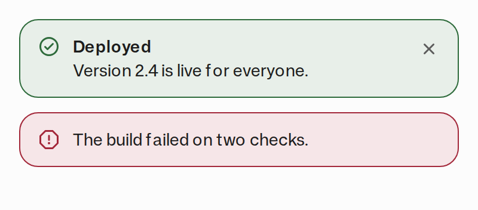
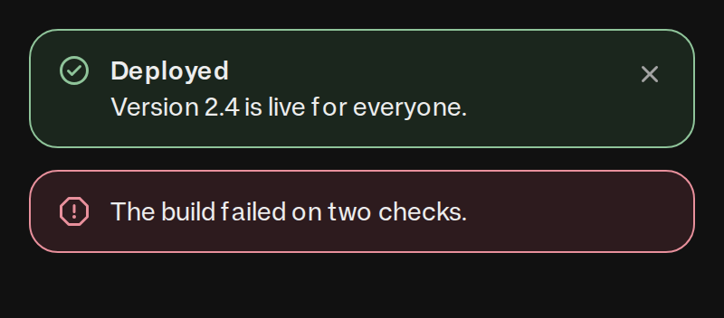
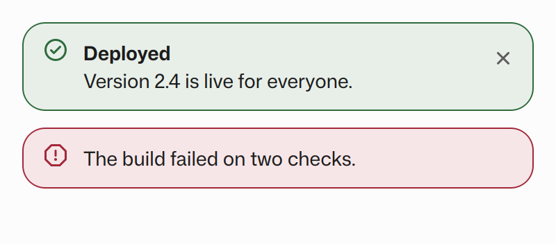
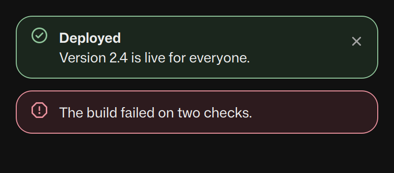
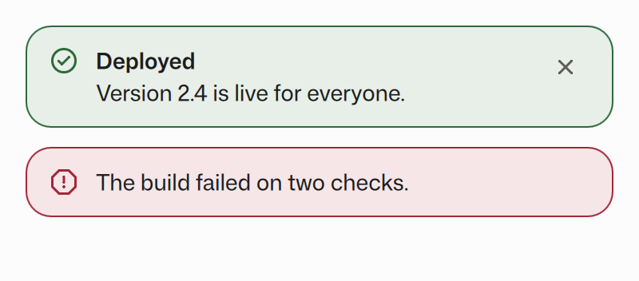
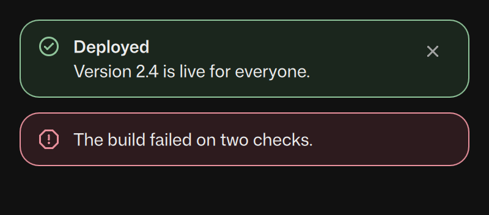
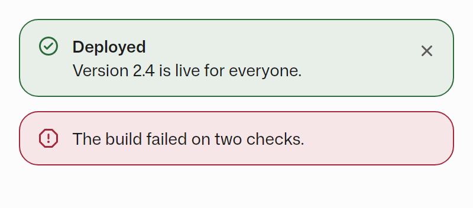
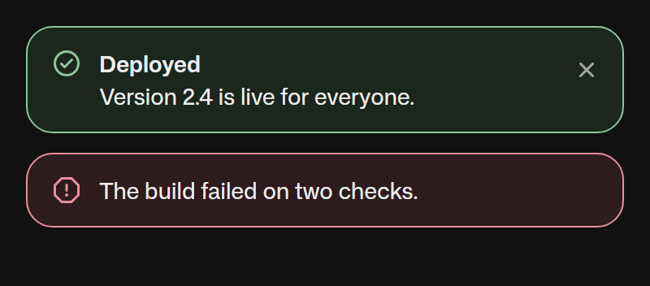
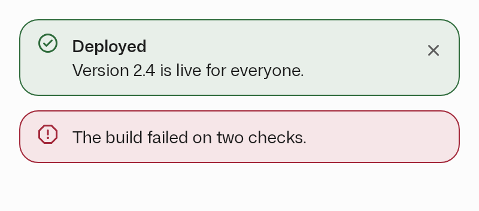
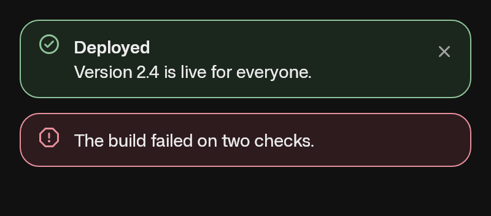

<!-- Generated by scripts/showcase.py from examples/ and component.toml. Do not edit by hand. -->

# Banner

A message across a region with an icon, title, text and optional dismiss.

Status · [All components](README.md)

## Props

| Prop | Type | Default | Values | Description |
| --- | --- | --- | --- | --- |
| `tone` | enum | `"info"` | `info`, `success`, `attention`, `danger`, `done` | Colour role and icon. |
| `title` | string |  |  | Bold first line. |
| `text` | string |  |  | Body text; ends with a full stop. |
| `dismissible` | bool | `false` |  | Shows a close button. Inside a touch scope the banner also swipes sideways to dismiss. |

Names follow the web targets. Qt Widgets takes `snake_case` arguments, Qt Quick `camelCase` properties, Avalonia `PascalCase` properties and Slint `kebab-case` properties; each example below shows the spelling for its target.

## Examples

Each example is run as it is shown here, on every push, and the screenshots are taken from that run (left Blanc, right Noir).

### CSS

 

```html
<div style="display: grid; gap: 12px">
  <div class="pm-banner pm-banner--success" role="status">
    <svg class="pm-icon pm-banner__icon" width="16" height="16" viewBox="0 0 16 16" aria-hidden="true"><path d="M0 8a8 8 0 1 1 16 0A8 8 0 0 1 0 8Zm1.5 0a6.5 6.5 0 1 0 13 0 6.5 6.5 0 0 0-13 0Zm10.28-1.72-4.5 4.5a.75.75 0 0 1-1.06 0l-2-2a.751.751 0 0 1 .018-1.042.751.751 0 0 1 1.042-.018l1.47 1.47 3.97-3.97a.751.751 0 0 1 1.042.018.751.751 0 0 1 .018 1.042Z"/></svg>
    <div class="pm-banner__body">
      <p class="pm-banner__title">Deployed</p>
      <p class="pm-banner__text">Version 2.4 is live for everyone.</p>
    </div>
    <button type="button" class="pm-icon-button pm-icon-button--invisible pm-banner__close" aria-label="Dismiss" title="Dismiss"><svg class="pm-icon" width="16" height="16" viewBox="0 0 16 16" aria-hidden="true"><path d="M3.72 3.72a.75.75 0 0 1 1.06 0L8 6.94l3.22-3.22a.749.749 0 0 1 1.275.326.749.749 0 0 1-.215.734L9.06 8l3.22 3.22a.749.749 0 0 1-.326 1.275.749.749 0 0 1-.734-.215L8 9.06l-3.22 3.22a.751.751 0 0 1-1.042-.018.751.751 0 0 1-.018-1.042L6.94 8 3.72 4.78a.75.75 0 0 1 0-1.06Z"/></svg></button>
  </div>
  <div class="pm-banner pm-banner--danger" role="alert">
    <svg class="pm-icon pm-banner__icon" width="16" height="16" viewBox="0 0 16 16" aria-hidden="true"><path d="M4.47.22A.749.749 0 0 1 5 0h6c.199 0 .389.079.53.22l4.25 4.25c.141.14.22.331.22.53v6a.749.749 0 0 1-.22.53l-4.25 4.25A.749.749 0 0 1 11 16H5a.749.749 0 0 1-.53-.22L.22 11.53A.749.749 0 0 1 0 11V5c0-.199.079-.389.22-.53Zm.84 1.28L1.5 5.31v5.38l3.81 3.81h5.38l3.81-3.81V5.31L10.69 1.5ZM8 4a.75.75 0 0 1 .75.75v3.5a.75.75 0 0 1-1.5 0v-3.5A.75.75 0 0 1 8 4Zm0 8a1 1 0 1 1 0-2 1 1 0 0 1 0 2Z"/></svg>
    <div class="pm-banner__body">
      <p class="pm-banner__text">The build failed on two checks.</p>
    </div>
  </div>
</div>
```

### Svelte

 

```svelte
<script lang="ts">
  import { Banner } from "$lib/purrimer";

  let shown = $state(true);
</script>

<div style="display: grid; gap: 12px">
  {#if shown}
    <Banner
      tone="success"
      title="Deployed"
      text="Version 2.4 is live for everyone."
      dismissible
      ondismiss={() => (shown = false)}
    />
  {/if}
  <Banner tone="danger" text="The build failed on two checks." />
</div>
```

### Solid

 

```tsx
import { Show, createSignal } from "solid-js";
import { Banner } from "~/purrimer";

export default function Example() {
  const [shown, setShown] = createSignal(true);
  return (
    <div style={{ display: "grid", gap: "12px" }}>
      <Show when={shown()}>
        <Banner
          tone="success"
          title="Deployed"
          text="Version 2.4 is live for everyone."
          dismissible
          onDismiss={() => setShown(false)}
        />
      </Show>
      <Banner tone="danger" text="The build failed on two checks." />
    </div>
  );
}
```

### Qt Widgets (PySide6)

 

```python
from purrimer_qt.components import Banner
from PySide6.QtWidgets import QVBoxLayout, QWidget


def example() -> QWidget:
    column = QWidget()
    layout = QVBoxLayout(column)
    layout.setContentsMargins(0, 0, 0, 0)
    layout.setSpacing(12)
    deployed = Banner("success", "Deployed", "Version 2.4 is live for everyone.", dismissible=True)
    deployed.dismissed.connect(deployed.hide)
    layout.addWidget(deployed)
    layout.addWidget(Banner("danger", text="The build failed on two checks."))
    return column
```

### Qt Quick

 

```qml
import QtQuick
import Purrimer

Column {
    spacing: 12
    Banner {
        width: 368
        tone: "success"
        title: "Deployed"
        text: "Version 2.4 is live for everyone."
        dismissible: true
        onDismissed: visible = false
    }
    Banner { width: 368; tone: "danger"; text: "The build failed on two checks." }
}
```

### Avalonia

 

```xml
<UserControl xmlns="https://github.com/avaloniaui"
             xmlns:pm="using:Purrimer.Avalonia">
  <StackPanel Spacing="12">
    <pm:Banner Tone="success" Title="Deployed" Text="Version 2.4 is live for everyone." IsDismissible="True" />
    <pm:Banner Tone="danger" Text="The build failed on two checks." />
  </StackPanel>
</UserControl>
```

### Slint

 

```slint
import { Banner } from "purrimer-components.slint";

export component Example inherits VerticalLayout {
    in-out property <bool> shown: true;
    spacing: 12px;
    alignment: start;
    if shown: Banner {
        tone: "success";
        title: "Deployed";
        text: "Version 2.4 is live for everyone.";
        dismissible: true;
        dismissed => { shown = false; }
    }
    Banner { tone: "danger"; text: "The build failed on two checks."; }
}
```

