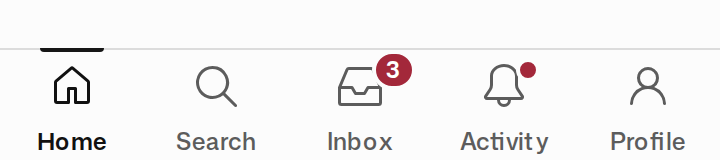
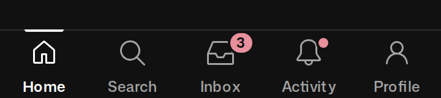
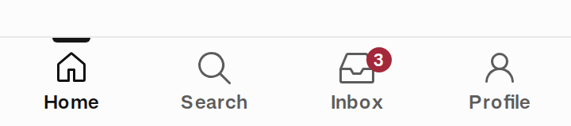
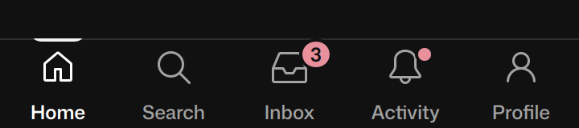
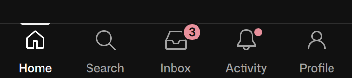
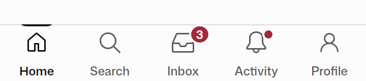
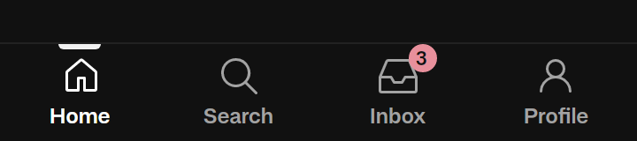
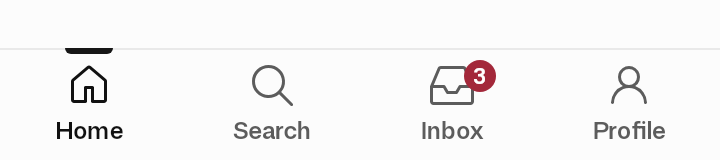

<!-- Generated by scripts/showcase.py from examples/ and component.toml. Do not edit by hand. -->

# BottomNav

Three to five destinations at the bottom of the screen, marked by a bar on top.

Mobile · [All components](README.md)

## Props

| Prop | Type | Default | Values | Description |
| --- | --- | --- | --- | --- |
| `items` | list |  |  | Items with icon, label and an optional badge count. |
| `selected` | int | `0` |  | Index of the current destination. |
| `showLabels` | bool | `false` |  | Shows labels under the icons. |

Names follow the web targets. Qt Widgets takes `snake_case` arguments, Qt Quick `camelCase` properties, Avalonia `PascalCase` properties and Slint `kebab-case` properties; each example below shows the spelling for its target.

## Examples

Each example is run as it is shown here, on every push, and the screenshots are taken from that run (left Blanc, right Noir).

### CSS

 

```html
<div style="display: flex; flex-direction: column; justify-content: flex-end; height: 100%">
  <nav class="pm-bottomnav" aria-label="Main">
    <button type="button" class="pm-bottomnav__item" aria-current="page"><svg class="pm-icon" width="24" height="24" viewBox="0 0 24 24" aria-hidden="true"><path d="M11.03 2.59a1.501 1.501 0 0 1 1.94 0l7.5 6.363a1.5 1.5 0 0 1 .53 1.144V19.5a1.5 1.5 0 0 1-1.5 1.5h-5.75a.75.75 0 0 1-.75-.75V14h-2v6.25a.75.75 0 0 1-.75.75H4.5A1.5 1.5 0 0 1 3 19.5v-9.403c0-.44.194-.859.53-1.144ZM12 3.734l-7.5 6.363V19.5h5v-6.25a.75.75 0 0 1 .75-.75h3.5a.75.75 0 0 1 .75.75v6.25h5v-9.403Z"/></svg><span>Home</span></button>
    <button type="button" class="pm-bottomnav__item"><svg class="pm-icon" width="24" height="24" viewBox="0 0 24 24" aria-hidden="true"><path d="M10.25 2a8.25 8.25 0 0 1 6.34 13.53l5.69 5.69a.749.749 0 0 1-.326 1.275.749.749 0 0 1-.734-.215l-5.69-5.69A8.25 8.25 0 1 1 10.25 2ZM3.5 10.25a6.75 6.75 0 1 0 13.5 0 6.75 6.75 0 0 0-13.5 0Z"/></svg><span>Search</span></button>
    <button type="button" class="pm-bottomnav__item"><svg class="pm-icon" width="24" height="24" viewBox="0 0 24 24" aria-hidden="true"><path d="M4.801 3.57A1.75 1.75 0 0 1 6.414 2.5h11.174c.702 0 1.337.42 1.611 1.067l3.741 8.828c.04.092.06.192.06.293v7.562A1.75 1.75 0 0 1 21.25 22H2.75A1.75 1.75 0 0 1 1 20.25v-7.5c0-.1.02-.199.059-.291L4.8 3.571ZM6.414 4a.25.25 0 0 0-.23.153L2.88 12H8a.75.75 0 0 1 .648.372L10.18 15h3.638l1.533-2.628a.75.75 0 0 1 .64-.372l5.13-.051-3.304-7.797a.25.25 0 0 0-.23-.152ZM21.5 13.445l-5.067.05-1.535 2.633a.75.75 0 0 1-.648.372h-4.5a.75.75 0 0 1-.648-.372L7.57 13.5H2.5v6.75c0 .138.112.25.25.25h18.5a.25.25 0 0 0 .25-.25Z"/></svg><span>Inbox</span><span class="pm-bottomnav__badge">3</span></button>
    <button type="button" class="pm-bottomnav__item"><svg class="pm-icon" width="24" height="24" viewBox="0 0 24 24" aria-hidden="true"><path d="M12 2.5a5.5 5.5 0 0 1 3.096 10.047 9.005 9.005 0 0 1 5.9 8.181.75.75 0 1 1-1.499.044 7.5 7.5 0 0 0-14.993 0 .75.75 0 0 1-1.5-.045 9.005 9.005 0 0 1 5.9-8.18A5.5 5.5 0 0 1 12 2.5ZM8 8a4 4 0 1 0 8 0 4 4 0 0 0-8 0Z"/></svg><span>Profile</span></button>
  </nav>
</div>
```

### Svelte

 

```svelte
<script lang="ts">
  import { BottomNav } from "$lib/purrimer";

  let tab = $state(0);
</script>

<div style="display: flex; flex-direction: column; justify-content: flex-end; height: 100%">
  <BottomNav
    showLabels
    bind:selected={tab}
    items={[
      { icon: "home", label: "Home" },
      { icon: "search", label: "Search" },
      { icon: "inbox", label: "Inbox", badge: 3 },
      { icon: "person", label: "Profile" },
    ]}
  />
</div>
```

### Solid

 

```tsx
import { createSignal } from "solid-js";
import { BottomNav } from "~/purrimer";

export default function Example() {
  const [tab, setTab] = createSignal(0);
  return (
    <div style={{ display: "flex", "flex-direction": "column", "justify-content": "flex-end", height: "100%" }}>
      <BottomNav
        showLabels
        selected={tab()}
        onSelect={setTab}
        items={[
          { icon: "home", label: "Home" },
          { icon: "search", label: "Search" },
          { icon: "inbox", label: "Inbox", badge: 3 },
          { icon: "person", label: "Profile" },
        ]}
      />
    </div>
  );
}
```

### Qt Widgets (PySide6)

 

```python
from purrimer_qt.components import BottomNav
from purrimer_qt.components.bottom_nav import BottomNavItem
from PySide6.QtWidgets import QVBoxLayout, QWidget


def example() -> QWidget:
    screen = QWidget()
    layout = QVBoxLayout(screen)
    layout.setContentsMargins(0, 0, 0, 0)
    layout.addStretch()
    nav = BottomNav(
        [
            BottomNavItem("home", "Home"),
            BottomNavItem("search", "Search"),
            BottomNavItem("inbox", "Inbox", badge=3),
            BottomNavItem("person", "Profile"),
        ]
    )
    nav.activated.connect(lambda index: print("tab", index))
    layout.addWidget(nav)
    return screen
```

### Qt Quick

 

```qml
import QtQuick
import Purrimer

Item {
    BottomNav {
        anchors.bottom: parent.bottom
        width: parent.width
        showLabels: true
        items: [
            { icon: "home", label: "Home" },
            { icon: "search", label: "Search" },
            { icon: "inbox", label: "Inbox", badge: 3 },
            { icon: "person", label: "Profile" }
        ]
        onActivated: index => selected = index
    }
}
```

### Avalonia

 

```xml
<UserControl xmlns="https://github.com/avaloniaui"
             xmlns:pm="using:Purrimer.Avalonia">
  <pm:BottomNav SelectedIndex="0" ShowLabels="True" VerticalAlignment="Bottom">
    <pm:BottomNavItem IconName="home" Label="Home" />
    <pm:BottomNavItem IconName="search" Label="Search" />
    <pm:BottomNavItem IconName="inbox" Label="Inbox" Badge="3" />
    <pm:BottomNavItem IconName="person" Label="Profile" />
  </pm:BottomNav>
</UserControl>
```

### Slint

 

```slint
import { BottomNav, PurrimerIcons } from "purrimer-components.slint";

export component Example inherits VerticalLayout {
    alignment: end;
    BottomNav {
        show-labels: true;
        items: [
            { icon: PurrimerIcons.home-24, label: "Home" },
            { icon: PurrimerIcons.search-24, label: "Search" },
            { icon: PurrimerIcons.inbox-24, label: "Inbox", badge: 3 },
            { icon: PurrimerIcons.person-24, label: "Profile" },
        ];
        activated(index) => { self.selected = index; }
    }
}
```

