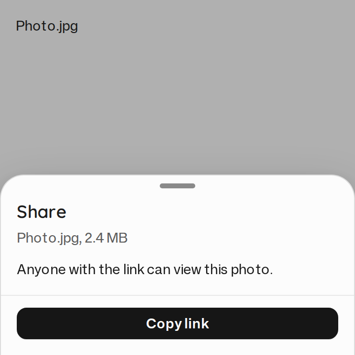
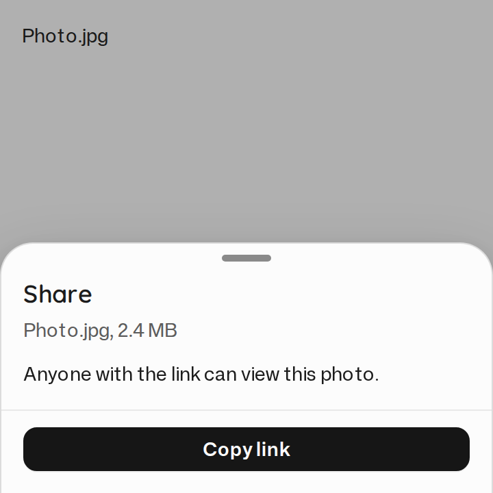
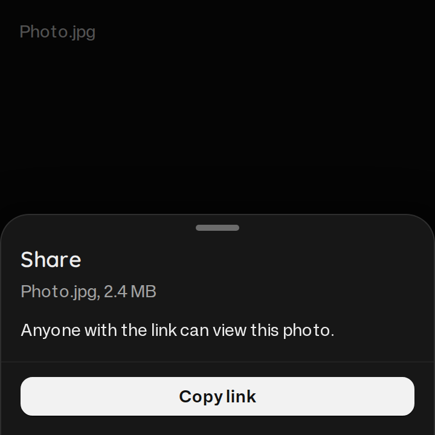
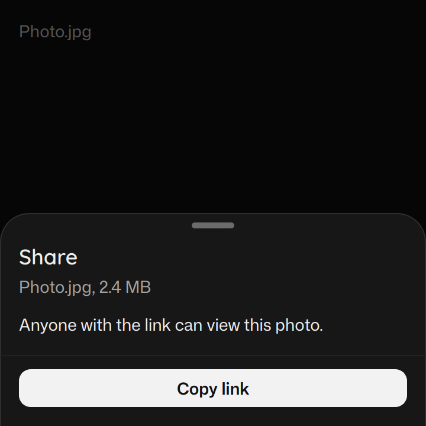
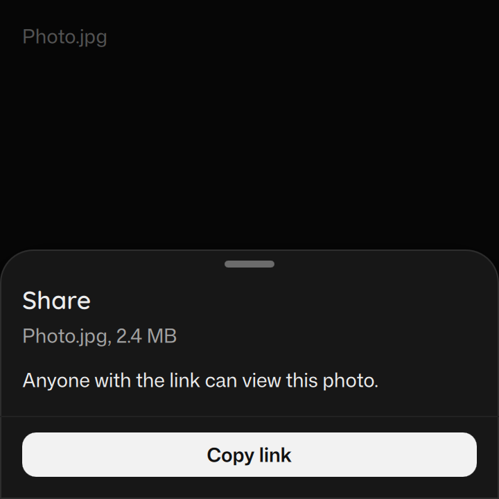
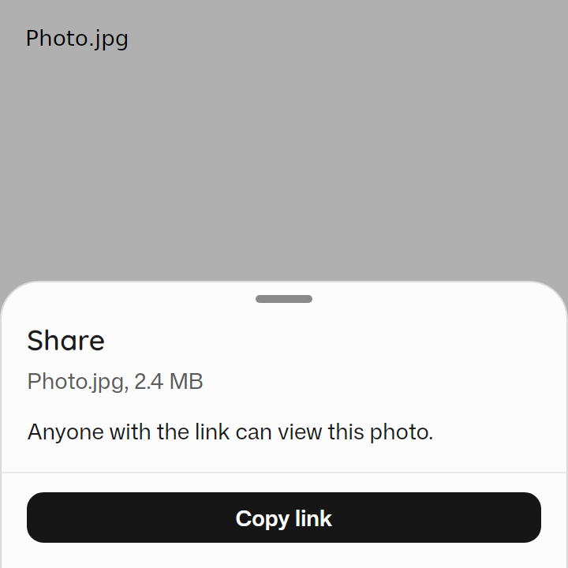

<!-- Generated by scripts/showcase.py from examples/ and component.toml. Do not edit by hand. -->

# BottomSheet

A sheet that rises from the bottom over a scrim; drag it down, tap the scrim or press Escape to close.

Mobile · [All components](README.md)

## Props

| Prop | Type | Default | Values | Description |
| --- | --- | --- | --- | --- |
| `open` | bool | `false` |  | Whether the sheet is shown. |
| `title` | string |  |  | Sheet title. |
| `description` | string |  |  | A line under the title in fgColor-muted. |
| `icon` | icon |  |  | An Octicon in a 32px tile before the title. |
| `tone` | enum | `"accent"` | `accent`, `info`, `success`, `attention`, `danger`, `neutral` | Colours the icon tile. |
| `size` | enum | `"auto"` | `auto`, `half`, `full` | auto fits the content; half and full set the height. |
| `dismissible` | bool | `true` |  | Dragging, the scrim and Escape close the sheet. Off, only an action closes it. |
| `grabber` | bool | `true` |  | Shows the drag handle. |
| `inline` | bool | `false` |  | Draws the sheet in place with no scrim, for docs and previews. |

Names follow the web targets. Qt Widgets takes `snake_case` arguments, Qt Quick `camelCase` properties, Avalonia `PascalCase` properties and Slint `kebab-case` properties; each example below shows the spelling for its target.

## Examples

Each example is run as it is shown here, on every push, and the screenshots are taken from that run (left Blanc, right Noir).

### CSS

 

```html
<div>
  <p class="text-body-medium" style="margin: 16px">Photo.jpg</p>
  <div class="pm-sheet-layer">
    <div class="pm-sheet-scrim" aria-hidden="true"></div>
    <div class="pm-sheet" role="dialog" aria-modal="true" aria-labelledby="share-title" tabindex="-1">
      <div class="pm-sheet__handle pm-sheet__handle--drag">
        <span class="pm-sheet__grabber" aria-hidden="true"></span>
        <div class="pm-sheet__head">
          <h2 class="pm-sheet__title" id="share-title">Share</h2>
          <p class="pm-sheet__desc">Photo.jpg, 2.4 MB</p>
        </div>
      </div>
      <div class="pm-sheet__body">
        <p style="margin: 0">Anyone with the link can view this photo.</p>
      </div>
      <div class="pm-sheet__actions">
        <button type="button" class="pm-button pm-button--primary pm-button--block">Copy link</button>
      </div>
    </div>
  </div>
</div>
```

### Svelte

 

```svelte
<script lang="ts">
  import { BottomSheet, Button } from "$lib/purrimer";

  let open = $state(true);
</script>

<p class="text-body-medium" style="margin: 16px">Photo.jpg</p>
<BottomSheet bind:open title="Share" description="Photo.jpg, 2.4 MB">
  <p style="margin: 0">Anyone with the link can view this photo.</p>
  {#snippet actions()}
    <Button variant="primary" block label="Copy link" onclick={() => (open = false)} />
  {/snippet}
</BottomSheet>
```

### Solid

 

```tsx
import { createSignal } from "solid-js";
import { BottomSheet, Button } from "~/purrimer";

export default function Example() {
  const [open, setOpen] = createSignal(true);
  return (
    <div>
      <p class="text-body-medium" style={{ margin: "16px" }}>Photo.jpg</p>
      <BottomSheet
        open={open()}
        title="Share"
        description="Photo.jpg, 2.4 MB"
        onClose={() => setOpen(false)}
        actions={<Button variant="primary" block label="Copy link" onClick={() => setOpen(false)} />}
      >
        <p style={{ margin: "0" }}>Anyone with the link can view this photo.</p>
      </BottomSheet>
    </div>
  );
}
```

### Qt Widgets (PySide6)

 

```python
from purrimer_qt.components import BottomSheet, Button
from PySide6.QtCore import QTimer
from PySide6.QtWidgets import QLabel, QVBoxLayout, QWidget


def example() -> QWidget:
    screen = QWidget()
    layout = QVBoxLayout(screen)
    layout.setContentsMargins(16, 16, 16, 16)
    layout.addWidget(QLabel("Photo.jpg"))
    layout.addStretch()

    # The sheet draws over its parent, so give it the screen widget.
    sheet = BottomSheet(screen, "Share", "Photo.jpg, 2.4 MB")
    note = QLabel("Anyone with the link can view this photo.")
    note.setWordWrap(True)
    sheet.body.addWidget(note)
    copy = Button("Copy link", "primary", block=True)
    copy.clicked.connect(sheet.close_sheet)
    sheet.add_action(copy)
    QTimer.singleShot(0, sheet.open)  # open once the screen is shown and has its size
    return screen
```

### Qt Quick

 

```qml
import QtQuick
import Purrimer

Item {
    Text {
        x: 16; y: 16
        text: "Photo.jpg"
        color: Purrimer.fgColorDefault
        font: Purrimer.textBodyMedium
    }

    BottomSheet {
        id: sheet
        title: "Share"
        description: "Photo.jpg, 2.4 MB"
        Component.onCompleted: open()

        Text {
            width: parent.width
            wrapMode: Text.Wrap
            text: "Anyone with the link can view this photo."
            color: Purrimer.fgColorDefault
            font: Purrimer.textBodyMedium
        }

        actions: [
            Button { text: "Copy link"; variant: "primary"; onClicked: sheet.close() }
        ]
    }
}
```

### Avalonia

 

```xml
<UserControl xmlns="https://github.com/avaloniaui"
             xmlns:pm="using:Purrimer.Avalonia">
  <!-- The sheet draws over its parent: put it last in a panel that covers the screen. -->
  <Panel>
    <TextBlock Margin="16" Text="Photo.jpg" />
    <pm:BottomSheet IsOpen="True" Title="Share" Description="Photo.jpg, 2.4 MB">
      <TextBlock Text="Anyone with the link can view this photo." TextWrapping="Wrap" />
      <pm:BottomSheet.Actions>
        <StackPanel Spacing="8">
          <Button Classes="primary block" Content="Copy link" />
        </StackPanel>
      </pm:BottomSheet.Actions>
    </pm:BottomSheet>
  </Panel>
</UserControl>
```

### Slint

 

```slint
import { BottomSheet, Purrimer } from "purrimer-components.slint";

// The sheet draws over its parent: put it last in an element that covers the screen.
export component Example inherits Rectangle {
    Text {
        x: 16px;
        y: 16px;
        text: "Photo.jpg";
        color: Purrimer.fg-color-default;
    }

    sheet := BottomSheet {
        open: true;
        title: "Share";
        description: "Photo.jpg, 2.4 MB";
        actions: [{ label: "Copy link", variant: "primary" }];
        action(index) => { sheet.close(); }
        Text {
            text: "Anyone with the link can view this photo.";
            wrap: word-wrap;
            color: Purrimer.fg-color-default;
        }
    }
}
```

