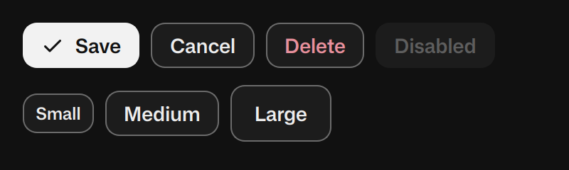
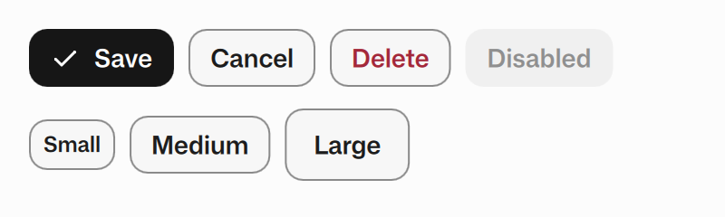
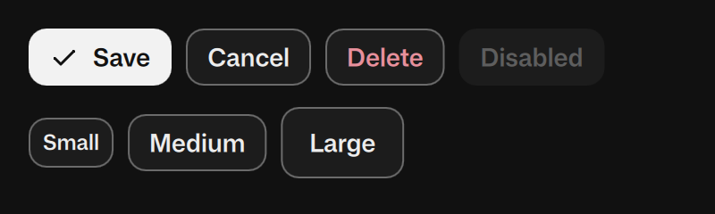
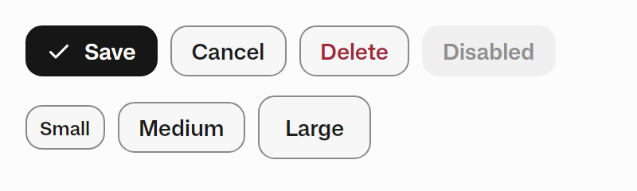
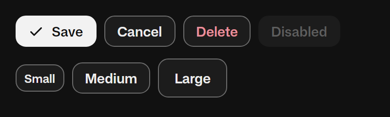
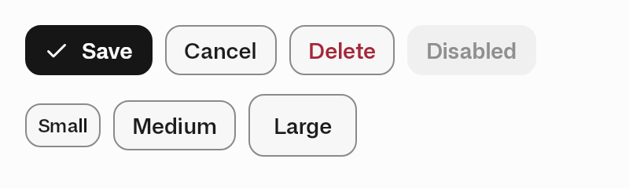
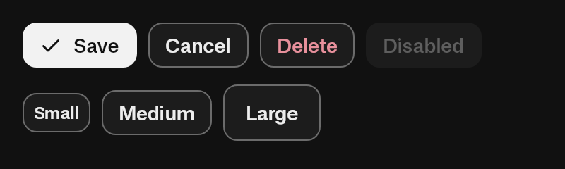

<!-- Generated by scripts/showcase.py from examples/ and component.toml. Do not edit by hand. -->

# Button

A labelled button for actions, in default, primary, danger and invisible variants.

Actions · [All components](README.md)

## Props

| Prop | Type | Default | Values | Description |
| --- | --- | --- | --- | --- |
| `label` | string |  |  | Text on the button. |
| `variant` | enum | `"default"` | `default`, `primary`, `danger`, `invisible` | Fill style. |
| `size` | enum | `"medium"` | `small`, `medium`, `large` | Height: 28, 32 or 40px. |
| `leadingIcon` | icon |  |  | Octicon before the label. |
| `trailingIcon` | icon |  |  | Octicon after the label. |
| `disabled` | bool | `false` |  | Greys the button and ignores presses. |
| `block` | bool | `false` |  | Fills the available width. |

Names follow the web targets. Qt Widgets takes `snake_case` arguments, Qt Quick `camelCase` properties, Avalonia `PascalCase` properties and Slint `kebab-case` properties; each example below shows the spelling for its target.

## Examples

Each example is run as it is shown here, on every push, and the screenshots are taken from that run (left Blanc, right Noir).

### CSS

 

```html
<div style="display: grid; gap: 12px">
  <div style="display: flex; gap: 8px">
    <button class="pm-button pm-button--primary"><svg class="pm-icon" width="16" height="16" viewBox="0 0 16 16" aria-hidden="true"><path d="M13.78 4.22a.75.75 0 0 1 0 1.06l-7.25 7.25a.75.75 0 0 1-1.06 0L2.22 9.28a.751.751 0 0 1 .018-1.042.751.751 0 0 1 1.042-.018L6 10.94l6.72-6.72a.75.75 0 0 1 1.06 0Z"/></svg>Save</button>
    <button class="pm-button">Cancel</button>
    <button class="pm-button pm-button--danger">Delete</button>
    <button class="pm-button" disabled>Disabled</button>
  </div>
  <div style="display: flex; gap: 8px; align-items: center">
    <button class="pm-button pm-button--small">Small</button>
    <button class="pm-button">Medium</button>
    <button class="pm-button pm-button--large">Large</button>
  </div>
</div>
```

### Svelte

 

```svelte
<script lang="ts">
  import { Button } from "$lib/purrimer";
</script>

<div style="display: grid; gap: 12px">
  <div style="display: flex; gap: 8px">
    <Button variant="primary" leadingIcon="check" label="Save" onclick={() => console.log("saved")} />
    <Button label="Cancel" />
    <Button variant="danger" label="Delete" />
    <Button label="Disabled" disabled />
  </div>
  <div style="display: flex; gap: 8px; align-items: center">
    <Button size="small" label="Small" />
    <Button label="Medium" />
    <Button size="large" label="Large" />
  </div>
</div>
```

### Solid

 

```tsx
import { Button } from "~/purrimer";

export default function Example() {
  return (
    <div style={{ display: "grid", gap: "12px" }}>
      <div style={{ display: "flex", gap: "8px" }}>
        <Button variant="primary" leadingIcon="check" label="Save" onClick={() => console.log("saved")} />
        <Button label="Cancel" />
        <Button variant="danger" label="Delete" />
        <Button label="Disabled" disabled />
      </div>
      <div style={{ display: "flex", gap: "8px", "align-items": "center" }}>
        <Button size="small" label="Small" />
        <Button label="Medium" />
        <Button size="large" label="Large" />
      </div>
    </div>
  );
}
```

### Qt Widgets (PySide6)

 

```python
from purrimer_qt.components import Button
from PySide6.QtCore import Qt
from PySide6.QtWidgets import QHBoxLayout, QVBoxLayout, QWidget


def example() -> QWidget:
    column = QWidget()
    layout = QVBoxLayout(column)
    layout.setContentsMargins(0, 0, 0, 0)
    layout.setSpacing(12)

    variants = QHBoxLayout()
    variants.setSpacing(8)
    save = Button("Save", "primary", leading_icon="check")
    save.clicked.connect(lambda: print("saved"))
    variants.addWidget(save)
    variants.addWidget(Button("Cancel"))
    variants.addWidget(Button("Delete", "danger"))
    disabled = Button("Disabled")
    disabled.setEnabled(False)
    variants.addWidget(disabled)
    variants.addStretch()
    layout.addLayout(variants)

    sizes = QHBoxLayout()
    sizes.setSpacing(8)
    sizes.setAlignment(Qt.AlignmentFlag.AlignVCenter)
    sizes.addWidget(Button("Small", size="small"))
    sizes.addWidget(Button("Medium"))
    sizes.addWidget(Button("Large", size="large"))
    sizes.addStretch()
    layout.addLayout(sizes)
    return column
```

### Qt Quick

 

```qml
import QtQuick
import Purrimer

Column {
    spacing: 12
    Row {
        spacing: 8
        Button { text: "Save"; variant: "primary"; leadingIcon: "check"; onClicked: console.log("saved") }
        Button { text: "Cancel" }
        Button { text: "Delete"; variant: "danger" }
        Button { text: "Disabled"; enabled: false }
    }
    Row {
        spacing: 8
        Button { text: "Small"; size: "small"; anchors.verticalCenter: parent.verticalCenter }
        Button { text: "Medium"; anchors.verticalCenter: parent.verticalCenter }
        Button { text: "Large"; size: "large" }
    }
}
```

### Avalonia

 

```xml
<UserControl xmlns="https://github.com/avaloniaui"
             xmlns:pm="using:Purrimer.Avalonia">
  <StackPanel Spacing="12">
    <StackPanel Orientation="Horizontal" Spacing="8">
      <Button Classes="primary" Content="Save" pm:ButtonAssist.LeadingIcon="check" />
      <Button Content="Cancel" />
      <Button Classes="danger" Content="Delete" />
      <Button Content="Disabled" IsEnabled="False" />
    </StackPanel>
    <StackPanel Orientation="Horizontal" Spacing="8">
      <Button Classes="small" Content="Small" VerticalAlignment="Center" />
      <Button Content="Medium" VerticalAlignment="Center" />
      <Button Classes="large" Content="Large" />
    </StackPanel>
  </StackPanel>
</UserControl>
```

### Slint

 

```slint
import { Button, PurrimerIcons } from "purrimer-components.slint";

export component Example inherits VerticalLayout {
    spacing: 12px;
    alignment: start;
    HorizontalLayout {
        spacing: 8px;
        alignment: start;
        Button { text: "Save"; variant: "primary"; leading-icon: PurrimerIcons.check-16; clicked => { debug("saved"); } }
        Button { text: "Cancel"; }
        Button { text: "Delete"; variant: "danger"; }
        Button { text: "Disabled"; enabled: false; }
    }
    HorizontalLayout {
        spacing: 8px;
        alignment: start;
        Button { text: "Small"; size: "small"; y: 6px; }
        Button { text: "Medium"; y: 4px; }
        Button { text: "Large"; size: "large"; }
    }
}
```

