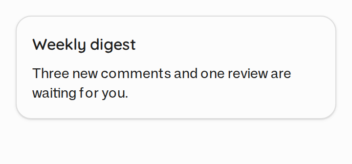
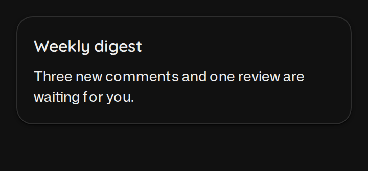
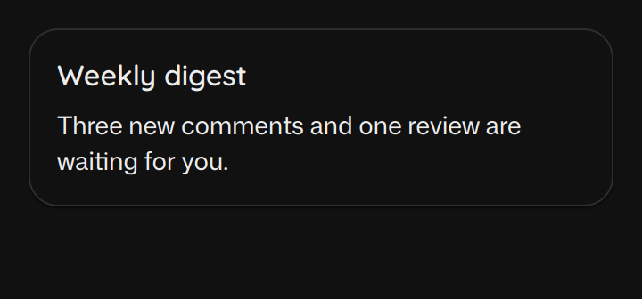
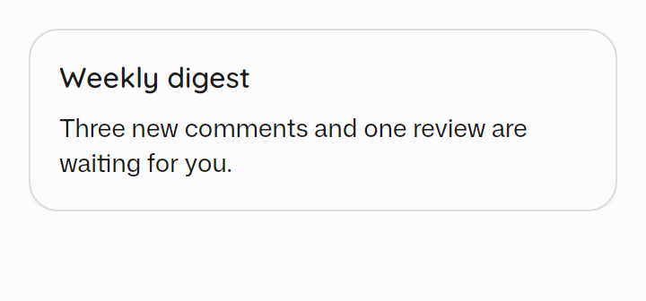
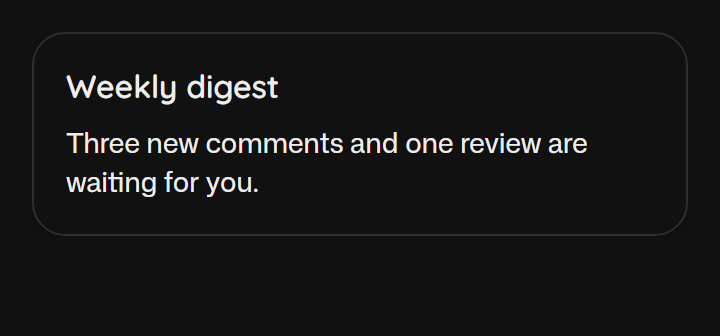
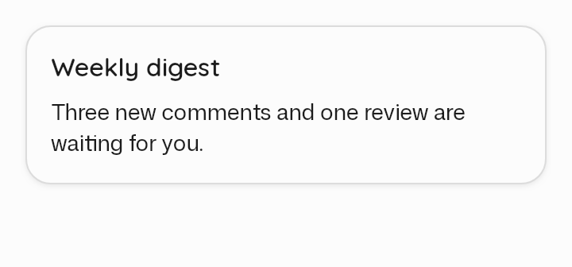
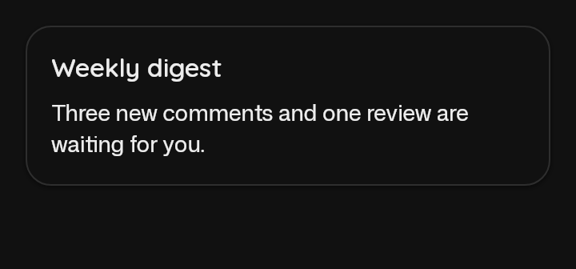

<!-- Generated by scripts/showcase.py from examples/ and component.toml. Do not edit by hand. -->

# Card

A raised surface with a hairline, a soft lift and optional title.

Containers · [All components](README.md)

## Props

| Prop | Type | Default | Values | Description |
| --- | --- | --- | --- | --- |
| `title` | string |  |  | Card header text. |
| `interactive` | bool | `false` |  | Lifts on hover and acts as one button. |

Names follow the web targets. Qt Widgets takes `snake_case` arguments, Qt Quick `camelCase` properties, Avalonia `PascalCase` properties and Slint `kebab-case` properties; each example below shows the spelling for its target.

## Examples

Each example is run as it is shown here, on every push, and the screenshots are taken from that run (left Blanc, right Noir).

### CSS

 

```html
<section class="pm-card">
  <h3 class="pm-card__title">Weekly digest</h3>
  <p style="margin: 0">Three new comments and one review are waiting for you.</p>
</section>
```

### Svelte

 

```svelte
<script lang="ts">
  import { Card } from "$lib/purrimer";
</script>

<Card title="Weekly digest">
  <p style="margin: 0">Three new comments and one review are waiting for you.</p>
</Card>
```

### Solid

 

```tsx
import { Card } from "~/purrimer";

export default function Example() {
  return (
    <Card title="Weekly digest">
      <p style={{ margin: 0 }}>Three new comments and one review are waiting for you.</p>
    </Card>
  );
}
```

### Qt Widgets (PySide6)

 

```python
from purrimer_qt.components import Card
from PySide6.QtWidgets import QLabel, QWidget


def example() -> QWidget:
    card = Card("Weekly digest")
    body = QLabel("Three new comments and one review are waiting for you.")
    body.setWordWrap(True)
    card.body.addWidget(body)
    return card
```

### Qt Quick

 

```qml
import QtQuick
import Purrimer

Card {
    width: 328
    title: "Weekly digest"
    Text {
        width: 296
        wrapMode: Text.Wrap
        text: "Three new comments and one review are waiting for you."
        color: Purrimer.fgColorDefault
        font: Purrimer.textBodyMedium
    }
}
```

### Avalonia

 

```xml
<UserControl xmlns="https://github.com/avaloniaui"
             xmlns:pm="using:Purrimer.Avalonia">
  <pm:Card Title="Weekly digest">
    <TextBlock Text="Three new comments and one review are waiting for you." TextWrapping="Wrap" />
  </pm:Card>
</UserControl>
```

### Slint

 

```slint
import { Card, Purrimer } from "purrimer-components.slint";

export component Example inherits VerticalLayout {
    alignment: start;
    Card {
        title: "Weekly digest";
        Text {
            text: "Three new comments and one review are waiting for you.";
            wrap: word-wrap;
            color: Purrimer.fg-color-default;
        }
    }
}
```

