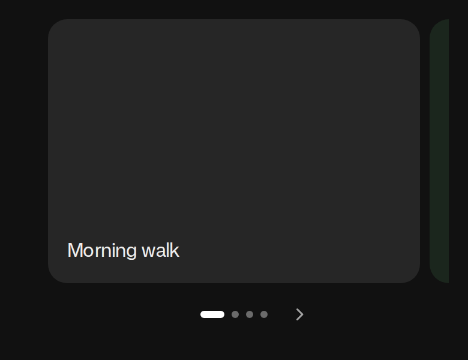
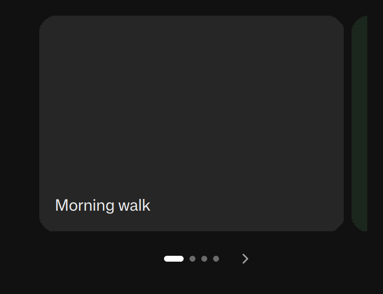
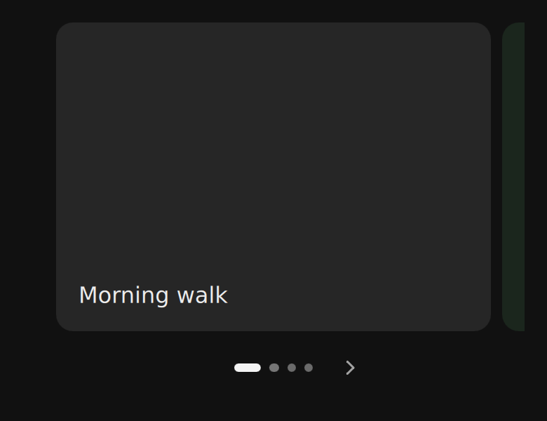
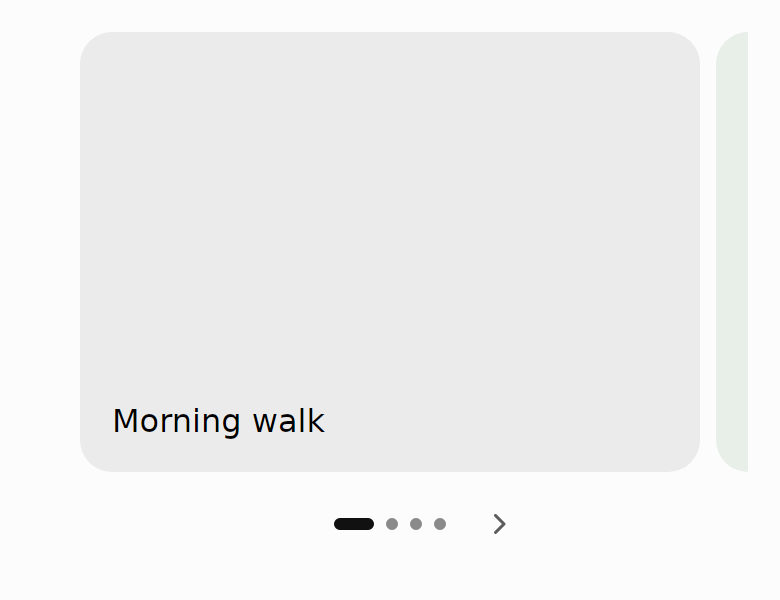
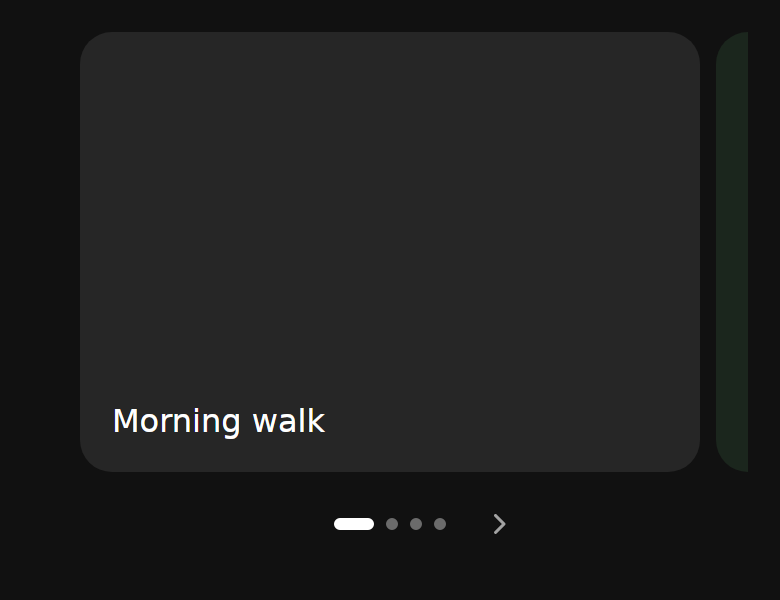
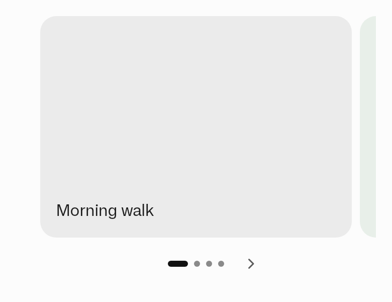

<!-- Generated by scripts/showcase.py from examples/ and component.toml. Do not edit by hand. -->

# Carousel

Slides side by side on scroll snap, with a page marker that follows the scroll one to one.

Mobile · [All components](README.md)

## Props

| Prop | Type | Default | Values | Description |
| --- | --- | --- | --- | --- |
| `index` | int | `0` |  | The current slide; a new value scrolls there. |
| `peek` | bool | `false` |  | Leaves the edge of the next slide showing. |
| `controls` | bool | `true` |  | Shows the previous and next buttons and the page marker. |
| `height` | length | `"200px"` |  | Slide height. |
| `ariaLabel` | string |  |  | Names the carousel region. Required. |

Names follow the web targets. Qt Widgets takes `snake_case` arguments, Qt Quick `camelCase` properties, Avalonia `PascalCase` properties and Slint `kebab-case` properties; each example below shows the spelling for its target.

## Examples

Each example is run as it is shown here, on every push, and the screenshots are taken from that run (left Blanc, right Noir).

### CSS

 

```html
<section class="pm-carousel pm-carousel--peek" aria-label="Highlights" aria-roledescription="carousel" style="--pm-carousel-h: 220px">
  <div class="pm-carousel__track" tabindex="0">
    <div class="pm-carousel__slide" role="group" aria-roledescription="slide" aria-label="1 of 4">
      <div class="text-body-large" style="display: flex; align-items: flex-end; height: 100%; padding: 16px; box-sizing: border-box; background: var(--bgColor-accent-muted)">Morning walk</div>
    </div>
    <div class="pm-carousel__slide" role="group" aria-roledescription="slide" aria-label="2 of 4">
      <div class="text-body-large" style="display: flex; align-items: flex-end; height: 100%; padding: 16px; box-sizing: border-box; background: var(--bgColor-success-muted)">Market haul</div>
    </div>
    <div class="pm-carousel__slide" role="group" aria-roledescription="slide" aria-label="3 of 4">
      <div class="text-body-large" style="display: flex; align-items: flex-end; height: 100%; padding: 16px; box-sizing: border-box; background: var(--bgColor-attention-muted)">Rainy afternoon</div>
    </div>
    <div class="pm-carousel__slide" role="group" aria-roledescription="slide" aria-label="4 of 4">
      <div class="text-body-large" style="display: flex; align-items: flex-end; height: 100%; padding: 16px; box-sizing: border-box; background: var(--bgColor-done-muted)">Late train</div>
    </div>
  </div>
  <div class="pm-carousel__controls">
    <button type="button" class="pm-icon-button pm-icon-button--invisible pm-carousel__nav pm-carousel__nav--hidden" aria-label="Previous" title="Previous" tabindex="-1"><svg class="pm-icon" width="16" height="16" viewBox="0 0 16 16" aria-hidden="true"><path d="M9.78 12.78a.75.75 0 0 1-1.06 0L4.47 8.53a.75.75 0 0 1 0-1.06l4.25-4.25a.751.751 0 0 1 1.042.018.751.751 0 0 1 .018 1.042L6.06 8l3.72 3.72a.75.75 0 0 1 0 1.06Z"/></svg></button>
    <div class="pm-carousel__dots" aria-hidden="true"><span class="pm-carousel__dot" style="--pm-dot: 1"></span><span class="pm-carousel__dot"></span><span class="pm-carousel__dot"></span><span class="pm-carousel__dot"></span></div>
    <button type="button" class="pm-icon-button pm-icon-button--invisible pm-carousel__nav" aria-label="Next" title="Next"><svg class="pm-icon" width="16" height="16" viewBox="0 0 16 16" aria-hidden="true"><path d="M6.22 3.22a.75.75 0 0 1 1.06 0l4.25 4.25a.75.75 0 0 1 0 1.06l-4.25 4.25a.751.751 0 0 1-1.042-.018.751.751 0 0 1-.018-1.042L9.94 8 6.22 4.28a.75.75 0 0 1 0-1.06Z"/></svg></button>
  </div>
</section>
```

### Svelte

 

```svelte
<script lang="ts">
  import { Carousel } from "$lib/purrimer";

  const slides = [
    { title: "Morning walk", tone: "var(--bgColor-accent-muted)" },
    { title: "Market haul", tone: "var(--bgColor-success-muted)" },
    { title: "Rainy afternoon", tone: "var(--bgColor-attention-muted)" },
    { title: "Late train", tone: "var(--bgColor-done-muted)" },
  ];
</script>

<Carousel ariaLabel="Highlights" items={slides} peek height={220}>
  {#snippet slide(item)}
    <div class="text-body-large" style="display: flex; align-items: flex-end; height: 100%; padding: 16px; box-sizing: border-box; background: {item.tone}">
      {item.title}
    </div>
  {/snippet}
</Carousel>
```

### Solid

 

```tsx
import { Carousel } from "~/purrimer";

const slides = [
  { title: "Morning walk", tone: "var(--bgColor-accent-muted)" },
  { title: "Market haul", tone: "var(--bgColor-success-muted)" },
  { title: "Rainy afternoon", tone: "var(--bgColor-attention-muted)" },
  { title: "Late train", tone: "var(--bgColor-done-muted)" },
];

export default function Example() {
  return (
    <Carousel
      ariaLabel="Highlights"
      items={slides}
      peek
      height={220}
      slide={(item) => (
        <div class="text-body-large" style={{ display: "flex", "align-items": "flex-end", height: "100%", padding: "16px", "box-sizing": "border-box", background: item.tone }}>
          {item.title}
        </div>
      )}
    />
  );
}
```

### Qt Widgets (PySide6)

 

```python
from purrimer_qt import theme
from purrimer_qt.components import Carousel
from PySide6.QtCore import Qt
from PySide6.QtWidgets import QLabel, QWidget

SLIDES = [
    ("Morning walk", "bgColor-accent-muted"),
    ("Market haul", "bgColor-success-muted"),
    ("Rainy afternoon", "bgColor-attention-muted"),
    ("Late train", "bgColor-done-muted"),
]


def example() -> QWidget:
    carousel = Carousel("Highlights", peek=True, slide_height=220)
    for title, tone in SLIDES:
        slide = QLabel(title)
        slide.setAlignment(Qt.AlignmentFlag.AlignLeft | Qt.AlignmentFlag.AlignBottom)
        slide.setIndent(0)
        background = theme.color(tone).name()
        slide.setStyleSheet(theme.text_css("text-body-large") + f"background: {background}; padding: 16px;")
        carousel.add_slide(slide)
    carousel.changed.connect(lambda index: print("slide", index))
    return carousel
```

### Qt Quick

 

```qml
pragma ComponentBehavior: Bound
import QtQuick
import Purrimer

Carousel {
    id: carousel
    width: 358
    accessibleName: "Highlights"
    peek: true
    slideHeight: 220
    model: [
        { title: "Morning walk", tone: Purrimer.bgColorAccentMuted },
        { title: "Market haul", tone: Purrimer.bgColorSuccessMuted },
        { title: "Rainy afternoon", tone: Purrimer.bgColorAttentionMuted },
        { title: "Late train", tone: Purrimer.bgColorDoneMuted }
    ]
    delegate: Rectangle {
        required property var modelData
        width: carousel.slideWidth
        height: carousel.slideHeight
        radius: 12
        color: modelData.tone
        Text {
            x: 16
            anchors.bottom: parent.bottom
            anchors.bottomMargin: 16
            text: parent.modelData.title
            color: Purrimer.fgColorDefault
            font.pixelSize: 16
        }
    }
    onChanged: (index) => console.log("slide", index)
}
```

### Avalonia

 

```xml
<UserControl xmlns="https://github.com/avaloniaui"
             xmlns:pm="using:Purrimer.Avalonia">
  <pm:Carousel IsPeeking="True" SlideHeight="220" VerticalAlignment="Top" AutomationProperties.Name="Highlights">
    <Border Background="{DynamicResource PmBgColorAccentMuted}" Padding="16">
      <TextBlock Text="Morning walk" FontSize="16" VerticalAlignment="Bottom" />
    </Border>
    <Border Background="{DynamicResource PmBgColorSuccessMuted}" Padding="16">
      <TextBlock Text="Market haul" FontSize="16" VerticalAlignment="Bottom" />
    </Border>
    <Border Background="{DynamicResource PmBgColorAttentionMuted}" Padding="16">
      <TextBlock Text="Rainy afternoon" FontSize="16" VerticalAlignment="Bottom" />
    </Border>
    <Border Background="{DynamicResource PmBgColorDoneMuted}" Padding="16">
      <TextBlock Text="Late train" FontSize="16" VerticalAlignment="Bottom" />
    </Border>
  </pm:Carousel>
</UserControl>
```

### Slint

 

```slint
import { Carousel, Purrimer } from "purrimer-components.slint";

export component Example inherits VerticalLayout {
    alignment: start;
    Carousel {
        accessible-label: "Highlights";
        peek: true;
        slide-height: 220px;
        items: [
            { title: "Morning walk", background: Purrimer.bg-color-accent-muted },
            { title: "Market haul", background: Purrimer.bg-color-success-muted },
            { title: "Rainy afternoon", background: Purrimer.bg-color-attention-muted },
            { title: "Late train", background: Purrimer.bg-color-done-muted },
        ];
        changed(index) => { debug("slide", index); }
    }
}
```

