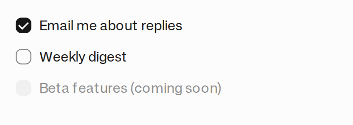
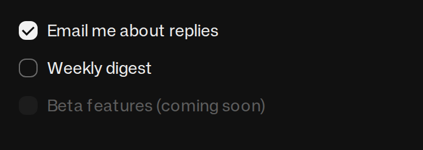
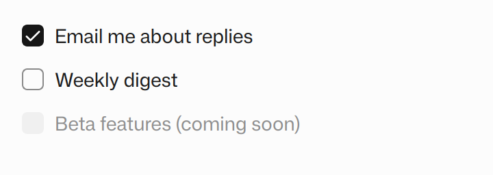
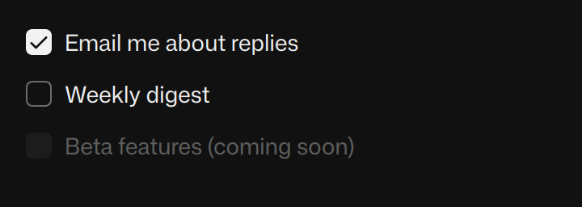
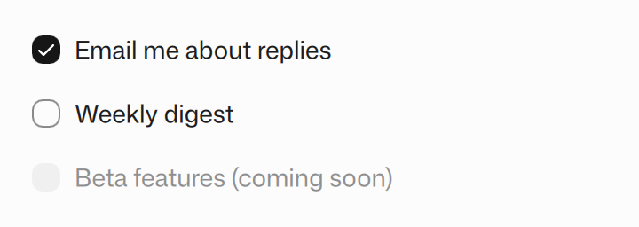
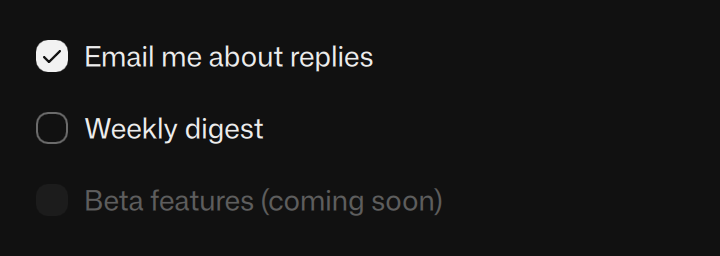
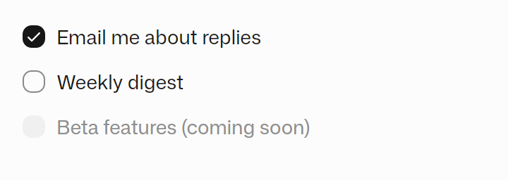
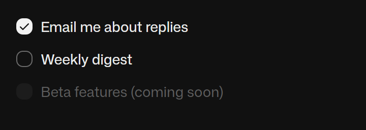
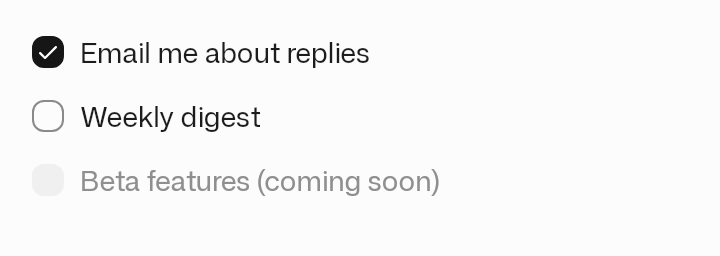
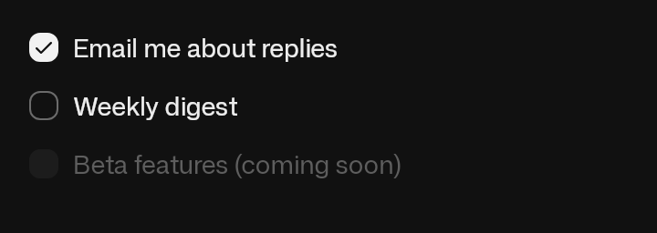

<!-- Generated by scripts/showcase.py from examples/ and component.toml. Do not edit by hand. -->

# Checkbox

A box that is checked, unchecked or indeterminate, with its label.

Forms · [All components](README.md)

## Props

| Prop | Type | Default | Values | Description |
| --- | --- | --- | --- | --- |
| `label` | string |  |  | Text beside the box. |
| `checked` | bool | `false` |  | Checked state. |
| `indeterminate` | bool | `false` |  | Shows a dash; wins over checked. |
| `disabled` | bool | `false` |  | Greys the control. |

Names follow the web targets. Qt Widgets takes `snake_case` arguments, Qt Quick `camelCase` properties, Avalonia `PascalCase` properties and Slint `kebab-case` properties; each example below shows the spelling for its target.

## Examples

Each example is run as it is shown here, on every push, and the screenshots are taken from that run (left Blanc, right Noir).

### CSS

 

```html
<div style="display: grid; gap: 12px; justify-items: start">
  <label class="pm-check"><input class="pm-check__input" type="checkbox" checked /><span>Email me about replies</span></label>
  <label class="pm-check"><input class="pm-check__input" type="checkbox" /><span>Weekly digest</span></label>
  <label class="pm-check"><input class="pm-check__input" type="checkbox" disabled /><span>Beta features (coming soon)</span></label>
</div>
```

### CSS, classless

 

```html
<label><input type="checkbox" checked /> Email me about replies</label>
<label><input type="checkbox" /> Weekly digest</label>
<label><input type="checkbox" disabled /> Beta features (coming soon)</label>
```

### Svelte

 

```svelte
<script lang="ts">
  import { Checkbox } from "$lib/purrimer";

  let replies = $state(true);
  let digest = $state(false);
</script>

<div style="display: grid; gap: 12px; justify-items: start">
  <Checkbox label="Email me about replies" bind:checked={replies} />
  <Checkbox label="Weekly digest" bind:checked={digest} />
  <Checkbox label="Beta features (coming soon)" disabled />
</div>
```

### Solid

 

```tsx
import { createSignal } from "solid-js";
import { Checkbox } from "~/purrimer";

export default function Example() {
  const [replies, setReplies] = createSignal(true);
  const [digest, setDigest] = createSignal(false);
  return (
    <div style={{ display: "grid", gap: "12px", "justify-items": "start" }}>
      <Checkbox label="Email me about replies" checked={replies()} onChange={setReplies} />
      <Checkbox label="Weekly digest" checked={digest()} onChange={setDigest} />
      <Checkbox label="Beta features (coming soon)" disabled />
    </div>
  );
}
```

### Qt Widgets (PySide6)

 

```python
from purrimer_qt.components import Checkbox
from PySide6.QtWidgets import QVBoxLayout, QWidget


def example() -> QWidget:
    column = QWidget()
    layout = QVBoxLayout(column)
    layout.setContentsMargins(0, 0, 0, 0)
    layout.setSpacing(12)
    replies = Checkbox("Email me about replies", checked=True)
    replies.toggled.connect(lambda on: print("replies", on))
    layout.addWidget(replies)
    layout.addWidget(Checkbox("Weekly digest"))
    beta = Checkbox("Beta features (coming soon)")
    beta.setEnabled(False)
    layout.addWidget(beta)
    return column
```

### Qt Quick

 

```qml
import QtQuick
import Purrimer

Column {
    spacing: 12
    Checkbox { text: "Email me about replies"; checked: true; onToggled: console.log("replies", checked) }
    Checkbox { text: "Weekly digest" }
    Checkbox { text: "Beta features (coming soon)"; enabled: false }
}
```

### Avalonia

 

```xml
<UserControl xmlns="https://github.com/avaloniaui"
             xmlns:pm="using:Purrimer.Avalonia">
  <StackPanel Spacing="12">
    <CheckBox Content="Email me about replies" IsChecked="True" />
    <CheckBox Content="Weekly digest" />
    <CheckBox Content="Beta features (coming soon)" IsEnabled="False" />
  </StackPanel>
</UserControl>
```

### Slint

 

```slint
import { Checkbox } from "purrimer-components.slint";

export component Example inherits VerticalLayout {
    spacing: 12px;
    alignment: start;
    Checkbox { text: "Email me about replies"; checked: true; toggled(on) => { debug("replies", on); } }
    Checkbox { text: "Weekly digest"; }
    Checkbox { text: "Beta features (coming soon)"; enabled: false; }
}
```

