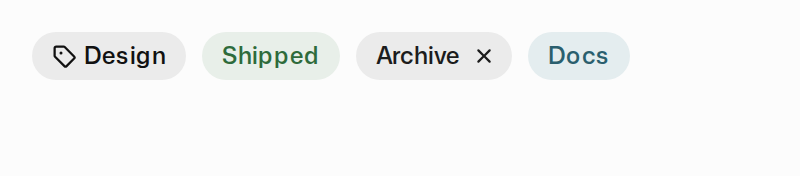
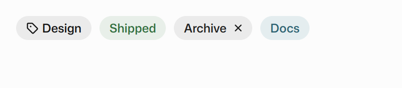
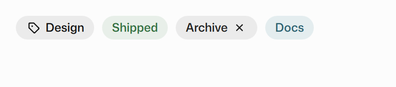
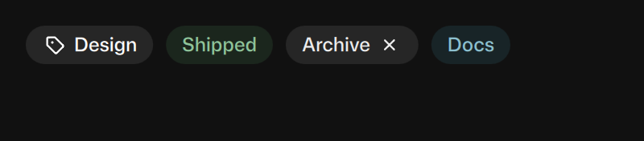
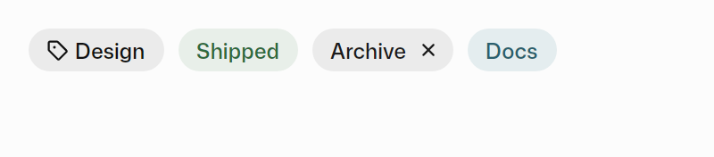
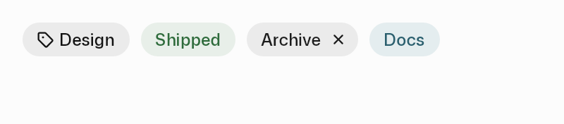

<!-- Generated by scripts/showcase.py from examples/ and component.toml. Do not edit by hand. -->

# Chip

A filled pastel tag for soft categories, optionally removable.

Status · [All components](README.md)

## Props

| Prop | Type | Default | Values | Description |
| --- | --- | --- | --- | --- |
| `text` | string |  |  | Chip text. |
| `tone` | enum | `"accent"` | `neutral`, `accent`, `success`, `attention`, `severe`, `danger`, `done`, `info` | Colour role. |
| `icon` | icon |  |  | Octicon before the text. |
| `removable` | bool | `false` |  | Shows a remove button. |

Names follow the web targets. Qt Widgets takes `snake_case` arguments, Qt Quick `camelCase` properties, Avalonia `PascalCase` properties and Slint `kebab-case` properties; each example below shows the spelling for its target.

## Examples

Each example is run as it is shown here, on every push, and the screenshots are taken from that run (left Blanc, right Noir).

### CSS

 

```html
<div style="display: flex; flex-wrap: wrap; gap: 8px">
  <span class="pm-chip"><svg class="pm-icon" width="16" height="16" viewBox="0 0 16 16" aria-hidden="true"><path d="M1 7.775V2.75C1 1.784 1.784 1 2.75 1h5.025c.464 0 .91.184 1.238.513l6.25 6.25a1.75 1.75 0 0 1 0 2.474l-5.026 5.026a1.75 1.75 0 0 1-2.474 0l-6.25-6.25A1.752 1.752 0 0 1 1 7.775Zm1.5 0c0 .066.026.13.073.177l6.25 6.25a.25.25 0 0 0 .354 0l5.025-5.025a.25.25 0 0 0 0-.354l-6.25-6.25a.25.25 0 0 0-.177-.073H2.75a.25.25 0 0 0-.25.25ZM6 5a1 1 0 1 1 0 2 1 1 0 0 1 0-2Z"/></svg>Design</span>
  <span class="pm-chip pm-chip--success">Shipped</span>
  <span class="pm-chip pm-chip--neutral">
    Archive
    <button type="button" class="pm-chip__remove" aria-label="Remove Archive"><svg class="pm-icon" width="16" height="16" viewBox="0 0 16 16" aria-hidden="true"><path d="M3.72 3.72a.75.75 0 0 1 1.06 0L8 6.94l3.22-3.22a.749.749 0 0 1 1.275.326.749.749 0 0 1-.215.734L9.06 8l3.22 3.22a.749.749 0 0 1-.326 1.275.749.749 0 0 1-.734-.215L8 9.06l-3.22 3.22a.751.751 0 0 1-1.042-.018.751.751 0 0 1-.018-1.042L6.94 8 3.72 4.78a.75.75 0 0 1 0-1.06Z"/></svg></button>
  </span>
  <span class="pm-chip pm-chip--info">Docs</span>
</div>
```

### Svelte

 

```svelte
<script lang="ts">
  import { Chip } from "$lib/purrimer";

  let tags = $state(["Archive"]);
</script>

<div style="display: flex; flex-wrap: wrap; gap: 8px">
  <Chip text="Design" icon="tag" />
  <Chip text="Shipped" tone="success" />
  {#each tags as tag (tag)}
    <Chip text={tag} tone="neutral" removable onremove={() => (tags = tags.filter((t) => t !== tag))} />
  {/each}
  <Chip text="Docs" tone="info" />
</div>
```

### Solid

 

```tsx
import { For, createSignal } from "solid-js";
import { Chip } from "~/purrimer";

export default function Example() {
  const [tags, setTags] = createSignal(["Archive"]);
  return (
    <div style={{ display: "flex", "flex-wrap": "wrap", gap: "8px" }}>
      <Chip text="Design" icon="tag" />
      <Chip text="Shipped" tone="success" />
      <For each={tags()}>
        {(tag) => <Chip text={tag} tone="neutral" removable onRemove={() => setTags(tags().filter((t) => t !== tag))} />}
      </For>
      <Chip text="Docs" tone="info" />
    </div>
  );
}
```

### Qt Widgets (PySide6)

 

```python
from purrimer_qt.components import Chip
from PySide6.QtWidgets import QHBoxLayout, QWidget


def example() -> QWidget:
    row = QWidget()
    layout = QHBoxLayout(row)
    layout.setContentsMargins(0, 0, 0, 0)
    layout.setSpacing(8)
    layout.addWidget(Chip("Design", icon="tag"))
    layout.addWidget(Chip("Shipped", "success"))
    archive = Chip("Archive", "neutral", removable=True)
    archive.removed.connect(archive.deleteLater)
    layout.addWidget(archive)
    layout.addWidget(Chip("Docs", "info"))
    layout.addStretch()
    return row
```

### Qt Quick

 

```qml
import QtQuick
import Purrimer

Flow {
    width: 368
    spacing: 8
    Chip { text: "Design"; iconName: "tag" }
    Chip { text: "Shipped"; tone: "success" }
    Chip { id: archive; text: "Archive"; tone: "neutral"; removable: true; onRemoved: archive.visible = false }
    Chip { text: "Docs"; tone: "info" }
}
```

### Avalonia

 

```xml
<UserControl xmlns="https://github.com/avaloniaui"
             xmlns:pm="using:Purrimer.Avalonia">
  <WrapPanel ItemSpacing="8" LineSpacing="8">
    <pm:Chip Text="Design" IconName="tag" />
    <pm:Chip Text="Shipped" Tone="success" />
    <pm:Chip Text="Archive" Tone="neutral" IsRemovable="True" />
    <pm:Chip Text="Docs" Tone="info" />
  </WrapPanel>
</UserControl>
```

### Slint

 

```slint
import { Chip, PurrimerIcons } from "purrimer-components.slint";

export component Example inherits HorizontalLayout {
    in-out property <bool> archived;
    spacing: 8px;
    alignment: start;
    Chip { text: "Design"; icon: PurrimerIcons.tag-16; }
    Chip { text: "Shipped"; tone: "success"; }
    if !archived: Chip { text: "Archive"; tone: "neutral"; removable: true; removed => { archived = true; } }
    Chip { text: "Docs"; tone: "info"; }
}
```

