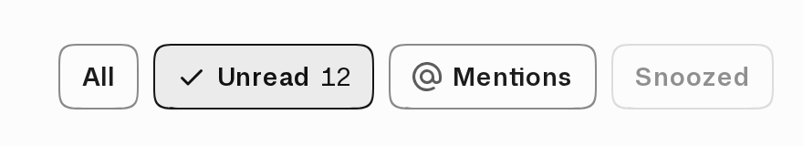
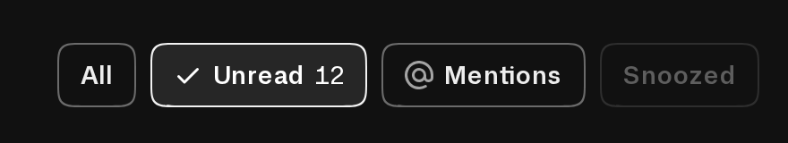
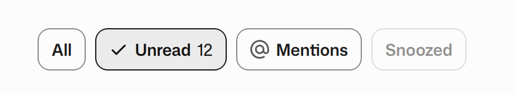
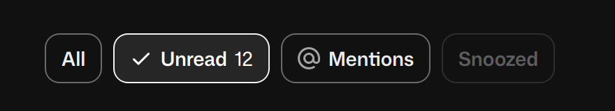
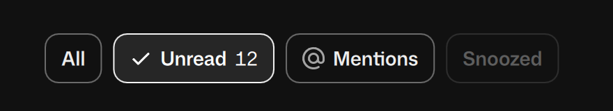
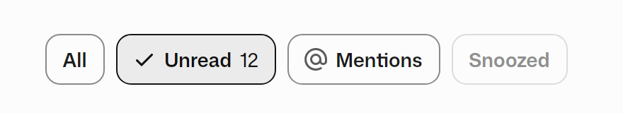
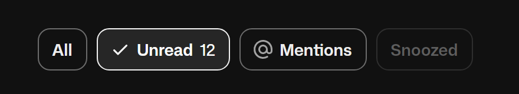
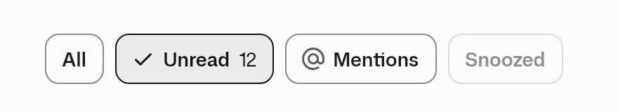
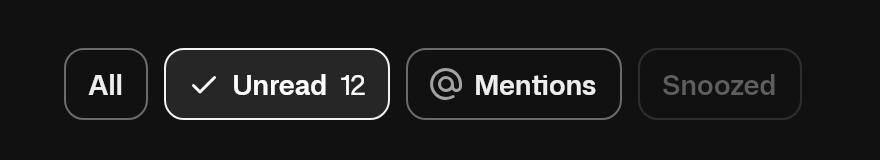

<!-- Generated by scripts/showcase.py from examples/ and component.toml. Do not edit by hand. -->

# ChipGroup

A row of filter chips that narrow what a screen shows; one or several can be on.

Mobile · [All components](README.md)

## Props

| Prop | Type | Default | Values | Description |
| --- | --- | --- | --- | --- |
| `options` | list |  |  | Options: { value, label, icon?, count?, disabled? }. |
| `value` | list |  |  | Values that are on. Single choice starts with the first option on. |
| `multiple` | bool | `false` |  | Lets several chips be on at once. |
| `allowEmpty` | bool | `false` |  | Lets a single choice be turned off. |
| `wrap` | bool | `false` |  | Wraps onto several lines instead of scrolling sideways. |
| `ariaLabel` | string |  |  | Accessible name of the group. |

Names follow the web targets. Qt Widgets takes `snake_case` arguments, Qt Quick `camelCase` properties, Avalonia `PascalCase` properties and Slint `kebab-case` properties; each example below shows the spelling for its target.

## Examples

Each example is run as it is shown here, on every push, and the screenshots are taken from that run (left Blanc, right Noir).

### CSS

 

```html
<div class="pm-chip-group" role="group" aria-label="Filter inbox">
  <button type="button" class="pm-chip-group__chip" aria-pressed="false"><span>All</span></button>
  <button type="button" class="pm-chip-group__chip" aria-pressed="true"><svg class="pm-icon" width="16" height="16" viewBox="0 0 16 16" aria-hidden="true"><path d="M13.78 4.22a.75.75 0 0 1 0 1.06l-7.25 7.25a.75.75 0 0 1-1.06 0L2.22 9.28a.751.751 0 0 1 .018-1.042.751.751 0 0 1 1.042-.018L6 10.94l6.72-6.72a.75.75 0 0 1 1.06 0Z"/></svg><span>Unread</span><span class="pm-chip-group__count">12</span></button>
  <button type="button" class="pm-chip-group__chip" aria-pressed="false"><svg class="pm-icon" width="16" height="16" viewBox="0 0 16 16" aria-hidden="true"><path d="M4.75 2.37a6.501 6.501 0 0 0 6.5 11.26.75.75 0 0 1 .75 1.298A7.999 7.999 0 0 1 .989 4.148 8 8 0 0 1 16 7.75v1.5a2.75 2.75 0 0 1-5.072 1.475 3.999 3.999 0 0 1-6.65-4.19A4 4 0 0 1 12 8v1.25a1.25 1.25 0 0 0 2.5 0V7.867a6.5 6.5 0 0 0-9.75-5.496ZM10.5 8a2.5 2.5 0 1 0-5 0 2.5 2.5 0 0 0 5 0Z"/></svg><span>Mentions</span></button>
  <button type="button" class="pm-chip-group__chip" aria-pressed="false" disabled><span>Snoozed</span></button>
</div>
```

### Svelte

 

```svelte
<script lang="ts">
  import { ChipGroup } from "$lib/purrimer";

  const options = [
    { value: "all", label: "All" },
    { value: "unread", label: "Unread", count: 12 },
    { value: "mentions", label: "Mentions", icon: "mention" },
    { value: "snoozed", label: "Snoozed", disabled: true },
  ];
  let value: string | string[] | null = $state("unread");
</script>

<ChipGroup ariaLabel="Filter inbox" {options} bind:value />
```

### Solid

 

```tsx
import { ChipGroup } from "~/purrimer";

const options = [
  { value: "all", label: "All" },
  { value: "unread", label: "Unread", count: 12 },
  { value: "mentions", label: "Mentions", icon: "mention" },
  { value: "snoozed", label: "Snoozed", disabled: true },
];

export default function Example() {
  return <ChipGroup ariaLabel="Filter inbox" options={options} value="unread" onChange={(v) => console.log("filter", v)} />;
}
```

### Qt Widgets (PySide6)

 

```python
from purrimer_qt.components import ChipGroup
from purrimer_qt.components.chip_group import ChipOption
from PySide6.QtWidgets import QWidget


def example() -> QWidget:
    chips = ChipGroup(
        [
            ChipOption("all", "All"),
            ChipOption("unread", "Unread", count=12),
            ChipOption("mentions", "Mentions", icon="mention"),
            ChipOption("snoozed", "Snoozed", disabled=True),
        ],
        value="unread",
        accessible_name="Filter inbox",
    )
    chips.changed.connect(lambda value: print("filter", value))
    return chips
```

### Qt Quick

 

```qml
import QtQuick
import Purrimer

ChipGroup {
    width: 440
    accessibleName: "Filter inbox"
    options: [
        { value: "all", label: "All" },
        { value: "unread", label: "Unread", count: 12 },
        { value: "mentions", label: "Mentions", icon: "mention" },
        { value: "snoozed", label: "Snoozed", disabled: true }
    ]
    value: "unread"
    onChanged: (value) => console.log("filter", value)
}
```

### Avalonia

 

```xml
<UserControl xmlns="https://github.com/avaloniaui"
             xmlns:pm="using:Purrimer.Avalonia">
  <pm:ChipGroup Value="unread" AutomationProperties.Name="Filter inbox">
    <pm:ChipGroupOption Value="all" Label="All" />
    <pm:ChipGroupOption Value="unread" Label="Unread" Count="12" />
    <pm:ChipGroupOption Value="mentions" Label="Mentions" IconName="mention" />
    <pm:ChipGroupOption Value="snoozed" Label="Snoozed" IsDisabled="True" />
  </pm:ChipGroup>
</UserControl>
```

### Slint

 

```slint
import { ChipGroup, PurrimerIcons } from "purrimer-components.slint";

export component Example inherits VerticalLayout {
    alignment: start;
    ChipGroup {
        accessible-label: "Filter inbox";
        current: 1;
        options: [
            { value: "all", label: "All" },
            { value: "unread", label: "Unread", count: "12" },
            { value: "mentions", label: "Mentions", icon: PurrimerIcons.mention-16 },
            { value: "snoozed", label: "Snoozed", disabled: true },
        ];
        changed(index, on) => { debug("filter", index, on); }
    }
}
```

