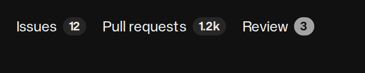
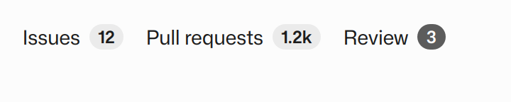
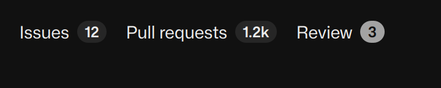
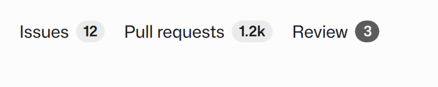
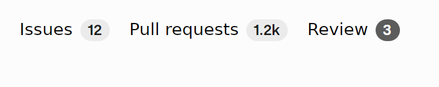
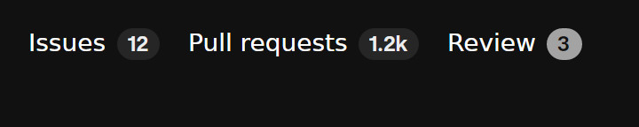
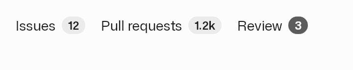
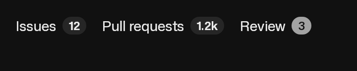

<!-- Generated by scripts/showcase.py from examples/ and component.toml. Do not edit by hand. -->

# CounterLabel

A small rounded count beside a label, tab or button.

Status · [All components](README.md)

## Props

| Prop | Type | Default | Values | Description |
| --- | --- | --- | --- | --- |
| `text` | string |  |  | The count, formatted for reading ("12", "1.2k"). |
| `variant` | enum | `"secondary"` | `secondary`, `primary` | secondary is a quiet grey; primary is solid, for counts that need attention. |

Names follow the web targets. Qt Widgets takes `snake_case` arguments, Qt Quick `camelCase` properties, Avalonia `PascalCase` properties and Slint `kebab-case` properties; each example below shows the spelling for its target.

## Examples

Each example is run as it is shown here, on every push, and the screenshots are taken from that run (left Blanc, right Noir).

### CSS

 

```html
<div class="text-body-medium" style="display: flex; gap: 16px; align-items: center">
  <span style="display: inline-flex; gap: 6px; align-items: center">Issues <span class="pm-counter">12</span></span>
  <span style="display: inline-flex; gap: 6px; align-items: center">Pull requests <span class="pm-counter">1.2k</span></span>
  <span style="display: inline-flex; gap: 6px; align-items: center">Review <span class="pm-counter pm-counter--primary">3</span></span>
</div>
```

### Svelte

 

```svelte
<script lang="ts">
  import { CounterLabel } from "$lib/purrimer";
</script>

<div class="text-body-medium" style="display: flex; gap: 16px; align-items: center">
  <span style="display: inline-flex; gap: 6px; align-items: center">Issues <CounterLabel text="12" /></span>
  <span style="display: inline-flex; gap: 6px; align-items: center">Pull requests <CounterLabel text="1.2k" /></span>
  <span style="display: inline-flex; gap: 6px; align-items: center">Review <CounterLabel text={3} variant="primary" /></span>
</div>
```

### Solid

 

```tsx
import { CounterLabel } from "~/purrimer";

export default function Example() {
  const row = { display: "inline-flex", gap: "6px", "align-items": "center" };
  return (
    <div class="text-body-medium" style={{ display: "flex", gap: "16px", "align-items": "center" }}>
      <span style={row}>Issues <CounterLabel text="12" /></span>
      <span style={row}>Pull requests <CounterLabel text="1.2k" /></span>
      <span style={row}>Review <CounterLabel text={3} variant="primary" /></span>
    </div>
  );
}
```

### Qt Widgets (PySide6)

 

```python
from purrimer_qt.components import CounterLabel
from PySide6.QtWidgets import QHBoxLayout, QLabel, QWidget


def example() -> QWidget:
    row = QWidget()
    layout = QHBoxLayout(row)
    layout.setContentsMargins(0, 0, 0, 0)
    layout.setSpacing(6)
    for text, count, variant in (
        ("Issues", "12", "secondary"),
        ("Pull requests", "1.2k", "secondary"),
        ("Review", 3, "primary"),
    ):
        layout.addWidget(QLabel(text))
        layout.addWidget(CounterLabel(count, variant))
        layout.addSpacing(10)
    layout.addStretch()
    return row
```

### Qt Quick

 

```qml
import QtQuick
import Purrimer

Row {
    spacing: 16
    Repeater {
        model: [["Issues", "12", "secondary"], ["Pull requests", "1.2k", "secondary"], ["Review", "3", "primary"]]
        Row {
            required property var modelData
            spacing: 6
            Text {
                text: parent.modelData[0]
                font: Purrimer.textBodyMedium
                color: Purrimer.fgColorDefault
                anchors.verticalCenter: parent.verticalCenter
            }
            CounterLabel { text: parent.modelData[1]; variant: parent.modelData[2]; anchors.verticalCenter: parent.verticalCenter }
        }
    }
}
```

### Avalonia

 

```xml
<UserControl xmlns="https://github.com/avaloniaui"
             xmlns:pm="using:Purrimer.Avalonia">
  <StackPanel Orientation="Horizontal" Spacing="6">
    <TextBlock Text="Issues" VerticalAlignment="Center" />
    <pm:CounterLabel Text="12" />
    <TextBlock Text="Pull requests" Margin="10,0,0,0" VerticalAlignment="Center" />
    <pm:CounterLabel Text="1.2k" />
    <TextBlock Text="Review" Margin="10,0,0,0" VerticalAlignment="Center" />
    <pm:CounterLabel Text="3" Variant="primary" />
  </StackPanel>
</UserControl>
```

### Slint

 

```slint
import { CounterLabel, Purrimer } from "purrimer-components.slint";

component Count inherits HorizontalLayout {
    in property <string> label;
    in property <string> count;
    in property <string> variant: "secondary";
    spacing: 6px;
    Text { text: root.label; color: Purrimer.fg-color-default; font-size: 14px; vertical-alignment: center; }
    CounterLabel { text: root.count; variant: root.variant; y: (parent.height - self.height) / 2; }
}

export component Example inherits HorizontalLayout {
    spacing: 16px;
    alignment: start;
    Count { label: "Issues"; count: "12"; }
    Count { label: "Pull requests"; count: "1.2k"; }
    Count { label: "Review"; count: "3"; variant: "primary"; }
}
```

