<!-- Generated by scripts/showcase.py from examples/ and component.toml. Do not edit by hand. -->

# Dialog

A modal surface over a scrim, with a title, body and right-aligned buttons.

Containers · [All components](README.md)

## Props

| Prop | Type | Default | Values | Description |
| --- | --- | --- | --- | --- |
| `open` | bool | `false` |  | Whether it is shown. |
| `title` | string |  |  | Dialog title. |

Names follow the web targets. Qt Widgets takes `snake_case` arguments, Qt Quick `camelCase` properties, Avalonia `PascalCase` properties and Slint `kebab-case` properties; each example below shows the spelling for its target.

## Examples

Each example is run as it is shown here, on every push, and the screenshots are taken from that run (left Blanc, right Noir).

### CSS

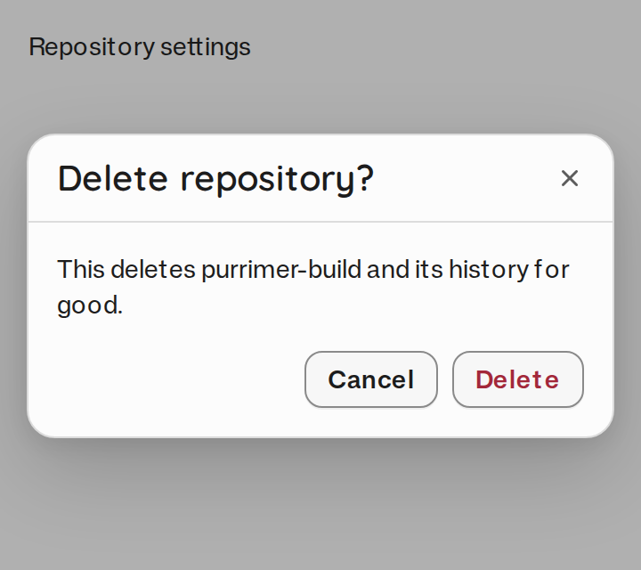 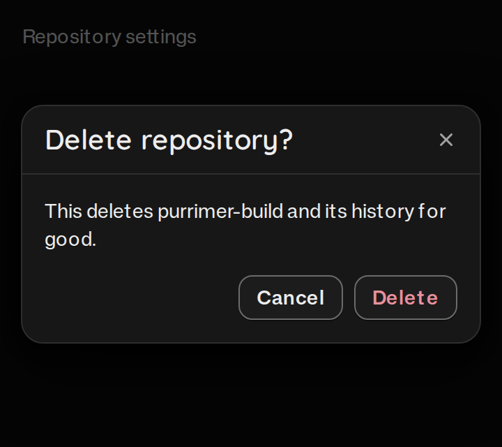

```html
<div>
  <p class="text-body-medium" style="margin: 16px">Repository settings</p>
  <div class="pm-dialog-scrim" role="presentation">
    <div class="pm-dialog" role="dialog" aria-modal="true" aria-labelledby="delete-title">
      <div class="pm-dialog__header">
        <h2 class="pm-dialog__title" id="delete-title">Delete repository?</h2>
        <button type="button" class="pm-icon-button pm-icon-button--invisible" aria-label="Close" title="Close"><svg class="pm-icon" width="16" height="16" viewBox="0 0 16 16" aria-hidden="true"><path d="M3.72 3.72a.75.75 0 0 1 1.06 0L8 6.94l3.22-3.22a.749.749 0 0 1 1.275.326.749.749 0 0 1-.215.734L9.06 8l3.22 3.22a.749.749 0 0 1-.326 1.275.749.749 0 0 1-.734-.215L8 9.06l-3.22 3.22a.751.751 0 0 1-1.042-.018.751.751 0 0 1-.018-1.042L6.94 8 3.72 4.78a.75.75 0 0 1 0-1.06Z"/></svg></button>
      </div>
      <div class="pm-dialog__body">This deletes purrimer-build and its history for good.</div>
      <div class="pm-dialog__footer">
        <button type="button" class="pm-button">Cancel</button>
        <button type="button" class="pm-button pm-button--danger">Delete</button>
      </div>
    </div>
  </div>
</div>
```

### CSS, classless

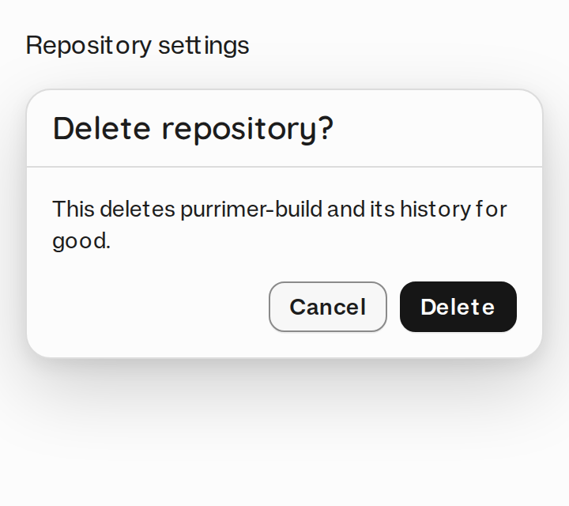 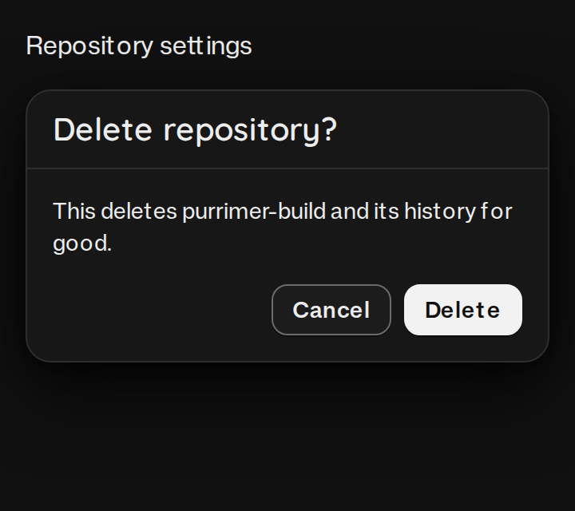

```html
<!-- Open it with dialog.showModal() to get the scrim; the open attribute shows it in place. -->
<p style="margin: 16px">Repository settings</p>
<dialog open aria-labelledby="delete-title">
  <header><h2 id="delete-title">Delete repository?</h2></header>
  <p>This deletes purrimer-build and its history for good.</p>
  <footer>
    <button>Cancel</button>
    <button type="submit">Delete</button>
  </footer>
</dialog>
```

### Svelte

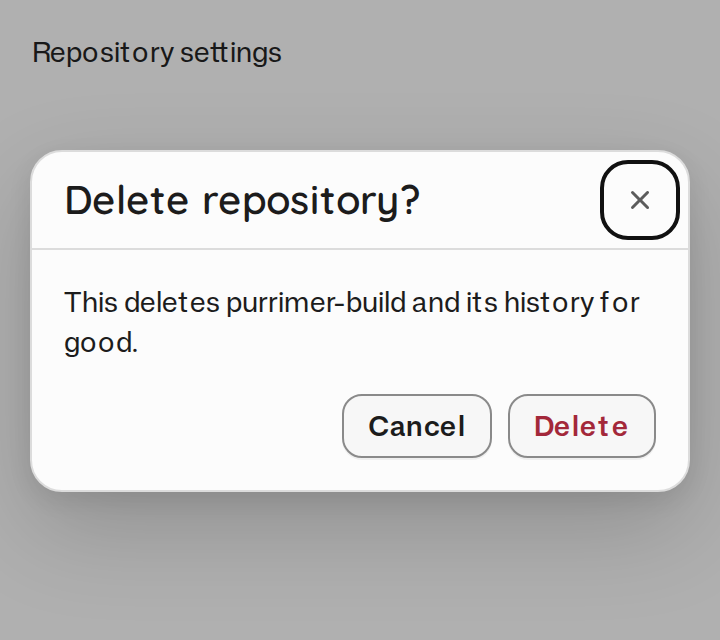 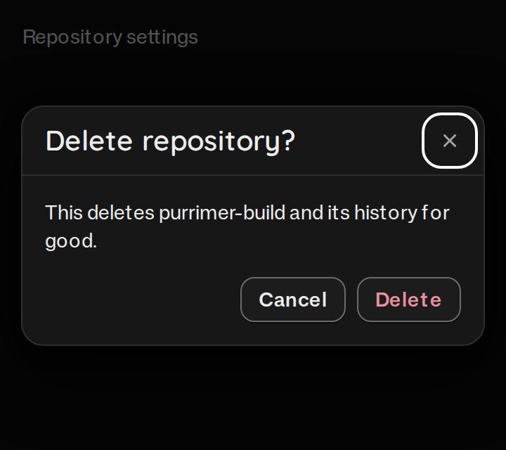

```svelte
<script lang="ts">
  import { Button, Dialog } from "$lib/purrimer";

  let open = $state(true);
</script>

<p class="text-body-medium" style="margin: 16px">Repository settings</p>
<Dialog bind:open title="Delete repository?">
  This deletes purrimer-build and its history for good.
  {#snippet footer()}
    <Button label="Cancel" onclick={() => (open = false)} />
    <Button variant="danger" label="Delete" onclick={() => (open = false)} />
  {/snippet}
</Dialog>
```

### Solid

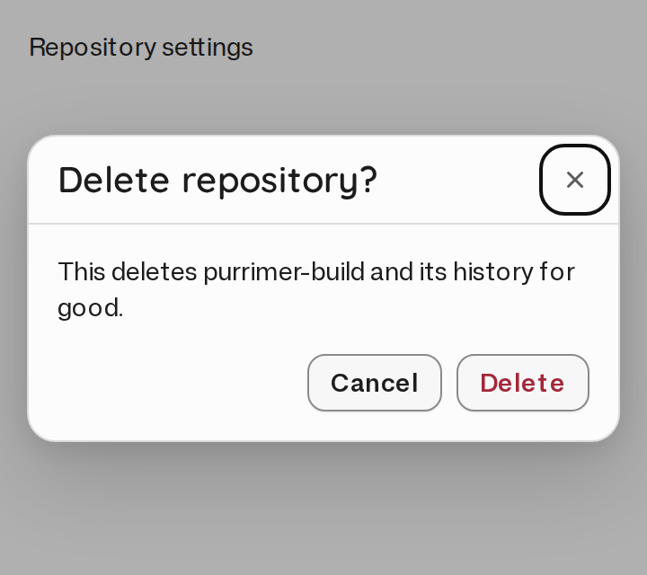 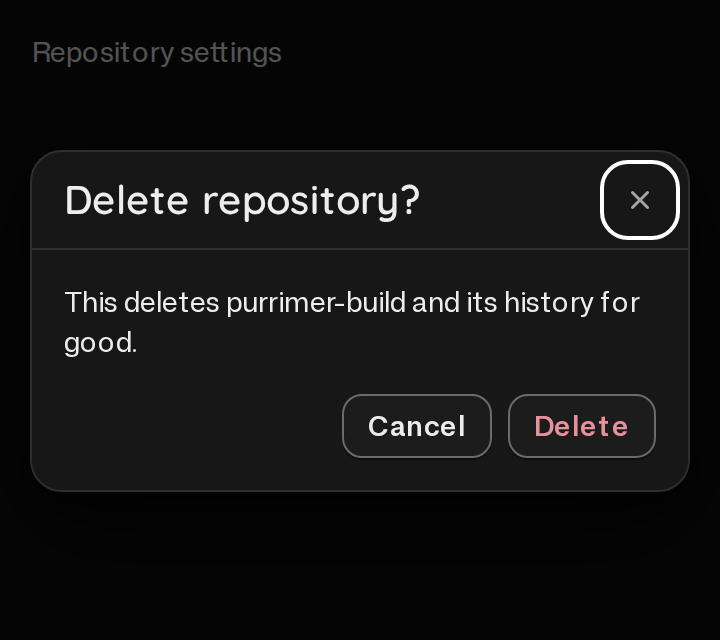

```tsx
import { createSignal } from "solid-js";
import { Button, Dialog } from "~/purrimer";

export default function Example() {
  const [open, setOpen] = createSignal(true);
  return (
    <div>
      <p class="text-body-medium" style={{ margin: "16px" }}>Repository settings</p>
      <Dialog
        open={open()}
        title="Delete repository?"
        onClose={() => setOpen(false)}
        footer={
          <>
            <Button label="Cancel" onClick={() => setOpen(false)} />
            <Button variant="danger" label="Delete" onClick={() => setOpen(false)} />
          </>
        }
      >
        This deletes purrimer-build and its history for good.
      </Dialog>
    </div>
  );
}
```

### Qt Widgets (PySide6)

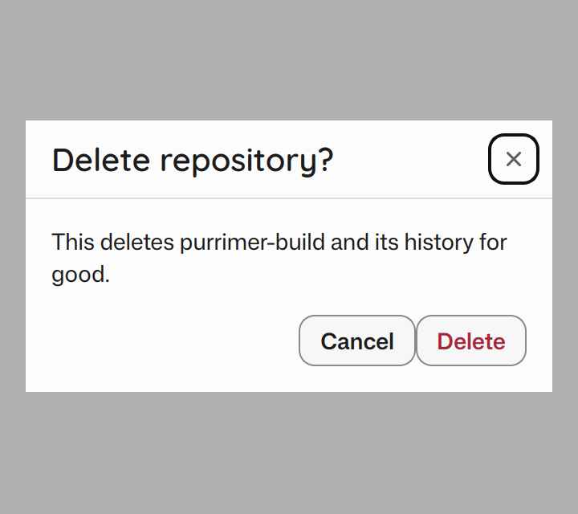 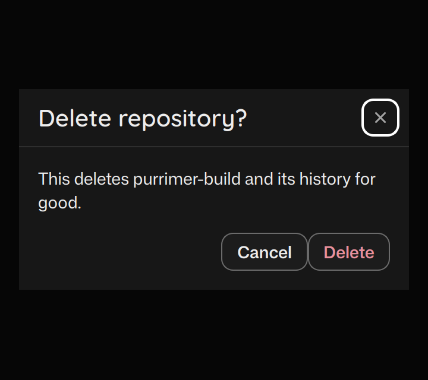

```python
from purrimer_qt.components import Button, Dialog
from PySide6.QtWidgets import QLabel, QWidget


def example() -> QWidget:
    # Dialog is a QDialog: show it with dialog.open() or dialog.exec().
    dialog = Dialog("Delete repository?", width=328)
    body = QLabel("This deletes purrimer-build and its history for good.")
    body.setWordWrap(True)
    dialog.body.addWidget(body)
    cancel = Button("Cancel")
    cancel.clicked.connect(dialog.reject)
    delete = Button("Delete", "danger")
    delete.clicked.connect(dialog.accept)
    dialog.footer.addWidget(cancel)
    dialog.footer.addWidget(delete)
    return dialog
```

### Qt Quick

 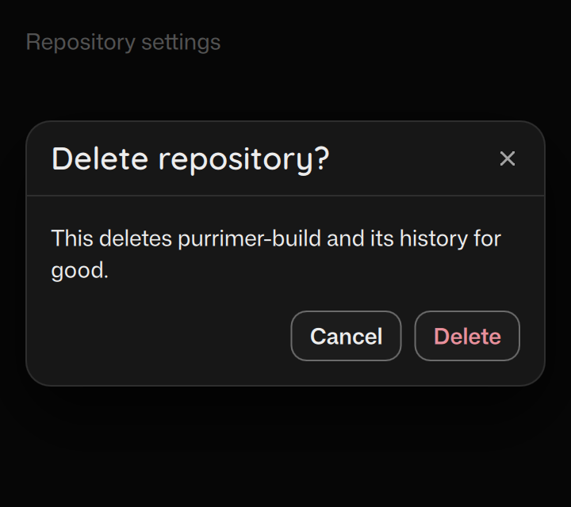

```qml
import QtQuick
import Purrimer

Item {
    Text {
        x: 16; y: 16
        text: "Repository settings"
        color: Purrimer.fgColorDefault
        font: Purrimer.textBodyMedium
    }

    Dialog {
        id: dialog
        title: "Delete repository?"
        Component.onCompleted: open()

        Text {
            width: parent.width
            wrapMode: Text.Wrap
            text: "This deletes purrimer-build and its history for good."
            color: Purrimer.fgColorDefault
            font: Purrimer.textBodyMedium
        }

        footer: [
            Button { text: "Cancel"; onClicked: dialog.close() },
            Button { text: "Delete"; variant: "danger"; onClicked: dialog.close() }
        ]
    }
}
```

### Avalonia

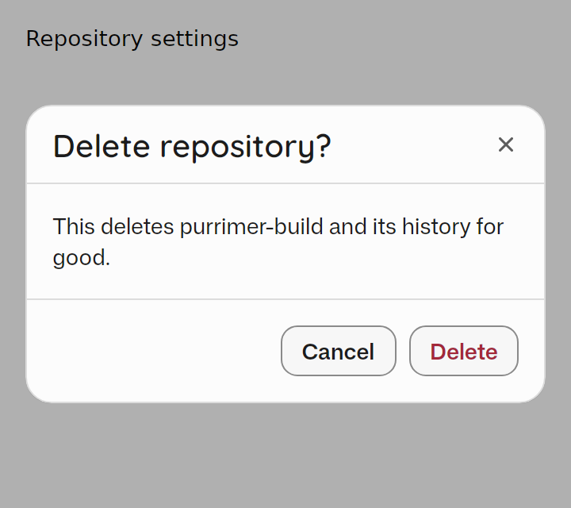 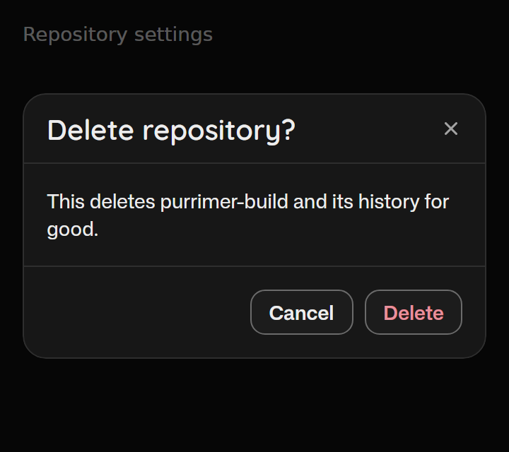

```xml
<UserControl xmlns="https://github.com/avaloniaui"
             xmlns:pm="using:Purrimer.Avalonia">
  <!-- The dialog draws over its parent: put it last in a panel that covers the window. -->
  <Panel>
    <TextBlock Margin="16" Text="Repository settings" />
    <pm:Dialog IsOpen="True" Title="Delete repository?">
      <TextBlock Text="This deletes purrimer-build and its history for good." TextWrapping="Wrap" />
      <pm:Dialog.Footer>
        <StackPanel Orientation="Horizontal" Spacing="8">
          <Button Content="Cancel" />
          <Button Classes="danger" Content="Delete" />
        </StackPanel>
      </pm:Dialog.Footer>
    </pm:Dialog>
  </Panel>
</UserControl>
```

### Slint

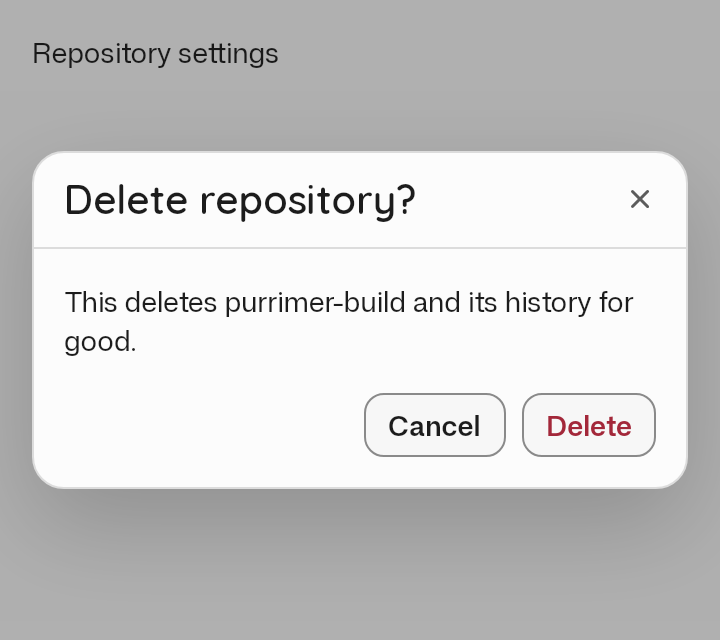 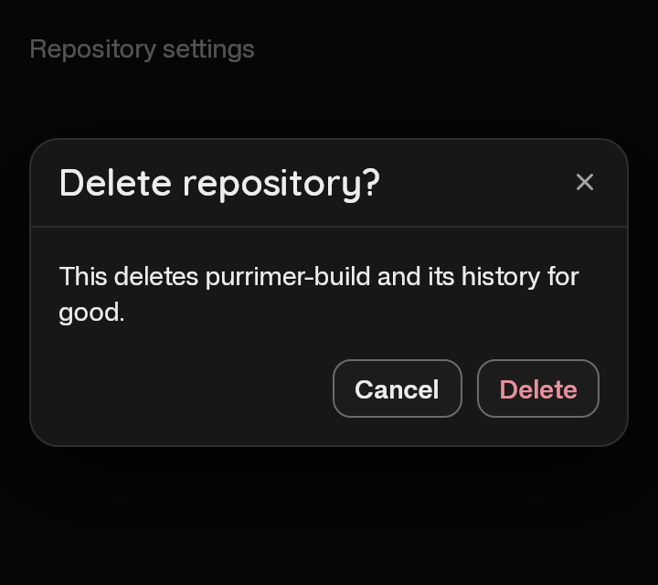

```slint
import { Button, Dialog, Purrimer } from "purrimer-components.slint";

// The dialog draws over its parent: put it last in an element that covers the window.
export component Example inherits Rectangle {
    Text {
        x: 16px;
        y: 16px;
        text: "Repository settings";
        color: Purrimer.fg-color-default;
    }

    dialog := Dialog {
        open: true;
        title: "Delete repository?";
        Text {
            text: "This deletes purrimer-build and its history for good.";
            wrap: word-wrap;
            color: Purrimer.fg-color-default;
        }
        HorizontalLayout {
            spacing: 8px;
            alignment: end;
            Button { text: "Cancel"; clicked => { dialog.open = false; } }
            Button { text: "Delete"; variant: "danger"; clicked => { dialog.open = false; } }
        }
    }
}
```

