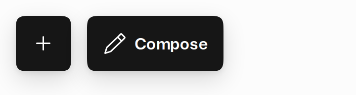
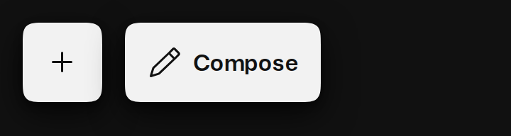
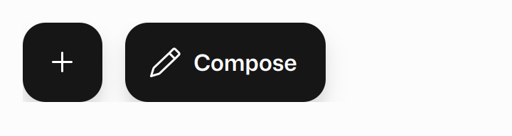
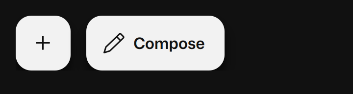
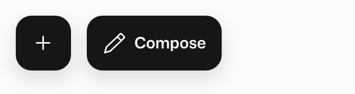
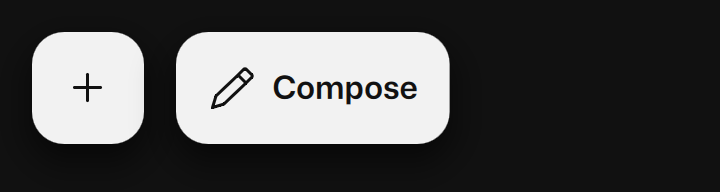
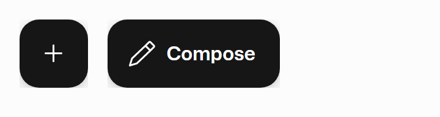
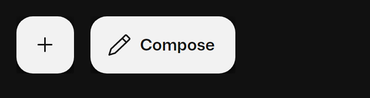
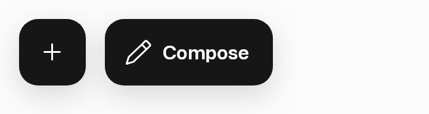
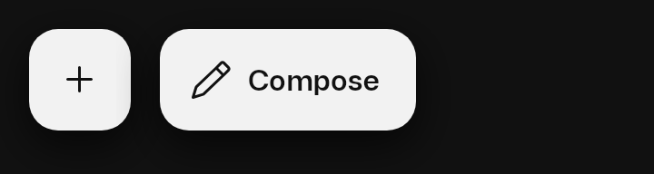

<!-- Generated by scripts/showcase.py from examples/ and component.toml. Do not edit by hand. -->

# FAB

The floating action button: one squircle for the main thing people create.

Mobile · [All components](README.md)

## Props

| Prop | Type | Default | Values | Description |
| --- | --- | --- | --- | --- |
| `icon` | icon | `"plus"` |  | Octicon at 24px. |
| `label` | string |  |  | Accessible name; shown when extended. |
| `extended` | bool | `false` |  | Shows the label beside the icon. |

Names follow the web targets. Qt Widgets takes `snake_case` arguments, Qt Quick `camelCase` properties, Avalonia `PascalCase` properties and Slint `kebab-case` properties; each example below shows the spelling for its target.

## Examples

Each example is run as it is shown here, on every push, and the screenshots are taken from that run (left Blanc, right Noir).

### CSS

 

```html
<div style="display: flex; gap: 16px; align-items: center">
  <button type="button" class="pm-fab" aria-label="New note"><svg class="pm-icon" width="24" height="24" viewBox="0 0 24 24" aria-hidden="true"><path d="M11.75 4.5a.75.75 0 0 1 .75.75V11h5.75a.75.75 0 0 1 0 1.5H12.5v5.75a.75.75 0 0 1-1.5 0V12.5H5.25a.75.75 0 0 1 0-1.5H11V5.25a.75.75 0 0 1 .75-.75Z"/></svg></button>
  <button type="button" class="pm-fab pm-fab--extended"><svg class="pm-icon" width="24" height="24" viewBox="0 0 24 24" aria-hidden="true"><path d="M17.263 2.177a1.75 1.75 0 0 1 2.474 0l2.586 2.586a1.75 1.75 0 0 1 0 2.474L19.53 10.03l-.012.013L8.69 20.378a1.753 1.753 0 0 1-.699.409l-5.523 1.68a.748.748 0 0 1-.747-.188.748.748 0 0 1-.188-.747l1.673-5.5a1.75 1.75 0 0 1 .466-.756L14.476 4.963ZM4.708 16.361a.26.26 0 0 0-.067.108l-1.264 4.154 4.177-1.271a.253.253 0 0 0 .1-.059l10.273-9.806-2.94-2.939-10.279 9.813ZM19 8.44l2.263-2.262a.25.25 0 0 0 0-.354l-2.586-2.586a.25.25 0 0 0-.354 0L16.061 5.5Z"/></svg><span>Compose</span></button>
</div>
```

### Svelte

 

```svelte
<script lang="ts">
  import { FAB } from "$lib/purrimer";
</script>

<div style="display: flex; gap: 16px; align-items: center">
  <FAB label="New note" onclick={() => console.log("new note")} />
  <FAB icon="pencil" label="Compose" extended />
</div>
```

### Solid

 

```tsx
import { FAB } from "~/purrimer";

export default function Example() {
  return (
    <div style={{ display: "flex", gap: "16px", "align-items": "center" }}>
      <FAB label="New note" onClick={() => console.log("new note")} />
      <FAB icon="pencil" label="Compose" extended />
    </div>
  );
}
```

### Qt Widgets (PySide6)

 

```python
from purrimer_qt.components import FAB
from PySide6.QtWidgets import QHBoxLayout, QWidget


def example() -> QWidget:
    row = QWidget()
    layout = QHBoxLayout(row)
    layout.setContentsMargins(0, 0, 0, 0)
    layout.setSpacing(16)
    note = FAB(label="New note")
    note.clicked.connect(lambda: print("new note"))
    layout.addWidget(note)
    layout.addWidget(FAB("pencil", "Compose", extended=True))
    layout.addStretch()
    return row
```

### Qt Quick

 

```qml
import QtQuick
import Purrimer

Row {
    spacing: 16
    FAB { label: "New note"; onClicked: console.log("new note") }
    FAB { iconName: "pencil"; label: "Compose"; extended: true }
}
```

### Avalonia

 

```xml
<UserControl xmlns="https://github.com/avaloniaui"
             xmlns:pm="using:Purrimer.Avalonia">
  <StackPanel Orientation="Horizontal" Spacing="16">
    <pm:FAB Label="New note" />
    <pm:FAB IconName="pencil" Label="Compose" IsExtended="True" />
  </StackPanel>
</UserControl>
```

### Slint

 

```slint
import { FAB, PurrimerIcons } from "purrimer-components.slint";

export component Example inherits HorizontalLayout {
    spacing: 16px;
    alignment: start;
    FAB { label: "New note"; clicked => { debug("new note"); } }
    FAB { icon: PurrimerIcons.pencil-24; label: "Compose"; extended: true; }
}
```

