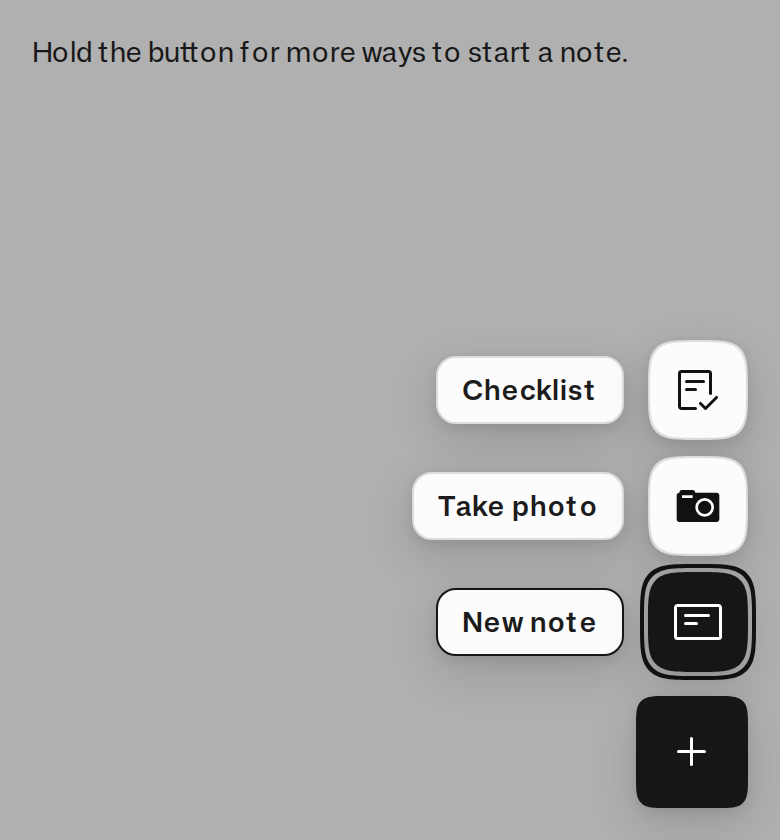
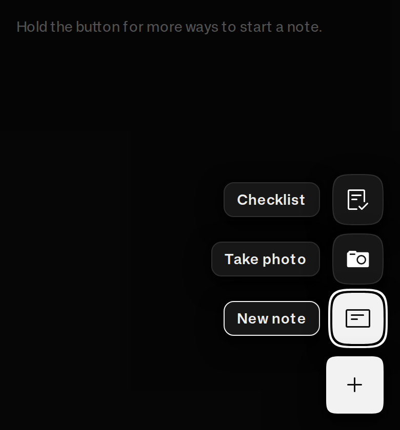
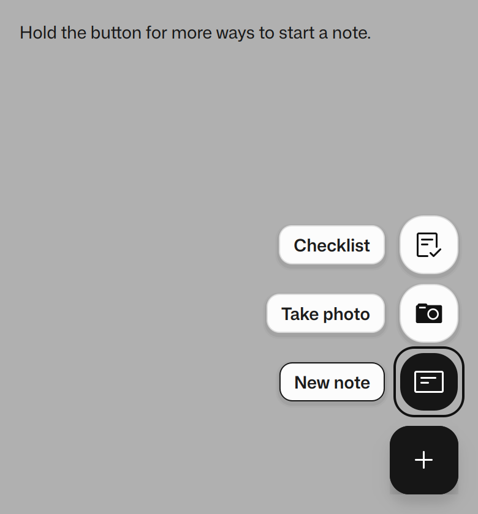
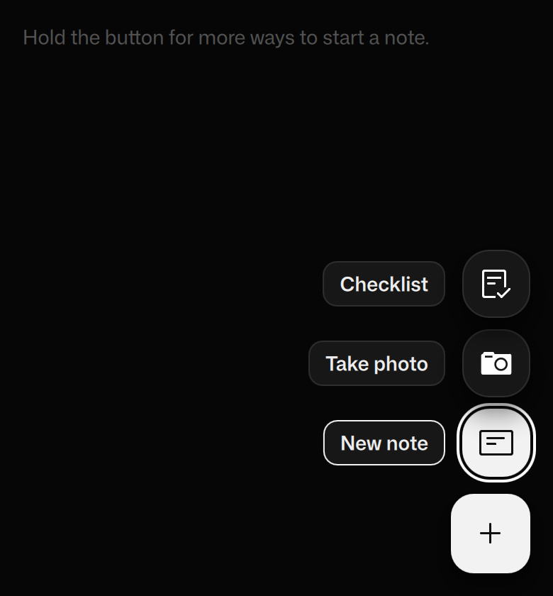
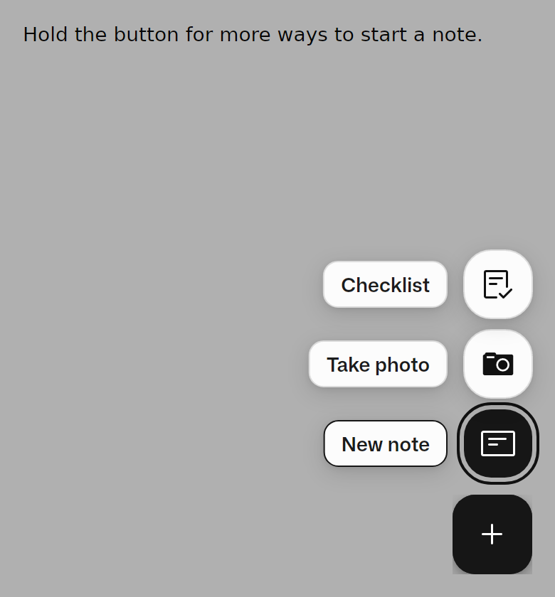
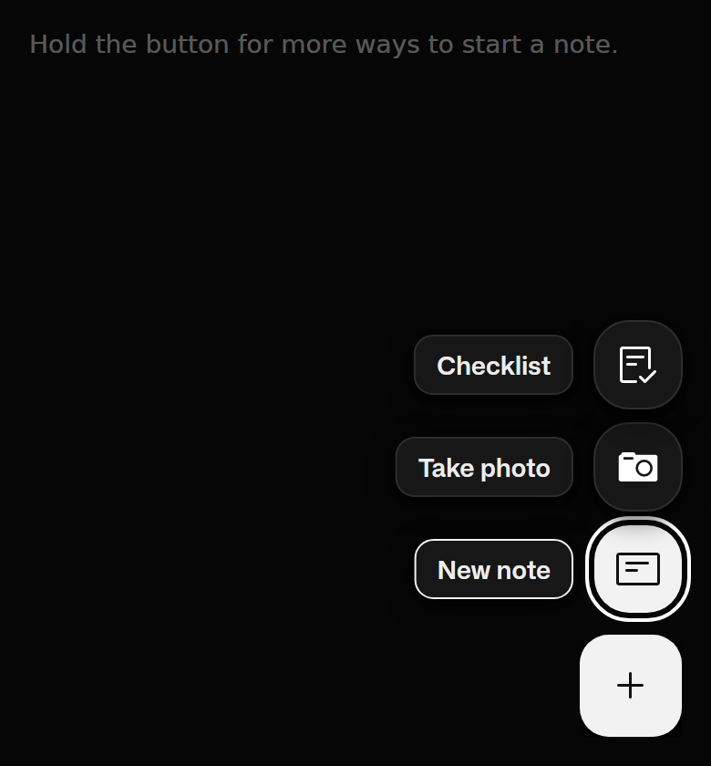

<!-- Generated by scripts/showcase.py from examples/ and component.toml. Do not edit by hand. -->

# HoldMenu

Press and hold a button to open more options around it, slide onto one and release to choose it.

Mobile · [All components](README.md)

## Props

| Prop | Type | Default | Values | Description |
| --- | --- | --- | --- | --- |
| `items` | list |  |  | Two to six options: { label, icon, variant?: danger, disabled? }. Item 0 sits nearest the trigger. |
| `layout` | enum | `"stack"` | `stack`, `arc` | stack is a column of labelled options; arc fans two to four icon-only options around a corner button. |
| `direction` | enum | `"up"` | `up`, `down` | Which side of the trigger the options open on. |
| `align` | enum | `"end"` | `end`, `start` | Lines the options up with the trigger's end or start edge. |
| `tapOpens` | bool | `false` |  | A tap opens the menu too, for a trigger with no action of its own. |
| `holdDelay` | number | `400` |  | Milliseconds before a press opens the menu. |
| `hint` | string | `"Slide to choose"` |  | The arc's prompt before an option is under the finger. |
| `defaultOpen` | bool | `false` |  | Opens the menu for tapping when it first shows. |

Names follow the web targets. Qt Widgets takes `snake_case` arguments, Qt Quick `camelCase` properties, Avalonia `PascalCase` properties and Slint `kebab-case` properties; each example below shows the spelling for its target.

## Examples

Each example is run as it is shown here, on every push, and the screenshots are taken from that run (left Blanc, right Noir).

### CSS

 

```html
<div style="position: relative; height: 420px">
  <p class="text-body-medium" style="margin: 0; padding: 16px">Hold the button for more ways to start a note.</p>
  <span class="pm-hold pm-hold--open" style="position: absolute; right: 16px; bottom: 16px">
    <button type="button" class="pm-fab" aria-label="New note" aria-haspopup="menu" aria-expanded="true" aria-controls="start-menu"><svg class="pm-icon" width="24" height="24" viewBox="0 0 24 24" aria-hidden="true"><path d="M11.75 4.5a.75.75 0 0 1 .75.75V11h5.75a.75.75 0 0 1 0 1.5H12.5v5.75a.75.75 0 0 1-1.5 0V12.5H5.25a.75.75 0 0 1 0-1.5H11V5.25a.75.75 0 0 1 .75-.75Z"/></svg></button>
  </span>
  <div class="pm-holdlayer">
    <div class="pm-holdlayer__scrim" aria-hidden="true"></div>
    <div id="start-menu" role="menu" aria-label="Start something" class="pm-holdmenu pm-holdmenu--stack pm-holdmenu--up" style="right: 16px; bottom: 84px">
      <button type="button" role="menuitem" tabindex="-1" data-hold-index="0" class="pm-holdmenu__item pm-holdmenu__item--active" style="--pm-hold-i: 0">
        <span class="pm-holdmenu__label">New note</span>
        <span class="pm-holdmenu__icon"><svg class="pm-icon" width="24" height="24" viewBox="0 0 24 24" aria-hidden="true"><path d="M0 4.75C0 3.784.784 3 1.75 3h20.5c.966 0 1.75.784 1.75 1.75v14.5A1.75 1.75 0 0 1 22.25 21H1.75A1.75 1.75 0 0 1 0 19.25Zm1.75-.25a.25.25 0 0 0-.25.25v14.5c0 .138.112.25.25.25h20.5a.25.25 0 0 0 .25-.25V4.75a.25.25 0 0 0-.25-.25ZM5 8.75A.75.75 0 0 1 5.75 8h11.5a.75.75 0 0 1 0 1.5H5.75A.75.75 0 0 1 5 8.75Zm0 4a.75.75 0 0 1 .75-.75h5.5a.75.75 0 0 1 0 1.5h-5.5a.75.75 0 0 1-.75-.75Z"/></svg></span>
      </button>
      <button type="button" role="menuitem" tabindex="-1" data-hold-index="1" class="pm-holdmenu__item" style="--pm-hold-i: 1">
        <span class="pm-holdmenu__label">Take photo</span>
        <span class="pm-holdmenu__icon"><svg class="pm-icon" width="24" height="24" viewBox="0 0 24 24" aria-hidden="true"><path d="M21.333 5.333c.734 0 1.334.6 1.334 1.334v12c0 .733-.6 1.333-1.334 1.333H2.667c-.734 0-1.334-.6-1.334-1.333v-12c0-.734.6-1.334 1.334-1.334C2.667 4.6 3.267 4 4 4h5.333c.734 0 1.334.6 1.334 1.333h10.666Zm-6 12A4.655 4.655 0 0 0 20 12.667 4.655 4.655 0 0 0 15.333 8a4.655 4.655 0 0 0-4.666 4.667 4.655 4.655 0 0 0 4.666 4.666Zm3.334-4.666A3.343 3.343 0 0 1 15.333 16 3.352 3.352 0 0 1 12 12.667a3.352 3.352 0 0 1 3.333-3.334 3.352 3.352 0 0 1 3.334 3.334ZM9.333 8V6.667H4V8h5.333Z"/></svg></span>
      </button>
      <button type="button" role="menuitem" tabindex="-1" data-hold-index="2" class="pm-holdmenu__item" style="--pm-hold-i: 2">
        <span class="pm-holdmenu__label">Checklist</span>
        <span class="pm-holdmenu__icon"><svg class="pm-icon" width="24" height="24" viewBox="0 0 24 24" aria-hidden="true"><path d="M3.5 3.75a.25.25 0 0 1 .25-.25h13.5a.25.25 0 0 1 .25.25v10a.75.75 0 0 0 1.5 0v-10A1.75 1.75 0 0 0 17.25 2H3.75A1.75 1.75 0 0 0 2 3.75v16.5c0 .966.784 1.75 1.75 1.75h7a.75.75 0 0 0 0-1.5h-7a.25.25 0 0 1-.25-.25V3.75ZM6.25 7a.75.75 0 0 0 0 1.5h8.5a.75.75 0 0 0 0-1.5h-8.5Zm-.75 4.75a.75.75 0 0 1 .75-.75h4.5a.75.75 0 0 1 0 1.5h-4.5a.75.75 0 0 1-.75-.75Zm16.28 4.53a.75.75 0 1 0-1.06-1.06l-4.97 4.97-1.97-1.97a.75.75 0 1 0-1.06 1.06l2.5 2.5a.75.75 0 0 0 1.06 0l5.5-5.5Z"/></svg></span>
      </button>
    </div>
  </div>
</div>
```

### Svelte

 

```svelte
<script lang="ts">
  import { FAB, HoldMenu } from "$lib/purrimer";
</script>

<div style="position: relative; height: 420px">
  <p class="text-body-medium" style="margin: 0; padding: 16px">Hold the button for more ways to start a note.</p>
  <div style="position: absolute; right: 16px; bottom: 16px">
    <HoldMenu
      defaultOpen
      ariaLabel="Start something"
      items={[
        { label: "New note", icon: "note" },
        { label: "Take photo", icon: "device-camera" },
        { label: "Checklist", icon: "checklist" },
      ]}
      onselect={(item) => console.log("chose", item.label)}
    >
      <FAB label="New note" onclick={() => console.log("new note")} />
    </HoldMenu>
  </div>
</div>
```

### Solid

 

```tsx
import { FAB, HoldMenu } from "~/purrimer";

export default function Example() {
  return (
    <div style={{ position: "relative", height: "420px" }}>
      <p class="text-body-medium" style={{ margin: 0, padding: "16px" }}>Hold the button for more ways to start a note.</p>
      <div style={{ position: "absolute", right: "16px", bottom: "16px" }}>
        <HoldMenu
          defaultOpen
          ariaLabel="Start something"
          items={[
            { label: "New note", icon: "note" },
            { label: "Take photo", icon: "device-camera" },
            { label: "Checklist", icon: "checklist" },
          ]}
          onSelect={(item) => console.log("chose", item.label)}
        >
          <FAB label="New note" onClick={() => console.log("new note")} />
        </HoldMenu>
      </div>
    </div>
  );
}
```

### Qt Widgets (PySide6)

 

```python
from purrimer_qt.components import FAB, HoldMenu
from purrimer_qt.components.hold_menu import HoldMenuItem
from PySide6.QtCore import Qt
from PySide6.QtWidgets import QGridLayout, QLabel, QWidget


def example() -> QWidget:
    screen = QWidget()
    layout = QGridLayout(screen)
    layout.setContentsMargins(16, 16, 16, 16)
    layout.addWidget(QLabel("Hold the button for more ways to start a note."), 0, 0)
    layout.setRowStretch(1, 1)
    fab = FAB(label="New note")
    fab.clicked.connect(lambda: print("new note"))
    menu = HoldMenu(
        fab,
        [
            HoldMenuItem("New note", "note"),
            HoldMenuItem("Take photo", "device-camera"),
            HoldMenuItem("Checklist", "checklist"),
        ],
        accessible_name="Start something",
        default_open=True,
    )
    menu.selected.connect(lambda index: print("chose", index))
    layout.addWidget(fab, 2, 0, Qt.AlignmentFlag.AlignRight)
    return screen
```

### Qt Quick

 

```qml
import QtQuick
import Purrimer

Item {
    width: 390
    height: 420

    Text {
        x: 16
        y: 16
        text: "Hold the button for more ways to start a note."
        color: Purrimer.fgColorDefault
        font: Purrimer.textBodyMedium
    }

    HoldMenu {
        anchors.right: parent.right
        anchors.bottom: parent.bottom
        anchors.margins: 16
        defaultOpen: true
        accessibleName: "Start something"
        items: [
            { label: "New note", icon: "note" },
            { label: "Take photo", icon: "device-camera" },
            { label: "Checklist", icon: "checklist" }
        ]
        onSelected: (index) => console.log("chose", index)

        FAB {
            label: "New note"
            onClicked: console.log("new note")
        }
    }
}
```

### Avalonia

 

```xml
<UserControl xmlns="https://github.com/avaloniaui"
             xmlns:pm="using:Purrimer.Avalonia">
  <Panel>
    <TextBlock Margin="16" Text="Hold the button for more ways to start a note." />
    <pm:HoldMenu Margin="16" HorizontalAlignment="Right" VerticalAlignment="Bottom" IsDefaultOpen="True"
                 AutomationProperties.Name="Start something">
      <pm:HoldMenu.Items>
        <pm:HoldMenuItem Label="New note" IconName="note" />
        <pm:HoldMenuItem Label="Take photo" IconName="device-camera" />
        <pm:HoldMenuItem Label="Checklist" IconName="checklist" />
      </pm:HoldMenu.Items>
      <pm:FAB Label="New note" />
    </pm:HoldMenu>
  </Panel>
</UserControl>
```

### Slint

 

```slint
import { FAB, HoldMenu, PurrimerIcons, Purrimer } from "purrimer-components.slint";

export component Example inherits Rectangle {
    width: 390px;
    height: 420px;

    Text {
        x: 16px;
        y: 16px;
        text: "Hold the button for more ways to start a note.";
        font-family: Purrimer.text-body-medium.font-family;
        font-size: Purrimer.text-body-medium.font-size;
        color: Purrimer.fg-color-default;
    }

    HoldMenu {
        width: self.preferred-width;
        height: self.preferred-height;
        x: parent.width - self.width - 16px;
        y: parent.height - self.height - 16px;
        default-open: true;
        accessible-name: "Start something";
        screen-width: root.width;
        screen-height: root.height;
        items: [
            { label: "New note", icon: PurrimerIcons.note-24 },
            { label: "Take photo", icon: PurrimerIcons.device-camera-24 },
            { label: "Checklist", icon: PurrimerIcons.checklist-24 },
        ];
        clicked => { debug("new note"); }
        selected(index) => { debug("chose", index); }

        FAB {
            label: "New note";
        }
    }
}
```

