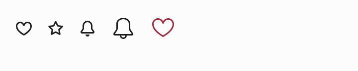
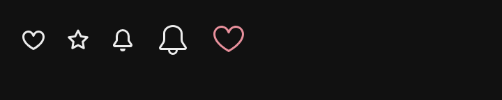
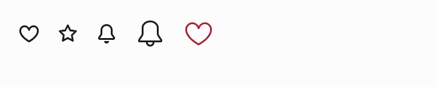
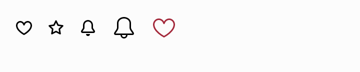
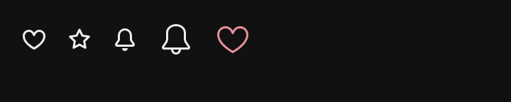

<!-- Generated by scripts/showcase.py from examples/ and component.toml. Do not edit by hand. -->

# Icon

An Octicon drawn in the current text colour, at 16 or 24px.

Graphics · [All components](README.md)

## Props

| Prop | Type | Default | Values | Description |
| --- | --- | --- | --- | --- |
| `name` | icon |  |  | Octicon name, such as search or arrow-left. |
| `size` | int | `16` |  | 16 or 24; 24 uses the 24px drawing when Octicons has one. |
| `label` | string |  |  | Accessible name; leave empty for decorative icons. |

Names follow the web targets. Qt Widgets takes `snake_case` arguments, Qt Quick `camelCase` properties, Avalonia `PascalCase` properties and Slint `kebab-case` properties; each example below shows the spelling for its target.

## Examples

Each example is run as it is shown here, on every push, and the screenshots are taken from that run (left Blanc, right Noir).

### CSS

 

```html
<div style="display: flex; gap: 16px; align-items: center">
  <svg class="pm-icon" width="16" height="16" viewBox="0 0 16 16" aria-hidden="true"><path d="m8 14.25.345.666a.75.75 0 0 1-.69 0l-.008-.004-.018-.01a7.152 7.152 0 0 1-.31-.17 22.055 22.055 0 0 1-3.434-2.414C2.045 10.731 0 8.35 0 5.5 0 2.836 2.086 1 4.25 1 5.797 1 7.153 1.802 8 3.02 8.847 1.802 10.203 1 11.75 1 13.914 1 16 2.836 16 5.5c0 2.85-2.045 5.231-3.885 6.818a22.066 22.066 0 0 1-3.744 2.584l-.018.01-.006.003h-.002ZM4.25 2.5c-1.336 0-2.75 1.164-2.75 3 0 2.15 1.58 4.144 3.365 5.682A20.58 20.58 0 0 0 8 13.393a20.58 20.58 0 0 0 3.135-2.211C12.92 9.644 14.5 7.65 14.5 5.5c0-1.836-1.414-3-2.75-3-1.373 0-2.609.986-3.029 2.456a.749.749 0 0 1-1.442 0C6.859 3.486 5.623 2.5 4.25 2.5Z"/></svg>
  <svg class="pm-icon" width="16" height="16" viewBox="0 0 16 16" aria-hidden="true"><path d="M8 .25a.75.75 0 0 1 .673.418l1.882 3.815 4.21.612a.75.75 0 0 1 .416 1.279l-3.046 2.97.719 4.192a.751.751 0 0 1-1.088.791L8 12.347l-3.766 1.98a.75.75 0 0 1-1.088-.79l.72-4.194L.818 6.374a.75.75 0 0 1 .416-1.28l4.21-.611L7.327.668A.75.75 0 0 1 8 .25Zm0 2.445L6.615 5.5a.75.75 0 0 1-.564.41l-3.097.45 2.24 2.184a.75.75 0 0 1 .216.664l-.528 3.084 2.769-1.456a.75.75 0 0 1 .698 0l2.77 1.456-.53-3.084a.75.75 0 0 1 .216-.664l2.24-2.183-3.096-.45a.75.75 0 0 1-.564-.41L8 2.694Z"/></svg>
  <svg class="pm-icon" width="16" height="16" viewBox="0 0 16 16" aria-hidden="true"><path d="M8 16a2 2 0 0 0 1.985-1.75c.017-.137-.097-.25-.235-.25h-3.5c-.138 0-.252.113-.235.25A2 2 0 0 0 8 16ZM3 5a5 5 0 0 1 10 0v2.947c0 .05.015.098.042.139l1.703 2.555A1.519 1.519 0 0 1 13.482 13H2.518a1.516 1.516 0 0 1-1.263-2.36l1.703-2.554A.255.255 0 0 0 3 7.947Zm5-3.5A3.5 3.5 0 0 0 4.5 5v2.947c0 .346-.102.683-.294.97l-1.703 2.556a.017.017 0 0 0-.003.01l.001.006c0 .002.002.004.004.006l.006.004.007.001h10.964l.007-.001.006-.004.004-.006.001-.007a.017.017 0 0 0-.003-.01l-1.703-2.554a1.745 1.745 0 0 1-.294-.97V5A3.5 3.5 0 0 0 8 1.5Z"/></svg>
  <svg class="pm-icon" width="24" height="24" viewBox="0 0 24 24" aria-hidden="true"><path d="M12 1c3.681 0 7 2.565 7 6v4.539c0 .642.189 1.269.545 1.803l2.2 3.298A1.517 1.517 0 0 1 20.482 19H15.5a3.5 3.5 0 1 1-7 0H3.519a1.518 1.518 0 0 1-1.265-2.359l2.2-3.299A3.25 3.25 0 0 0 5 11.539V7c0-3.435 3.318-6 7-6ZM6.5 7v4.539a4.75 4.75 0 0 1-.797 2.635l-2.2 3.298-.003.01.001.007.004.006.006.004.007.001h16.964l.007-.001.006-.004.004-.006.001-.006a.017.017 0 0 0-.003-.01l-2.199-3.299a4.753 4.753 0 0 1-.798-2.635V7c0-2.364-2.383-4.5-5.5-4.5S6.5 4.636 6.5 7ZM14 19h-4a2 2 0 1 0 4 0Z"/></svg>
  <span style="color: var(--fgColor-danger)"><svg class="pm-icon" width="24" height="24" viewBox="0 0 24 24" aria-hidden="true"><path d="m12 20.703.343.667a.748.748 0 0 1-.686 0l-.003-.002-.007-.003-.025-.013a31.138 31.138 0 0 1-5.233-3.576C3.8 15.573 1 12.332 1 8.514v-.001C1 5.053 3.829 2.5 6.736 2.5 9.03 2.5 10.881 3.726 12 5.605 13.12 3.726 14.97 2.5 17.264 2.5 20.17 2.5 23 5.052 23 8.514c0 3.818-2.801 7.06-5.389 9.262a31.148 31.148 0 0 1-5.233 3.576l-.025.013-.007.003-.002.001ZM6.736 4C4.657 4 2.5 5.88 2.5 8.514c0 3.107 2.324 5.96 4.861 8.12a29.655 29.655 0 0 0 4.566 3.175l.073.041.073-.04c.271-.153.661-.38 1.13-.674.94-.588 2.19-1.441 3.436-2.502 2.537-2.16 4.861-5.013 4.861-8.12C21.5 5.88 19.343 4 17.264 4c-2.106 0-3.801 1.389-4.553 3.643a.751.751 0 0 1-1.422 0C10.537 5.389 8.841 4 6.736 4Z"/></svg></span>
</div>
```

### Svelte

 

```svelte
<script lang="ts">
  import { Icon } from "$lib/purrimer";
</script>

<div style="display: flex; gap: 16px; align-items: center">
  <Icon name="heart" />
  <Icon name="star" />
  <Icon name="bell" />
  <Icon name="bell" size={24} label="Notifications" />
  <span style="color: var(--fgColor-danger)"><Icon name="heart" size={24} /></span>
</div>
```

### Solid

 

```tsx
import { Icon } from "~/purrimer";

export default function Example() {
  return (
    <div style={{ display: "flex", gap: "16px", "align-items": "center" }}>
      <Icon name="heart" />
      <Icon name="star" />
      <Icon name="bell" />
      <Icon name="bell" size={24} label="Notifications" />
      <span style={{ color: "var(--fgColor-danger)" }}>
        <Icon name="heart" size={24} />
      </span>
    </div>
  );
}
```

### Qt Widgets (PySide6)

 

```python
from purrimer_qt.components import Icon
from PySide6.QtWidgets import QHBoxLayout, QWidget


def example() -> QWidget:
    row = QWidget()
    layout = QHBoxLayout(row)
    layout.setContentsMargins(0, 0, 0, 0)
    layout.setSpacing(16)
    layout.addWidget(Icon("heart"))
    layout.addWidget(Icon("star"))
    layout.addWidget(Icon("bell"))
    layout.addWidget(Icon("bell", 24))
    layout.addWidget(Icon("heart", 24, color="fgColor-danger"))
    layout.addStretch()
    return row
```

### Qt Quick

 

```qml
import QtQuick
import Purrimer

Row {
    spacing: 16
    Icon { name: "heart"; anchors.verticalCenter: parent.verticalCenter }
    Icon { name: "star"; anchors.verticalCenter: parent.verticalCenter }
    Icon { name: "bell"; anchors.verticalCenter: parent.verticalCenter }
    Icon { name: "bell"; size: 24 }
    Icon { name: "heart"; size: 24; color: Purrimer.fgColorDanger }
}
```

### Avalonia

 

```xml
<UserControl xmlns="https://github.com/avaloniaui"
             xmlns:pm="using:Purrimer.Avalonia">
  <StackPanel Orientation="Horizontal" Spacing="16">
    <pm:Icon IconName="heart" VerticalAlignment="Center" />
    <pm:Icon IconName="star" VerticalAlignment="Center" />
    <pm:Icon IconName="bell" VerticalAlignment="Center" />
    <pm:Icon IconName="bell" Size="24" />
    <pm:Icon IconName="heart" Size="24" Foreground="{DynamicResource PmFgColorDanger}" />
  </StackPanel>
</UserControl>
```

### Slint

 

```slint
import { Icon, Purrimer, PurrimerIcons } from "purrimer-components.slint";

export component Example inherits HorizontalLayout {
    spacing: 16px;
    alignment: start;
    Icon { path: PurrimerIcons.heart-16; y: 4px; }
    Icon { path: PurrimerIcons.star-16; y: 4px; }
    Icon { path: PurrimerIcons.bell-16; y: 4px; }
    Icon { path: PurrimerIcons.bell-24; size: 24px; box: 24; }
    Icon { path: PurrimerIcons.heart-24; size: 24px; box: 24; color: Purrimer.fg-color-danger; }
}
```

