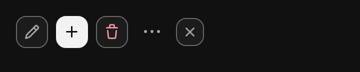
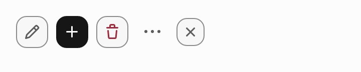
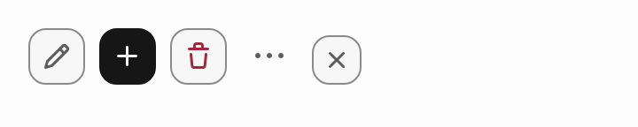

<!-- Generated by scripts/showcase.py from examples/ and component.toml. Do not edit by hand. -->

# IconButton

A square button holding one Octicon; its label is the accessible name.

Actions · [All components](README.md)

## Props

| Prop | Type | Default | Values | Description |
| --- | --- | --- | --- | --- |
| `icon` | icon |  |  | Octicon name. |
| `label` | string |  |  | Accessible name, also the tooltip. |
| `variant` | enum | `"default"` | `default`, `primary`, `danger`, `invisible` | Fill style. |
| `size` | enum | `"medium"` | `small`, `medium`, `large` | 28, 32 or 40px square. |
| `disabled` | bool | `false` |  | Greys the button and ignores presses. |

Names follow the web targets. Qt Widgets takes `snake_case` arguments, Qt Quick `camelCase` properties, Avalonia `PascalCase` properties and Slint `kebab-case` properties; each example below shows the spelling for its target.

## Examples

Each example is run as it is shown here, on every push, and the screenshots are taken from that run (left Blanc, right Noir).

### CSS

 

```html
<div style="display: flex; gap: 8px; align-items: center">
  <button class="pm-icon-button" aria-label="Edit" title="Edit"><svg class="pm-icon" width="16" height="16" viewBox="0 0 16 16" aria-hidden="true"><path d="M11.013 1.427a1.75 1.75 0 0 1 2.474 0l1.086 1.086a1.75 1.75 0 0 1 0 2.474l-8.61 8.61c-.21.21-.47.364-.756.445l-3.251.93a.75.75 0 0 1-.927-.928l.929-3.25c.081-.286.235-.547.445-.758l8.61-8.61Zm.176 4.823L9.75 4.81l-6.286 6.287a.253.253 0 0 0-.064.108l-.558 1.953 1.953-.558a.253.253 0 0 0 .108-.064Zm1.238-3.763a.25.25 0 0 0-.354 0L10.811 3.75l1.439 1.44 1.263-1.263a.25.25 0 0 0 0-.354Z"/></svg></button>
  <button class="pm-icon-button pm-icon-button--primary" aria-label="Add" title="Add"><svg class="pm-icon" width="16" height="16" viewBox="0 0 16 16" aria-hidden="true"><path d="M7.75 2a.75.75 0 0 1 .75.75V7h4.25a.75.75 0 0 1 0 1.5H8.5v4.25a.75.75 0 0 1-1.5 0V8.5H2.75a.75.75 0 0 1 0-1.5H7V2.75A.75.75 0 0 1 7.75 2Z"/></svg></button>
  <button class="pm-icon-button pm-icon-button--danger" aria-label="Delete" title="Delete"><svg class="pm-icon" width="16" height="16" viewBox="0 0 16 16" aria-hidden="true"><path d="M11 1.75V3h2.25a.75.75 0 0 1 0 1.5H2.75a.75.75 0 0 1 0-1.5H5V1.75C5 .784 5.784 0 6.75 0h2.5C10.216 0 11 .784 11 1.75ZM4.496 6.675l.66 6.6a.25.25 0 0 0 .249.225h5.19a.25.25 0 0 0 .249-.225l.66-6.6a.75.75 0 0 1 1.492.149l-.66 6.6A1.748 1.748 0 0 1 10.595 15h-5.19a1.75 1.75 0 0 1-1.741-1.575l-.66-6.6a.75.75 0 1 1 1.492-.15ZM6.5 1.75V3h3V1.75a.25.25 0 0 0-.25-.25h-2.5a.25.25 0 0 0-.25.25Z"/></svg></button>
  <button class="pm-icon-button pm-icon-button--invisible" aria-label="More" title="More"><svg class="pm-icon" width="16" height="16" viewBox="0 0 16 16" aria-hidden="true"><path d="M8 9a1.5 1.5 0 1 0 0-3 1.5 1.5 0 0 0 0 3ZM1.5 9a1.5 1.5 0 1 0 0-3 1.5 1.5 0 0 0 0 3Zm13 0a1.5 1.5 0 1 0 0-3 1.5 1.5 0 0 0 0 3Z"/></svg></button>
  <button class="pm-icon-button pm-icon-button--small" aria-label="Close" title="Close"><svg class="pm-icon" width="16" height="16" viewBox="0 0 16 16" aria-hidden="true"><path d="M3.72 3.72a.75.75 0 0 1 1.06 0L8 6.94l3.22-3.22a.749.749 0 0 1 1.275.326.749.749 0 0 1-.215.734L9.06 8l3.22 3.22a.749.749 0 0 1-.326 1.275.749.749 0 0 1-.734-.215L8 9.06l-3.22 3.22a.751.751 0 0 1-1.042-.018.751.751 0 0 1-.018-1.042L6.94 8 3.72 4.78a.75.75 0 0 1 0-1.06Z"/></svg></button>
</div>
```

### Svelte

 

```svelte
<script lang="ts">
  import { IconButton } from "$lib/purrimer";
</script>

<div style="display: flex; gap: 8px; align-items: center">
  <IconButton icon="pencil" label="Edit" />
  <IconButton icon="plus" label="Add" variant="primary" />
  <IconButton icon="trash" label="Delete" variant="danger" />
  <IconButton icon="kebab-horizontal" label="More" variant="invisible" />
  <IconButton icon="x" label="Close" size="small" />
</div>
```

### Solid

 

```tsx
import { IconButton } from "~/purrimer";

export default function Example() {
  return (
    <div style={{ display: "flex", gap: "8px", "align-items": "center" }}>
      <IconButton icon="pencil" label="Edit" />
      <IconButton icon="plus" label="Add" variant="primary" />
      <IconButton icon="trash" label="Delete" variant="danger" />
      <IconButton icon="kebab-horizontal" label="More" variant="invisible" />
      <IconButton icon="x" label="Close" size="small" />
    </div>
  );
}
```

### Qt Widgets (PySide6)

 

```python
from purrimer_qt.components import IconButton
from PySide6.QtCore import Qt
from PySide6.QtWidgets import QHBoxLayout, QWidget


def example() -> QWidget:
    row = QWidget()
    layout = QHBoxLayout(row)
    layout.setContentsMargins(0, 0, 0, 0)
    layout.setSpacing(8)
    layout.setAlignment(Qt.AlignmentFlag.AlignVCenter)
    layout.addWidget(IconButton("pencil", "Edit"))
    layout.addWidget(IconButton("plus", "Add", "primary"))
    layout.addWidget(IconButton("trash", "Delete", "danger"))
    layout.addWidget(IconButton("kebab-horizontal", "More", "invisible"))
    layout.addWidget(IconButton("x", "Close", size="small"))
    layout.addStretch()
    return row
```

### Qt Quick

 

```qml
import QtQuick
import Purrimer

Row {
    spacing: 8
    IconButton { iconName: "pencil"; label: "Edit" }
    IconButton { iconName: "plus"; label: "Add"; variant: "primary" }
    IconButton { iconName: "trash"; label: "Delete"; variant: "danger" }
    IconButton { iconName: "kebab-horizontal"; label: "More"; variant: "invisible" }
    IconButton { iconName: "x"; label: "Close"; size: "small"; anchors.verticalCenter: parent.verticalCenter }
}
```

### Avalonia

 

```xml
<UserControl xmlns="https://github.com/avaloniaui"
             xmlns:pm="using:Purrimer.Avalonia">
  <StackPanel Orientation="Horizontal" Spacing="8">
    <pm:IconButton IconName="pencil" Label="Edit" />
    <pm:IconButton IconName="plus" Label="Add" Classes="primary" />
    <pm:IconButton IconName="trash" Label="Delete" Classes="danger" />
    <pm:IconButton IconName="kebab-horizontal" Label="More" Classes="invisible" />
    <pm:IconButton IconName="x" Label="Close" Classes="small" VerticalAlignment="Center" />
  </StackPanel>
</UserControl>
```

### Slint

 

```slint
import { IconButton, PurrimerIcons } from "purrimer-components.slint";

export component Example inherits HorizontalLayout {
    spacing: 8px;
    alignment: start;
    IconButton { icon: PurrimerIcons.pencil-16; label: "Edit"; }
    IconButton { icon: PurrimerIcons.plus-16; label: "Add"; variant: "primary"; }
    IconButton { icon: PurrimerIcons.trash-16; label: "Delete"; variant: "danger"; }
    IconButton { icon: PurrimerIcons.kebab-horizontal-16; label: "More"; variant: "invisible"; }
    IconButton { icon: PurrimerIcons.x-16; label: "Close"; size: "small"; y: 4px; }
}
```

