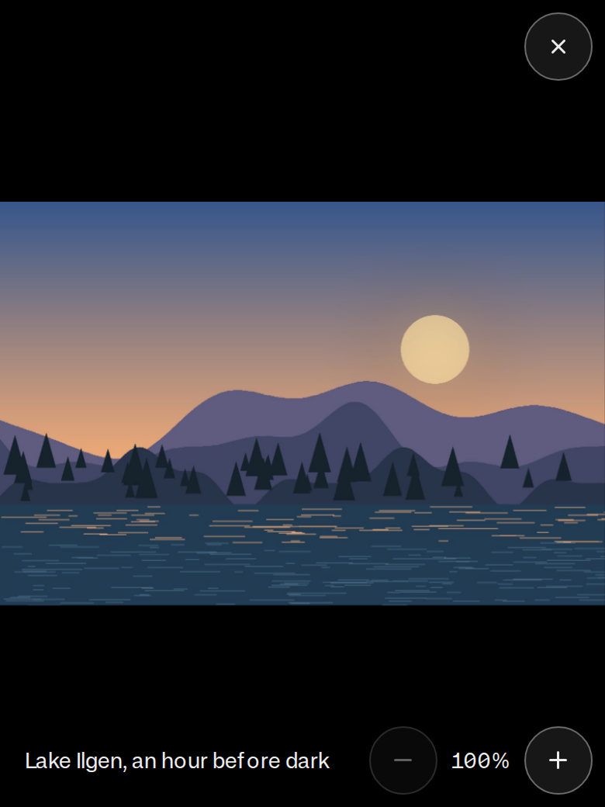
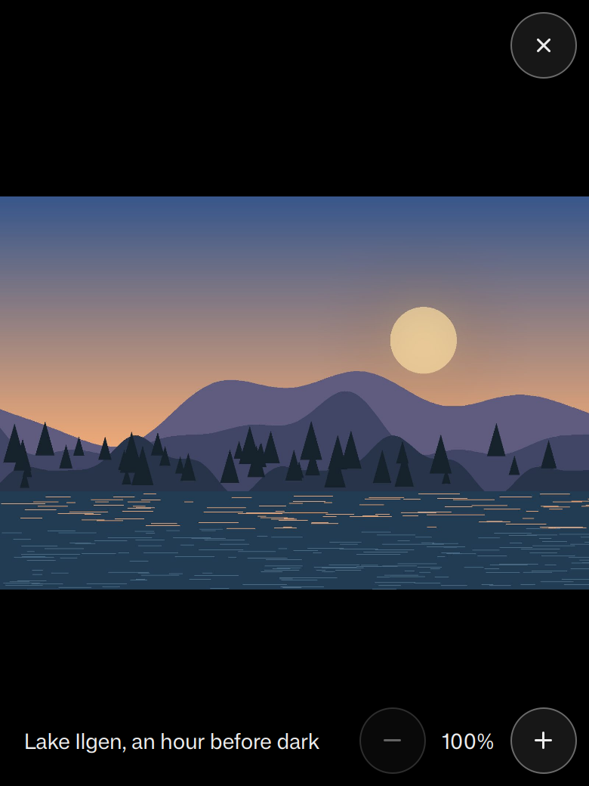
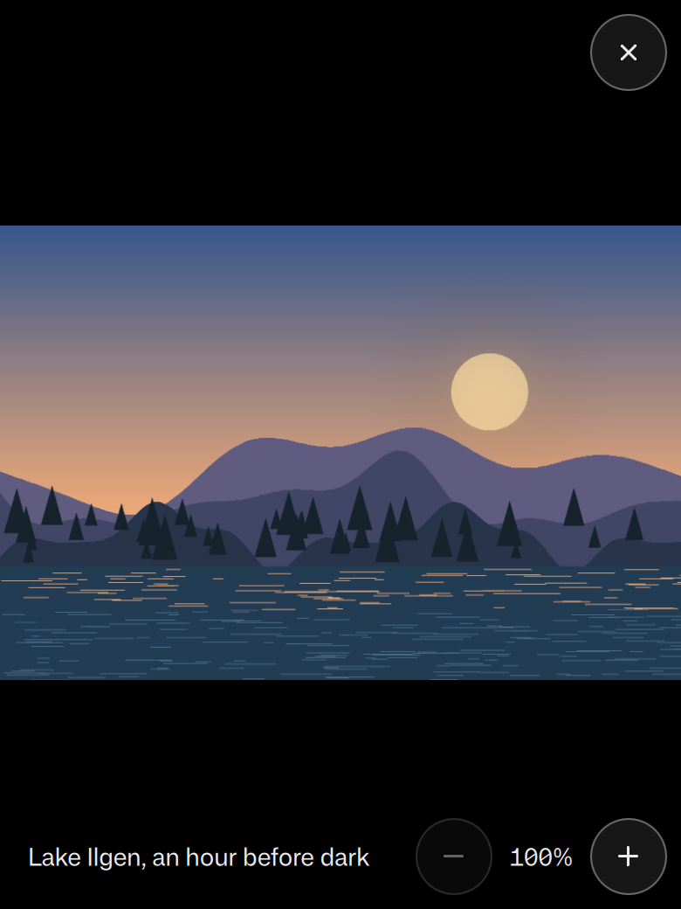
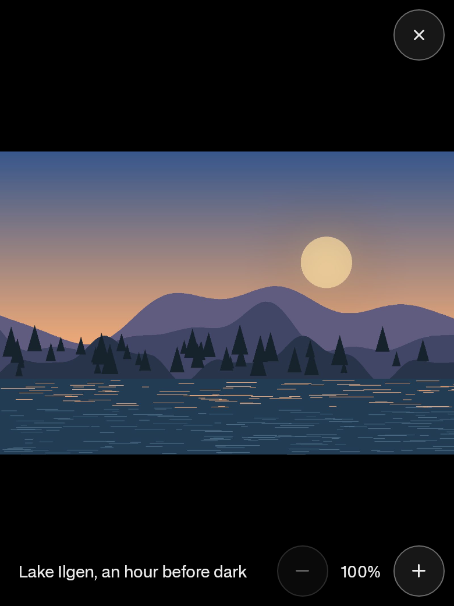

<!-- Generated by scripts/showcase.py from examples/ and component.toml. Do not edit by hand. -->

# ImageViewer

A photo on a dark stage that people pinch or double-tap to zoom, drag to look around, and drag down to close.

Mobile · [All components](README.md)

## Props

| Prop | Type | Default | Values | Description |
| --- | --- | --- | --- | --- |
| `src` | string |  |  | The picture. |
| `alt` | string |  |  | What the picture shows; it names the viewer. |
| `caption` | string |  |  | A line under the picture. |
| `open` | bool | `false` |  | Shows the viewer over the screen. |
| `inline` | bool | `false` |  | Draws the viewer in place instead of over the screen, for docs and previews. |
| `maxScale` | number | `4` |  | The furthest zoom. |
| `labels` | object | `{}` |  | Words for the image, stage, close, zoomIn and zoomOut, for translation. |

Names follow the web targets. Qt Widgets takes `snake_case` arguments, Qt Quick `camelCase` properties, Avalonia `PascalCase` properties and Slint `kebab-case` properties; each example below shows the spelling for its target.

## Examples

Each example is run as it is shown here, on every push, and the screenshots are taken from that run (left Blanc, right Noir).

### CSS

 

```html
<div class="pm-imgview pm-imgview--inline" role="group" aria-label="Sunset over the lake" data-density="touch">
  <div class="pm-imgview__backdrop" aria-hidden="true"></div>
  <div class="pm-imgview__stage" tabindex="0" role="img" aria-label="Sunset over the lake. Plus and minus zoom, arrow keys move.">
    
  </div>
  <div class="pm-imgview__top">
    <button type="button" class="pm-imgview__btn" aria-label="Close"><svg class="pm-icon" width="16" height="16" viewBox="0 0 16 16" aria-hidden="true"><path d="M3.72 3.72a.75.75 0 0 1 1.06 0L8 6.94l3.22-3.22a.749.749 0 0 1 1.275.326.749.749 0 0 1-.215.734L9.06 8l3.22 3.22a.749.749 0 0 1-.326 1.275.749.749 0 0 1-.734-.215L8 9.06l-3.22 3.22a.751.751 0 0 1-1.042-.018.751.751 0 0 1-.018-1.042L6.94 8 3.72 4.78a.75.75 0 0 1 0-1.06Z"/></svg></button>
  </div>
  <div class="pm-imgview__bottom">
    <p class="pm-imgview__caption">Lake Ilgen, an hour before dark</p>
    <span class="pm-imgview__zoom">
      <button type="button" class="pm-imgview__btn" aria-label="Zoom out" aria-disabled="true"><svg class="pm-icon" width="16" height="16" viewBox="0 0 16 16" aria-hidden="true"><path d="M2 7.75A.75.75 0 0 1 2.75 7h10a.75.75 0 0 1 0 1.5h-10A.75.75 0 0 1 2 7.75Z"/></svg></button>
      <span class="pm-imgview__pct" aria-live="polite">100%</span>
      <button type="button" class="pm-imgview__btn" aria-label="Zoom in"><svg class="pm-icon" width="16" height="16" viewBox="0 0 16 16" aria-hidden="true"><path d="M7.75 2a.75.75 0 0 1 .75.75V7h4.25a.75.75 0 0 1 0 1.5H8.5v4.25a.75.75 0 0 1-1.5 0V8.5H2.75a.75.75 0 0 1 0-1.5H7V2.75A.75.75 0 0 1 7.75 2Z"/></svg></button>
    </span>
  </div>
</div>
```

### Svelte

 

```svelte
<script lang="ts">
  import { ImageViewer } from "$lib/purrimer";
  import photo from "./photo.jpg";
</script>

<ImageViewer inline src={photo} alt="Sunset over the lake" caption="Lake Ilgen, an hour before dark" onclose={() => console.log("close")} />
```

### Solid

 

```tsx
import { ImageViewer } from "~/purrimer";
import photo from "./photo.jpg";

export default function Example() {
  return <ImageViewer inline src={photo} alt="Sunset over the lake" caption="Lake Ilgen, an hour before dark" onClose={() => console.log("close")} />;
}
```

### Qt Widgets (PySide6)

 

```python
from pathlib import Path

from purrimer_qt.components import ImageViewer
from PySide6.QtWidgets import QVBoxLayout, QWidget


def example() -> QWidget:
    page = QWidget()
    layout = QVBoxLayout(page)
    layout.setContentsMargins(0, 0, 0, 0)
    viewer = ImageViewer(
        str(Path(__file__).with_name("photo.jpg")),
        alt="Sunset over the lake",
        caption="Lake Ilgen, an hour before dark",
        inline=True,
    )
    viewer.closed.connect(lambda: print("close"))
    layout.addWidget(viewer)
    return page
```

### Qt Quick

 

```qml
import QtQuick
import Purrimer

ImageViewer {
    width: 390
    height: 520
    inline: true
    source: Qt.resolvedUrl("photo.jpg")
    alt: "Sunset over the lake"
    caption: "Lake Ilgen, an hour before dark"
    onClosed: console.log("close")
}
```

### Avalonia

 

```xml
<UserControl xmlns="https://github.com/avaloniaui"
             xmlns:pm="using:Purrimer.Avalonia">
  <pm:ImageViewer IsInline="True" Source="avares://Purrimer.Avalonia/Examples/ImageViewer/photo.jpg"
                  Alt="Sunset over the lake" Caption="Lake Ilgen, an hour before dark" />
</UserControl>
```

### Slint

 

```slint
import { ImageViewer } from "purrimer-components.slint";

export component Example inherits Rectangle {
    width: 390px;
    height: 520px;

    ImageViewer {
        inline: true;
        source: @image-url("photo.jpg");
        alt: "Sunset over the lake";
        caption: "Lake Ilgen, an hour before dark";
        closed => { debug("close"); }
    }
}
```

