<!-- Generated by scripts/showcase.py from examples/ and component.toml. Do not edit by hand. -->

# InfoButton

An info button that opens a short explanation in a bottom sheet, where a desktop would use a tooltip.

Mobile · [All components](README.md)

## Props

| Prop | Type | Default | Values | Description |
| --- | --- | --- | --- | --- |
| `title` | string |  |  | Sheet title; the button is named "About" plus the title. |
| `message` | string |  |  | The explanation, a sentence or two at 16px. |
| `closeLabel` | string | `"Got it"` |  | The button that closes the sheet. |
| `icon` | icon | `"info"` |  | The button's Octicon. |
| `defaultOpen` | bool | `false` |  | Starts with the sheet open. |

Names follow the web targets. Qt Widgets takes `snake_case` arguments, Qt Quick `camelCase` properties, Avalonia `PascalCase` properties and Slint `kebab-case` properties; each example below shows the spelling for its target.

## Examples

Each example is run as it is shown here, on every push, and the screenshots are taken from that run (left Blanc, right Noir).

### CSS

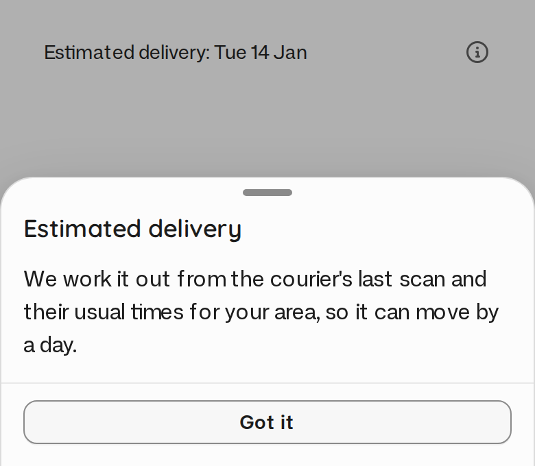 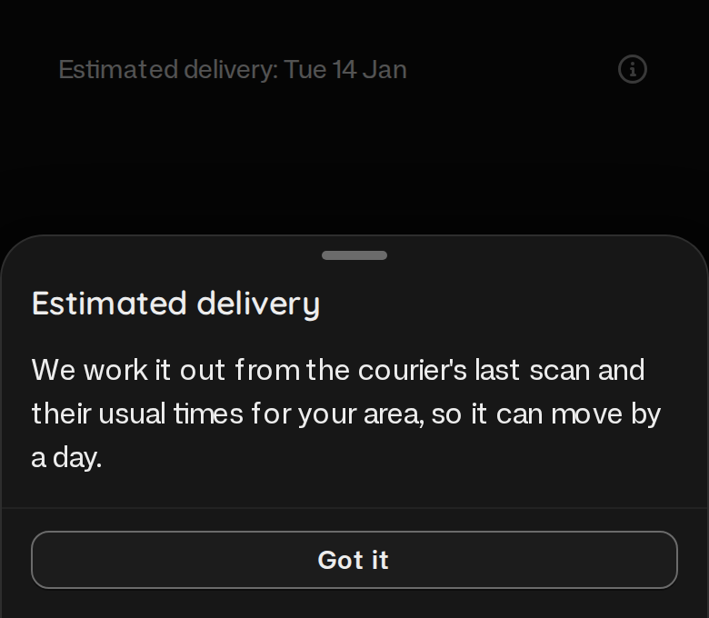

```html
<div class="text-body-medium" style="display: flex; align-items: center; padding: 16px 20px 0 32px">
  <span style="flex: 1">Estimated delivery: Tue 14 Jan</span>
  <button type="button" class="pm-icon-button pm-icon-button--invisible pm-info-button" aria-label="About estimated delivery" aria-haspopup="dialog" title="About estimated delivery">
    <svg class="pm-icon" width="16" height="16" viewBox="0 0 16 16" aria-hidden="true"><path d="M0 8a8 8 0 1 1 16 0A8 8 0 0 1 0 8Zm8-6.5a6.5 6.5 0 1 0 0 13 6.5 6.5 0 0 0 0-13ZM6.5 7.75A.75.75 0 0 1 7.25 7h1a.75.75 0 0 1 .75.75v2.75h.25a.75.75 0 0 1 0 1.5h-2a.75.75 0 0 1 0-1.5h.25v-2h-.25a.75.75 0 0 1-.75-.75ZM8 6a1 1 0 1 1 0-2 1 1 0 0 1 0 2Z"/></svg>
  </button>
  <div class="pm-sheet-layer">
    <div class="pm-sheet-scrim" aria-hidden="true"></div>
    <div class="pm-sheet" role="dialog" aria-modal="true" aria-labelledby="eta-title" tabindex="-1">
      <div class="pm-sheet__handle pm-sheet__handle--drag">
        <span class="pm-sheet__grabber" aria-hidden="true"></span>
        <div class="pm-sheet__head"><h2 class="pm-sheet__title" id="eta-title">Estimated delivery</h2></div>
      </div>
      <div class="pm-sheet__body">
        <p class="pm-info-button__text">We work it out from the courier's last scan and their usual times for your area, so it can move by a day.</p>
      </div>
      <div class="pm-sheet__actions">
        <button type="button" class="pm-button pm-button--block">Got it</button>
      </div>
    </div>
  </div>
</div>
```

### Svelte

 

```svelte
<script lang="ts">
  import { InfoButton } from "$lib/purrimer";
</script>

<div class="text-body-medium" style="display: flex; align-items: center; padding: 16px 20px 0 32px">
  <span style="flex: 1">Estimated delivery: Tue 14 Jan</span>
  <InfoButton
    defaultOpen
    title="Estimated delivery"
    message="We work it out from the courier's last scan and their usual times for your area, so it can move by a day."
  />
</div>
```

### Solid

 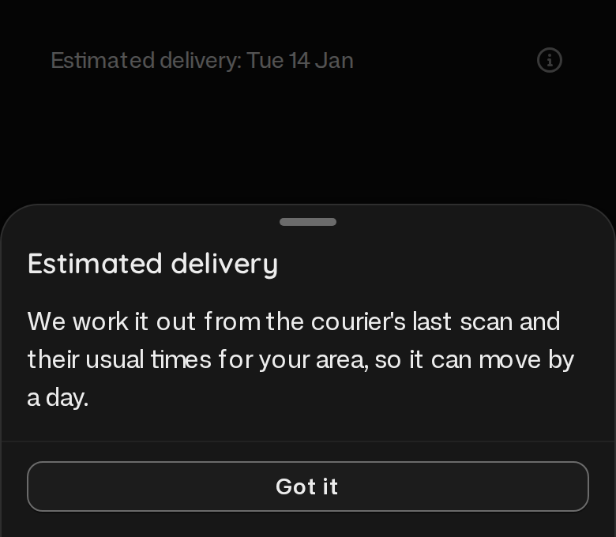

```tsx
import { InfoButton } from "~/purrimer";

export default function Example() {
  return (
    <div class="text-body-medium" style={{ display: "flex", "align-items": "center", padding: "16px 20px 0 32px" }}>
      <span style={{ flex: "1" }}>Estimated delivery: Tue 14 Jan</span>
      <InfoButton
        defaultOpen
        title="Estimated delivery"
        message="We work it out from the courier's last scan and their usual times for your area, so it can move by a day."
      />
    </div>
  );
}
```

### Qt Widgets (PySide6)

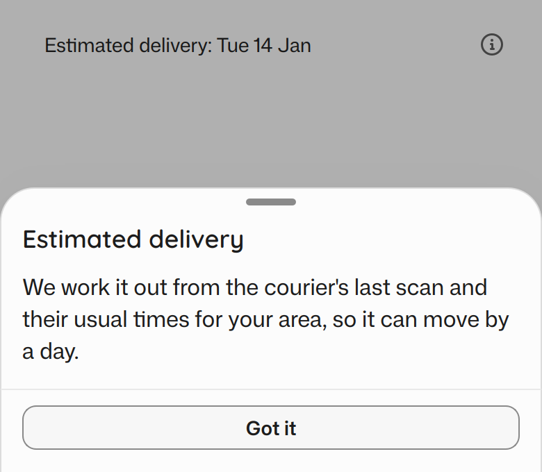 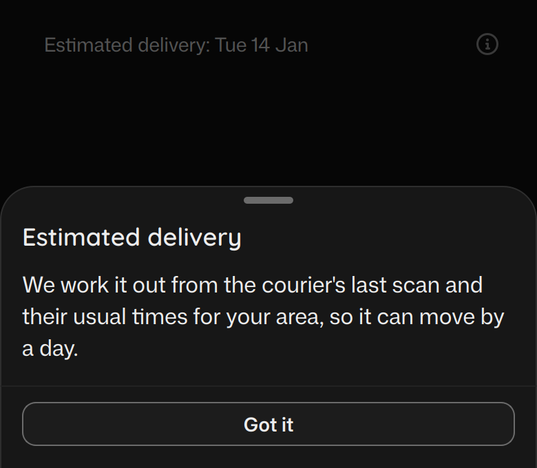

```python
from purrimer_qt.components import InfoButton
from PySide6.QtWidgets import QHBoxLayout, QLabel, QVBoxLayout, QWidget


def example() -> QWidget:
    screen = QWidget()
    column = QVBoxLayout(screen)
    column.setContentsMargins(32, 16, 20, 0)
    row = QHBoxLayout()
    row.addWidget(QLabel("Estimated delivery: Tue 14 Jan"), 1)
    row.addWidget(
        InfoButton(
            "Estimated delivery",
            "We work it out from the courier's last scan and their usual times for your area, so it can move by a day.",
            default_open=True,
        )
    )
    column.addLayout(row)
    column.addStretch()
    return screen
```

### Qt Quick

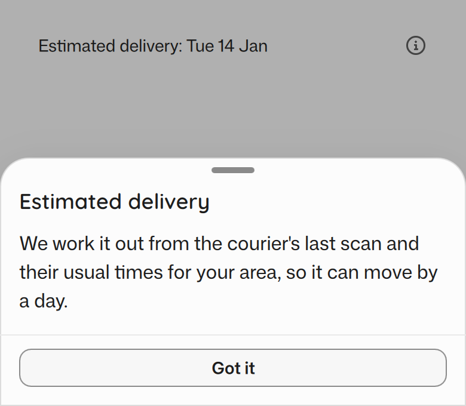 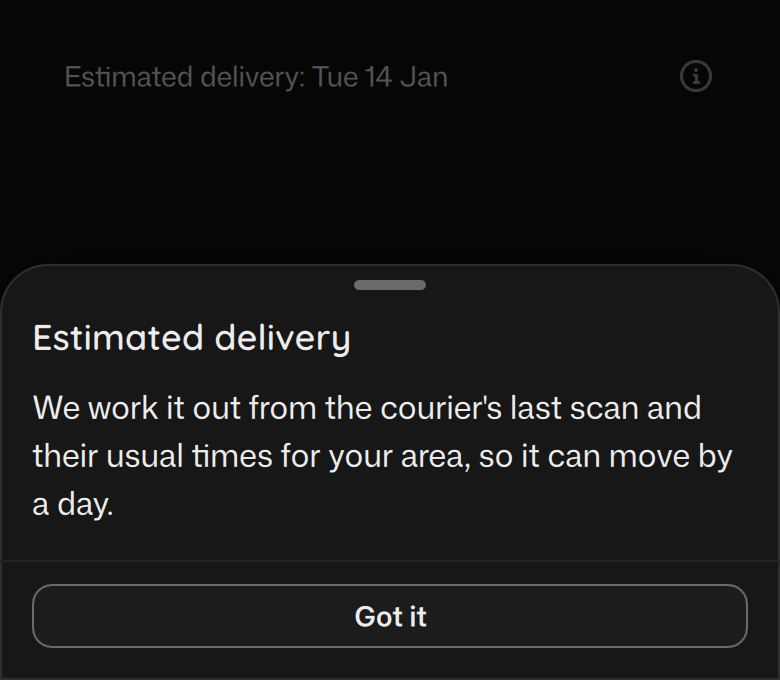

```qml
import QtQuick
import Purrimer

Item {
    width: 390
    height: 340

    Row {
        x: 32
        y: 16
        width: parent.width - 52
        Text {
            width: parent.width - info.width
            anchors.verticalCenter: parent.verticalCenter
            text: "Estimated delivery: Tue 14 Jan"
            color: Purrimer.fgColorDefault
            font: Purrimer.textBodyMedium
        }
        InfoButton {
            id: info
            defaultOpen: true
            title: "Estimated delivery"
            message: "We work it out from the courier's last scan and their usual times for your area, so it can move by a day."
        }
    }
}
```

### Avalonia

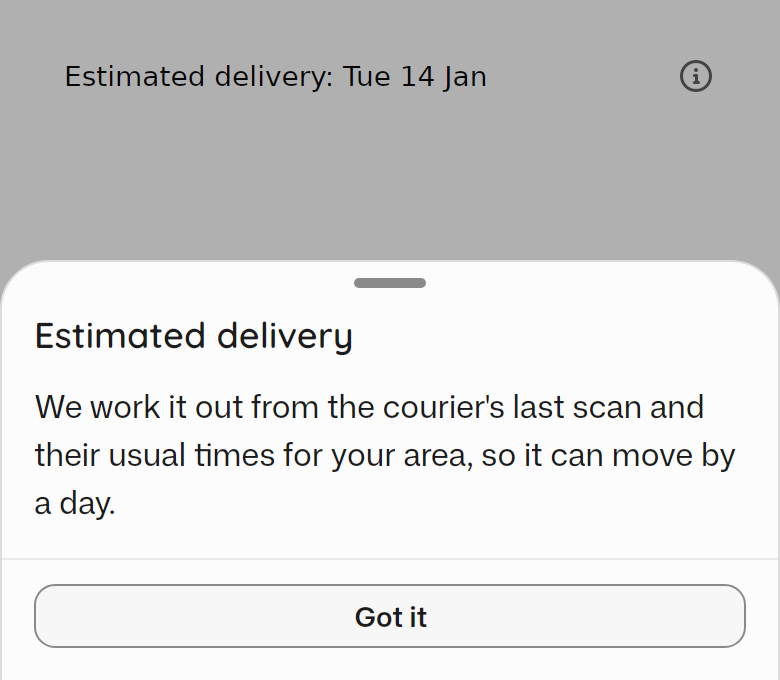 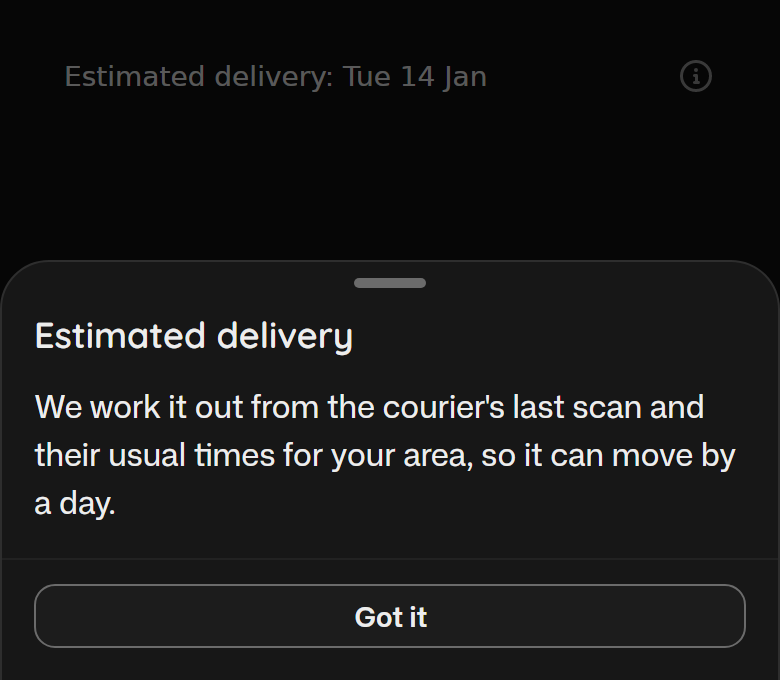

```xml
<UserControl xmlns="https://github.com/avaloniaui"
             xmlns:pm="using:Purrimer.Avalonia">
  <DockPanel VerticalAlignment="Top" Margin="32,16,20,0">
    <pm:InfoButton DockPanel.Dock="Right" IsDefaultOpen="True" Title="Estimated delivery"
                   Message="We work it out from the courier's last scan and their usual times for your area, so it can move by a day." />
    <TextBlock VerticalAlignment="Center" Text="Estimated delivery: Tue 14 Jan" />
  </DockPanel>
</UserControl>
```

### Slint

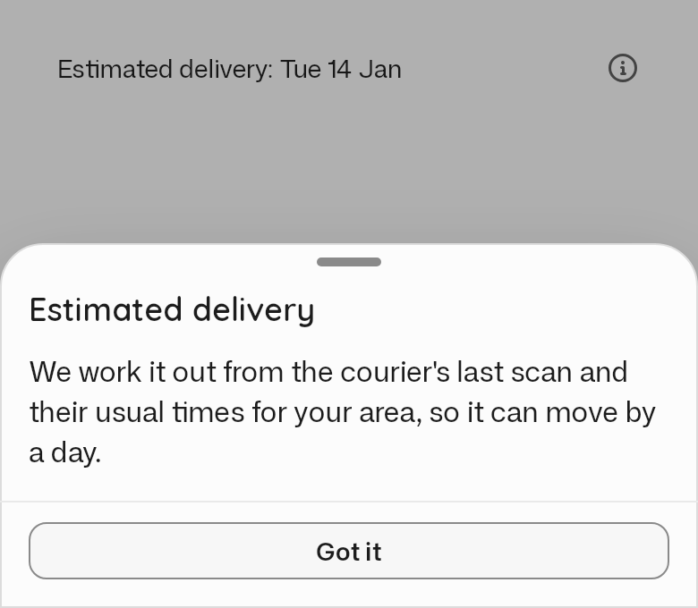 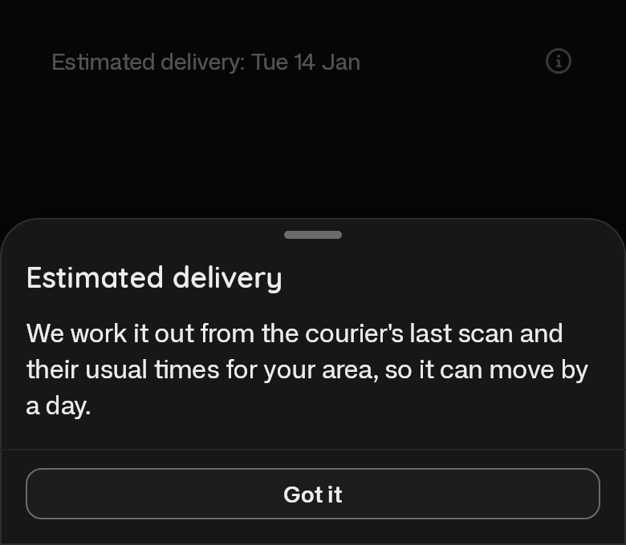

```slint
import { BottomSheet, InfoButton, Purrimer } from "purrimer-components.slint";

export component Example inherits Rectangle {
    HorizontalLayout {
        y: 16px;
        height: 44px;
        padding-left: 32px;
        padding-right: 20px;
        Text {
            text: "Estimated delivery: Tue 14 Jan";
            vertical-alignment: center;
            color: Purrimer.fg-color-default;
        }
        InfoButton {
            title: "Estimated delivery";
            clicked => { sheet.open = true; }
        }
    }

    // The sheet the button opens, last so it covers the screen.
    sheet := BottomSheet {
        open: true;
        title: "Estimated delivery";
        actions: [{ label: "Got it" }];
        action(index) => { self.close(); }
        Text {
            text: "We work it out from the courier's last scan and their usual times for your area, so it can move by a day.";
            wrap: word-wrap;
            font-size: 16px;
            color: Purrimer.fg-color-default;
        }
    }
}
```

