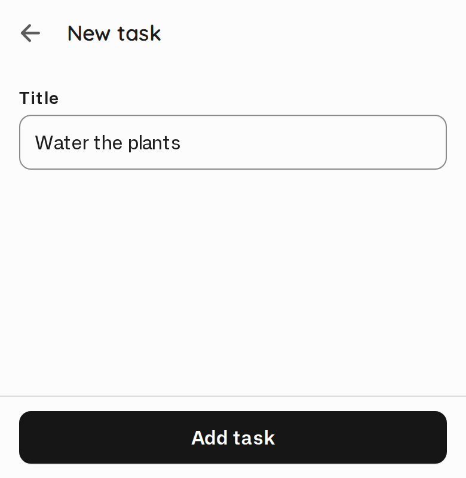
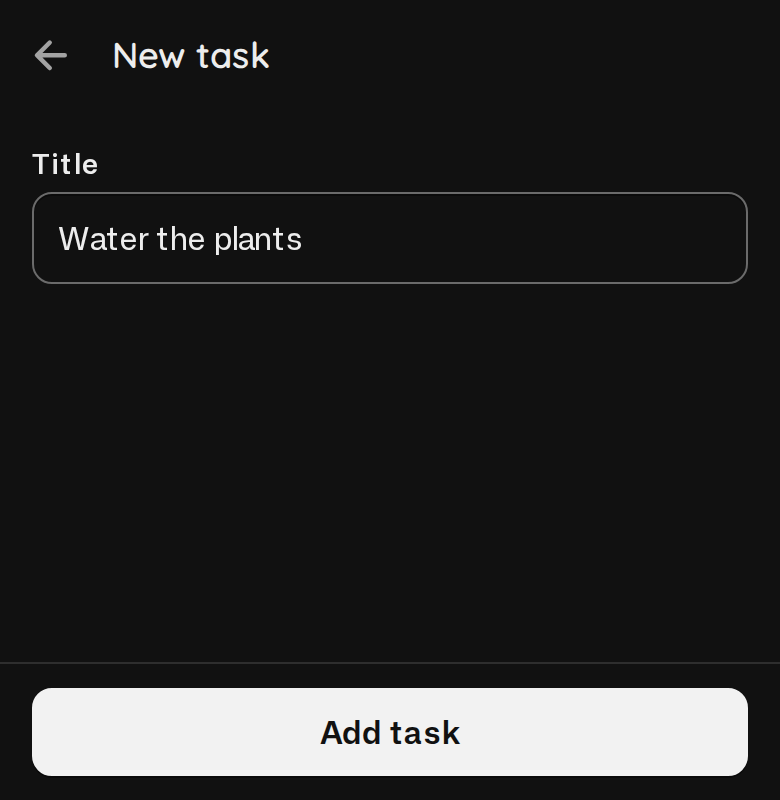
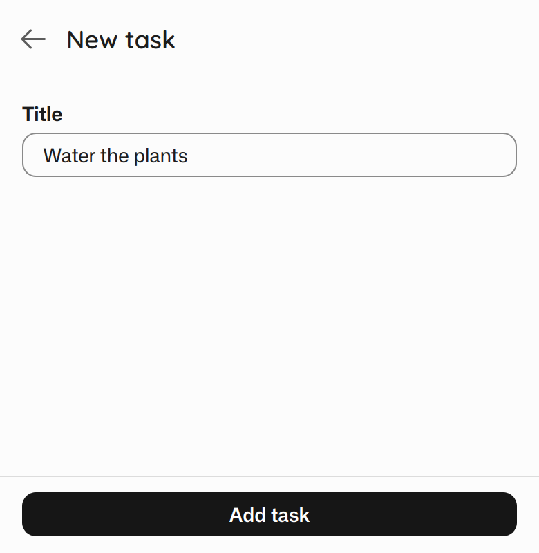
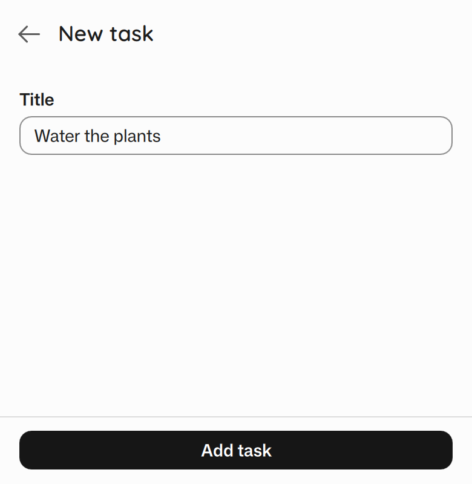
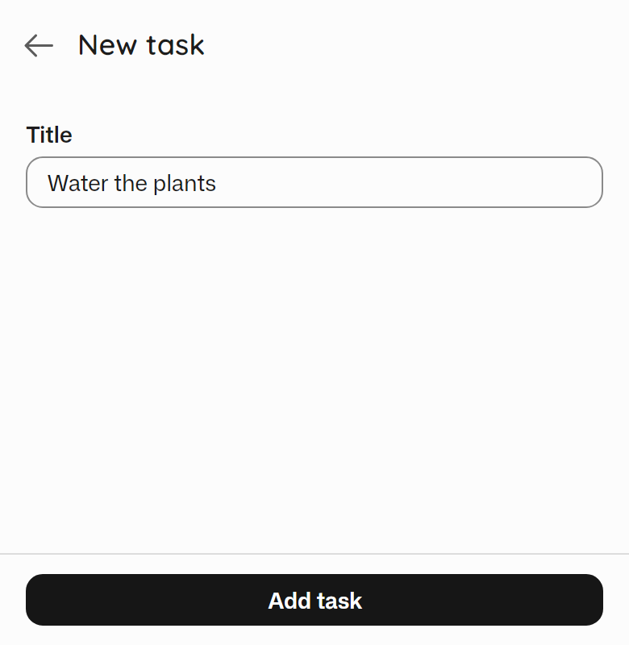
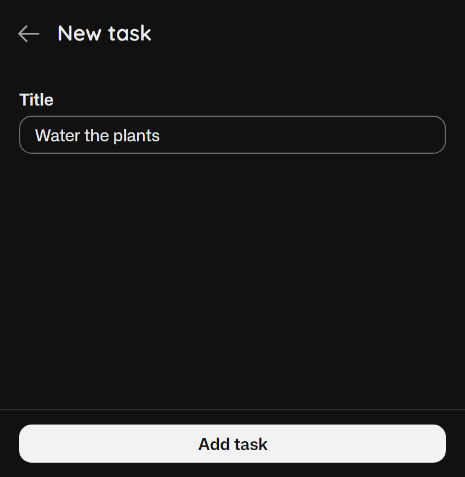
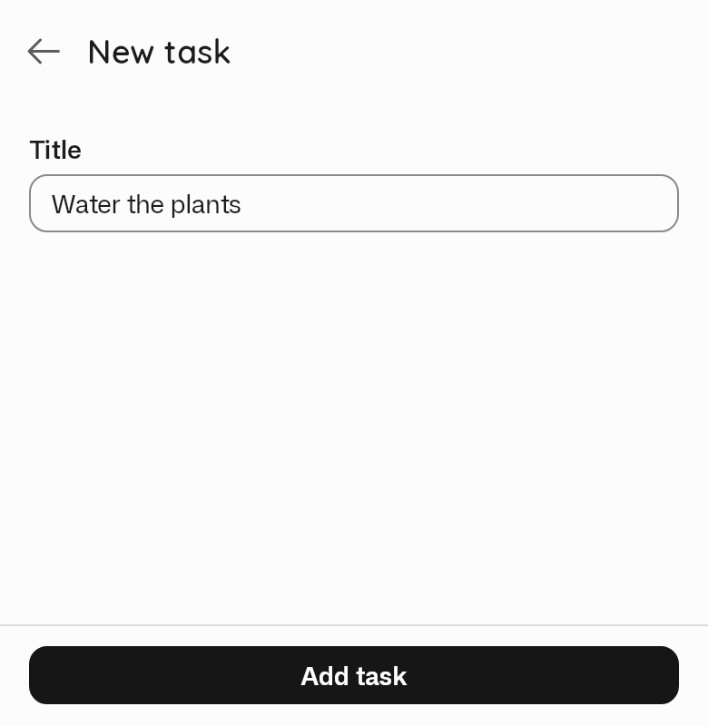

<!-- Generated by scripts/showcase.py from examples/ and component.toml. Do not edit by hand. -->

# KeyboardFooter

A footer for a screen's primary action that sits at the bottom of a MobileScreen and rides above the on-screen keyboard.

Mobile · [All components](README.md)

## Props

| Prop | Type | Default | Values | Description |
| --- | --- | --- | --- | --- |
| `children` | slot |  |  | One or two full-width Buttons, the primary one last. |

Names follow the web targets. Qt Widgets takes `snake_case` arguments, Qt Quick `camelCase` properties, Avalonia `PascalCase` properties and Slint `kebab-case` properties; each example below shows the spelling for its target.

## Examples

Each example is run as it is shown here, on every push, and the screenshots are taken from that run (left Blanc, right Noir).

### CSS

 

```html
<div class="pm-mobile-screen pm-mobile-screen--has-footer" data-density="touch">
  <div class="pm-mobile-screen__bar">
    <header class="pm-appbar">
      <button type="button" class="pm-icon-button pm-icon-button--invisible pm-appbar__back" aria-label="Back" title="Back"><svg class="pm-icon" width="16" height="16" viewBox="0 0 16 16" aria-hidden="true"><path d="M7.78 12.53a.75.75 0 0 1-1.06 0L2.47 8.28a.75.75 0 0 1 0-1.06l4.25-4.25a.751.751 0 0 1 1.042.018.751.751 0 0 1 .018 1.042L4.81 7h7.44a.75.75 0 0 1 0 1.5H4.81l2.97 2.97a.75.75 0 0 1 0 1.06Z"/></svg></button>
      <h1 class="pm-appbar__title">New task</h1>
      <div class="pm-appbar__actions"></div>
    </header>
  </div>
  <div class="pm-mobile-screen__body">
    <div class="pm-mobile-screen__content">
      <div style="padding: 16px">
        <div class="pm-field">
          <label class="pm-field__label" for="task-title">Title</label>
          <div class="pm-field__control"><input id="task-title" class="pm-field__input" type="text" value="Water the plants" /></div>
        </div>
      </div>
    </div>
  </div>
  <div class="pm-keyboard-footer">
    <button type="button" class="pm-button pm-button--primary pm-button--block">Add task</button>
  </div>
</div>
```

### Svelte

 

```svelte
<script lang="ts">
  import { AppBar, Button, KeyboardFooter, MobileScreen, TextField } from "$lib/purrimer";

  let title = $state("Water the plants");
</script>

<MobileScreen>
  {#snippet appBar()}
    <AppBar title="New task" back />
  {/snippet}
  <div style="padding: 16px">
    <TextField label="Title" bind:value={title} />
  </div>
  {#snippet footer()}
    <KeyboardFooter>
      <Button variant="primary" block label="Add task" />
    </KeyboardFooter>
  {/snippet}
</MobileScreen>
```

### Solid

 

```tsx
import { AppBar, Button, KeyboardFooter, MobileScreen, TextField } from "~/purrimer";

export default function Example() {
  return (
    <MobileScreen
      appBar={<AppBar title="New task" back />}
      footer={
        <KeyboardFooter>
          <Button variant="primary" block label="Add task" />
        </KeyboardFooter>
      }
    >
      <div style={{ padding: "16px" }}>
        <TextField label="Title" value="Water the plants" />
      </div>
    </MobileScreen>
  );
}
```

### Qt Widgets (PySide6)

 

```python
from purrimer_qt.components import AppBar, Button, KeyboardFooter, MobileScreen, TextField
from PySide6.QtWidgets import QWidget


def example() -> QWidget:
    footer = KeyboardFooter()
    footer.add_button(Button("Add task", "primary", block=True))
    screen = MobileScreen(app_bar=AppBar("New task", back=True), footer=footer)
    field = TextField("Title", "Water the plants")
    field.setContentsMargins(16, 16, 16, 0)
    screen.body.addWidget(field)
    return screen
```

### Qt Quick

 

```qml
import QtQuick
import Purrimer

MobileScreen {
    appBar: AppBar { title: "New task"; back: true }
    footer: KeyboardFooter {
        Button { text: "Add task"; variant: "primary" }
    }

    Item {
        width: parent.width
        height: field.implicitHeight + 16
        TextField {
            id: field
            x: 16
            y: 16
            width: parent.width - 32
            label: "Title"
            text: "Water the plants"
        }
    }
}
```

### Avalonia

 

```xml
<UserControl xmlns="https://github.com/avaloniaui"
             xmlns:pm="using:Purrimer.Avalonia">
  <pm:MobileScreen>
    <pm:MobileScreen.AppBar>
      <pm:AppBar Title="New task" ShowBack="True" />
    </pm:MobileScreen.AppBar>
    <pm:MobileScreen.Footer>
      <pm:KeyboardFooter>
        <Button Classes="primary block" Content="Add task" />
      </pm:KeyboardFooter>
    </pm:MobileScreen.Footer>
    <pm:TextField Margin="16" Label="Title" Text="Water the plants" />
  </pm:MobileScreen>
</UserControl>
```

### Slint

 

```slint
import { MobileScreen, TextField } from "purrimer-components.slint";

export component Example inherits Rectangle {
    MobileScreen {
        title: "New task";
        back: true;
        footer-label: "Add task";
        footer-clicked => { debug("add task"); }
        VerticalLayout {
            padding: 16px;
            TextField {
                label: "Title";
                text: "Water the plants";
            }
        }
    }
}
```

