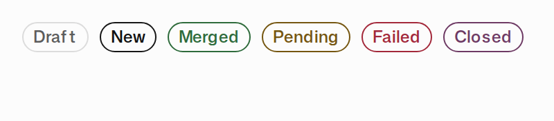
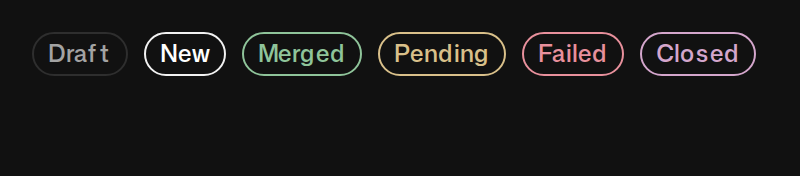
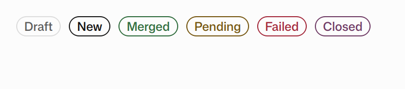
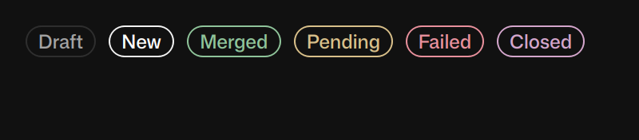
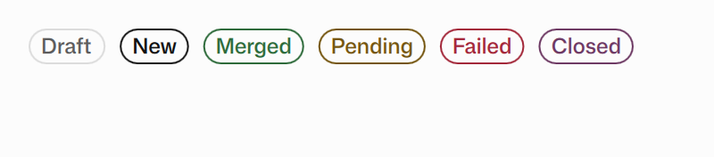
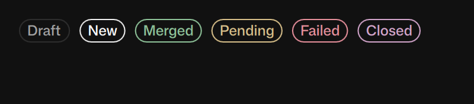
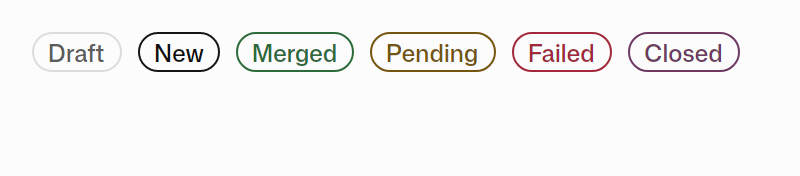
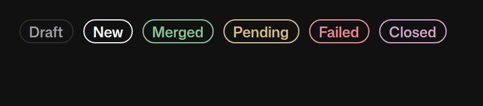
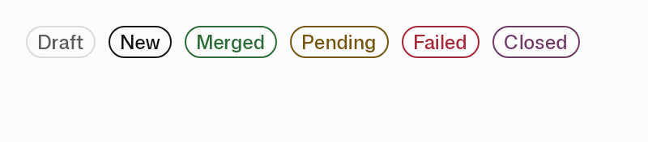
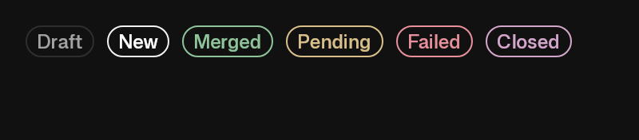

<!-- Generated by scripts/showcase.py from examples/ and component.toml. Do not edit by hand. -->

# Label

An outlined pill naming a state or category.

Status · [All components](README.md)

## Props

| Prop | Type | Default | Values | Description |
| --- | --- | --- | --- | --- |
| `text` | string |  |  | Label text. |
| `tone` | enum | `"default"` | `default`, `accent`, `success`, `attention`, `severe`, `danger`, `done`, `info` | Colour role. |

Names follow the web targets. Qt Widgets takes `snake_case` arguments, Qt Quick `camelCase` properties, Avalonia `PascalCase` properties and Slint `kebab-case` properties; each example below shows the spelling for its target.

## Examples

Each example is run as it is shown here, on every push, and the screenshots are taken from that run (left Blanc, right Noir).

### CSS

 

```html
<div style="display: flex; flex-wrap: wrap; gap: 8px">
  <span class="pm-label">Draft</span>
  <span class="pm-label pm-label--accent">New</span>
  <span class="pm-label pm-label--success">Merged</span>
  <span class="pm-label pm-label--attention">Pending</span>
  <span class="pm-label pm-label--danger">Failed</span>
  <span class="pm-label pm-label--done">Closed</span>
</div>
```

### Svelte

 

```svelte
<script lang="ts">
  import { Label } from "$lib/purrimer";
</script>

<div style="display: flex; flex-wrap: wrap; gap: 8px">
  <Label text="Draft" />
  <Label text="New" tone="accent" />
  <Label text="Merged" tone="success" />
  <Label text="Pending" tone="attention" />
  <Label text="Failed" tone="danger" />
  <Label tone="done">Closed</Label>
</div>
```

### Solid

 

```tsx
import { Label } from "~/purrimer";

export default function Example() {
  return (
    <div style={{ display: "flex", "flex-wrap": "wrap", gap: "8px" }}>
      <Label text="Draft" />
      <Label text="New" tone="accent" />
      <Label text="Merged" tone="success" />
      <Label text="Pending" tone="attention" />
      <Label text="Failed" tone="danger" />
      <Label tone="done">Closed</Label>
    </div>
  );
}
```

### Qt Widgets (PySide6)

 

```python
from purrimer_qt.components import Label
from PySide6.QtWidgets import QHBoxLayout, QWidget


def example() -> QWidget:
    row = QWidget()
    layout = QHBoxLayout(row)
    layout.setContentsMargins(0, 0, 0, 0)
    layout.setSpacing(8)
    for text, tone in [
        ("Draft", "default"),
        ("New", "accent"),
        ("Merged", "success"),
        ("Pending", "attention"),
        ("Failed", "danger"),
        ("Closed", "done"),
    ]:
        layout.addWidget(Label(text, tone))
    layout.addStretch()
    return row
```

### Qt Quick

 

```qml
import QtQuick
import Purrimer

Flow {
    width: 368
    spacing: 8
    Label { text: "Draft" }
    Label { text: "New"; tone: "accent" }
    Label { text: "Merged"; tone: "success" }
    Label { text: "Pending"; tone: "attention" }
    Label { text: "Failed"; tone: "danger" }
    Label { text: "Closed"; tone: "done" }
}
```

### Avalonia

 

```xml
<UserControl xmlns="https://github.com/avaloniaui"
             xmlns:pm="using:Purrimer.Avalonia">
  <WrapPanel ItemSpacing="8" LineSpacing="8">
    <pm:Label Text="Draft" />
    <pm:Label Text="New" Tone="accent" />
    <pm:Label Text="Merged" Tone="success" />
    <pm:Label Text="Pending" Tone="attention" />
    <pm:Label Text="Failed" Tone="danger" />
    <pm:Label Text="Closed" Tone="done" />
  </WrapPanel>
</UserControl>
```

### Slint

 

```slint
import { Label } from "purrimer-components.slint";

export component Example inherits HorizontalLayout {
    spacing: 8px;
    alignment: start;
    Label { text: "Draft"; }
    Label { text: "New"; tone: "accent"; }
    Label { text: "Merged"; tone: "success"; }
    Label { text: "Pending"; tone: "attention"; }
    Label { text: "Failed"; tone: "danger"; }
    Label { text: "Closed"; tone: "done"; }
}
```

