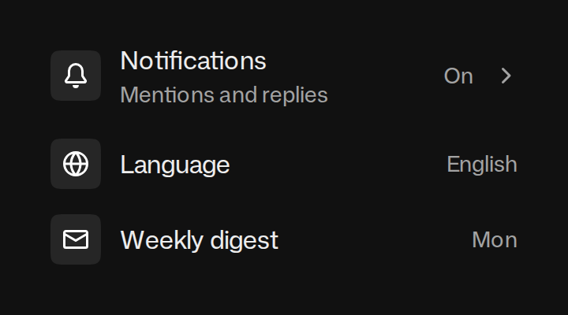
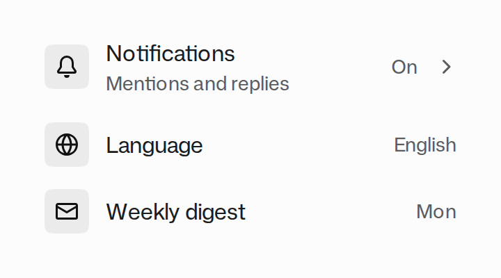
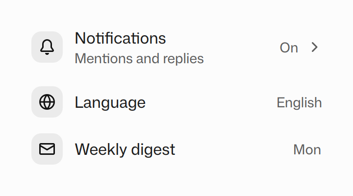
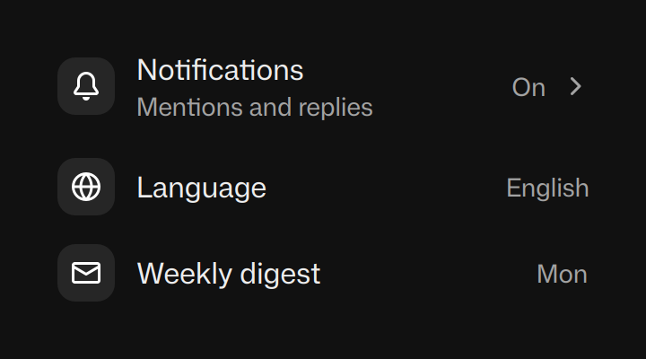
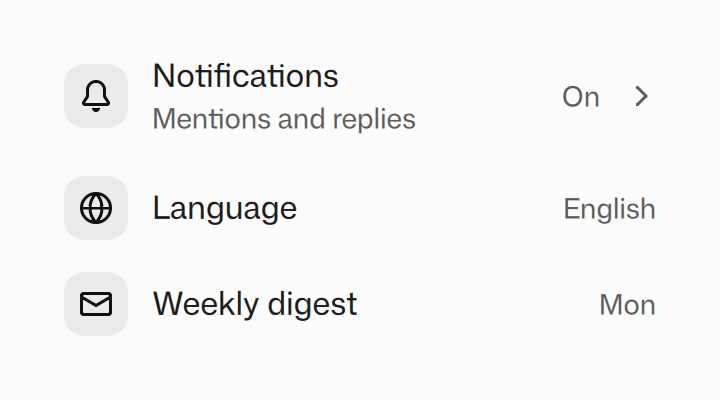
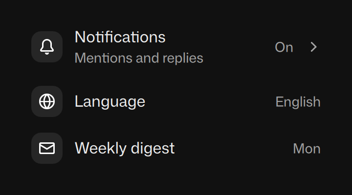
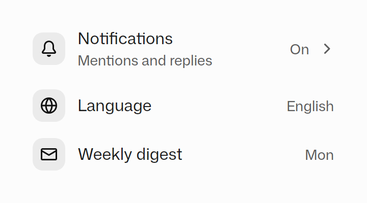
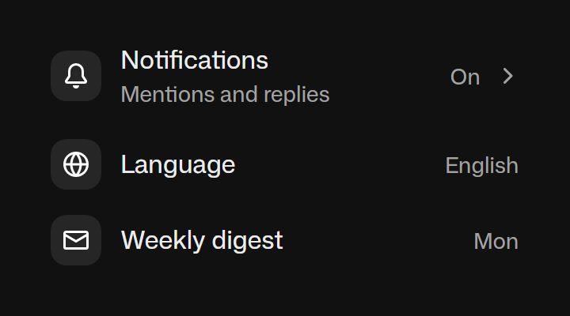
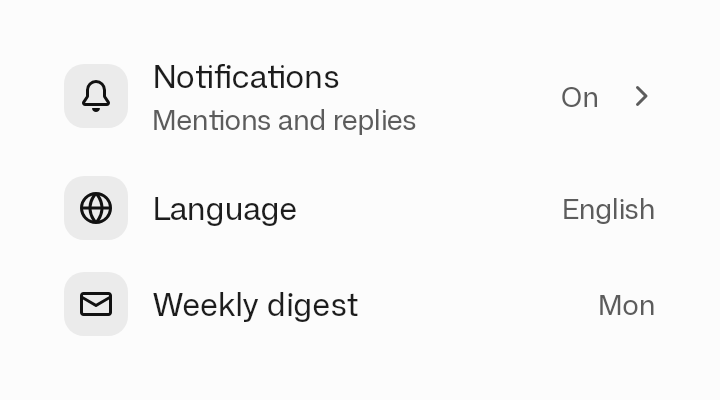
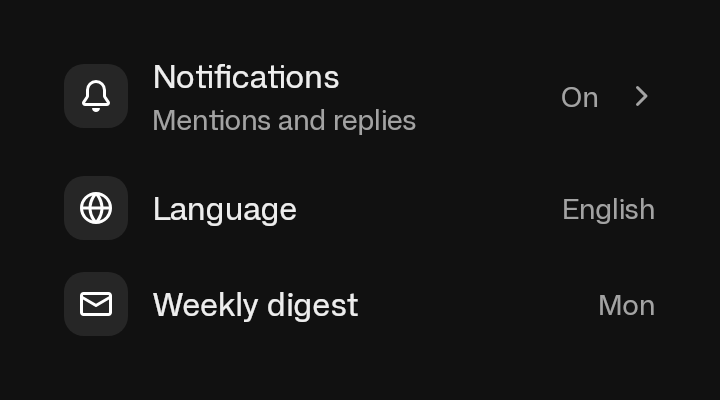

<!-- Generated by scripts/showcase.py from examples/ and component.toml. Do not edit by hand. -->

# ListItem

One row of a mobile list: icon tile, headline, supporting text and trailing text, with optional swipe actions.

Mobile · [All components](README.md)

## Props

| Prop | Type | Default | Values | Description |
| --- | --- | --- | --- | --- |
| `headline` | string |  |  | First line. |
| `supporting` | string |  |  | Second line; makes the row 64px. |
| `icon` | icon |  |  | Octicon in the leading tile. |
| `trailing` | string |  |  | Text at the end, such as a time. |
| `chevron` | bool | `false` |  | Shows a chevron for rows that open a screen. |
| `swipeStart` | object | `{}` |  | { label, icon, tone, onSwipe } revealed by dragging toward the end of the line; commits past 40% of the row. |
| `swipeEnd` | object | `{}` |  | { label, icon, tone, onSwipe } revealed by dragging toward the start of the line. |

Names follow the web targets. Qt Widgets takes `snake_case` arguments, Qt Quick `camelCase` properties, Avalonia `PascalCase` properties and Slint `kebab-case` properties; each example below shows the spelling for its target.

## Examples

Each example is run as it is shown here, on every push, and the screenshots are taken from that run (left Blanc, right Noir).

### CSS

 

```html
<div role="list">
  <button type="button" class="pm-list-item pm-list-item--two-line">
    <span class="pm-list-item__tile"><svg class="pm-icon" width="16" height="16" viewBox="0 0 16 16" aria-hidden="true"><path d="M8 16a2 2 0 0 0 1.985-1.75c.017-.137-.097-.25-.235-.25h-3.5c-.138 0-.252.113-.235.25A2 2 0 0 0 8 16ZM3 5a5 5 0 0 1 10 0v2.947c0 .05.015.098.042.139l1.703 2.555A1.519 1.519 0 0 1 13.482 13H2.518a1.516 1.516 0 0 1-1.263-2.36l1.703-2.554A.255.255 0 0 0 3 7.947Zm5-3.5A3.5 3.5 0 0 0 4.5 5v2.947c0 .346-.102.683-.294.97l-1.703 2.556a.017.017 0 0 0-.003.01l.001.006c0 .002.002.004.004.006l.006.004.007.001h10.964l.007-.001.006-.004.004-.006.001-.007a.017.017 0 0 0-.003-.01l-1.703-2.554a1.745 1.745 0 0 1-.294-.97V5A3.5 3.5 0 0 0 8 1.5Z"/></svg></span>
    <span class="pm-list-item__text">
      <span class="pm-list-item__headline">Notifications</span>
      <span class="pm-list-item__supporting">Mentions and replies</span>
    </span>
    <span class="pm-list-item__trailing">On</span>
    <svg class="pm-icon pm-list-item__chevron" width="16" height="16" viewBox="0 0 16 16" aria-hidden="true"><path d="M6.22 3.22a.75.75 0 0 1 1.06 0l4.25 4.25a.75.75 0 0 1 0 1.06l-4.25 4.25a.751.751 0 0 1-1.042-.018.751.751 0 0 1-.018-1.042L9.94 8 6.22 4.28a.75.75 0 0 1 0-1.06Z"/></svg>
  </button>
  <div class="pm-list-item" role="listitem">
    <span class="pm-list-item__tile"><svg class="pm-icon" width="16" height="16" viewBox="0 0 16 16" aria-hidden="true"><path d="M8 0a8 8 0 1 1 0 16A8 8 0 0 1 8 0ZM5.78 8.75a9.64 9.64 0 0 0 1.363 4.177c.255.426.542.832.857 1.215.245-.296.551-.705.857-1.215A9.64 9.64 0 0 0 10.22 8.75Zm4.44-1.5a9.64 9.64 0 0 0-1.363-4.177c-.307-.51-.612-.919-.857-1.215a9.927 9.927 0 0 0-.857 1.215A9.64 9.64 0 0 0 5.78 7.25Zm-5.944 1.5H1.543a6.507 6.507 0 0 0 4.666 5.5c-.123-.181-.24-.365-.352-.552-.715-1.192-1.437-2.874-1.581-4.948Zm-2.733-1.5h2.733c.144-2.074.866-3.756 1.58-4.948.12-.197.237-.381.353-.552a6.507 6.507 0 0 0-4.666 5.5Zm10.181 1.5c-.144 2.074-.866 3.756-1.58 4.948-.12.197-.237.381-.353.552a6.507 6.507 0 0 0 4.666-5.5Zm2.733-1.5a6.507 6.507 0 0 0-4.666-5.5c.123.181.24.365.353.552.714 1.192 1.436 2.874 1.58 4.948Z"/></svg></span>
    <span class="pm-list-item__text"><span class="pm-list-item__headline">Language</span></span>
    <span class="pm-list-item__trailing">English</span>
  </div>
  <div class="pm-list-item-swipe" role="listitem">
    <div class="pm-list-item__slide">
      <div class="pm-list-item">
        <span class="pm-list-item__tile"><svg class="pm-icon" width="16" height="16" viewBox="0 0 16 16" aria-hidden="true"><path d="M1.75 2h12.5c.966 0 1.75.784 1.75 1.75v8.5A1.75 1.75 0 0 1 14.25 14H1.75A1.75 1.75 0 0 1 0 12.25v-8.5C0 2.784.784 2 1.75 2ZM1.5 12.251c0 .138.112.25.25.25h12.5a.25.25 0 0 0 .25-.25V5.809L8.38 9.397a.75.75 0 0 1-.76 0L1.5 5.809v6.442Zm13-8.181v-.32a.25.25 0 0 0-.25-.25H1.75a.25.25 0 0 0-.25.25v.32L8 7.88Z"/></svg></span>
        <span class="pm-list-item__text"><span class="pm-list-item__headline">Weekly digest</span></span>
        <span class="pm-list-item__trailing">Mon</span>
      </div>
    </div>
    <button type="button" class="pm-list-item__swipe-alt">Mark as read</button>
    <button type="button" class="pm-list-item__swipe-alt">Archive</button>
  </div>
</div>
```

### Svelte

 

```svelte
<script lang="ts">
  import { ListItem } from "$lib/purrimer";
</script>

<div role="list">
  <ListItem
    icon="bell"
    headline="Notifications"
    supporting="Mentions and replies"
    trailing="On"
    chevron
    onclick={() => console.log("open notifications")}
  />
  <ListItem icon="globe" headline="Language" trailing="English" />
  <ListItem
    icon="mail"
    headline="Weekly digest"
    trailing="Mon"
    swipeStart={{ label: "Mark as read", icon: "check", tone: "accent", onswipe: () => console.log("read") }}
    swipeEnd={{ label: "Archive", icon: "archive", tone: "success", onswipe: () => console.log("archive") }}
  />
</div>
```

### Solid

 

```tsx
import { ListItem } from "~/purrimer";

export default function Example() {
  return (
    <div role="list">
      <ListItem
        icon="bell"
        headline="Notifications"
        supporting="Mentions and replies"
        trailing="On"
        chevron
        onClick={() => console.log("open notifications")}
      />
      <ListItem icon="globe" headline="Language" trailing="English" />
      <ListItem
        icon="mail"
        headline="Weekly digest"
        trailing="Mon"
        swipeStart={{ label: "Mark as read", icon: "check", tone: "accent", onSwipe: () => console.log("read") }}
        swipeEnd={{ label: "Archive", icon: "archive", tone: "success", onSwipe: () => console.log("archive") }}
      />
    </div>
  );
}
```

### Qt Widgets (PySide6)

 

```python
from purrimer_qt.components import ListItem
from purrimer_qt.components.list_item import SwipeAction
from PySide6.QtWidgets import QVBoxLayout, QWidget


def example() -> QWidget:
    rows = QWidget()
    layout = QVBoxLayout(rows)
    layout.setContentsMargins(0, 0, 0, 0)
    layout.setSpacing(0)
    notifications = ListItem(
        "Notifications", "Mentions and replies", icon="bell", trailing="On", chevron=True, clickable=True
    )
    notifications.clicked.connect(lambda: print("open notifications"))
    layout.addWidget(notifications)
    layout.addWidget(ListItem("Language", icon="globe", trailing="English"))
    layout.addWidget(
        ListItem(
            "Weekly digest",
            icon="mail",
            trailing="Mon",
            swipe_start=SwipeAction("Mark as read", "check", "accent", lambda: print("read")),
            swipe_end=SwipeAction("Archive", "archive", "success", lambda: print("archive")),
        )
    )
    return rows
```

### Qt Quick

 

```qml
import QtQuick
import Purrimer

Column {
    width: 328
    height: 168
    ListItem {
        width: parent.width
        iconName: "bell"
        headline: "Notifications"
        supporting: "Mentions and replies"
        trailing: "On"
        chevron: true
        clickable: true
        onClicked: console.log("open notifications")
    }
    ListItem { width: parent.width; iconName: "globe"; headline: "Language"; trailing: "English" }
    ListItem {
        width: parent.width
        iconName: "mail"
        headline: "Weekly digest"
        trailing: "Mon"
        swipeStart: ({ label: "Mark as read", icon: "check", tone: "accent" })
        swipeEnd: ({ label: "Archive", icon: "archive", tone: "success" })
        onSwiped: (side) => console.log(side === "start" ? "read" : "archive")
    }
}
```

### Avalonia

 

```xml
<UserControl xmlns="https://github.com/avaloniaui"
             xmlns:pm="using:Purrimer.Avalonia">
  <StackPanel>
    <pm:ListItem IconName="bell" Headline="Notifications" Supporting="Mentions and replies" Trailing="On" ShowChevron="True" />
    <pm:ListItem IconName="globe" Headline="Language" Trailing="English" />
    <pm:ListItem IconName="mail" Headline="Weekly digest" Trailing="Mon">
      <pm:ListItem.SwipeStart>
        <pm:ListItemSwipeAction Label="Mark as read" IconName="check" Tone="accent" />
      </pm:ListItem.SwipeStart>
      <pm:ListItem.SwipeEnd>
        <pm:ListItemSwipeAction Label="Archive" IconName="archive" Tone="success" />
      </pm:ListItem.SwipeEnd>
    </pm:ListItem>
  </StackPanel>
</UserControl>
```

### Slint

 

```slint
import { ListItem, PurrimerIcons } from "purrimer-components.slint";

export component Example inherits VerticalLayout {
    alignment: start;
    ListItem {
        icon: PurrimerIcons.bell-16;
        headline: "Notifications";
        supporting: "Mentions and replies";
        trailing: "On";
        chevron: true;
        clickable: true;
        clicked => { debug("open notifications"); }
    }
    ListItem { icon: PurrimerIcons.globe-16; headline: "Language"; trailing: "English"; }
    ListItem {
        icon: PurrimerIcons.mail-16;
        headline: "Weekly digest";
        trailing: "Mon";
        swipe-start: { label: "Mark as read", icon: PurrimerIcons.check-24, tone: "accent" };
        swipe-end: { label: "Archive", icon: PurrimerIcons.archive-24, tone: "success" };
        swiped(side) => { debug(side == "start" ? "read" : "archive"); }
    }
}
```

