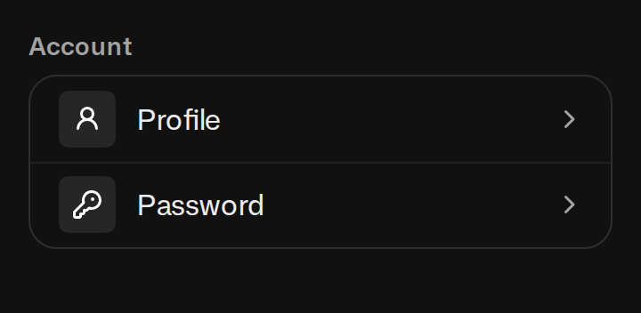
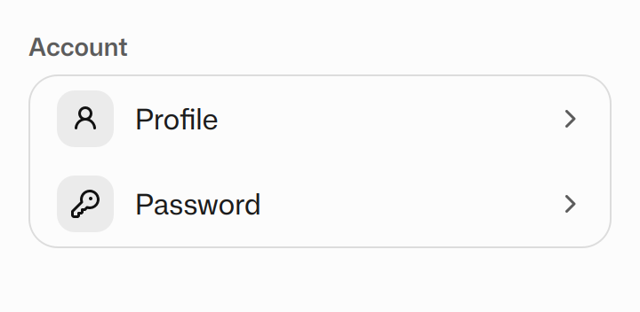
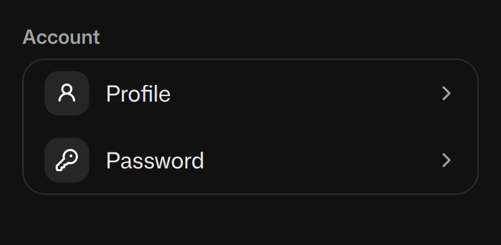
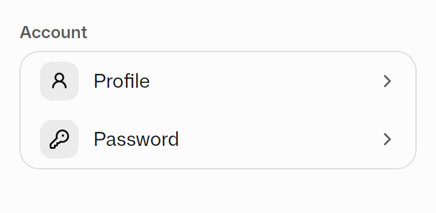
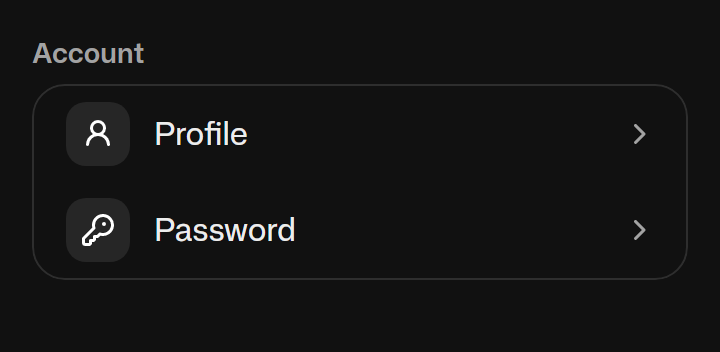
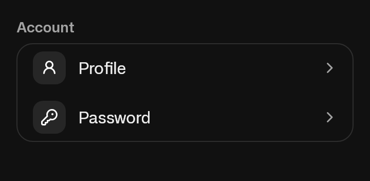

<!-- Generated by scripts/showcase.py from examples/ and component.toml. Do not edit by hand. -->

# ListSection

A titled group of list rows, inset in a rounded box or plain.

Mobile · [All components](README.md)

## Props

| Prop | Type | Default | Values | Description |
| --- | --- | --- | --- | --- |
| `header` | string |  |  | Section title above the rows. |
| `variant` | enum | `"inset"` | `inset`, `plain` | Box style. |

Names follow the web targets. Qt Widgets takes `snake_case` arguments, Qt Quick `camelCase` properties, Avalonia `PascalCase` properties and Slint `kebab-case` properties; each example below shows the spelling for its target.

## Examples

Each example is run as it is shown here, on every push, and the screenshots are taken from that run (left Blanc, right Noir).

### CSS

 

```html
<div style="padding-top: 16px">
  <section class="pm-list-section pm-list-section--inset">
    <h2 class="pm-list-section__header">Account</h2>
    <div class="pm-list-section__rows" role="list">
      <div class="pm-list-item" role="listitem">
        <span class="pm-list-item__tile"><svg class="pm-icon" width="16" height="16" viewBox="0 0 16 16" aria-hidden="true"><path d="M10.561 8.073a6.005 6.005 0 0 1 3.432 5.142.75.75 0 1 1-1.498.07 4.5 4.5 0 0 0-8.99 0 .75.75 0 0 1-1.498-.07 6.004 6.004 0 0 1 3.431-5.142 3.999 3.999 0 1 1 5.123 0ZM10.5 5a2.5 2.5 0 1 0-5 0 2.5 2.5 0 0 0 5 0Z"/></svg></span>
        <span class="pm-list-item__text"><span class="pm-list-item__headline">Profile</span></span>
        <svg class="pm-icon pm-list-item__chevron" width="16" height="16" viewBox="0 0 16 16" aria-hidden="true"><path d="M6.22 3.22a.75.75 0 0 1 1.06 0l4.25 4.25a.75.75 0 0 1 0 1.06l-4.25 4.25a.751.751 0 0 1-1.042-.018.751.751 0 0 1-.018-1.042L9.94 8 6.22 4.28a.75.75 0 0 1 0-1.06Z"/></svg>
      </div>
      <div class="pm-list-item" role="listitem">
        <span class="pm-list-item__tile"><svg class="pm-icon" width="16" height="16" viewBox="0 0 16 16" aria-hidden="true"><path d="M10.5 0a5.499 5.499 0 1 1-1.288 10.848l-.932.932a.749.749 0 0 1-.53.22H7v.75a.749.749 0 0 1-.22.53l-.5.5a.749.749 0 0 1-.53.22H5v.75a.749.749 0 0 1-.22.53l-.5.5a.749.749 0 0 1-.53.22h-2A1.75 1.75 0 0 1 0 14.25v-2c0-.199.079-.389.22-.53l4.932-4.932A5.5 5.5 0 0 1 10.5 0Zm-4 5.5c-.001.431.069.86.205 1.269a.75.75 0 0 1-.181.768L1.5 12.56v1.69c0 .138.112.25.25.25h1.69l.06-.06v-1.19a.75.75 0 0 1 .75-.75h1.19l.06-.06v-1.19a.75.75 0 0 1 .75-.75h1.19l1.023-1.025a.75.75 0 0 1 .768-.18A4 4 0 1 0 6.5 5.5ZM11 6a1 1 0 1 1 0-2 1 1 0 0 1 0 2Z"/></svg></span>
        <span class="pm-list-item__text"><span class="pm-list-item__headline">Password</span></span>
        <svg class="pm-icon pm-list-item__chevron" width="16" height="16" viewBox="0 0 16 16" aria-hidden="true"><path d="M6.22 3.22a.75.75 0 0 1 1.06 0l4.25 4.25a.75.75 0 0 1 0 1.06l-4.25 4.25a.751.751 0 0 1-1.042-.018.751.751 0 0 1-.018-1.042L9.94 8 6.22 4.28a.75.75 0 0 1 0-1.06Z"/></svg>
      </div>
    </div>
  </section>
</div>
```

### Svelte

 

```svelte
<script lang="ts">
  import { ListItem, ListSection } from "$lib/purrimer";
</script>

<div style="padding-top: 16px">
  <ListSection header="Account">
    <ListItem icon="person" headline="Profile" chevron />
    <ListItem icon="key" headline="Password" chevron />
  </ListSection>
</div>
```

### Solid

 

```tsx
import { ListItem, ListSection } from "~/purrimer";

export default function Example() {
  return (
    <div style={{ "padding-top": "16px" }}>
      <ListSection header="Account">
        <ListItem icon="person" headline="Profile" chevron />
        <ListItem icon="key" headline="Password" chevron />
      </ListSection>
    </div>
  );
}
```

### Qt Widgets (PySide6)

 

```python
from purrimer_qt.components import ListItem, ListSection
from PySide6.QtWidgets import QVBoxLayout, QWidget


def example() -> QWidget:
    screen = QWidget()
    layout = QVBoxLayout(screen)
    layout.setContentsMargins(0, 16, 0, 0)
    account = ListSection("Account")
    account.add_item(ListItem("Profile", icon="person", chevron=True))
    account.add_item(ListItem("Password", icon="key", chevron=True))
    layout.addWidget(account)
    layout.addStretch()
    return screen
```

### Qt Quick

 

```qml
import QtQuick
import Purrimer

Item {
    ListSection {
        y: 16
        width: parent.width
        header: "Account"
        ListItem { width: parent.width; iconName: "person"; headline: "Profile"; chevron: true }
        ListItem { width: parent.width; iconName: "key"; headline: "Password"; chevron: true }
    }
}
```

### Avalonia

 

```xml
<UserControl xmlns="https://github.com/avaloniaui"
             xmlns:pm="using:Purrimer.Avalonia">
  <pm:ListSection Header="Account" Margin="0,16,0,0" VerticalAlignment="Top">
    <pm:ListItem IconName="person" Headline="Profile" ShowChevron="True" />
    <pm:ListItem IconName="key" Headline="Password" ShowChevron="True" />
  </pm:ListSection>
</UserControl>
```

### Slint

 

```slint
import { ListItem, ListSection, PurrimerIcons } from "purrimer-components.slint";

export component Example inherits VerticalLayout {
    padding-top: 16px;
    alignment: start;
    ListSection {
        header: "Account";
        ListItem { icon: PurrimerIcons.person-16; headline: "Profile"; chevron: true; }
        ListItem { icon: PurrimerIcons.key-16; headline: "Password"; chevron: true; }
    }
}
```

