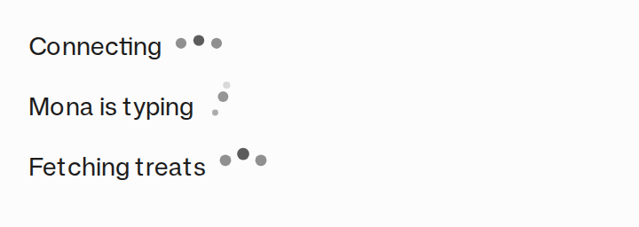
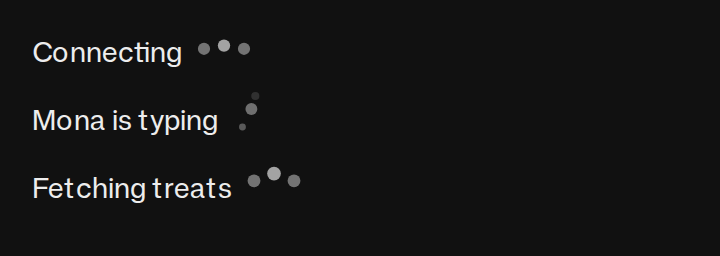
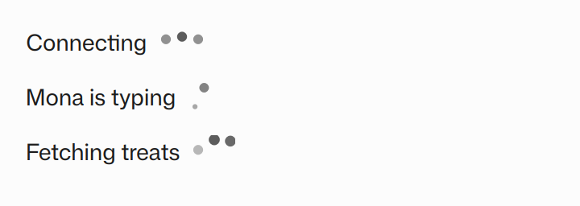
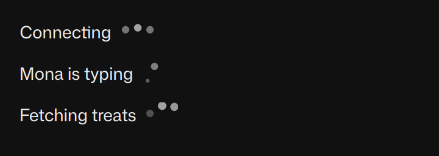
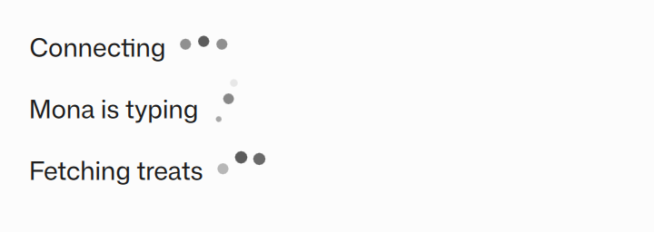
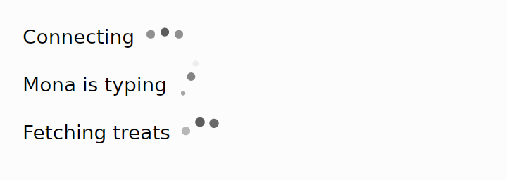
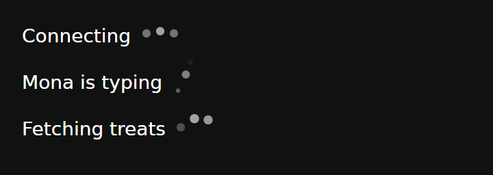
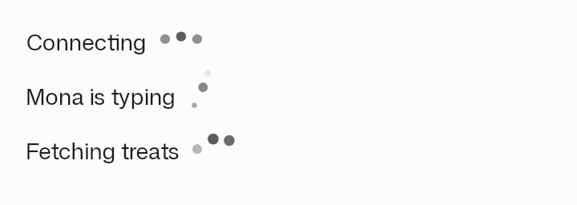
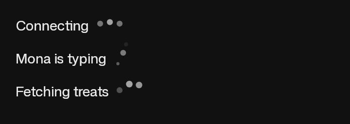

<!-- Generated by scripts/showcase.py from examples/ and component.toml. Do not edit by hand. -->

# LoadingDots

Three dots for short inline waits, or three drifting bubbles while waiting on a person.

Status · [All components](README.md)

## Props

| Prop | Type | Default | Values | Description |
| --- | --- | --- | --- | --- |
| `variant` | enum | `"steps"` | `steps`, `snooze` | steps: three dots stepping in turn. snooze: three bubbles drifting up, for someone else's turn. |
| `label` | string |  |  | Announced to screen readers; "Loading" for steps and "Waiting" for snooze when empty. |
| `kind` | enum | `"sleepy"` | `sleepy`, `playful` | Motion kind: sleepy drifts, playful hops higher and faster. |

Names follow the web targets. Qt Widgets takes `snake_case` arguments, Qt Quick `camelCase` properties, Avalonia `PascalCase` properties and Slint `kebab-case` properties; each example below shows the spelling for its target.

## Examples

Each example is run as it is shown here, on every push, and the screenshots are taken from that run (left Blanc, right Noir).

### CSS

 

```html
<div class="text-body-medium" style="display: grid; gap: 12px; justify-items: start">
  <span style="display: inline-flex; gap: 8px; align-items: center">Connecting <span class="pm-dots" role="status"><i aria-hidden="true"></i><i aria-hidden="true"></i><i aria-hidden="true"></i><span class="pm-sr-only">Loading</span></span></span>
  <span style="display: inline-flex; gap: 4px; align-items: center">Mona is typing <span class="pm-dots pm-dots--snooze" role="status"><i aria-hidden="true"></i><i aria-hidden="true"></i><i aria-hidden="true"></i><span class="pm-sr-only">Waiting</span></span></span>
  <span style="display: inline-flex; gap: 8px; align-items: center">Fetching treats <span class="pm-dots" role="status" data-motion="playful"><i aria-hidden="true"></i><i aria-hidden="true"></i><i aria-hidden="true"></i><span class="pm-sr-only">Loading</span></span></span>
</div>
```

### Svelte

 

```svelte
<script lang="ts">
  import { LoadingDots } from "$lib/purrimer";
</script>

<div class="text-body-medium" style="display: grid; gap: 12px; justify-items: start">
  <span style="display: inline-flex; gap: 8px; align-items: center">Connecting <LoadingDots /></span>
  <span style="display: inline-flex; gap: 4px; align-items: center">Mona is typing <LoadingDots variant="snooze" /></span>
  <span style="display: inline-flex; gap: 8px; align-items: center">Fetching treats <LoadingDots kind="playful" /></span>
</div>
```

### Solid

 

```tsx
import { LoadingDots } from "~/purrimer";

export default function Example() {
  const row = (gap: string) => ({ display: "inline-flex", gap, "align-items": "center" });
  return (
    <div class="text-body-medium" style={{ display: "grid", gap: "12px", "justify-items": "start" }}>
      <span style={row("8px")}>Connecting <LoadingDots /></span>
      <span style={row("4px")}>Mona is typing <LoadingDots variant="snooze" /></span>
      <span style={row("8px")}>Fetching treats <LoadingDots kind="playful" /></span>
    </div>
  );
}
```

### Qt Widgets (PySide6)

 

```python
from purrimer_qt.components import LoadingDots
from PySide6.QtWidgets import QHBoxLayout, QLabel, QVBoxLayout, QWidget


def row(text: str, dots: LoadingDots, gap: int) -> QWidget:
    widget = QWidget()
    layout = QHBoxLayout(widget)
    layout.setContentsMargins(0, 0, 0, 0)
    layout.setSpacing(gap)
    layout.addWidget(QLabel(text))
    layout.addWidget(dots)
    layout.addStretch()
    return widget


def example() -> QWidget:
    column = QWidget()
    layout = QVBoxLayout(column)
    layout.setContentsMargins(0, 0, 0, 0)
    layout.setSpacing(12)
    layout.addWidget(row("Connecting", LoadingDots(), 8))
    layout.addWidget(row("Mona is typing", LoadingDots("snooze"), 4))
    layout.addWidget(row("Fetching treats", LoadingDots(kind="playful"), 8))
    return column
```

### Qt Quick

 

```qml
import QtQuick
import Purrimer

Column {
    spacing: 12
    Row {
        spacing: 8
        Text { text: "Connecting"; font: Purrimer.textBodyMedium; color: Purrimer.fgColorDefault; anchors.verticalCenter: parent.verticalCenter }
        LoadingDots { anchors.verticalCenter: parent.verticalCenter }
    }
    Row {
        spacing: 4
        Text { text: "Mona is typing"; font: Purrimer.textBodyMedium; color: Purrimer.fgColorDefault; anchors.verticalCenter: parent.verticalCenter }
        LoadingDots { variant: "snooze"; anchors.verticalCenter: parent.verticalCenter }
    }
    Row {
        spacing: 8
        Text { text: "Fetching treats"; font: Purrimer.textBodyMedium; color: Purrimer.fgColorDefault; anchors.verticalCenter: parent.verticalCenter }
        LoadingDots { kind: "playful"; anchors.verticalCenter: parent.verticalCenter }
    }
}
```

### Avalonia

 

```xml
<UserControl xmlns="https://github.com/avaloniaui"
             xmlns:pm="using:Purrimer.Avalonia">
  <StackPanel Spacing="12">
    <StackPanel Orientation="Horizontal" Spacing="8">
      <TextBlock Text="Connecting" VerticalAlignment="Center" />
      <pm:LoadingDots />
    </StackPanel>
    <StackPanel Orientation="Horizontal" Spacing="4">
      <TextBlock Text="Mona is typing" VerticalAlignment="Center" />
      <pm:LoadingDots Variant="snooze" />
    </StackPanel>
    <StackPanel Orientation="Horizontal" Spacing="8">
      <TextBlock Text="Fetching treats" VerticalAlignment="Center" />
      <pm:LoadingDots Kind="playful" />
    </StackPanel>
  </StackPanel>
</UserControl>
```

### Slint

 

```slint
import { LoadingDots, Purrimer } from "purrimer-components.slint";

component Waiting inherits HorizontalLayout {
    in property <string> text;
    in property <string> variant: "steps";
    in property <string> kind: "sleepy";
    spacing: root.variant == "snooze" ? 4px : 8px;
    alignment: start;
    Text { text: root.text; color: Purrimer.fg-color-default; vertical-alignment: center; }
    LoadingDots { variant: root.variant; kind: root.kind; y: (parent.height - self.height) / 2; }
}

export component Example inherits VerticalLayout {
    spacing: 12px;
    alignment: start;
    Waiting { text: "Connecting"; }
    Waiting { text: "Mona is typing"; variant: "snooze"; }
    Waiting { text: "Fetching treats"; kind: "playful"; }
}
```

