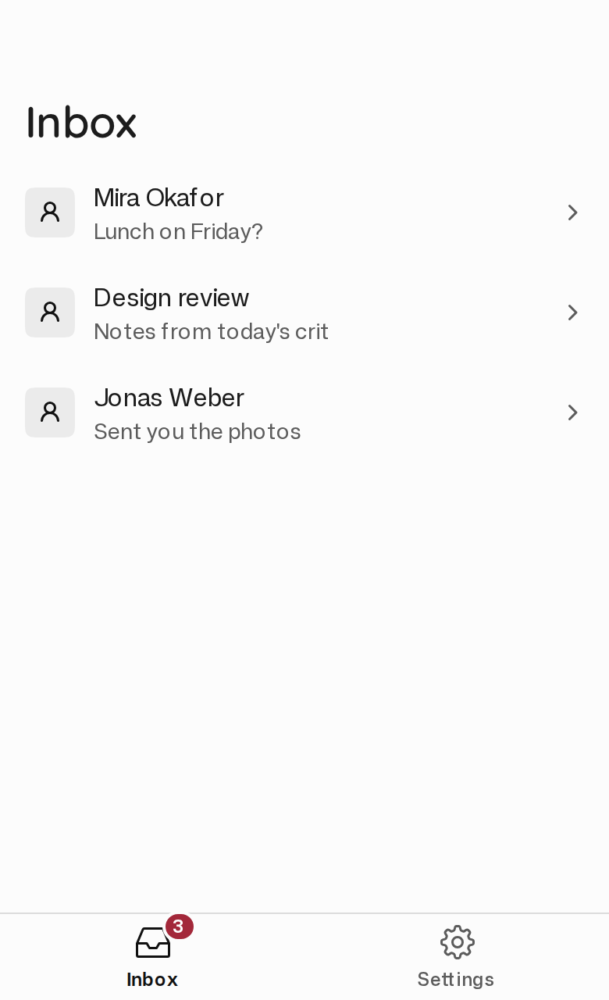
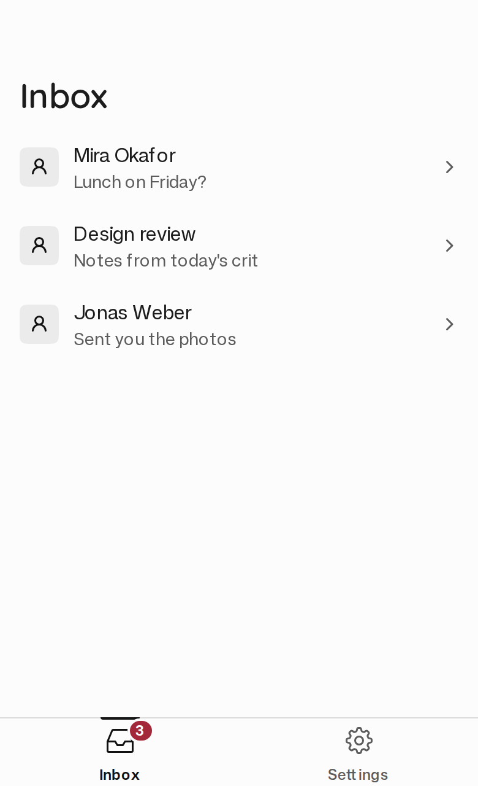
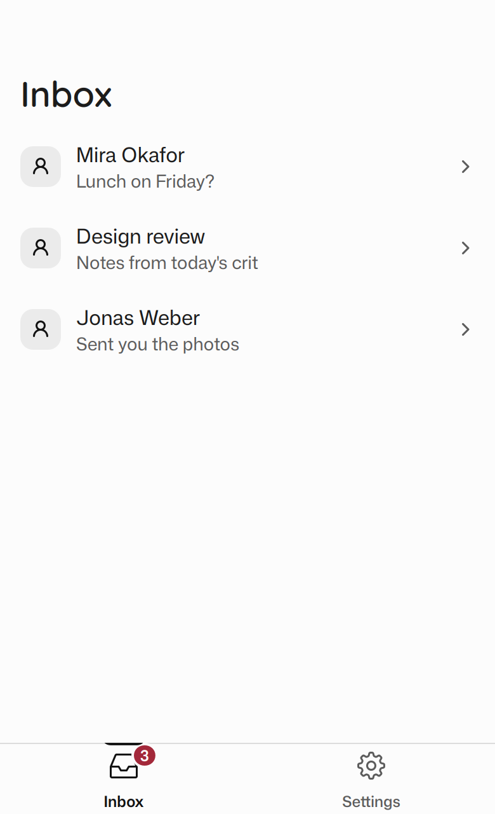
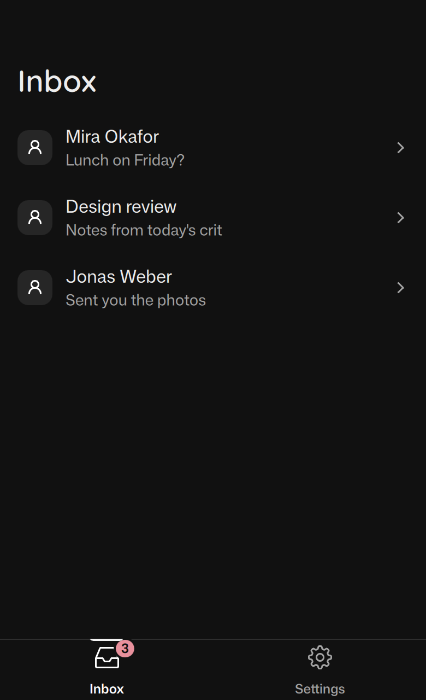
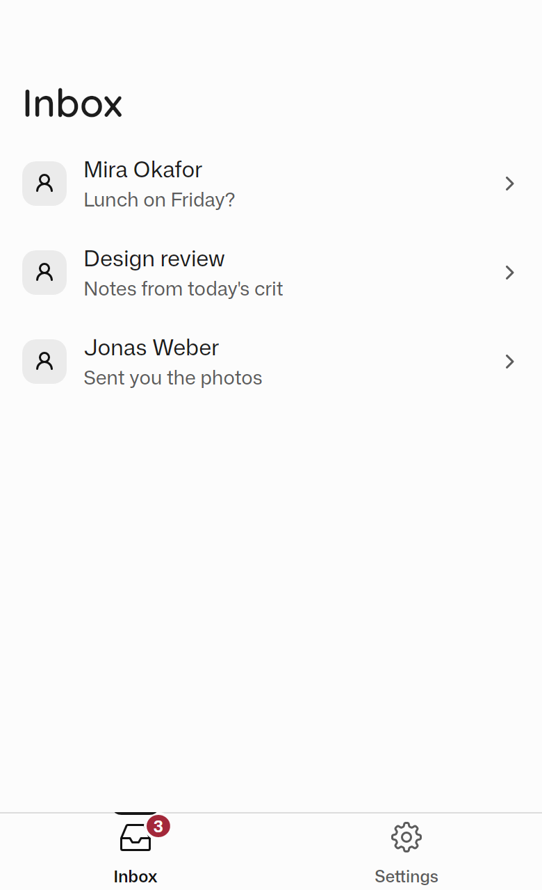
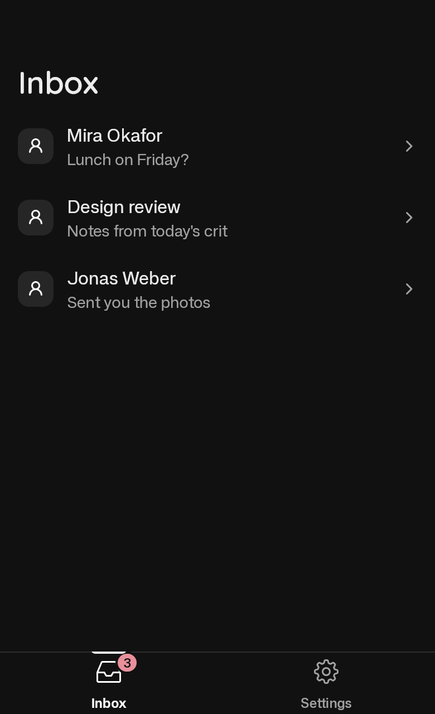

<!-- Generated by scripts/showcase.py from examples/ and component.toml. Do not edit by hand. -->

# MobileNavigator

A stack of phone screens: pushes slide in from the edge, tabs crossfade, and a swipe from the left edge goes back.

Mobile · [All components](README.md)

## Props

| Prop | Type | Default | Values | Description |
| --- | --- | --- | --- | --- |
| `screens` | map |  |  | Screen name to screen; each screen gets nav, params and active. |
| `initial` | string |  |  | The first screen's name, when there are no tabs. |
| `tabs` | list |  |  | Sections, each with its own stack: { screen, label, icon, badge? }. The navigator draws the BottomNav. |
| `history` | bool | `false` |  | Ties pushes to browser history, so the browser or Android back button pops. |

Names follow the web targets. Qt Widgets takes `snake_case` arguments, Qt Quick `camelCase` properties, Avalonia `PascalCase` properties and Slint `kebab-case` properties; each example below shows the spelling for its target.

## Examples

Each example is run as it is shown here, on every push, and the screenshots are taken from that run (left Blanc, right Noir).

### CSS

 

```html
<div class="pm-navigator">
  <div class="pm-navigator__stage">
    <section class="pm-navigator__screen">
      <div class="pm-mobile-screen" data-density="touch">
        <div class="pm-mobile-screen__bar">
          <header class="pm-appbar"><h1 class="pm-appbar__title"></h1><div class="pm-appbar__actions"></div></header>
          <h1 class="pm-appbar-large">Inbox</h1>
        </div>
        <div class="pm-mobile-screen__body">
          <div class="pm-mobile-screen__content">
          <div role="list">
            <button type="button" class="pm-list-item pm-list-item--two-line">
              <span class="pm-list-item__tile"><svg class="pm-icon" width="16" height="16" viewBox="0 0 16 16" aria-hidden="true"><path d="M10.561 8.073a6.005 6.005 0 0 1 3.432 5.142.75.75 0 1 1-1.498.07 4.5 4.5 0 0 0-8.99 0 .75.75 0 0 1-1.498-.07 6.004 6.004 0 0 1 3.431-5.142 3.999 3.999 0 1 1 5.123 0ZM10.5 5a2.5 2.5 0 1 0-5 0 2.5 2.5 0 0 0 5 0Z"/></svg></span>
              <span class="pm-list-item__text"><span class="pm-list-item__headline">Mira Okafor</span><span class="pm-list-item__supporting">Lunch on Friday?</span></span>
              <svg class="pm-icon pm-list-item__chevron" width="16" height="16" viewBox="0 0 16 16" aria-hidden="true"><path d="M6.22 3.22a.75.75 0 0 1 1.06 0l4.25 4.25a.75.75 0 0 1 0 1.06l-4.25 4.25a.751.751 0 0 1-1.042-.018.751.751 0 0 1-.018-1.042L9.94 8 6.22 4.28a.75.75 0 0 1 0-1.06Z"/></svg>
            </button>
            <button type="button" class="pm-list-item pm-list-item--two-line">
              <span class="pm-list-item__tile"><svg class="pm-icon" width="16" height="16" viewBox="0 0 16 16" aria-hidden="true"><path d="M10.561 8.073a6.005 6.005 0 0 1 3.432 5.142.75.75 0 1 1-1.498.07 4.5 4.5 0 0 0-8.99 0 .75.75 0 0 1-1.498-.07 6.004 6.004 0 0 1 3.431-5.142 3.999 3.999 0 1 1 5.123 0ZM10.5 5a2.5 2.5 0 1 0-5 0 2.5 2.5 0 0 0 5 0Z"/></svg></span>
              <span class="pm-list-item__text"><span class="pm-list-item__headline">Design review</span><span class="pm-list-item__supporting">Notes from today's crit</span></span>
              <svg class="pm-icon pm-list-item__chevron" width="16" height="16" viewBox="0 0 16 16" aria-hidden="true"><path d="M6.22 3.22a.75.75 0 0 1 1.06 0l4.25 4.25a.75.75 0 0 1 0 1.06l-4.25 4.25a.751.751 0 0 1-1.042-.018.751.751 0 0 1-.018-1.042L9.94 8 6.22 4.28a.75.75 0 0 1 0-1.06Z"/></svg>
            </button>
            <button type="button" class="pm-list-item pm-list-item--two-line">
              <span class="pm-list-item__tile"><svg class="pm-icon" width="16" height="16" viewBox="0 0 16 16" aria-hidden="true"><path d="M10.561 8.073a6.005 6.005 0 0 1 3.432 5.142.75.75 0 1 1-1.498.07 4.5 4.5 0 0 0-8.99 0 .75.75 0 0 1-1.498-.07 6.004 6.004 0 0 1 3.431-5.142 3.999 3.999 0 1 1 5.123 0ZM10.5 5a2.5 2.5 0 1 0-5 0 2.5 2.5 0 0 0 5 0Z"/></svg></span>
              <span class="pm-list-item__text"><span class="pm-list-item__headline">Jonas Weber</span><span class="pm-list-item__supporting">Sent you the photos</span></span>
              <svg class="pm-icon pm-list-item__chevron" width="16" height="16" viewBox="0 0 16 16" aria-hidden="true"><path d="M6.22 3.22a.75.75 0 0 1 1.06 0l4.25 4.25a.75.75 0 0 1 0 1.06l-4.25 4.25a.751.751 0 0 1-1.042-.018.751.751 0 0 1-.018-1.042L9.94 8 6.22 4.28a.75.75 0 0 1 0-1.06Z"/></svg>
            </button>
          </div>
          </div>
        </div>
      </div>
      <div class="pm-navigator__dim" aria-hidden="true"></div>
    </section>
    <div class="pm-navigator__back-mark" aria-hidden="true"><svg class="pm-icon" width="16" height="16" viewBox="0 0 16 16" aria-hidden="true"><path d="M7.78 12.53a.75.75 0 0 1-1.06 0L2.47 8.28a.75.75 0 0 1 0-1.06l4.25-4.25a.751.751 0 0 1 1.042.018.751.751 0 0 1 .018 1.042L4.81 7h7.44a.75.75 0 0 1 0 1.5H4.81l2.97 2.97a.75.75 0 0 1 0 1.06Z"/></svg></div>
  </div>
  <div class="pm-navigator__nav">
    <nav class="pm-bottomnav" aria-label="Main">
      <button type="button" class="pm-bottomnav__item" aria-current="page"><svg class="pm-icon" width="24" height="24" viewBox="0 0 24 24" aria-hidden="true"><path d="M4.801 3.57A1.75 1.75 0 0 1 6.414 2.5h11.174c.702 0 1.337.42 1.611 1.067l3.741 8.828c.04.092.06.192.06.293v7.562A1.75 1.75 0 0 1 21.25 22H2.75A1.75 1.75 0 0 1 1 20.25v-7.5c0-.1.02-.199.059-.291L4.8 3.571ZM6.414 4a.25.25 0 0 0-.23.153L2.88 12H8a.75.75 0 0 1 .648.372L10.18 15h3.638l1.533-2.628a.75.75 0 0 1 .64-.372l5.13-.051-3.304-7.797a.25.25 0 0 0-.23-.152ZM21.5 13.445l-5.067.05-1.535 2.633a.75.75 0 0 1-.648.372h-4.5a.75.75 0 0 1-.648-.372L7.57 13.5H2.5v6.75c0 .138.112.25.25.25h18.5a.25.25 0 0 0 .25-.25Z"/></svg><span>Inbox</span><span class="pm-bottomnav__badge">3</span></button>
      <button type="button" class="pm-bottomnav__item"><svg class="pm-icon" width="24" height="24" viewBox="0 0 24 24" aria-hidden="true"><path d="M16 12a4 4 0 1 1-8 0 4 4 0 0 1 8 0Zm-1.5 0a2.5 2.5 0 1 0-5 0 2.5 2.5 0 0 0 5 0ZM12 1c.266 0 .532.009.797.028.763.055 1.345.617 1.512 1.304l.352 1.45c.019.078.09.171.225.221.247.089.49.19.728.302.13.061.246.044.315.002l1.275-.776c.603-.368 1.411-.353 1.99.147.402.349.78.726 1.128 1.129.501.578.515 1.386.147 1.99l-.776 1.274c-.042.069-.058.185.002.315.112.238.213.481.303.728.048.135.142.205.22.225l1.45.352c.687.167 1.249.749 1.303 1.512.038.531.038 1.063 0 1.594-.054.763-.616 1.345-1.303 1.512l-1.45.352c-.078.019-.171.09-.221.225-.089.248-.19.491-.302.728-.061.13-.044.246-.002.315l.776 1.275c.368.603.353 1.411-.147 1.99-.349.402-.726.78-1.129 1.128-.578.501-1.386.515-1.99.147l-1.274-.776c-.069-.042-.185-.058-.314.002a8.606 8.606 0 0 1-.729.303c-.135.048-.205.142-.225.22l-.352 1.45c-.167.687-.749 1.249-1.512 1.303-.531.038-1.063.038-1.594 0-.763-.054-1.345-.616-1.512-1.303l-.352-1.45c-.019-.078-.09-.171-.225-.221a8.138 8.138 0 0 1-.728-.302c-.13-.061-.246-.044-.315-.002l-1.275.776c-.603.368-1.411.353-1.99-.147-.402-.349-.78-.726-1.128-1.129-.501-.578-.515-1.386-.147-1.99l.776-1.274c.042-.069.058-.185-.002-.314a8.606 8.606 0 0 1-.303-.729c-.048-.135-.142-.205-.22-.225l-1.45-.352c-.687-.167-1.249-.749-1.304-1.512a11.158 11.158 0 0 1 0-1.594c.055-.763.617-1.345 1.304-1.512l1.45-.352c.078-.019.171-.09.221-.225.089-.248.19-.491.302-.728.061-.13.044-.246.002-.315l-.776-1.275c-.368-.603-.353-1.411.147-1.99.349-.402.726-.78 1.129-1.128.578-.501 1.386-.515 1.99-.147l1.274.776c.069.042.185.058.315-.002.238-.112.481-.213.728-.303.135-.048.205-.142.225-.22l.352-1.45c.167-.687.749-1.249 1.512-1.304C11.466 1.01 11.732 1 12 1Zm-.69 1.525c-.055.004-.135.05-.161.161l-.353 1.45a1.832 1.832 0 0 1-1.172 1.277 7.147 7.147 0 0 0-.6.249 1.833 1.833 0 0 1-1.734-.074l-1.274-.776c-.098-.06-.186-.036-.228 0a9.774 9.774 0 0 0-.976.976c-.036.042-.06.131 0 .228l.776 1.274c.314.529.342 1.18.074 1.734a7.147 7.147 0 0 0-.249.6 1.831 1.831 0 0 1-1.278 1.173l-1.45.351c-.11.027-.156.107-.16.162a9.63 9.63 0 0 0 0 1.38c.004.055.05.135.161.161l1.45.353a1.832 1.832 0 0 1 1.277 1.172c.074.204.157.404.249.6.268.553.24 1.204-.074 1.733l-.776 1.275c-.06.098-.036.186 0 .228.301.348.628.675.976.976.042.036.131.06.228 0l1.274-.776a1.83 1.83 0 0 1 1.734-.075c.196.093.396.176.6.25a1.831 1.831 0 0 1 1.173 1.278l.351 1.45c.027.11.107.156.162.16a9.63 9.63 0 0 0 1.38 0c.055-.004.135-.05.161-.161l.353-1.45a1.834 1.834 0 0 1 1.172-1.278 6.82 6.82 0 0 0 .6-.248 1.831 1.831 0 0 1 1.733.074l1.275.776c.098.06.186.036.228 0 .348-.301.675-.628.976-.976.036-.042.06-.131 0-.228l-.776-1.275a1.834 1.834 0 0 1-.075-1.733c.093-.196.176-.396.25-.6a1.831 1.831 0 0 1 1.278-1.173l1.45-.351c.11-.027.156-.107.16-.162a9.63 9.63 0 0 0 0-1.38c-.004-.055-.05-.135-.161-.161l-1.45-.353c-.626-.152-1.08-.625-1.278-1.172a6.576 6.576 0 0 0-.248-.6 1.833 1.833 0 0 1 .074-1.734l.776-1.274c.06-.098.036-.186 0-.228a9.774 9.774 0 0 0-.976-.976c-.042-.036-.131-.06-.228 0l-1.275.776a1.831 1.831 0 0 1-1.733.074 6.88 6.88 0 0 0-.6-.249 1.835 1.835 0 0 1-1.173-1.278l-.351-1.45c-.027-.11-.107-.156-.162-.16a9.63 9.63 0 0 0-1.38 0Z"/></svg><span>Settings</span></button>
    </nav>
  </div>
</div>
```

### Svelte

 

```svelte
<script lang="ts">
  import { AppBar, ListItem, MobileNavigator, MobileScreen } from "$lib/purrimer";

  const threads = [
    { name: "Mira Okafor", text: "Lunch on Friday?" },
    { name: "Design review", text: "Notes from today's crit" },
    { name: "Jonas Weber", text: "Sent you the photos" },
  ];
  const tabs = [
    { screen: "inbox", label: "Inbox", icon: "inbox", badge: 3 },
    { screen: "settings", label: "Settings", icon: "gear" },
  ];
</script>

<MobileNavigator {tabs}>
  {#snippet screen(name, nav, params)}
    {#if name === "inbox"}
      <MobileScreen>
        {#snippet appBar()}<AppBar title="Inbox" large />{/snippet}
        <div role="list">
          {#each threads as thread (thread.name)}
            <ListItem icon="person" headline={thread.name} supporting={thread.text} chevron onclick={() => nav.push("thread", thread)} />
          {/each}
        </div>
      </MobileScreen>
    {:else if name === "thread"}
      {@const thread = params as { name: string; text: string }}
      <MobileScreen>
        {#snippet appBar()}<AppBar title={thread.name} back onback={() => nav.pop()} />{/snippet}
        <p class="text-body-medium" style="margin: 16px">{thread.text}</p>
      </MobileScreen>
    {:else}
      <MobileScreen surface="inset">
        {#snippet appBar()}<AppBar title="Settings" large />{/snippet}
        <div role="list">
          <ListItem icon="bell" headline="Notifications" trailing="On" chevron />
        </div>
      </MobileScreen>
    {/if}
  {/snippet}
</MobileNavigator>
```

### Solid

 

```tsx
import { For } from "solid-js";
import { AppBar, ListItem, MobileNavigator, MobileScreen, type ScreenProps } from "~/purrimer";

type Thread = { name: string; text: string };

const threads: Thread[] = [
  { name: "Mira Okafor", text: "Lunch on Friday?" },
  { name: "Design review", text: "Notes from today's crit" },
  { name: "Jonas Weber", text: "Sent you the photos" },
];

const screens = {
  inbox: ({ nav }: ScreenProps) => (
    <MobileScreen appBar={<AppBar title="Inbox" large />}>
      <div role="list">
        <For each={threads}>
          {(t) => <ListItem icon="person" headline={t.name} supporting={t.text} chevron onClick={() => nav.push("thread", t)} />}
        </For>
      </div>
    </MobileScreen>
  ),
  thread: ({ nav, params }: ScreenProps) => {
    const thread = params as Thread;
    return (
      <MobileScreen appBar={<AppBar title={thread.name} back onBack={() => nav.pop()} />}>
        <p class="text-body-medium" style={{ margin: "16px" }}>{thread.text}</p>
      </MobileScreen>
    );
  },
  settings: () => (
    <MobileScreen surface="inset" appBar={<AppBar title="Settings" large />}>
      <div role="list">
        <ListItem icon="bell" headline="Notifications" trailing="On" chevron />
      </div>
    </MobileScreen>
  ),
};

export default function Example() {
  return (
    <MobileNavigator
      screens={screens}
      tabs={[
        { screen: "inbox", label: "Inbox", icon: "inbox", badge: 3 },
        { screen: "settings", label: "Settings", icon: "gear" },
      ]}
    />
  );
}
```

### Qt Widgets (PySide6)

 

```python
from purrimer_qt.components import AppBar, ListItem, MobileNavigator, MobileScreen
from purrimer_qt.components.mobile_navigator import NavTab
from PySide6.QtWidgets import QLabel, QWidget

THREADS = [
    ("Mira Okafor", "Lunch on Friday?"),
    ("Design review", "Notes from today's crit"),
    ("Jonas Weber", "Sent you the photos"),
]


def inbox(nav: MobileNavigator, _params: object) -> QWidget:
    screen = MobileScreen(app_bar=AppBar("Inbox", large=True))
    for name, text in THREADS:
        item = ListItem(name, text, icon="person", chevron=True, clickable=True)
        item.clicked.connect(lambda n=name, t=text: nav.push("thread", (n, t)))
        screen.body.addWidget(item)
    return screen


def thread(nav: MobileNavigator, params: object) -> QWidget:
    name, text = params
    bar = AppBar(name, back=True)
    bar.backClicked.connect(nav.pop)
    screen = MobileScreen(app_bar=bar)
    note = QLabel(text)
    note.setContentsMargins(16, 16, 16, 16)
    screen.body.addWidget(note)
    return screen


def settings(_nav: MobileNavigator, _params: object) -> QWidget:
    screen = MobileScreen(app_bar=AppBar("Settings", large=True), surface="inset")
    screen.body.addWidget(ListItem("Notifications", icon="bell", trailing="On", chevron=True))
    return screen


def example() -> QWidget:
    return MobileNavigator(
        {"inbox": inbox, "thread": thread, "settings": settings},
        tabs=[NavTab("inbox", "Inbox", "inbox", badge=3), NavTab("settings", "Settings", "gear")],
    )
```

### Qt Quick

 

```qml
pragma ComponentBehavior: Bound
import QtQuick
import Purrimer

MobileNavigator {
    tabs: [
        { screen: "inbox", label: "Inbox", icon: "inbox", badge: 3 },
        { screen: "settings", label: "Settings", icon: "gear" }
    ]
    screens: ({ inbox: inbox, thread: thread, settings: settings })

    Component {
        id: inbox
        MobileScreen {
            id: inboxScreen
            property var nav
            property var params
            property bool active
            appBar: AppBar { title: "Inbox"; large: true }
            Repeater {
                model: [["Mira Okafor", "Lunch on Friday?"], ["Design review", "Notes from today's crit"], ["Jonas Weber", "Sent you the photos"]]
                ListItem {
                    required property var modelData
                    width: parent ? parent.width : 0
                    iconName: "person"
                    headline: modelData[0]
                    supporting: modelData[1]
                    chevron: true
                    clickable: true
                    onClicked: inboxScreen.nav.push("thread", modelData)
                }
            }
        }
    }

    Component {
        id: thread
        MobileScreen {
            id: threadScreen
            property var nav
            property var params
            property bool active
            appBar: AppBar { title: threadScreen.params[0]; back: true; onBackClicked: threadScreen.nav.pop() }
            Text {
                x: 16
                y: 16
                text: threadScreen.params[1]
                color: Purrimer.fgColorDefault
                font: Purrimer.textBodyMedium
            }
        }
    }

    Component {
        id: settings
        MobileScreen {
            property var nav
            property var params
            property bool active
            surface: "inset"
            appBar: AppBar { title: "Settings"; large: true }
            ListItem { width: parent ? parent.width : 0; iconName: "bell"; headline: "Notifications"; trailing: "On"; chevron: true }
        }
    }
}
```

### Avalonia

 

```xml
<UserControl xmlns="https://github.com/avaloniaui"
             xmlns:x="http://schemas.microsoft.com/winfx/2006/xaml"
             xmlns:pm="using:Purrimer.Avalonia">
  <pm:MobileNavigator>
    <pm:MobileNavigator.Tabs>
      <pm:MobileNavigatorTab Screen="inbox" Label="Inbox" IconName="inbox" Badge="3" />
      <pm:MobileNavigatorTab Screen="settings" Label="Settings" IconName="gear" />
    </pm:MobileNavigator.Tabs>
    <pm:MobileNavigator.Screens>
      <pm:MobileNavigatorScreen Name="inbox">
        <DataTemplate x:DataType="pm:MobileNavigatorContext">
          <pm:MobileScreen>
            <pm:MobileScreen.AppBar>
              <pm:AppBar Title="Inbox" IsLarge="True" />
            </pm:MobileScreen.AppBar>
            <StackPanel>
              <pm:ListItem IconName="person" Headline="Mira Okafor" Supporting="Lunch on Friday?" ShowChevron="True"
                           pm:MobileNavigator.PushOnTap="thread" pm:MobileNavigator.PushParams="Mira Okafor" />
              <pm:ListItem IconName="person" Headline="Design review" Supporting="Notes from today's crit" ShowChevron="True"
                           pm:MobileNavigator.PushOnTap="thread" pm:MobileNavigator.PushParams="Design review" />
              <pm:ListItem IconName="person" Headline="Jonas Weber" Supporting="Sent you the photos" ShowChevron="True"
                           pm:MobileNavigator.PushOnTap="thread" pm:MobileNavigator.PushParams="Jonas Weber" />
            </StackPanel>
          </pm:MobileScreen>
        </DataTemplate>
      </pm:MobileNavigatorScreen>
      <pm:MobileNavigatorScreen Name="thread">
        <DataTemplate x:DataType="pm:MobileNavigatorContext">
          <pm:MobileScreen>
            <pm:MobileScreen.AppBar>
              <!-- The back button pops on its own inside a MobileNavigator. -->
              <pm:AppBar Title="{Binding Params}" ShowBack="True" />
            </pm:MobileScreen.AppBar>
            <TextBlock Margin="16" Text="Thread" />
          </pm:MobileScreen>
        </DataTemplate>
      </pm:MobileNavigatorScreen>
      <pm:MobileNavigatorScreen Name="settings">
        <DataTemplate x:DataType="pm:MobileNavigatorContext">
          <pm:MobileScreen Surface="inset">
            <pm:MobileScreen.AppBar>
              <pm:AppBar Title="Settings" IsLarge="True" />
            </pm:MobileScreen.AppBar>
            <pm:ListItem IconName="bell" Headline="Notifications" Trailing="On" ShowChevron="True" />
          </pm:MobileScreen>
        </DataTemplate>
      </pm:MobileNavigatorScreen>
    </pm:MobileNavigator.Screens>
  </pm:MobileNavigator>
</UserControl>
```

### Slint

 

```slint
import { ListItem, MobileNavigator, MobileScreen, NavScreen, PurrimerIcons, PurrimerNavigator, Purrimer } from "purrimer-components.slint";

export component Example inherits Rectangle {
    // Screens read their params from the app: here, the thread that was opened.
    property <string> thread;

    MobileNavigator {
        tab-screens: ["inbox", "settings"];
        nav-items: [
            { icon: PurrimerIcons.inbox-24, label: "Inbox", badge: 3 },
            { icon: PurrimerIcons.gear-24, label: "Settings" },
        ];

        NavScreen {
            name: "inbox";
            MobileScreen {
                title: "Inbox";
                large: true;
                ListItem { icon: PurrimerIcons.person-16; headline: "Mira Okafor"; supporting: "Lunch on Friday?"; chevron: true; clickable: true; clicked => { root.thread = "Mira Okafor"; PurrimerNavigator.push("thread"); } }
                ListItem { icon: PurrimerIcons.person-16; headline: "Design review"; supporting: "Notes from today's crit"; chevron: true; clickable: true; clicked => { root.thread = "Design review"; PurrimerNavigator.push("thread"); } }
                ListItem { icon: PurrimerIcons.person-16; headline: "Jonas Weber"; supporting: "Sent you the photos"; chevron: true; clickable: true; clicked => { root.thread = "Jonas Weber"; PurrimerNavigator.push("thread"); } }
            }
        }
        NavScreen {
            name: "thread";
            MobileScreen {
                title: root.thread;
                back: true;
                back-clicked => { PurrimerNavigator.pop(); }
                Text { text: "Thread"; color: Purrimer.fg-color-default; }
            }
        }
        NavScreen {
            name: "settings";
            MobileScreen {
                title: "Settings";
                large: true;
                surface: "inset";
                ListItem { icon: PurrimerIcons.bell-16; headline: "Notifications"; trailing: "On"; chevron: true; }
            }
        }
    }
}
```

