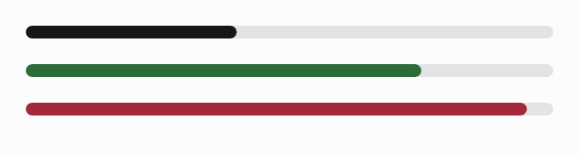
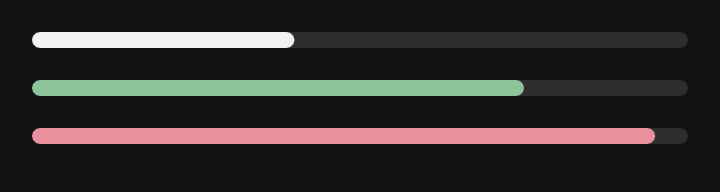
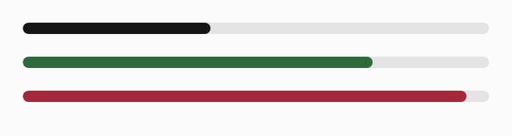

<!-- Generated by scripts/showcase.py from examples/ and component.toml. Do not edit by hand. -->

# ProgressBar

A track that fills to show progress, or sweeps while it is unknown.

Status · [All components](README.md)

## Props

| Prop | Type | Default | Values | Description |
| --- | --- | --- | --- | --- |
| `value` | float | `0` |  | Progress from 0 to 100. |
| `indeterminate` | bool | `false` |  | Sweeps instead of filling. |
| `tone` | enum | `"accent"` | `accent`, `success`, `attention`, `danger` | Fill colour role. |

Names follow the web targets. Qt Widgets takes `snake_case` arguments, Qt Quick `camelCase` properties, Avalonia `PascalCase` properties and Slint `kebab-case` properties; each example below shows the spelling for its target.

## Examples

Each example is run as it is shown here, on every push, and the screenshots are taken from that run (left Blanc, right Noir).

### CSS

 

```html
<div style="display: grid; gap: 16px">
  <div class="pm-progress" role="progressbar" aria-label="Upload" aria-valuemin="0" aria-valuemax="100" aria-valuenow="40">
    <div class="pm-progress__fill" style="width: 40%"></div>
  </div>
  <div class="pm-progress pm-progress--success" role="progressbar" aria-label="Storage" aria-valuemin="0" aria-valuemax="100" aria-valuenow="75">
    <div class="pm-progress__fill" style="width: 75%"></div>
  </div>
  <div class="pm-progress pm-progress--danger" role="progressbar" aria-label="Quota" aria-valuemin="0" aria-valuemax="100" aria-valuenow="95">
    <div class="pm-progress__fill" style="width: 95%"></div>
  </div>
</div>
```

### Svelte

 

```svelte
<script lang="ts">
  import { ProgressBar } from "$lib/purrimer";
</script>

<!-- Set indeterminate to sweep while the amount is unknown. -->
<div style="display: grid; gap: 16px">
  <ProgressBar value={40} label="Upload" />
  <ProgressBar value={75} tone="success" label="Storage" />
  <ProgressBar value={95} tone="danger" label="Quota" />
</div>
```

### Solid

 

```tsx
import { ProgressBar } from "~/purrimer";

// Set indeterminate to sweep while the amount is unknown.
export default function Example() {
  return (
    <div style={{ display: "grid", gap: "16px" }}>
      <ProgressBar value={40} label="Upload" />
      <ProgressBar value={75} tone="success" label="Storage" />
      <ProgressBar value={95} tone="danger" label="Quota" />
    </div>
  );
}
```

### Qt Widgets (PySide6)

 

```python
from purrimer_qt.components import ProgressBar
from PySide6.QtWidgets import QVBoxLayout, QWidget


def example() -> QWidget:
    # ProgressBar(indeterminate=True) sweeps while the amount is unknown.
    column = QWidget()
    layout = QVBoxLayout(column)
    layout.setContentsMargins(0, 0, 0, 0)
    layout.setSpacing(16)
    layout.addWidget(ProgressBar(40))
    layout.addWidget(ProgressBar(75, "success"))
    layout.addWidget(ProgressBar(95, "danger"))
    return column
```

### Qt Quick

 

```qml
import QtQuick
import Purrimer

// Set indeterminate: true to sweep while the amount is unknown.
Column {
    spacing: 16
    ProgressBar { width: 328; value: 40 }
    ProgressBar { width: 328; value: 75; tone: "success" }
    ProgressBar { width: 328; value: 95; tone: "danger" }
}
```

### Avalonia

 

```xml
<UserControl xmlns="https://github.com/avaloniaui"
             xmlns:pm="using:Purrimer.Avalonia">
  <!-- IsIndeterminate="True" sweeps while the amount is unknown. -->
  <StackPanel Spacing="16">
    <ProgressBar Value="40" />
    <ProgressBar Value="75" Classes="success" />
    <ProgressBar Value="95" Classes="danger" />
  </StackPanel>
</UserControl>
```

### Slint

 

```slint
import { ProgressBar } from "purrimer-components.slint";

// Set indeterminate: true to sweep while the amount is unknown.
export component Example inherits VerticalLayout {
    spacing: 16px;
    alignment: start;
    ProgressBar { value: 40; }
    ProgressBar { value: 75; tone: "success"; }
    ProgressBar { value: 95; tone: "danger"; }
}
```

