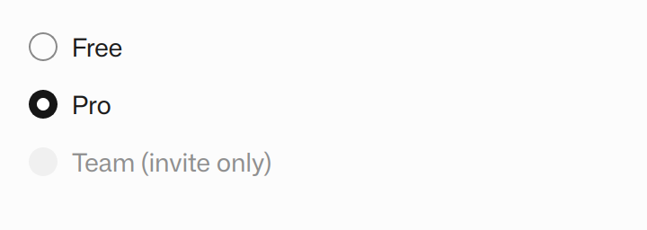
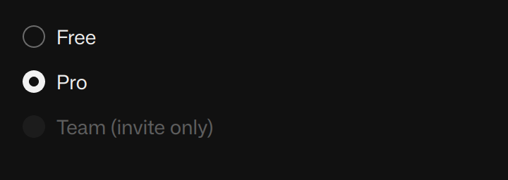
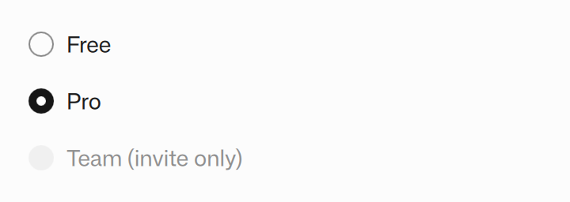
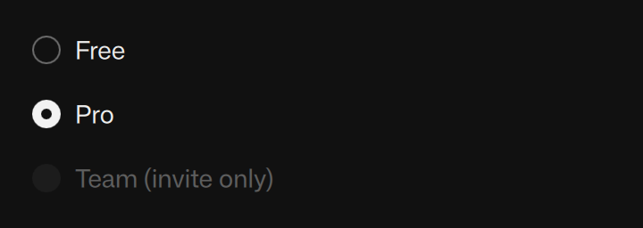
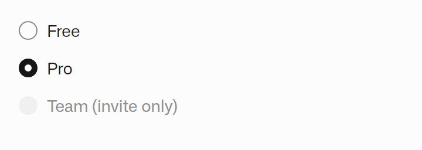
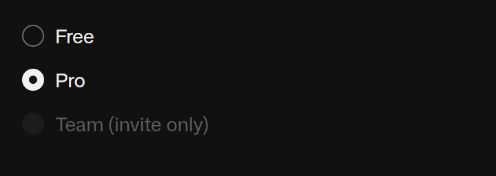
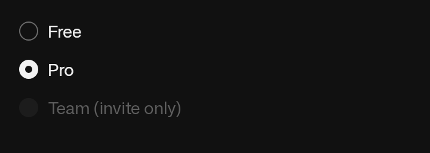

<!-- Generated by scripts/showcase.py from examples/ and component.toml. Do not edit by hand. -->

# Radio

One choice of a group; give every radio of a group the same name.

Forms · [All components](README.md)

## Props

| Prop | Type | Default | Values | Description |
| --- | --- | --- | --- | --- |
| `label` | string |  |  | Text beside the circle. |
| `name` | string |  |  | Group name. |
| `value` | string |  |  | Value this radio stands for. |
| `checked` | bool | `false` |  | Selected state. |
| `disabled` | bool | `false` |  | Greys the control. |

Names follow the web targets. Qt Widgets takes `snake_case` arguments, Qt Quick `camelCase` properties, Avalonia `PascalCase` properties and Slint `kebab-case` properties; each example below shows the spelling for its target.

## Examples

Each example is run as it is shown here, on every push, and the screenshots are taken from that run (left Blanc, right Noir).

### CSS

 

```html
<fieldset style="display: grid; gap: 12px; justify-items: start; border: 0; margin: 0; padding: 0">
  <label class="pm-radio"><input class="pm-radio__input" type="radio" name="plan" value="free" /><span>Free</span></label>
  <label class="pm-radio"><input class="pm-radio__input" type="radio" name="plan" value="pro" checked /><span>Pro</span></label>
  <label class="pm-radio"><input class="pm-radio__input" type="radio" name="plan" value="team" disabled /><span>Team (invite only)</span></label>
</fieldset>
```

### CSS, classless

 

```html
<fieldset aria-label="Plan">
  <label><input type="radio" name="plan" value="free" /> Free</label>
  <label><input type="radio" name="plan" value="pro" checked /> Pro</label>
  <label><input type="radio" name="plan" value="team" disabled /> Team (invite only)</label>
</fieldset>
```

### Svelte

 

```svelte
<script lang="ts">
  import { Radio } from "$lib/purrimer";

  let plan = $state("pro");
</script>

<div style="display: grid; gap: 12px; justify-items: start" role="radiogroup" aria-label="Plan">
  <Radio label="Free" name="plan" value="free" bind:group={plan} />
  <Radio label="Pro" name="plan" value="pro" bind:group={plan} />
  <Radio label="Team (invite only)" name="plan" value="team" bind:group={plan} disabled />
</div>
```

### Solid

 

```tsx
import { createSignal } from "solid-js";
import { Radio } from "~/purrimer";

export default function Example() {
  const [plan, setPlan] = createSignal("pro");
  return (
    <div style={{ display: "grid", gap: "12px", "justify-items": "start" }} role="radiogroup" aria-label="Plan">
      <Radio label="Free" name="plan" value="free" checked={plan() === "free"} onSelect={setPlan} />
      <Radio label="Pro" name="plan" value="pro" checked={plan() === "pro"} onSelect={setPlan} />
      <Radio label="Team (invite only)" name="plan" value="team" disabled />
    </div>
  );
}
```

### Qt Widgets (PySide6)

 

```python
from purrimer_qt.components import Radio
from PySide6.QtWidgets import QVBoxLayout, QWidget


def example() -> QWidget:
    # Radios with the same parent are exclusive; use a QButtonGroup to split them.
    group = QWidget()
    layout = QVBoxLayout(group)
    layout.setContentsMargins(0, 0, 0, 0)
    layout.setSpacing(12)
    layout.addWidget(Radio("Free"))
    layout.addWidget(Radio("Pro", checked=True))
    team = Radio("Team (invite only)")
    team.setEnabled(False)
    layout.addWidget(team)
    return group
```

### Qt Quick

 

```qml
import QtQuick
import Purrimer

// Radios in the same parent are exclusive; use a ButtonGroup to split them.
Column {
    spacing: 12
    Radio { text: "Free" }
    Radio { text: "Pro"; checked: true }
    Radio { text: "Team (invite only)"; enabled: false }
}
```

### Avalonia

 

```xml
<UserControl xmlns="https://github.com/avaloniaui"
             xmlns:pm="using:Purrimer.Avalonia">
  <StackPanel Spacing="12">
    <RadioButton GroupName="plan" Content="Free" />
    <RadioButton GroupName="plan" Content="Pro" IsChecked="True" />
    <RadioButton GroupName="plan" Content="Team (invite only)" IsEnabled="False" />
  </StackPanel>
</UserControl>
```

### Slint

 

```slint
import { Radio } from "purrimer-components.slint";

// Slint has no radio groups; keep the choice in one property.
export component Example inherits VerticalLayout {
    in-out property <int> plan: 1;
    spacing: 12px;
    alignment: start;
    Radio { text: "Free"; checked: plan == 0; toggled => { plan = 0; } }
    Radio { text: "Pro"; checked: plan == 1; toggled => { plan = 1; } }
    Radio { text: "Team (invite only)"; enabled: false; }
}
```

