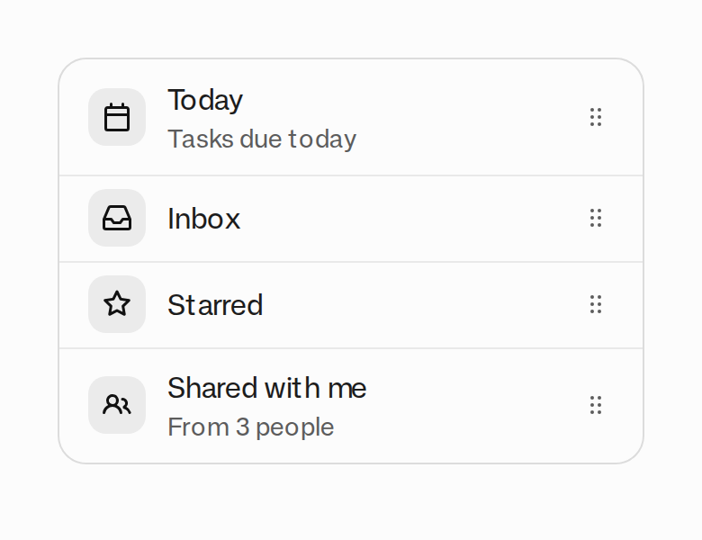
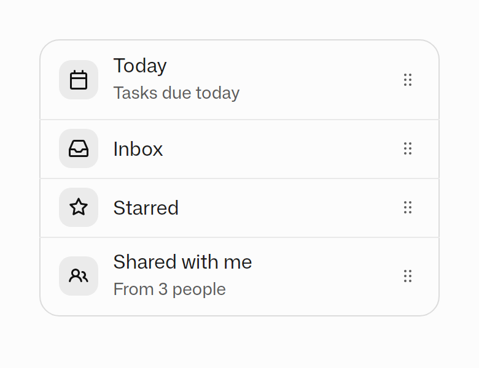
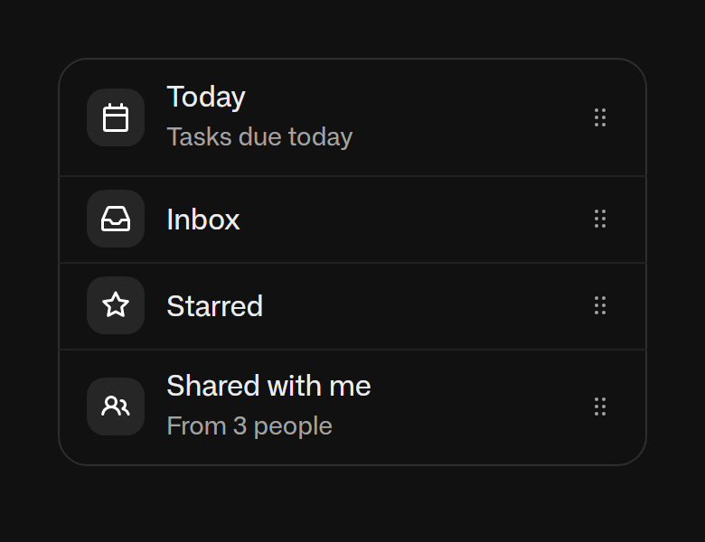
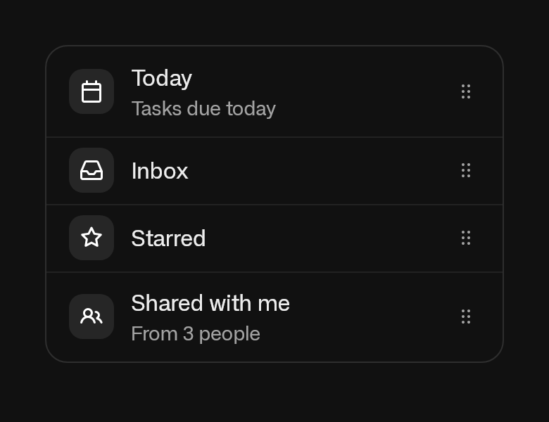

<!-- Generated by scripts/showcase.py from examples/ and component.toml. Do not edit by hand. -->

# ReorderList

A list people put in their own order by holding a row, or pressing its handle, and dragging it to a new place.

Mobile · [All components](README.md)

## Props

| Prop | Type | Default | Values | Description |
| --- | --- | --- | --- | --- |
| `items` | list |  |  | Rows: { key, headline, supporting?, icon? }. |
| `variant` | enum | `"inset"` | `inset`, `plain` | inset draws a card for settings; plain runs edge to edge. |
| `disabled` | bool | `false` |  | Locks the order. |

Names follow the web targets. Qt Widgets takes `snake_case` arguments, Qt Quick `camelCase` properties, Avalonia `PascalCase` properties and Slint `kebab-case` properties; each example below shows the spelling for its target.

## Examples

Each example is run as it is shown here, on every push, and the screenshots are taken from that run (left Blanc, right Noir).

### CSS

 

```html
<div style="padding-top: 16px">
<ul class="pm-reorder pm-reorder--inset" aria-label="Home sections">
  <li class="pm-reorder__row pm-reorder__row--two-line">
    <span class="pm-reorder__tile"><svg class="pm-icon" width="16" height="16" viewBox="0 0 16 16" aria-hidden="true"><path d="M4.75 0a.75.75 0 0 1 .75.75V2h5V.75a.75.75 0 0 1 1.5 0V2h1.25c.966 0 1.75.784 1.75 1.75v10.5A1.75 1.75 0 0 1 13.25 16H2.75A1.75 1.75 0 0 1 1 14.25V3.75C1 2.784 1.784 2 2.75 2H4V.75A.75.75 0 0 1 4.75 0ZM2.5 7.5v6.75c0 .138.112.25.25.25h10.5a.25.25 0 0 0 .25-.25V7.5Zm10.75-4H2.75a.25.25 0 0 0-.25.25V6h11V3.75a.25.25 0 0 0-.25-.25Z"/></svg></span>
    <span class="pm-reorder__text"><span class="pm-reorder__headline">Today</span><span class="pm-reorder__supporting">Tasks due today</span></span>
    <span class="pm-reorder__actions"><button type="button" class="pm-icon-button pm-icon-button--invisible pm-reorder__handle" aria-label="Reorder Today" title="Reorder Today"><svg class="pm-icon" width="16" height="16" viewBox="0 0 16 16" aria-hidden="true"><path d="M10 13a1 1 0 1 1 0-2 1 1 0 0 1 0 2Zm0-4a1 1 0 1 1 0-2 1 1 0 0 1 0 2Zm-4 4a1 1 0 1 1 0-2 1 1 0 0 1 0 2Zm5-9a1 1 0 1 1-2 0 1 1 0 0 1 2 0ZM7 8a1 1 0 1 1-2 0 1 1 0 0 1 2 0ZM6 5a1 1 0 1 1 0-2 1 1 0 0 1 0 2Z"/></svg></button></span>
  </li>
  <li class="pm-reorder__row">
    <span class="pm-reorder__tile"><svg class="pm-icon" width="16" height="16" viewBox="0 0 16 16" aria-hidden="true"><path d="M2.8 2.06A1.75 1.75 0 0 1 4.41 1h7.18c.7 0 1.333.417 1.61 1.06l2.74 6.395c.04.093.06.194.06.295v4.5A1.75 1.75 0 0 1 14.25 15H1.75A1.75 1.75 0 0 1 0 13.25v-4.5c0-.101.02-.202.06-.295Zm1.61.44a.25.25 0 0 0-.23.152L1.887 8H4.75a.75.75 0 0 1 .6.3L6.625 10h2.75l1.275-1.7a.75.75 0 0 1 .6-.3h2.863L11.82 2.652a.25.25 0 0 0-.23-.152Zm10.09 7h-2.875l-1.275 1.7a.75.75 0 0 1-.6.3h-3.5a.75.75 0 0 1-.6-.3L4.375 9.5H1.5v3.75c0 .138.112.25.25.25h12.5a.25.25 0 0 0 .25-.25Z"/></svg></span>
    <span class="pm-reorder__text"><span class="pm-reorder__headline">Inbox</span></span>
    <span class="pm-reorder__actions"><button type="button" class="pm-icon-button pm-icon-button--invisible pm-reorder__handle" aria-label="Reorder Inbox" title="Reorder Inbox"><svg class="pm-icon" width="16" height="16" viewBox="0 0 16 16" aria-hidden="true"><path d="M10 13a1 1 0 1 1 0-2 1 1 0 0 1 0 2Zm0-4a1 1 0 1 1 0-2 1 1 0 0 1 0 2Zm-4 4a1 1 0 1 1 0-2 1 1 0 0 1 0 2Zm5-9a1 1 0 1 1-2 0 1 1 0 0 1 2 0ZM7 8a1 1 0 1 1-2 0 1 1 0 0 1 2 0ZM6 5a1 1 0 1 1 0-2 1 1 0 0 1 0 2Z"/></svg></button></span>
  </li>
  <li class="pm-reorder__row">
    <span class="pm-reorder__tile"><svg class="pm-icon" width="16" height="16" viewBox="0 0 16 16" aria-hidden="true"><path d="M8 .25a.75.75 0 0 1 .673.418l1.882 3.815 4.21.612a.75.75 0 0 1 .416 1.279l-3.046 2.97.719 4.192a.751.751 0 0 1-1.088.791L8 12.347l-3.766 1.98a.75.75 0 0 1-1.088-.79l.72-4.194L.818 6.374a.75.75 0 0 1 .416-1.28l4.21-.611L7.327.668A.75.75 0 0 1 8 .25Zm0 2.445L6.615 5.5a.75.75 0 0 1-.564.41l-3.097.45 2.24 2.184a.75.75 0 0 1 .216.664l-.528 3.084 2.769-1.456a.75.75 0 0 1 .698 0l2.77 1.456-.53-3.084a.75.75 0 0 1 .216-.664l2.24-2.183-3.096-.45a.75.75 0 0 1-.564-.41L8 2.694Z"/></svg></span>
    <span class="pm-reorder__text"><span class="pm-reorder__headline">Starred</span></span>
    <span class="pm-reorder__actions"><button type="button" class="pm-icon-button pm-icon-button--invisible pm-reorder__handle" aria-label="Reorder Starred" title="Reorder Starred"><svg class="pm-icon" width="16" height="16" viewBox="0 0 16 16" aria-hidden="true"><path d="M10 13a1 1 0 1 1 0-2 1 1 0 0 1 0 2Zm0-4a1 1 0 1 1 0-2 1 1 0 0 1 0 2Zm-4 4a1 1 0 1 1 0-2 1 1 0 0 1 0 2Zm5-9a1 1 0 1 1-2 0 1 1 0 0 1 2 0ZM7 8a1 1 0 1 1-2 0 1 1 0 0 1 2 0ZM6 5a1 1 0 1 1 0-2 1 1 0 0 1 0 2Z"/></svg></button></span>
  </li>
  <li class="pm-reorder__row pm-reorder__row--two-line">
    <span class="pm-reorder__tile"><svg class="pm-icon" width="16" height="16" viewBox="0 0 16 16" aria-hidden="true"><path d="M2 5.5a3.5 3.5 0 1 1 5.898 2.549 5.508 5.508 0 0 1 3.034 4.084.75.75 0 1 1-1.482.235 4 4 0 0 0-7.9 0 .75.75 0 0 1-1.482-.236A5.507 5.507 0 0 1 3.102 8.05 3.493 3.493 0 0 1 2 5.5ZM11 4a3.001 3.001 0 0 1 2.22 5.018 5.01 5.01 0 0 1 2.56 3.012.749.749 0 0 1-.885.954.752.752 0 0 1-.549-.514 3.507 3.507 0 0 0-2.522-2.372.75.75 0 0 1-.574-.73v-.352a.75.75 0 0 1 .416-.672A1.5 1.5 0 0 0 11 5.5.75.75 0 0 1 11 4Zm-5.5-.5a2 2 0 1 0-.001 3.999A2 2 0 0 0 5.5 3.5Z"/></svg></span>
    <span class="pm-reorder__text"><span class="pm-reorder__headline">Shared with me</span><span class="pm-reorder__supporting">From 3 people</span></span>
    <span class="pm-reorder__actions"><button type="button" class="pm-icon-button pm-icon-button--invisible pm-reorder__handle" aria-label="Reorder Shared with me" title="Reorder Shared with me"><svg class="pm-icon" width="16" height="16" viewBox="0 0 16 16" aria-hidden="true"><path d="M10 13a1 1 0 1 1 0-2 1 1 0 0 1 0 2Zm0-4a1 1 0 1 1 0-2 1 1 0 0 1 0 2Zm-4 4a1 1 0 1 1 0-2 1 1 0 0 1 0 2Zm5-9a1 1 0 1 1-2 0 1 1 0 0 1 2 0ZM7 8a1 1 0 1 1-2 0 1 1 0 0 1 2 0ZM6 5a1 1 0 1 1 0-2 1 1 0 0 1 0 2Z"/></svg></button></span>
  </li>
</ul>
<span class="pm-reorder__status" role="status"></span>
</div>
```

### Svelte

 

```svelte
<script lang="ts">
  import { ReorderList, type ReorderItem } from "$lib/purrimer";

  let sections: ReorderItem[] = $state([
    { key: "today", headline: "Today", supporting: "Tasks due today", icon: "calendar" },
    { key: "inbox", headline: "Inbox", icon: "inbox" },
    { key: "starred", headline: "Starred", icon: "star" },
    { key: "shared", headline: "Shared with me", supporting: "From 3 people", icon: "people" },
  ]);
</script>

<div style="padding-top: 16px">
  <ReorderList ariaLabel="Home sections" bind:items={sections} onreorder={(_, from, to) => console.log("moved", from, to)} />
</div>
```

### Solid

 

```tsx
import { ReorderList } from "~/purrimer";

export default function Example() {
  return (
    <div style={{ "padding-top": "16px" }}>
      <ReorderList
        ariaLabel="Home sections"
        items={[
          { key: "today", headline: "Today", supporting: "Tasks due today", icon: "calendar" },
          { key: "inbox", headline: "Inbox", icon: "inbox" },
          { key: "starred", headline: "Starred", icon: "star" },
          { key: "shared", headline: "Shared with me", supporting: "From 3 people", icon: "people" },
        ]}
        onReorder={(_, from, to) => console.log("moved", from, to)}
      />
    </div>
  );
}
```

### Qt Widgets (PySide6)

 

```python
from purrimer_qt.components import ReorderList
from purrimer_qt.components.reorder_list import ReorderItem
from PySide6.QtWidgets import QVBoxLayout, QWidget


def example() -> QWidget:
    page = QWidget()
    layout = QVBoxLayout(page)
    layout.setContentsMargins(0, 16, 0, 0)
    sections = ReorderList(
        [
            ReorderItem("today", "Today", "Tasks due today", icon="calendar"),
            ReorderItem("inbox", "Inbox", icon="inbox"),
            ReorderItem("starred", "Starred", icon="star"),
            ReorderItem("shared", "Shared with me", "From 3 people", icon="people"),
        ],
        accessible_name="Home sections",
    )
    sections.reordered.connect(lambda from_, to: print("moved", from_, to))
    layout.addWidget(sections)
    layout.addStretch()
    return page
```

### Qt Quick

 

```qml
import QtQuick
import Purrimer

Item {
    width: 358
    height: 268

    ReorderList {
        y: 16
        width: parent.width
        accessibleName: "Home sections"
        items: [
            { key: "today", headline: "Today", supporting: "Tasks due today", icon: "calendar" },
            { key: "inbox", headline: "Inbox", icon: "inbox" },
            { key: "starred", headline: "Starred", icon: "star" },
            { key: "shared", headline: "Shared with me", supporting: "From 3 people", icon: "people" }
        ]
        onReordered: (from, to) => console.log("moved", from, to)
    }
}
```

### Avalonia

 

```xml
<UserControl xmlns="https://github.com/avaloniaui"
             xmlns:pm="using:Purrimer.Avalonia">
  <pm:ReorderList Margin="0,16,0,0" VerticalAlignment="Top">
    <pm:ReorderItem Key="today" Headline="Today" Supporting="Tasks due today" IconName="calendar" />
    <pm:ReorderItem Key="inbox" Headline="Inbox" IconName="inbox" />
    <pm:ReorderItem Key="starred" Headline="Starred" IconName="star" />
    <pm:ReorderItem Key="shared" Headline="Shared with me" Supporting="From 3 people" IconName="people" />
  </pm:ReorderList>
</UserControl>
```

### Slint

 

```slint
import { ReorderList, PurrimerIcons } from "purrimer-components.slint";

export component Example inherits VerticalLayout {
    alignment: start;
    padding-top: 16px;
    ReorderList {
        accessible-name: "Home sections";
        items: [
            { key: "today", headline: "Today", supporting: "Tasks due today", icon: PurrimerIcons.calendar-16 },
            { key: "inbox", headline: "Inbox", icon: PurrimerIcons.inbox-16 },
            { key: "starred", headline: "Starred", icon: PurrimerIcons.star-16 },
            { key: "shared", headline: "Shared with me", supporting: "From 3 people", icon: PurrimerIcons.people-16 },
        ];
        reordered(from, to) => { debug("moved", from, to); }
    }
}
```

