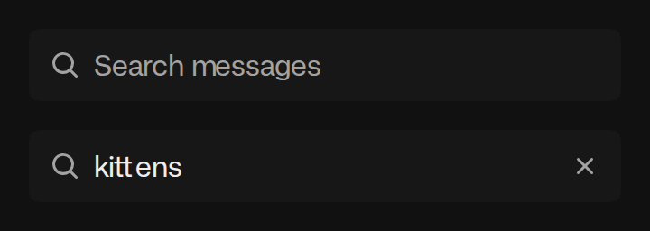
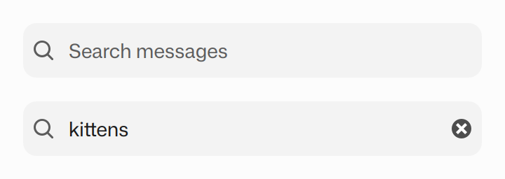
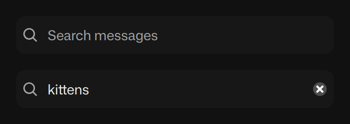
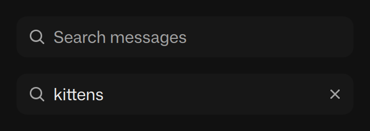
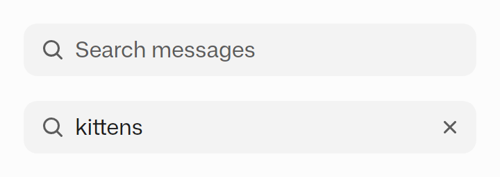
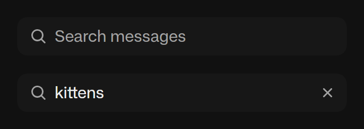
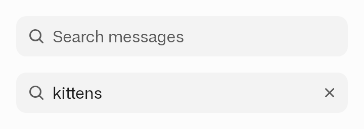
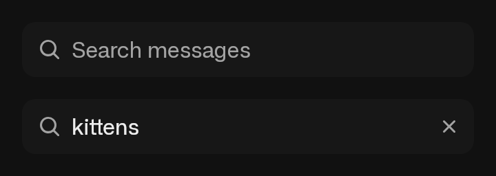

<!-- Generated by scripts/showcase.py from examples/ and component.toml. Do not edit by hand. -->

# SearchBar

A rounded search field with a leading icon and a clear button.

Mobile · [All components](README.md)

## Props

| Prop | Type | Default | Values | Description |
| --- | --- | --- | --- | --- |
| `value` | string |  |  | Query text. |
| `placeholder` | string | `"Search"` |  | Hint while empty. |

Names follow the web targets. Qt Widgets takes `snake_case` arguments, Qt Quick `camelCase` properties, Avalonia `PascalCase` properties and Slint `kebab-case` properties; each example below shows the spelling for its target.

## Examples

Each example is run as it is shown here, on every push, and the screenshots are taken from that run (left Blanc, right Noir).

### CSS

 

```html
<div style="display: grid; gap: 16px">
  <form class="pm-search" role="search">
    <svg class="pm-icon" width="16" height="16" viewBox="0 0 16 16" aria-hidden="true"><path d="M10.68 11.74a6 6 0 0 1-7.922-8.982 6 6 0 0 1 8.982 7.922l3.04 3.04a.749.749 0 0 1-.326 1.275.749.749 0 0 1-.734-.215ZM11.5 7a4.499 4.499 0 1 0-8.997 0A4.499 4.499 0 0 0 11.5 7Z"/></svg>
    <input class="pm-search__input" type="search" enterkeyhint="search" aria-label="Search" placeholder="Search messages" />
  </form>
  <form class="pm-search" role="search">
    <svg class="pm-icon" width="16" height="16" viewBox="0 0 16 16" aria-hidden="true"><path d="M10.68 11.74a6 6 0 0 1-7.922-8.982 6 6 0 0 1 8.982 7.922l3.04 3.04a.749.749 0 0 1-.326 1.275.749.749 0 0 1-.734-.215ZM11.5 7a4.499 4.499 0 1 0-8.997 0A4.499 4.499 0 0 0 11.5 7Z"/></svg>
    <input class="pm-search__input" type="search" enterkeyhint="search" aria-label="Search" value="kittens" />
    <button type="button" class="pm-search__clear" aria-label="Clear"><svg class="pm-icon" width="16" height="16" viewBox="0 0 16 16" aria-hidden="true"><path d="M3.72 3.72a.75.75 0 0 1 1.06 0L8 6.94l3.22-3.22a.749.749 0 0 1 1.275.326.749.749 0 0 1-.215.734L9.06 8l3.22 3.22a.749.749 0 0 1-.326 1.275.749.749 0 0 1-.734-.215L8 9.06l-3.22 3.22a.751.751 0 0 1-1.042-.018.751.751 0 0 1-.018-1.042L6.94 8 3.72 4.78a.75.75 0 0 1 0-1.06Z"/></svg></button>
  </form>
</div>
```

### Svelte

 

```svelte
<script lang="ts">
  import { SearchBar } from "$lib/purrimer";

  let query = $state("");
  let recent = $state("kittens");
</script>

<div style="display: grid; gap: 16px">
  <SearchBar placeholder="Search messages" bind:value={query} onsubmit={(q) => console.log("search", q)} />
  <SearchBar bind:value={recent} />
</div>
```

### Solid

 

```tsx
import { createSignal } from "solid-js";
import { SearchBar } from "~/purrimer";

export default function Example() {
  const [query, setQuery] = createSignal("");
  const [recent, setRecent] = createSignal("kittens");
  return (
    <div style={{ display: "grid", gap: "16px" }}>
      <SearchBar placeholder="Search messages" value={query()} onValue={setQuery} onSubmit={(q) => console.log("search", q)} />
      <SearchBar value={recent()} onValue={setRecent} />
    </div>
  );
}
```

### Qt Widgets (PySide6)

 

```python
from purrimer_qt.components import SearchBar
from PySide6.QtWidgets import QVBoxLayout, QWidget


def example() -> QWidget:
    column = QWidget()
    layout = QVBoxLayout(column)
    layout.setContentsMargins(0, 0, 0, 0)
    layout.setSpacing(16)
    search = SearchBar(placeholder="Search messages")
    search.returnPressed.connect(lambda: print("search", search.text()))
    layout.addWidget(search)
    layout.addWidget(SearchBar("kittens"))
    return column
```

### Qt Quick

 

```qml
import QtQuick
import Purrimer

Column {
    spacing: 16
    SearchBar { width: 328; placeholderText: "Search messages"; onAccepted: console.log("search", text) }
    SearchBar { width: 328; text: "kittens" }
}
```

### Avalonia

 

```xml
<UserControl xmlns="https://github.com/avaloniaui"
             xmlns:pm="using:Purrimer.Avalonia">
  <StackPanel Spacing="16">
    <pm:SearchBar PlaceholderText="Search messages" />
    <pm:SearchBar Text="kittens" />
  </StackPanel>
</UserControl>
```

### Slint

 

```slint
import { SearchBar } from "purrimer-components.slint";

export component Example inherits VerticalLayout {
    spacing: 16px;
    alignment: start;
    SearchBar { placeholder: "Search messages"; accepted(query) => { debug("search", query); } }
    SearchBar { text: "kittens"; }
}
```

