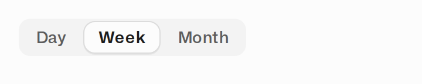
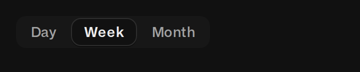
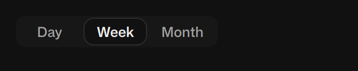
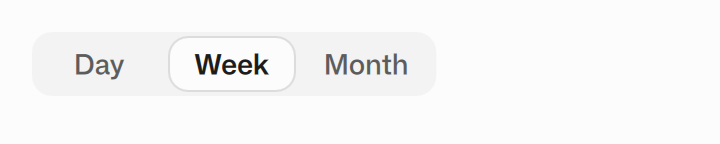
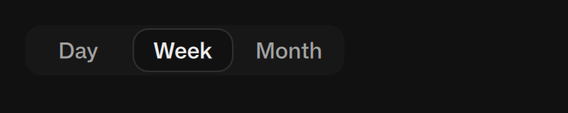
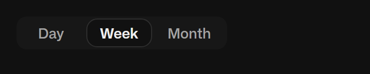
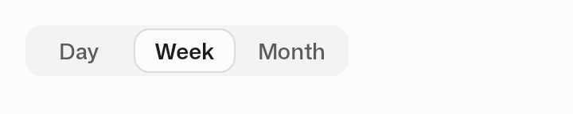
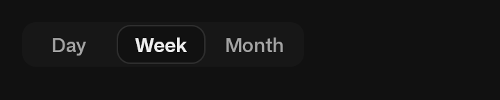

<!-- Generated by scripts/showcase.py from examples/ and component.toml. Do not edit by hand. -->

# SegmentedControl

Two to five segments that switch a view; the selected one lifts.

Navigation · [All components](README.md)

## Props

| Prop | Type | Default | Values | Description |
| --- | --- | --- | --- | --- |
| `items` | list |  |  | Segment labels. |
| `selected` | int | `0` |  | Index of the selected segment. |

Names follow the web targets. Qt Widgets takes `snake_case` arguments, Qt Quick `camelCase` properties, Avalonia `PascalCase` properties and Slint `kebab-case` properties; each example below shows the spelling for its target.

## Examples

Each example is run as it is shown here, on every push, and the screenshots are taken from that run (left Blanc, right Noir).

### CSS

 

```html
<div class="pm-segmented" role="radiogroup" aria-label="View">
  <button type="button" class="pm-segmented__item" role="radio" aria-checked="false" tabindex="-1">Day</button>
  <button type="button" class="pm-segmented__item" role="radio" aria-checked="true" tabindex="0">Week</button>
  <button type="button" class="pm-segmented__item" role="radio" aria-checked="false" tabindex="-1">Month</button>
</div>
```

### Svelte

 

```svelte
<script lang="ts">
  import { SegmentedControl } from "$lib/purrimer";

  let view = $state(1);
</script>

<SegmentedControl items={["Day", "Week", "Month"]} bind:selected={view} label="Calendar view" />
```

### Solid

 

```tsx
import { createSignal } from "solid-js";
import { SegmentedControl } from "~/purrimer";

export default function Example() {
  const [view, setView] = createSignal(1);
  return <SegmentedControl items={["Day", "Week", "Month"]} selected={view()} onSelect={setView} label="Calendar view" />;
}
```

### Qt Widgets (PySide6)

 

```python
from purrimer_qt.components import SegmentedControl
from PySide6.QtWidgets import QWidget


def example() -> QWidget:
    view = SegmentedControl(["Day", "Week", "Month"], selected=1)
    view.activated.connect(lambda index: print("view", index))
    return view
```

### Qt Quick

 

```qml
import QtQuick
import Purrimer

SegmentedControl {
    items: ["Day", "Week", "Month"]
    selected: 1
    onActivated: index => selected = index
}
```

### Avalonia

 

```xml
<UserControl xmlns="https://github.com/avaloniaui"
             xmlns:pm="using:Purrimer.Avalonia">
  <pm:SegmentedControl SelectedIndex="1">
    <ListBoxItem Content="Day" />
    <ListBoxItem Content="Week" />
    <ListBoxItem Content="Month" />
  </pm:SegmentedControl>
</UserControl>
```

### Slint

 

```slint
import { SegmentedControl } from "purrimer-components.slint";

export component Example inherits HorizontalLayout {
    alignment: start;
    SegmentedControl {
        items: ["Day", "Week", "Month"];
        selected: 1;
        activated(index) => { self.selected = index; }
    }
}
```

