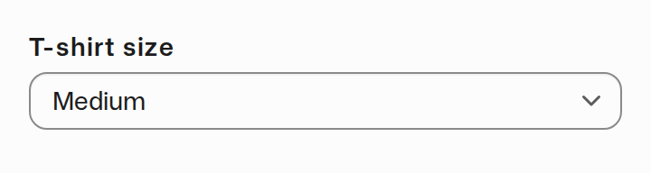
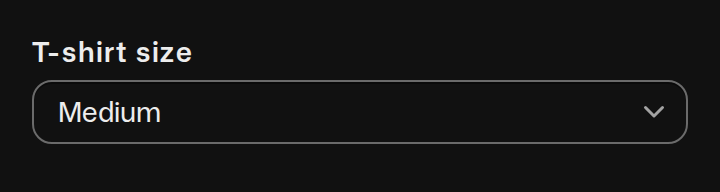
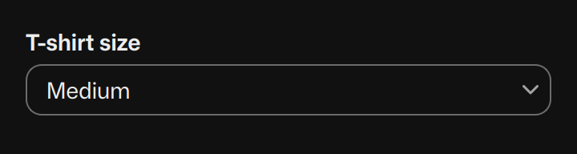
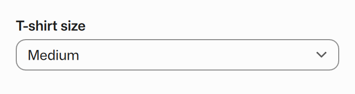
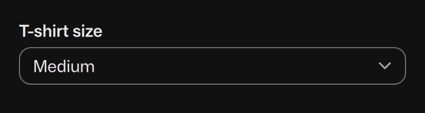
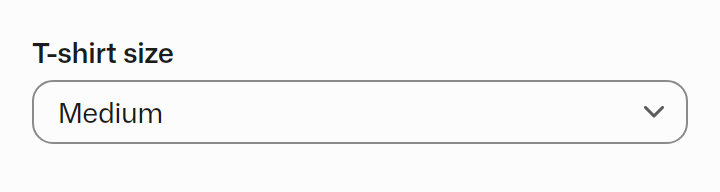
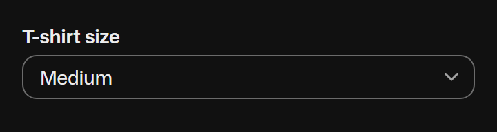
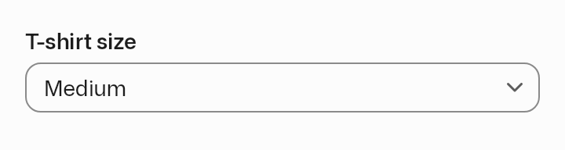
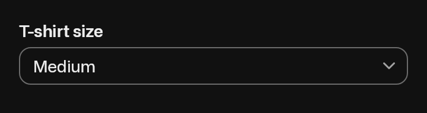

<!-- Generated by scripts/showcase.py from examples/ and component.toml. Do not edit by hand. -->

# Select

A field that opens a list of options; the open list joins the field.

Forms · [All components](README.md)

## Props

| Prop | Type | Default | Values | Description |
| --- | --- | --- | --- | --- |
| `label` | string |  |  | Label above the field. |
| `options` | list |  |  | Option labels. |
| `value` | int | `-1` |  | Index of the chosen option, or -1 for none. |
| `placeholder` | string | `"Choose"` |  | Text while nothing is chosen. |
| `disabled` | bool | `false` |  | Greys the field. |

Names follow the web targets. Qt Widgets takes `snake_case` arguments, Qt Quick `camelCase` properties, Avalonia `PascalCase` properties and Slint `kebab-case` properties; each example below shows the spelling for its target.

## Examples

Each example is run as it is shown here, on every push, and the screenshots are taken from that run (left Blanc, right Noir).

### CSS

 

```html
<div class="pm-select">
  <span class="pm-select__label" id="size-label">T-shirt size</span>
  <button type="button" class="pm-select__field" role="combobox" aria-haspopup="listbox" aria-expanded="false" aria-labelledby="size-label">
    <span>Medium</span>
    <svg class="pm-icon" width="16" height="16" viewBox="0 0 16 16" aria-hidden="true"><path d="M12.78 5.22a.749.749 0 0 1 0 1.06l-4.25 4.25a.749.749 0 0 1-1.06 0L3.22 6.28a.749.749 0 1 1 1.06-1.06L8 8.939l3.72-3.719a.749.749 0 0 1 1.06 0Z"/></svg>
  </button>
</div>
```

### Svelte

 

```svelte
<script lang="ts">
  import { Select } from "$lib/purrimer";

  let size = $state(1);
</script>

<Select label="T-shirt size" options={["Small", "Medium", "Large"]} bind:value={size} />
```

### Solid

 

```tsx
import { createSignal } from "solid-js";
import { Select } from "~/purrimer";

export default function Example() {
  const [size, setSize] = createSignal(1);
  return <Select label="T-shirt size" options={["Small", "Medium", "Large"]} value={size()} onChange={setSize} />;
}
```

### Qt Widgets (PySide6)

 

```python
from purrimer_qt.components import Select
from PySide6.QtWidgets import QWidget


def example() -> QWidget:
    size = Select("T-shirt size", ["Small", "Medium", "Large"], current_index=1)
    size.currentIndexChanged.connect(lambda index: print("size", index))
    return size
```

### Qt Quick

 

```qml
import QtQuick
import Purrimer

Select {
    width: 328
    label: "T-shirt size"
    options: ["Small", "Medium", "Large"]
    currentIndex: 1
    onActivated: index => console.log("size", index)
}
```

### Avalonia

 

```xml
<UserControl xmlns="https://github.com/avaloniaui"
             xmlns:pm="using:Purrimer.Avalonia">
  <pm:Select Label="T-shirt size" SelectedIndex="1" HorizontalAlignment="Stretch">
    <ComboBoxItem Content="Small" />
    <ComboBoxItem Content="Medium" />
    <ComboBoxItem Content="Large" />
  </pm:Select>
</UserControl>
```

### Slint

 

```slint
import { Select } from "purrimer-components.slint";

export component Example inherits VerticalLayout {
    alignment: start;
    Select {
        label: "T-shirt size";
        options: ["Small", "Medium", "Large"];
        current-index: 1;
        selected(index) => { debug("size", index); }
    }
}
```

