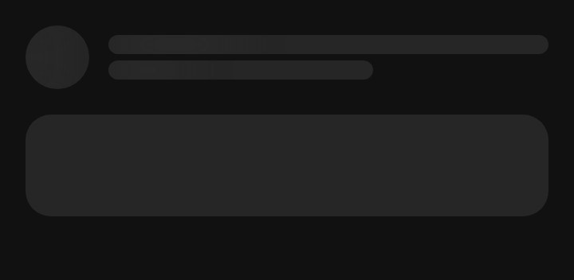
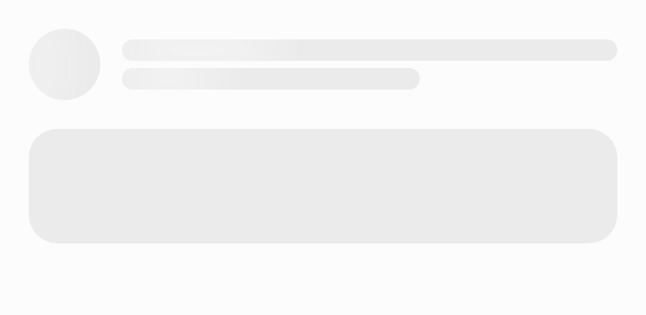
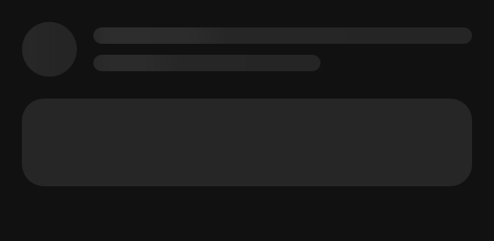
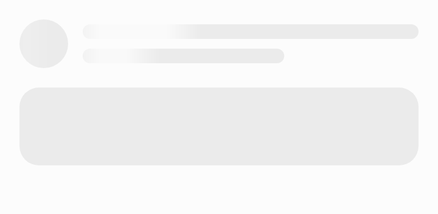
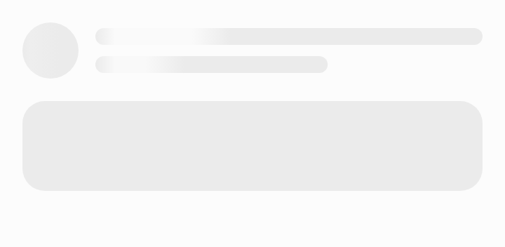
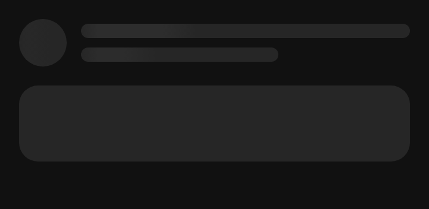

<!-- Generated by scripts/showcase.py from examples/ and component.toml. Do not edit by hand. -->

# Skeleton

Placeholder shapes that hold the layout while content loads, with a slow sunbeam or a sleepy breath.

Status · [All components](README.md)

## Props

| Prop | Type | Default | Values | Description |
| --- | --- | --- | --- | --- |
| `variant` | enum | `"text"` | `text`, `block`, `circle` | text is a 12px pill per line; block uses borderRadius-large; circle is round, for avatars. |
| `effect` | enum | `"sunbeam"` | `sunbeam`, `snore` | sunbeam: a soft band of light sweeps across. snore: the placeholder breathes. |
| `lines` | int | `1` |  | Text only: the number of lines; the last of several is 60% wide. |
| `width` | length |  |  | Width; text and block fill their container when unset, circles default to 40px. |
| `height` | length |  |  | Height; block defaults to 64px and circle to its width. |
| `kind` | enum | `"sleepy"` | `sleepy`, `playful` | Motion kind: playful sweeps faster. |

Names follow the web targets. Qt Widgets takes `snake_case` arguments, Qt Quick `camelCase` properties, Avalonia `PascalCase` properties and Slint `kebab-case` properties; each example below shows the spelling for its target.

## Examples

Each example is run as it is shown here, on every push, and the screenshots are taken from that run (left Blanc, right Noir).

### CSS

 

```html
<div aria-busy="true" style="display: grid; gap: 16px">
  <div style="display: flex; gap: 12px; align-items: center">
    <span class="pm-skeleton pm-skeleton--circle pm-skeleton--sunbeam" aria-hidden="true"></span>
    <span class="pm-skeleton-lines" aria-hidden="true" style="flex: 1">
      <span class="pm-skeleton pm-skeleton--text pm-skeleton--sunbeam"></span>
      <span class="pm-skeleton pm-skeleton--text pm-skeleton--sunbeam" style="width: 60%"></span>
    </span>
  </div>
  <span class="pm-skeleton pm-skeleton--block pm-skeleton--snore" aria-hidden="true"></span>
</div>
```

### Svelte

 

```svelte
<script lang="ts">
  import { Skeleton } from "$lib/purrimer";
</script>

<div aria-busy="true" style="display: grid; gap: 16px">
  <div style="display: flex; gap: 12px; align-items: center">
    <Skeleton variant="circle" />
    <div style="flex: 1"><Skeleton lines={2} /></div>
  </div>
  <Skeleton variant="block" effect="snore" />
</div>
```

### Solid

 

```tsx
import { Skeleton } from "~/purrimer";

export default function Example() {
  return (
    <div aria-busy="true" style={{ display: "grid", gap: "16px" }}>
      <div style={{ display: "flex", gap: "12px", "align-items": "center" }}>
        <Skeleton variant="circle" />
        <div style={{ flex: "1" }}><Skeleton lines={2} /></div>
      </div>
      <Skeleton variant="block" effect="snore" />
    </div>
  );
}
```

### Qt Widgets (PySide6)

 

```python
from purrimer_qt.components import Skeleton
from PySide6.QtWidgets import QHBoxLayout, QVBoxLayout, QWidget


def example() -> QWidget:
    column = QWidget()
    layout = QVBoxLayout(column)
    layout.setContentsMargins(0, 0, 0, 0)
    layout.setSpacing(16)
    row = QHBoxLayout()
    row.setSpacing(12)
    row.addWidget(Skeleton("circle"))
    row.addWidget(Skeleton(lines=2), 1)
    layout.addLayout(row)
    layout.addWidget(Skeleton("block", effect="snore"))
    return column
```

### Qt Quick

 

```qml
import QtQuick
import Purrimer

Column {
    width: 328
    spacing: 16
    Row {
        width: parent.width
        spacing: 12
        Skeleton { id: avatar; variant: "circle"; anchors.verticalCenter: parent.verticalCenter }
        Skeleton { lines: 2; width: parent.width - avatar.width - parent.spacing }
    }
    Skeleton { variant: "block"; effect: "snore"; width: parent.width }
}
```

### Avalonia

 

```xml
<UserControl xmlns="https://github.com/avaloniaui"
             xmlns:pm="using:Purrimer.Avalonia">
  <StackPanel Spacing="16">
    <Grid ColumnDefinitions="Auto,*">
      <pm:Skeleton Variant="circle" VerticalAlignment="Center" />
      <pm:Skeleton Grid.Column="1" Lines="2" Margin="12,0,0,0" VerticalAlignment="Center" />
    </Grid>
    <pm:Skeleton Variant="block" LoadingEffect="snore" />
  </StackPanel>
</UserControl>
```

### Slint

 

```slint
import { Skeleton } from "purrimer-components.slint";

export component Example inherits VerticalLayout {
    spacing: 16px;
    alignment: start;
    HorizontalLayout {
        spacing: 12px;
        Skeleton { variant: "circle"; }
        Skeleton { lines: 2; y: (parent.height - self.height) / 2; }
    }
    Skeleton { variant: "block"; effect: "snore"; }
}
```

