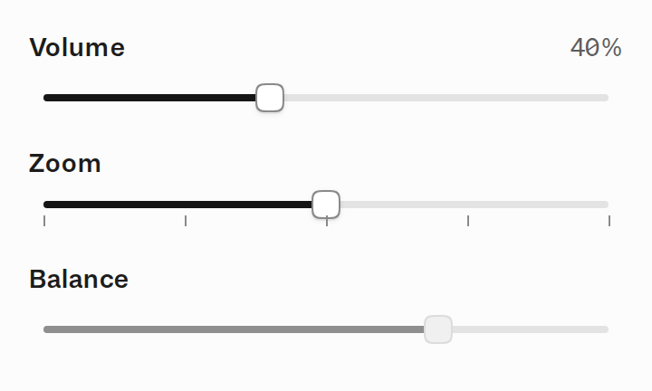
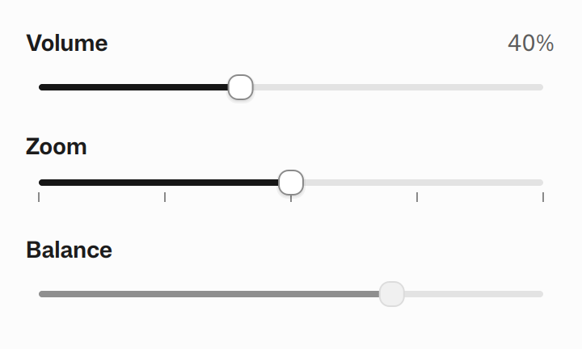
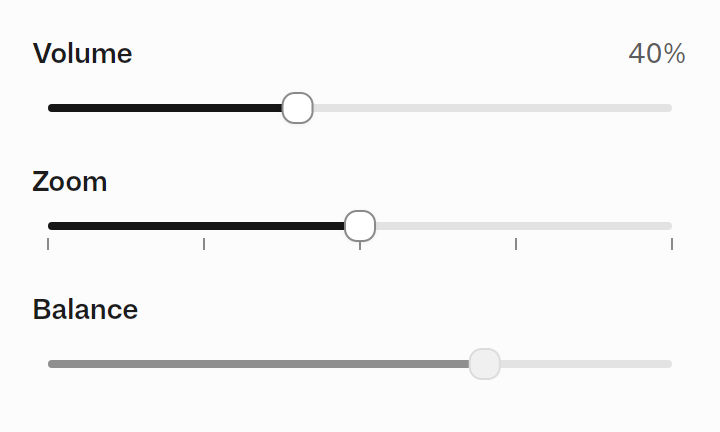

<!-- Generated by scripts/showcase.py from examples/ and component.toml. Do not edit by hand. -->

# Slider

Picks a value from a continuous range by dragging a squircle thumb.

Forms · [All components](README.md)

## Props

| Prop | Type | Default | Values | Description |
| --- | --- | --- | --- | --- |
| `label` | string |  |  | Label above the slider; without one, pass an accessible name. |
| `value` | number | `0` |  | Current value. |
| `min` | number | `0` |  | Lowest value. |
| `max` | number | `100` |  | Highest value. |
| `step` | number | `1` |  | Arrow-key step; values snap to it. |
| `pageStep` | number | `10` |  | Page Up and Page Down step. |
| `orientation` | enum | `"horizontal"` | `horizontal`, `vertical` | Track direction; vertical fills from the bottom. |
| `tickPosition` | enum | `"none"` | `none`, `above`, `below`, `both`, `left`, `right` | Where tick marks go: above and below for horizontal sliders, left and right for vertical ones. |
| `tickInterval` | number | `0` |  | Distance between ticks; 0 uses pageStep. |
| `length` | int | `0` |  | Track length in px; 0 fills the width, or 160px when vertical. |
| `showValue` | bool | `false` |  | Shows the value at the end of the label row. |
| `suffix` | string |  |  | Text after the shown value, such as "%". |
| `disabled` | bool | `false` |  | Greys the slider and ignores input. |

Names follow the web targets. Qt Widgets takes `snake_case` arguments, Qt Quick `camelCase` properties, Avalonia `PascalCase` properties and Slint `kebab-case` properties; each example below shows the spelling for its target.

## Examples

Each example is run as it is shown here, on every push, and the screenshots are taken from that run (left Blanc, right Noir).

### CSS

 

```html
<div style="display: grid; gap: 12px">
<div class="pm-slider">
  <div class="pm-slider__head"><span class="pm-slider__label" id="volume-label">Volume</span><span class="pm-slider__value" aria-hidden="true">40%</span></div>
  <div class="pm-slider__control">
    <div class="pm-slider__track">
      <div class="pm-slider__fill" style="width: 40%"></div>
      <div class="pm-slider__thumb" role="slider" tabindex="0" aria-valuemin="0" aria-valuemax="100" aria-valuenow="40" aria-labelledby="volume-label" style="left: 40%"></div>
    </div>
  </div>
</div>
<div class="pm-slider">
  <div class="pm-slider__head"><span class="pm-slider__label" id="zoom-label">Zoom</span></div>
  <div class="pm-slider__control">
    <div class="pm-slider__track">
      <div class="pm-slider__fill" style="width: 50%"></div>
      <div class="pm-slider__thumb" role="slider" tabindex="0" aria-valuemin="0" aria-valuemax="100" aria-valuenow="50" aria-labelledby="zoom-label" style="left: 50%"></div>
    </div>
    <div class="pm-slider__ticks pm-slider__ticks--after" aria-hidden="true"><span class="pm-slider__tick" style="left: 0%"></span><span class="pm-slider__tick" style="left: 25%"></span><span class="pm-slider__tick" style="left: 50%"></span><span class="pm-slider__tick" style="left: 75%"></span><span class="pm-slider__tick" style="left: 100%"></span></div>
  </div>
</div>
<div class="pm-slider pm-slider--disabled">
  <div class="pm-slider__head"><span class="pm-slider__label" id="balance-label">Balance</span></div>
  <div class="pm-slider__control">
    <div class="pm-slider__track">
      <div class="pm-slider__fill" style="width: 70%"></div>
      <div class="pm-slider__thumb" role="slider" tabindex="-1" aria-valuemin="0" aria-valuemax="100" aria-valuenow="70" aria-labelledby="balance-label" aria-disabled="true" style="left: 70%"></div>
    </div>
  </div>
</div>
</div>
```

### Svelte

 

```svelte
<script lang="ts">
  import { Slider } from "$lib/purrimer";

  let volume = $state(40);
</script>

<div style="display: grid; gap: 12px">
  <Slider label="Volume" bind:value={volume} showValue suffix="%" />
  <Slider label="Zoom" value={50} step={5} pageStep={25} tickPosition="below" />
  <Slider label="Balance" value={70} disabled />
</div>
```

### Solid

 

```tsx
import { createSignal } from "solid-js";
import { Slider } from "~/purrimer";

export default function Example() {
  const [volume, setVolume] = createSignal(40);
  return (
    <div style={{ display: "grid", gap: "12px" }}>
      <Slider label="Volume" value={volume()} onChange={setVolume} showValue suffix="%" />
      <Slider label="Zoom" value={50} step={5} pageStep={25} tickPosition="below" />
      <Slider label="Balance" value={70} disabled />
    </div>
  );
}
```

### Qt Widgets (PySide6)

 

```python
from purrimer_qt.components import Slider
from PySide6.QtWidgets import QVBoxLayout, QWidget


def example() -> QWidget:
    column = QWidget()
    layout = QVBoxLayout(column)
    layout.setContentsMargins(0, 0, 0, 0)
    layout.setSpacing(12)
    volume = Slider("Volume", 40, show_value=True, suffix="%")
    volume.valueChanged.connect(lambda value: print("volume", value))
    layout.addWidget(volume)
    layout.addWidget(Slider("Zoom", 50, step=5, page_step=25, tick_position="below"))
    balance = Slider("Balance", 70)
    balance.setEnabled(False)
    layout.addWidget(balance)
    return column
```

### Qt Quick

 

```qml
import QtQuick
import Purrimer

Column {
    width: 328
    spacing: 12
    Slider { width: parent.width; label: "Volume"; value: 40; showValue: true; suffix: "%" }
    Slider { width: parent.width; label: "Zoom"; value: 50; stepSize: 5; pageStep: 25; tickPosition: "below" }
    Slider { width: parent.width; label: "Balance"; value: 70; disabled: true }
}
```

### Avalonia

 

```xml
<UserControl xmlns="https://github.com/avaloniaui"
             xmlns:pm="using:Purrimer.Avalonia">
  <StackPanel Spacing="12">
    <pm:Slider Label="Volume" Value="40" ShowValue="True" Suffix="%" />
    <pm:Slider Label="Zoom" Value="50" SmallChange="5" LargeChange="25" TickPosition="below" />
    <pm:Slider Label="Balance" Value="70" IsEnabled="False" />
  </StackPanel>
</UserControl>
```

### Slint

 

```slint
import { Slider } from "purrimer-components.slint";

export component Example inherits VerticalLayout {
    spacing: 12px;
    alignment: start;
    Slider { label: "Volume"; value: 40; show-value: true; suffix: "%"; changed(value) => { debug("volume", value); } }
    Slider { label: "Zoom"; value: 50; step: 5; page-step: 25; tick-position: "below"; }
    Slider { label: "Balance"; value: 70; enabled: false; }
}
```

