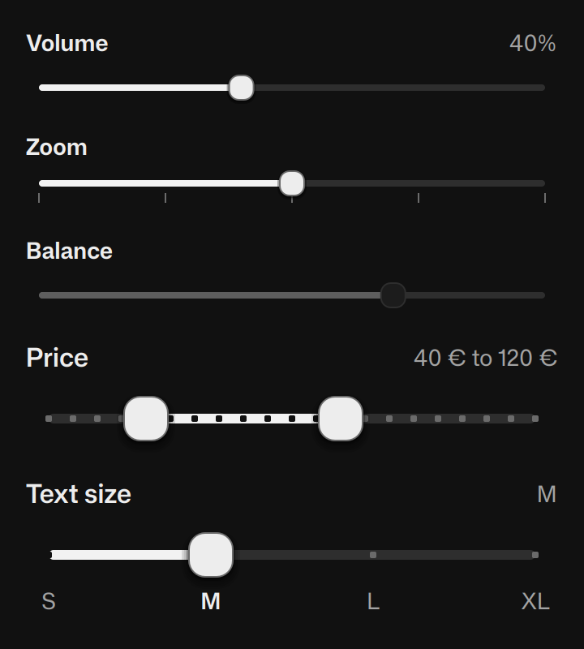
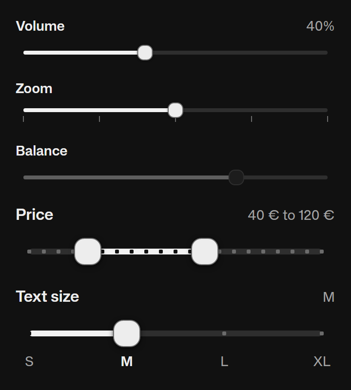
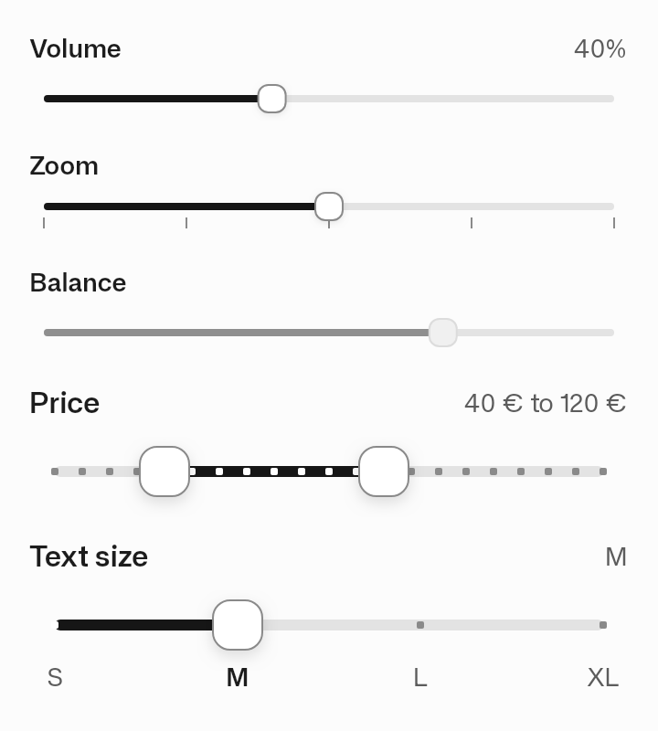

<!-- Generated by scripts/showcase.py from examples/ and component.toml. Do not edit by hand. -->

# Slider

Picks a value, or a low and high pair, from a range by dragging a squircle thumb.

Forms · [All components](README.md)

## Props

| Prop | Type | Default | Values | Description |
| --- | --- | --- | --- | --- |
| `label` | string |  |  | Label above the slider; without one, pass an accessible name. |
| `value` | number | `0` |  | Current value; with range, the [low, high] pair (low and high on the native targets). |
| `min` | number | `0` |  | Lowest value. |
| `max` | number | `100` |  | Highest value. |
| `step` | number | `1` |  | Arrow-key step; values snap to it. With marks, 0 snaps to the marks alone. |
| `pageStep` | number | `10` |  | Page Up and Page Down step. |
| `orientation` | enum | `"horizontal"` | `horizontal`, `vertical` | Track direction; vertical fills from the bottom. |
| `tickPosition` | enum | `"none"` | `none`, `above`, `below`, `both`, `left`, `right` | Where tick marks go: above and below for horizontal sliders, left and right for vertical ones. |
| `tickInterval` | number | `0` |  | Distance between ticks; 0 uses pageStep. |
| `length` | int | `0` |  | Track length in px; 0 fills the width, or 160px when vertical. |
| `showValue` | bool | `false` |  | Shows the value at the end of the label row; a range reads "low to high". |
| `suffix` | string |  |  | Text after the shown value, such as "%". |
| `disabled` | bool | `false` |  | Greys the slider and ignores input. |
| `range` | bool | `false` |  | Two thumbs for a low and a high value that cannot pass each other. Always uses the touch design. |
| `marks` | list |  |  | Named detents, { value, label? }: the thumb snaps to them within 10px and their labels sit under the track. Always uses the touch design. |

Names follow the web targets. Qt Widgets takes `snake_case` arguments, Qt Quick `camelCase` properties, Avalonia `PascalCase` properties and Slint `kebab-case` properties; each example below shows the spelling for its target.

## Examples

Each example is run as it is shown here, on every push, and the screenshots are taken from that run (left Blanc, right Noir).

### CSS

 

```html
<div style="display: grid; gap: 12px">
<div class="pm-slider">
  <div class="pm-slider__head"><span class="pm-slider__label" id="volume-label">Volume</span><span class="pm-slider__value" aria-hidden="true">40%</span></div>
  <div class="pm-slider__control">
    <div class="pm-slider__track">
      <div class="pm-slider__fill" style="width: 40%"></div>
      <div class="pm-slider__thumb" role="slider" tabindex="0" aria-valuemin="0" aria-valuemax="100" aria-valuenow="40" aria-labelledby="volume-label" style="left: 40%"></div>
    </div>
  </div>
</div>
<div class="pm-slider">
  <div class="pm-slider__head"><span class="pm-slider__label" id="zoom-label">Zoom</span></div>
  <div class="pm-slider__control">
    <div class="pm-slider__track">
      <div class="pm-slider__fill" style="width: 50%"></div>
      <div class="pm-slider__thumb" role="slider" tabindex="0" aria-valuemin="0" aria-valuemax="100" aria-valuenow="50" aria-labelledby="zoom-label" style="left: 50%"></div>
    </div>
    <div class="pm-slider__ticks pm-slider__ticks--after" aria-hidden="true"><span class="pm-slider__tick" style="left: 0%"></span><span class="pm-slider__tick" style="left: 25%"></span><span class="pm-slider__tick" style="left: 50%"></span><span class="pm-slider__tick" style="left: 75%"></span><span class="pm-slider__tick" style="left: 100%"></span></div>
  </div>
</div>
<div class="pm-slider pm-slider--disabled">
  <div class="pm-slider__head"><span class="pm-slider__label" id="balance-label">Balance</span></div>
  <div class="pm-slider__control">
    <div class="pm-slider__track">
      <div class="pm-slider__fill" style="width: 70%"></div>
      <div class="pm-slider__thumb" role="slider" tabindex="-1" aria-valuemin="0" aria-valuemax="100" aria-valuenow="70" aria-labelledby="balance-label" aria-disabled="true" style="left: 70%"></div>
    </div>
  </div>
</div>
<div class="pm-slider pm-slider--touch">
  <div class="pm-slider__head"><span class="pm-slider__label" id="price-label">Price</span><span class="pm-slider__value" aria-hidden="true">40 € to 120 €</span></div>
  <div class="pm-slider__control">
    <div class="pm-slider__lane">
      <span class="pm-slider__rail" aria-hidden="true"><span class="pm-slider__detent" style="left: 0%"></span><span class="pm-slider__detent" style="left: 5%"></span><span class="pm-slider__detent" style="left: 10%"></span><span class="pm-slider__detent" style="left: 15%"></span><span class="pm-slider__detent pm-slider__detent--on" style="left: 20%"></span><span class="pm-slider__detent pm-slider__detent--on" style="left: 25%"></span><span class="pm-slider__detent pm-slider__detent--on" style="left: 30%"></span><span class="pm-slider__detent pm-slider__detent--on" style="left: 35%"></span><span class="pm-slider__detent pm-slider__detent--on" style="left: 40%"></span><span class="pm-slider__detent pm-slider__detent--on" style="left: 45%"></span><span class="pm-slider__detent pm-slider__detent--on" style="left: 50%"></span><span class="pm-slider__detent pm-slider__detent--on" style="left: 55%"></span><span class="pm-slider__detent pm-slider__detent--on" style="left: 60%"></span><span class="pm-slider__detent" style="left: 65%"></span><span class="pm-slider__detent" style="left: 70%"></span><span class="pm-slider__detent" style="left: 75%"></span><span class="pm-slider__detent" style="left: 80%"></span><span class="pm-slider__detent" style="left: 85%"></span><span class="pm-slider__detent" style="left: 90%"></span><span class="pm-slider__detent" style="left: 95%"></span><span class="pm-slider__detent" style="left: 100%"></span><span class="pm-slider__bar" style="left: 20%; width: 40%"></span></span>
      <span data-thumb="0" class="pm-slider__hit" style="left: 20%" role="slider" tabindex="0" aria-valuemin="0" aria-valuemax="120" aria-valuenow="40" aria-valuetext="40 €" aria-orientation="horizontal" aria-label="Minimum Price"><span class="pm-slider__knob" aria-hidden="true"></span><span class="pm-slider__bubble" aria-hidden="true">40 €</span></span>
      <span data-thumb="1" class="pm-slider__hit" style="left: 60%" role="slider" tabindex="0" aria-valuemin="40" aria-valuemax="200" aria-valuenow="120" aria-valuetext="120 €" aria-orientation="horizontal" aria-label="Maximum Price"><span class="pm-slider__knob" aria-hidden="true"></span><span class="pm-slider__bubble" aria-hidden="true">120 €</span></span>
    </div>
  </div>
</div>
<div class="pm-slider pm-slider--touch">
  <div class="pm-slider__head"><span class="pm-slider__label" id="size-label">Text size</span><span class="pm-slider__value" aria-hidden="true">M</span></div>
  <div class="pm-slider__control">
    <div class="pm-slider__lane">
      <span class="pm-slider__rail" aria-hidden="true"><span class="pm-slider__detent pm-slider__detent--on" style="left: 0%"></span><span class="pm-slider__detent pm-slider__detent--on" style="left: 33.3333%"></span><span class="pm-slider__detent" style="left: 66.6667%"></span><span class="pm-slider__detent" style="left: 100%"></span><span class="pm-slider__bar" style="left: 0%; width: 33.3333%"></span></span>
      <span data-thumb="0" class="pm-slider__hit" style="left: 33.3333%" role="slider" tabindex="0" aria-valuemin="1" aria-valuemax="4" aria-valuenow="2" aria-valuetext="M" aria-orientation="horizontal" aria-labelledby="size-label"><span class="pm-slider__knob" aria-hidden="true"></span><span class="pm-slider__bubble" aria-hidden="true">M</span></span>
    </div>
    <div class="pm-slider__marks" aria-hidden="true"><span class="pm-slider__mark" style="left: 0%">S</span><span class="pm-slider__mark pm-slider__mark--on" style="left: 33.3333%">M</span><span class="pm-slider__mark" style="left: 66.6667%">L</span><span class="pm-slider__mark" style="left: 100%">XL</span></div>
  </div>
</div>
</div>
```

### Svelte

 

```svelte
<script lang="ts">
  import { Slider } from "$lib/purrimer";

  let volume = $state(40);
  let price: [number, number] = $state([40, 120]);
  const sizes = [
    { value: 1, label: "S" },
    { value: 2, label: "M" },
    { value: 3, label: "L" },
    { value: 4, label: "XL" },
  ];
</script>

<div style="display: grid; gap: 12px">
  <Slider label="Volume" bind:value={volume} showValue suffix="%" />
  <Slider label="Zoom" value={50} step={5} pageStep={25} tickPosition="below" />
  <Slider label="Balance" value={70} disabled />
  <Slider label="Price" range bind:value={price} max={200} step={10} showValue suffix=" €" />
  <Slider label="Text size" value={2} min={1} max={4} marks={sizes} showValue />
</div>
```

### Solid

 

```tsx
import { createSignal } from "solid-js";
import { Slider } from "~/purrimer";

export default function Example() {
  const [volume, setVolume] = createSignal(40);
  const [price, setPrice] = createSignal<[number, number]>([40, 120]);
  const sizes = [
    { value: 1, label: "S" },
    { value: 2, label: "M" },
    { value: 3, label: "L" },
    { value: 4, label: "XL" },
  ];
  return (
    <div style={{ display: "grid", gap: "12px" }}>
      <Slider label="Volume" value={volume()} onChange={(v) => setVolume(v as number)} showValue suffix="%" />
      <Slider label="Zoom" value={50} step={5} pageStep={25} tickPosition="below" />
      <Slider label="Balance" value={70} disabled />
      <Slider
        label="Price"
        range
        value={price()}
        onChange={(v) => setPrice(v as [number, number])}
        max={200}
        step={10}
        showValue
        suffix=" €"
      />
      <Slider label="Text size" value={2} min={1} max={4} marks={sizes} showValue />
    </div>
  );
}
```

### Qt Widgets (PySide6)

 

```python
from purrimer_qt.components import Slider
from purrimer_qt.components.slider import SliderMark
from PySide6.QtWidgets import QVBoxLayout, QWidget


def example() -> QWidget:
    column = QWidget()
    layout = QVBoxLayout(column)
    layout.setContentsMargins(0, 0, 0, 0)
    layout.setSpacing(12)
    volume = Slider("Volume", 40, show_value=True, suffix="%")
    volume.valueChanged.connect(lambda value: print("volume", value))
    layout.addWidget(volume)
    layout.addWidget(Slider("Zoom", 50, step=5, page_step=25, tick_position="below"))
    balance = Slider("Balance", 70)
    balance.setEnabled(False)
    layout.addWidget(balance)
    price = Slider("Price", maximum=200, step=10, show_value=True, suffix=" €", range=True, low=40, high=120)
    price.rangeChanged.connect(lambda low, high: print("price", low, high))
    layout.addWidget(price)
    sizes = [SliderMark(1, "S"), SliderMark(2, "M"), SliderMark(3, "L"), SliderMark(4, "XL")]
    layout.addWidget(Slider("Text size", 2, minimum=1, maximum=4, show_value=True, marks=sizes))
    layout.addStretch()
    return column
```

### Qt Quick

 

```qml
import QtQuick
import Purrimer

Column {
    width: 328
    spacing: 12
    Slider { width: parent.width; label: "Volume"; value: 40; showValue: true; suffix: "%" }
    Slider { width: parent.width; label: "Zoom"; value: 50; stepSize: 5; pageStep: 25; tickPosition: "below" }
    Slider { width: parent.width; label: "Balance"; value: 70; disabled: true }
    Slider {
        width: parent.width
        label: "Price"
        range: true
        to: 200
        stepSize: 10
        low: 40
        high: 120
        showValue: true
        suffix: " €"
        onRangeMoved: (low, high) => console.log("price", low, high)
    }
    Slider {
        width: parent.width
        label: "Text size"
        from: 1
        to: 4
        value: 2
        showValue: true
        marks: [{ value: 1, label: "S" }, { value: 2, label: "M" }, { value: 3, label: "L" }, { value: 4, label: "XL" }]
    }
}
```

### Avalonia

 

```xml
<UserControl xmlns="https://github.com/avaloniaui"
             xmlns:pm="using:Purrimer.Avalonia">
  <StackPanel Spacing="12">
    <pm:Slider Label="Volume" Value="40" ShowValue="True" Suffix="%" />
    <pm:Slider Label="Zoom" Value="50" SmallChange="5" LargeChange="25" TickPosition="below" />
    <pm:Slider Label="Balance" Value="70" IsEnabled="False" />
    <pm:Slider Label="Price" IsRange="True" Maximum="200" SmallChange="10" LowValue="40" HighValue="120"
               ShowValue="True" Suffix=" €" />
    <pm:Slider Label="Text size" Minimum="1" Maximum="4" Value="2" ShowValue="True">
      <pm:Slider.Marks>
        <pm:SliderMark Value="1" Label="S" />
        <pm:SliderMark Value="2" Label="M" />
        <pm:SliderMark Value="3" Label="L" />
        <pm:SliderMark Value="4" Label="XL" />
      </pm:Slider.Marks>
    </pm:Slider>
  </StackPanel>
</UserControl>
```

### Slint

 

```slint
import { Slider, SliderMark } from "purrimer-components.slint";

export component Example inherits VerticalLayout {
    spacing: 12px;
    alignment: start;
    Slider { label: "Volume"; value: 40; show-value: true; suffix: "%"; changed(value) => { debug("volume", value); } }
    Slider { label: "Zoom"; value: 50; step: 5; page-step: 25; tick-position: "below"; }
    Slider { label: "Balance"; value: 70; enabled: false; }
    Slider {
        label: "Price";
        range: true;
        maximum: 200;
        step: 10;
        low: 40;
        high: 120;
        show-value: true;
        suffix: " €";
        range-changed(low, high) => { debug("price", low, high); }
    }
    Slider {
        label: "Text size";
        minimum: 1;
        maximum: 4;
        value: 2;
        show-value: true;
        marks: [
            { value: 1, label: "S" },
            { value: 2, label: "M" },
            { value: 3, label: "L" },
            { value: 4, label: "XL" },
        ];
    }
}
```

