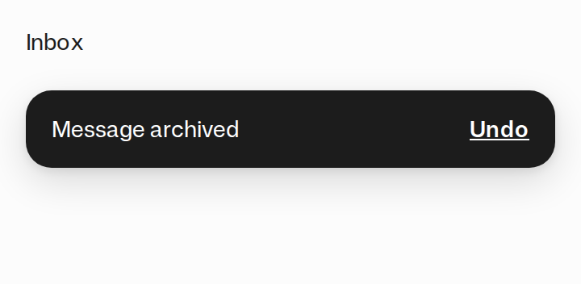
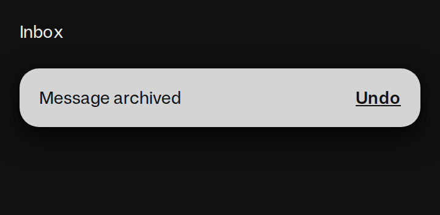
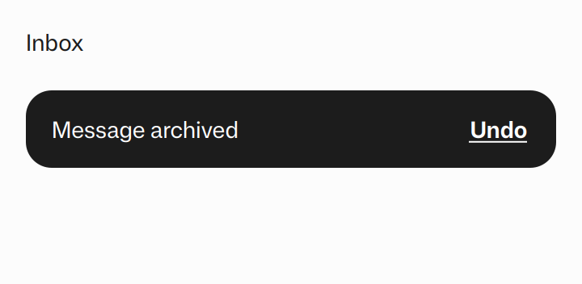
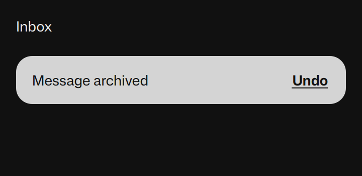
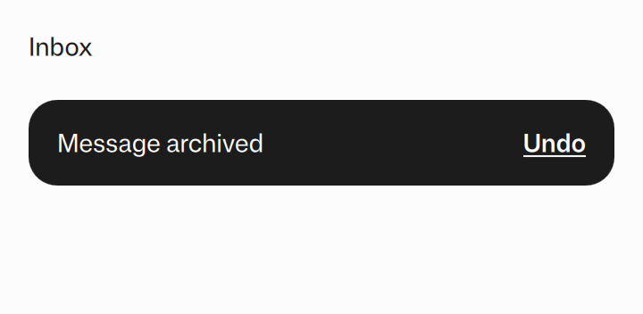
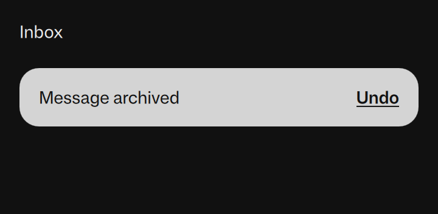
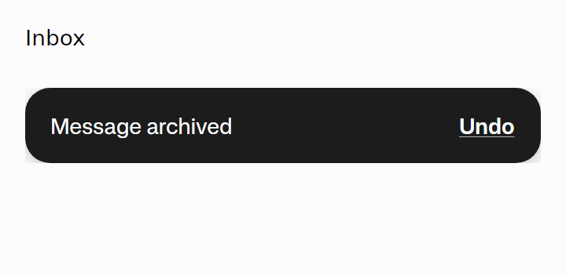
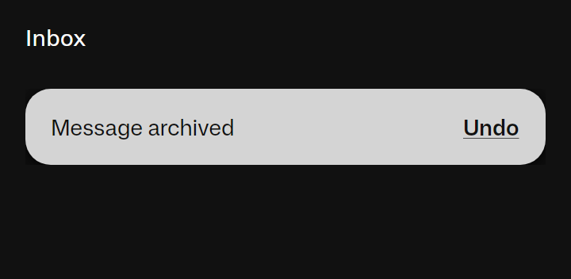
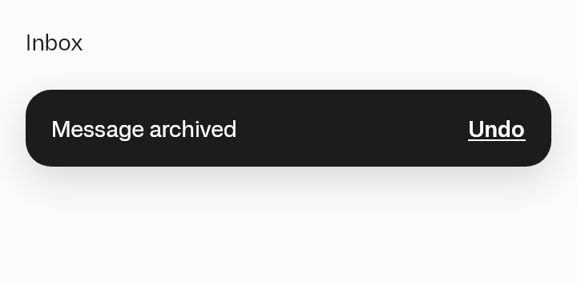

<!-- Generated by scripts/showcase.py from examples/ and component.toml. Do not edit by hand. -->

# Snackbar

A short message on an inverse surface above the bottom bar, with one optional action; swipe it sideways to dismiss it.

Mobile · [All components](README.md)

## Props

| Prop | Type | Default | Values | Description |
| --- | --- | --- | --- | --- |
| `open` | bool | `false` |  | Whether it is shown. |
| `message` | string |  |  | One line of text. |
| `action` | string |  |  | Action button text. |
| `duration` | int | `4000` |  | Milliseconds before it closes; 0 keeps it open. |

Names follow the web targets. Qt Widgets takes `snake_case` arguments, Qt Quick `camelCase` properties, Avalonia `PascalCase` properties and Slint `kebab-case` properties; each example below shows the spelling for its target.

## Examples

Each example is run as it is shown here, on every push, and the screenshots are taken from that run (left Blanc, right Noir).

### CSS

 

```html
<div>
  <p class="text-body-medium" style="margin: 16px">Inbox</p>
  <div class="pm-snackbar" role="status" aria-live="polite">
    <span class="pm-snackbar__message">Message archived</span>
    <button type="button" class="pm-snackbar__action">Undo</button>
  </div>
</div>
```

### Svelte

 

```svelte
<script lang="ts">
  import { Snackbar } from "$lib/purrimer";

  let open = $state(true);
</script>

<p class="text-body-medium" style="margin: 16px">Inbox</p>
<Snackbar bind:open message="Message archived" action="Undo" onaction={() => console.log("undo")} />
```

### Solid

 

```tsx
import { createSignal } from "solid-js";
import { Snackbar } from "~/purrimer";

export default function Example() {
  const [open, setOpen] = createSignal(true);
  return (
    <div>
      <p class="text-body-medium" style={{ margin: "16px" }}>Inbox</p>
      <Snackbar
        open={open()}
        message="Message archived"
        action="Undo"
        onAction={() => console.log("undo")}
        onClose={() => setOpen(false)}
      />
    </div>
  );
}
```

### Qt Widgets (PySide6)

 

```python
from purrimer_qt.components import Snackbar
from PySide6.QtCore import QTimer
from PySide6.QtWidgets import QLabel, QVBoxLayout, QWidget


def example() -> QWidget:
    screen = QWidget()
    layout = QVBoxLayout(screen)
    layout.setContentsMargins(16, 16, 16, 16)
    layout.addWidget(QLabel("Inbox"))
    layout.addStretch()
    snackbar = Snackbar()
    snackbar.actionTriggered.connect(lambda: print("undo"))
    layout.addWidget(snackbar)
    # Above the bottom bar, as on a phone screen.
    layout.addSpacing(56)
    QTimer.singleShot(0, lambda: snackbar.show_message("Message archived", "Undo"))
    return screen
```

### Qt Quick

 

```qml
import QtQuick
import Purrimer

Item {
    Text {
        x: 16; y: 16
        text: "Inbox"
        color: Purrimer.fgColorDefault
        font: Purrimer.textBodyMedium
    }

    Snackbar {
        message: "Message archived"
        action: "Undo"
        onActionTriggered: console.log("undo")
        Component.onCompleted: open()
    }
}
```

### Avalonia

 

```xml
<UserControl xmlns="https://github.com/avaloniaui"
             xmlns:pm="using:Purrimer.Avalonia">
  <Panel>
    <TextBlock Margin="16" Text="Inbox" />
    <pm:Snackbar IsOpen="True" Message="Message archived" ActionText="Undo" />
  </Panel>
</UserControl>
```

### Slint

 

```slint
import { Purrimer, Snackbar } from "purrimer-components.slint";

export component Example inherits Rectangle {
    Text {
        x: 16px;
        y: 16px;
        text: "Inbox";
        color: Purrimer.fg-color-default;
    }

    // Inset by the gutter, above the bottom bar.
    Snackbar {
        x: 16px;
        width: parent.width - 32px;
        y: parent.height - self.height - Purrimer.mobile-bottom-nav-height - 16px;
        open: true;
        message: "Message archived";
        action: "Undo";
        action-triggered => { debug("undo"); }
    }
}
```

