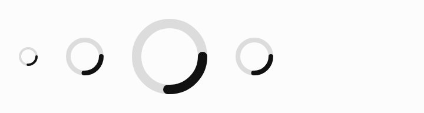
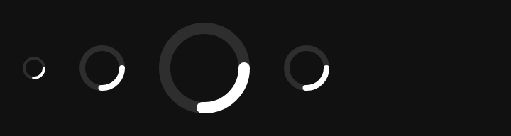
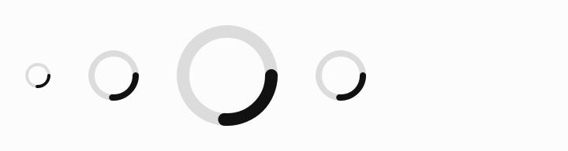
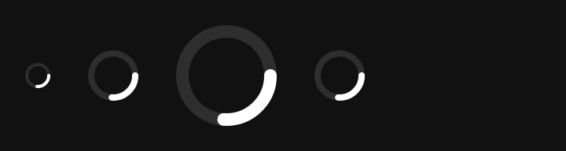
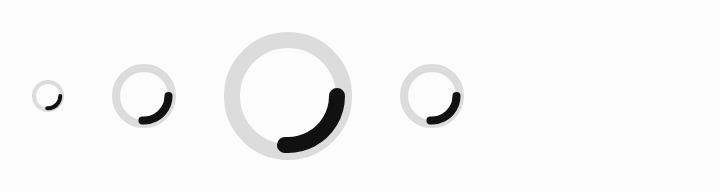
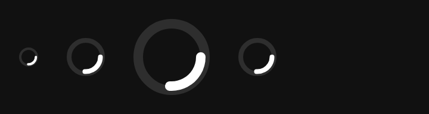

<!-- Generated by scripts/showcase.py from examples/ and component.toml. Do not edit by hand. -->

# Spinner

A rotating arc for waits under about ten seconds.

Status · [All components](README.md)

## Props

| Prop | Type | Default | Values | Description |
| --- | --- | --- | --- | --- |
| `size` | enum | `"medium"` | `small`, `medium`, `large` | small 16px, medium 32px, large 64px; the web targets also take a number. |
| `label` | string | `"Loading"` |  | Announced to screen readers. |
| `kind` | enum | `"sleepy"` | `sleepy`, `playful` | Motion kind. Sleepy turns once every 1.6s with a steady arc; playful turns faster and the arc stretches. |

Names follow the web targets. Qt Widgets takes `snake_case` arguments, Qt Quick `camelCase` properties, Avalonia `PascalCase` properties and Slint `kebab-case` properties; each example below shows the spelling for its target.

## Examples

Each example is run as it is shown here, on every push, and the screenshots are taken from that run (left Blanc, right Noir).

### CSS

 

```html
<div style="display: flex; gap: 24px; align-items: center">
  <span class="pm-spinner" role="status"><svg width="16" height="16" viewBox="0 0 16 16" fill="none" aria-hidden="true"><circle class="pm-spinner__track" cx="8" cy="8" r="7" stroke-width="2"></circle><circle class="pm-spinner__arc" cx="8" cy="8" r="7" stroke-width="2" pathLength="100"></circle></svg><span class="pm-sr-only">Loading</span></span>
  <span class="pm-spinner" role="status"><svg width="32" height="32" viewBox="0 0 16 16" fill="none" aria-hidden="true"><circle class="pm-spinner__track" cx="8" cy="8" r="7" stroke-width="2"></circle><circle class="pm-spinner__arc" cx="8" cy="8" r="7" stroke-width="2" pathLength="100"></circle></svg><span class="pm-sr-only">Loading</span></span>
  <span class="pm-spinner" role="status"><svg width="64" height="64" viewBox="0 0 16 16" fill="none" aria-hidden="true"><circle class="pm-spinner__track" cx="8" cy="8" r="7" stroke-width="2"></circle><circle class="pm-spinner__arc" cx="8" cy="8" r="7" stroke-width="2" pathLength="100"></circle></svg><span class="pm-sr-only">Loading</span></span>
  <span class="pm-spinner" role="status" data-motion="playful"><svg width="32" height="32" viewBox="0 0 16 16" fill="none" aria-hidden="true"><circle class="pm-spinner__track" cx="8" cy="8" r="7" stroke-width="2"></circle><circle class="pm-spinner__arc" cx="8" cy="8" r="7" stroke-width="2" pathLength="100"></circle></svg><span class="pm-sr-only">Loading</span></span>
</div>
```

### Svelte

 

```svelte
<script lang="ts">
  import { Spinner } from "$lib/purrimer";
</script>

<div style="display: flex; gap: 24px; align-items: center">
  <Spinner size="small" />
  <Spinner />
  <Spinner size="large" label="Loading the report" />
  <Spinner kind="playful" />
</div>
```

### Solid

 

```tsx
import { Spinner } from "~/purrimer";

export default function Example() {
  return (
    <div style={{ display: "flex", gap: "24px", "align-items": "center" }}>
      <Spinner size="small" />
      <Spinner />
      <Spinner size="large" label="Loading the report" />
      <Spinner kind="playful" />
    </div>
  );
}
```

### Qt Widgets (PySide6)

 

```python
from purrimer_qt.components import Spinner
from PySide6.QtCore import Qt
from PySide6.QtWidgets import QHBoxLayout, QWidget


def example() -> QWidget:
    row = QWidget()
    layout = QHBoxLayout(row)
    layout.setContentsMargins(0, 0, 0, 0)
    layout.setSpacing(24)
    layout.addWidget(Spinner("small"), alignment=Qt.AlignmentFlag.AlignVCenter)
    layout.addWidget(Spinner(), alignment=Qt.AlignmentFlag.AlignVCenter)
    layout.addWidget(Spinner("large", label="Loading the report"), alignment=Qt.AlignmentFlag.AlignVCenter)
    layout.addWidget(Spinner(kind="playful"), alignment=Qt.AlignmentFlag.AlignVCenter)
    layout.addStretch()
    return row
```

### Qt Quick

 

```qml
import QtQuick
import Purrimer

Row {
    spacing: 24
    Spinner { size: "small"; anchors.verticalCenter: parent.verticalCenter }
    Spinner { anchors.verticalCenter: parent.verticalCenter }
    Spinner { size: "large"; label: "Loading the report" }
    Spinner { kind: "playful"; anchors.verticalCenter: parent.verticalCenter }
}
```

### Avalonia

 

```xml
<UserControl xmlns="https://github.com/avaloniaui"
             xmlns:pm="using:Purrimer.Avalonia">
  <StackPanel Orientation="Horizontal" Spacing="24">
    <pm:Spinner Size="small" VerticalAlignment="Center" />
    <pm:Spinner VerticalAlignment="Center" />
    <pm:Spinner Size="large" Label="Loading the report" />
    <pm:Spinner Kind="playful" VerticalAlignment="Center" />
  </StackPanel>
</UserControl>
```

### Slint

 

```slint
import { Spinner } from "purrimer-components.slint";

export component Example inherits HorizontalLayout {
    spacing: 24px;
    alignment: start;
    Spinner { size: "small"; y: (parent.height - self.height) / 2; }
    Spinner { y: (parent.height - self.height) / 2; }
    Spinner { size: "large"; label: "Loading the report"; }
    Spinner { kind: "playful"; y: (parent.height - self.height) / 2; }
}
```

