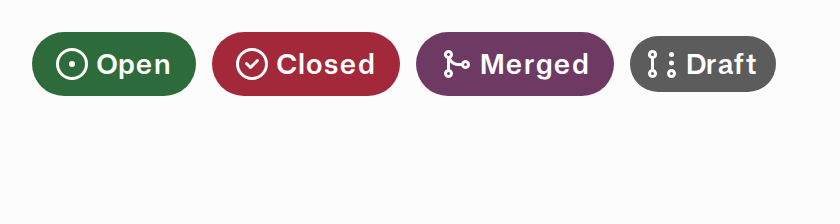
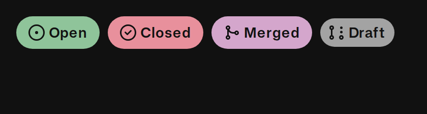
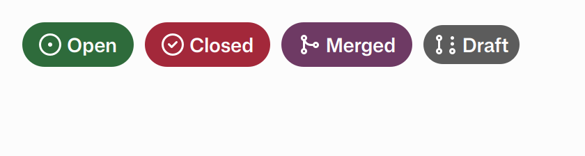
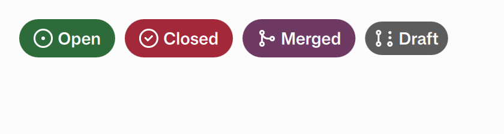
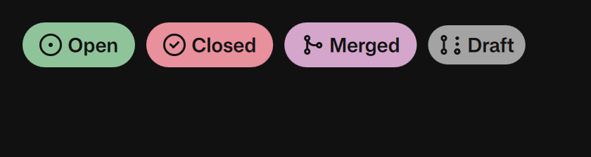
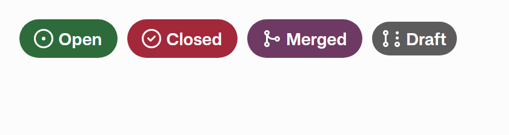
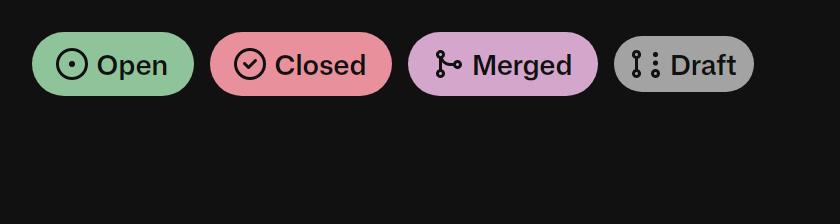
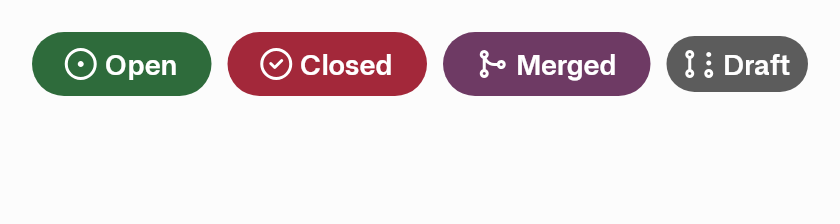
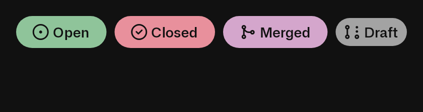

<!-- Generated by scripts/showcase.py from examples/ and component.toml. Do not edit by hand. -->

# StateLabel

A solid pill that states where an issue or pull request stands, with an Octicon and a word.

Status · [All components](README.md)

## Props

| Prop | Type | Default | Values | Description |
| --- | --- | --- | --- | --- |
| `status` | enum | `"open"` | `open`, `closed`, `merged`, `draft`, `pullOpen`, `pullClosed` | Lifecycle state; picks the colour and the icon. |
| `text` | string |  |  | The visible word, such as "Open" or "Merged". |
| `size` | enum | `"medium"` | `medium`, `small` | medium is 32px tall; small is 28px. |

Names follow the web targets. Qt Widgets takes `snake_case` arguments, Qt Quick `camelCase` properties, Avalonia `PascalCase` properties and Slint `kebab-case` properties; each example below shows the spelling for its target.

## Examples

Each example is run as it is shown here, on every push, and the screenshots are taken from that run (left Blanc, right Noir).

### CSS

 

```html
<div style="display: flex; flex-wrap: wrap; gap: 8px; align-items: center">
  <span class="pm-state pm-state--success"><svg viewBox="0 0 16 16" aria-hidden="true"><path d="M8 9.5a1.5 1.5 0 1 0 0-3 1.5 1.5 0 0 0 0 3Z"></path><path d="M8 0a8 8 0 1 1 0 16A8 8 0 0 1 8 0ZM1.5 8a6.5 6.5 0 1 0 13 0 6.5 6.5 0 0 0-13 0Z"></path></svg>Open</span>
  <span class="pm-state pm-state--danger"><svg viewBox="0 0 16 16" aria-hidden="true"><path d="M11.28 6.78a.75.75 0 0 0-1.06-1.06L7.25 8.69 5.78 7.22a.75.75 0 0 0-1.06 1.06l2 2a.75.75 0 0 0 1.06 0l3.5-3.5Z"></path><path d="M16 8A8 8 0 1 1 0 8a8 8 0 0 1 16 0Zm-1.5 0a6.5 6.5 0 1 0-13 0 6.5 6.5 0 0 0 13 0Z"></path></svg>Closed</span>
  <span class="pm-state pm-state--done"><svg viewBox="0 0 16 16" aria-hidden="true"><path d="M5.45 5.154A4.25 4.25 0 0 0 9.25 7.5h1.378a2.251 2.251 0 1 1 0 1.5H9.25A5.734 5.734 0 0 1 5 7.123v3.505a2.25 2.25 0 1 1-1.5 0V5.372a2.25 2.25 0 1 1 1.95-.218ZM4.25 13.5a.75.75 0 1 0 0-1.5.75.75 0 0 0 0 1.5Zm8.5-4.5a.75.75 0 1 0 0-1.5.75.75 0 0 0 0 1.5ZM5 3.25a.75.75 0 1 0 0 .005V3.25Z"></path></svg>Merged</span>
  <span class="pm-state pm-state--small"><svg viewBox="0 0 16 16" aria-hidden="true"><path d="M3.25 1A2.25 2.25 0 0 1 4 5.372v5.256a2.251 2.251 0 1 1-1.5 0V5.372A2.251 2.251 0 0 1 3.25 1Zm9.5 14a2.25 2.25 0 1 1 0-4.5 2.25 2.25 0 0 1 0 4.5ZM2.5 3.25a.75.75 0 1 0 1.5 0 .75.75 0 0 0-1.5 0ZM3.25 12a.75.75 0 1 0 0 1.5.75.75 0 0 0 0-1.5Zm9.5 0a.75.75 0 1 0 0 1.5.75.75 0 0 0 0-1.5ZM14 7.5a1.25 1.25 0 1 1-2.5 0 1.25 1.25 0 0 1 2.5 0Zm0-4.25a1.25 1.25 0 1 1-2.5 0 1.25 1.25 0 0 1 2.5 0Z"></path></svg>Draft</span>
</div>
```

### Svelte

 

```svelte
<script lang="ts">
  import { StateLabel } from "$lib/purrimer";
</script>

<div style="display: flex; flex-wrap: wrap; gap: 8px; align-items: center">
  <StateLabel status="open" text="Open" />
  <StateLabel status="closed" text="Closed" />
  <StateLabel status="merged" text="Merged" />
  <StateLabel status="draft" size="small" text="Draft" />
</div>
```

### Solid

 

```tsx
import { StateLabel } from "~/purrimer";

export default function Example() {
  return (
    <div style={{ display: "flex", "flex-wrap": "wrap", gap: "8px", "align-items": "center" }}>
      <StateLabel status="open" text="Open" />
      <StateLabel status="closed" text="Closed" />
      <StateLabel status="merged" text="Merged" />
      <StateLabel status="draft" size="small" text="Draft" />
    </div>
  );
}
```

### Qt Widgets (PySide6)

 

```python
from purrimer_qt.components import StateLabel
from PySide6.QtWidgets import QHBoxLayout, QWidget


def example() -> QWidget:
    row = QWidget()
    layout = QHBoxLayout(row)
    layout.setContentsMargins(0, 0, 0, 0)
    layout.setSpacing(8)
    layout.addWidget(StateLabel("Open", "open"))
    layout.addWidget(StateLabel("Closed", "closed"))
    layout.addWidget(StateLabel("Merged", "merged"))
    layout.addWidget(StateLabel("Draft", "draft", size="small"))
    layout.addStretch()
    return row
```

### Qt Quick

 

```qml
import QtQuick
import Purrimer

Row {
    spacing: 8
    StateLabel { status: "open"; text: "Open" }
    StateLabel { status: "closed"; text: "Closed" }
    StateLabel { status: "merged"; text: "Merged" }
    StateLabel { status: "draft"; size: "small"; text: "Draft"; anchors.verticalCenter: parent.verticalCenter }
}
```

### Avalonia

 

```xml
<UserControl xmlns="https://github.com/avaloniaui"
             xmlns:pm="using:Purrimer.Avalonia">
  <StackPanel Orientation="Horizontal" Spacing="8">
    <pm:StateLabel Status="open" Text="Open" />
    <pm:StateLabel Status="closed" Text="Closed" />
    <pm:StateLabel Status="merged" Text="Merged" />
    <pm:StateLabel Status="draft" Size="small" Text="Draft" />
  </StackPanel>
</UserControl>
```

### Slint

 

```slint
import { StateLabel } from "purrimer-components.slint";

export component Example inherits HorizontalLayout {
    spacing: 8px;
    alignment: start;
    StateLabel { status: "open"; text: "Open"; }
    StateLabel { status: "closed"; text: "Closed"; }
    StateLabel { status: "merged"; text: "Merged"; }
    StateLabel { status: "draft"; size: "small"; text: "Draft"; y: (parent.height - self.height) / 2; }
}
```

