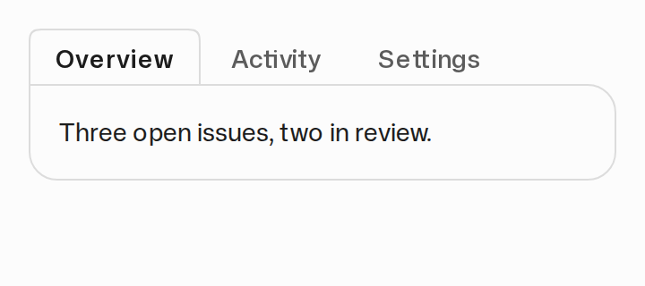
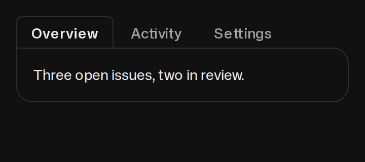
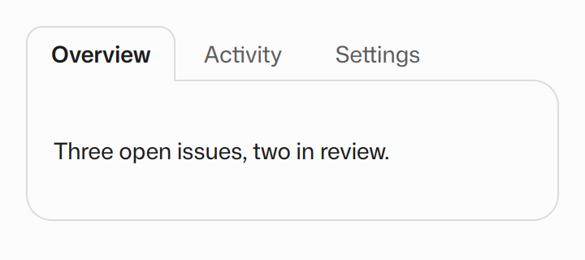
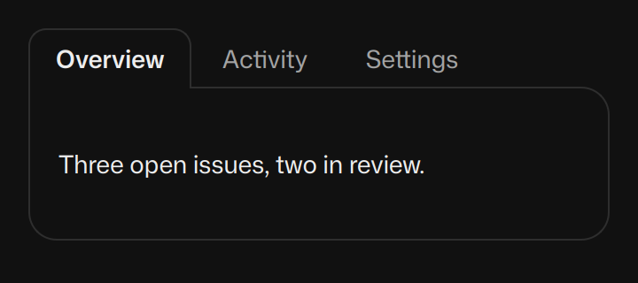
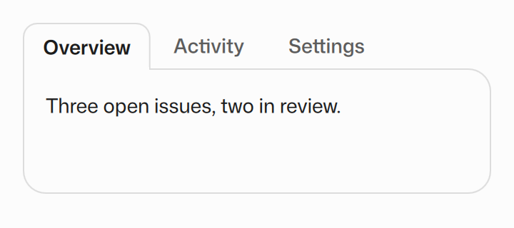
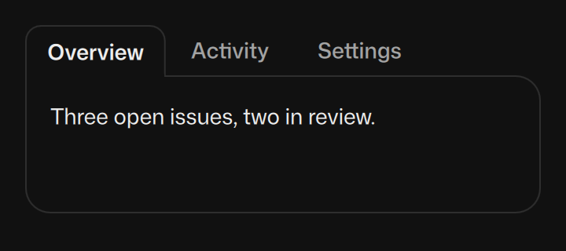
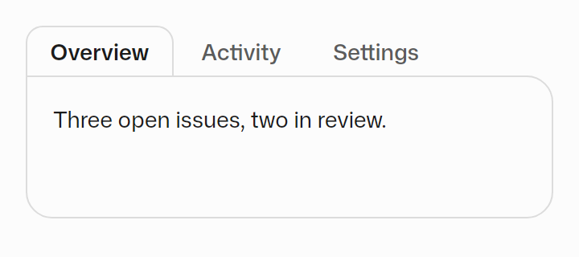
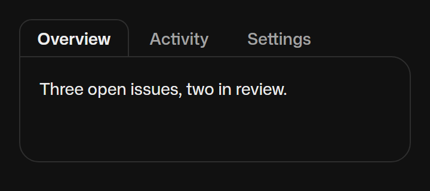
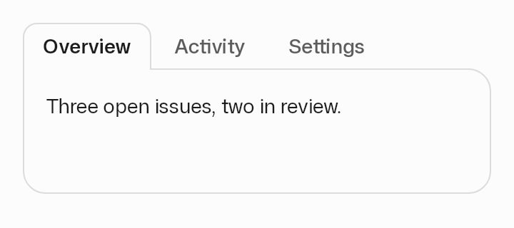
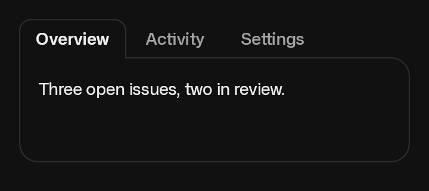

<!-- Generated by scripts/showcase.py from examples/ and component.toml. Do not edit by hand. -->

# Tabs

Document tabs whose current tab joins the panel under it.

Navigation · [All components](README.md)

## Props

| Prop | Type | Default | Values | Description |
| --- | --- | --- | --- | --- |
| `items` | list |  |  | Tab labels. |
| `selected` | int | `0` |  | Index of the current tab. |

Names follow the web targets. Qt Widgets takes `snake_case` arguments, Qt Quick `camelCase` properties, Avalonia `PascalCase` properties and Slint `kebab-case` properties; each example below shows the spelling for its target.

## Examples

Each example is run as it is shown here, on every push, and the screenshots are taken from that run (left Blanc, right Noir).

### CSS

 

```html
<div class="pm-tabs">
  <div class="pm-tabs__list" role="tablist" aria-label="Project">
    <button type="button" class="pm-tabs__tab" role="tab" id="tab-0" aria-controls="panel" aria-selected="true" tabindex="0">Overview</button>
    <button type="button" class="pm-tabs__tab" role="tab" id="tab-1" aria-controls="panel" aria-selected="false" tabindex="-1">Activity</button>
    <button type="button" class="pm-tabs__tab" role="tab" id="tab-2" aria-controls="panel" aria-selected="false" tabindex="-1">Settings</button>
  </div>
  <div class="pm-tabs__panel" role="tabpanel" id="panel" aria-labelledby="tab-0" tabindex="0">Three open issues, two in review.</div>
</div>
```

### Svelte

 

```svelte
<script lang="ts">
  import { Tabs } from "$lib/purrimer";

  const panels = ["Three open issues, two in review.", "Updated 2 hours ago.", "Visible to your team."];
  let tab = $state(0);
</script>

<Tabs items={["Overview", "Activity", "Settings"]} bind:selected={tab} label="Project">
  {#snippet panel(i)}{panels[i]}{/snippet}
</Tabs>
```

### Solid

 

```tsx
import { createSignal } from "solid-js";
import { Tabs } from "~/purrimer";

const panels = ["Three open issues, two in review.", "Updated 2 hours ago.", "Visible to your team."];

export default function Example() {
  const [tab, setTab] = createSignal(0);
  return (
    <Tabs items={["Overview", "Activity", "Settings"]} selected={tab()} onSelect={setTab} label="Project">
      {(i) => panels[i]}
    </Tabs>
  );
}
```

### Qt Widgets (PySide6)

 

```python
from purrimer_qt.components import Tabs
from PySide6.QtWidgets import QLabel, QWidget


def example() -> QWidget:
    tabs = Tabs()
    for title, text in [
        ("Overview", "Three open issues, two in review."),
        ("Activity", "Updated 2 hours ago."),
        ("Settings", "Visible to your team."),
    ]:
        tabs.addTab(QLabel(text), title)
    tabs.setFixedHeight(120)
    return tabs
```

### Qt Quick

 

```qml
import QtQuick
import Purrimer

Tabs {
    id: tabs
    width: 328
    height: 120
    items: ["Overview", "Activity", "Settings"]
    onActivated: index => selected = index

    Text {
        text: ["Three open issues, two in review.", "Updated 2 hours ago.", "Visible to your team."][tabs.selected]
        color: Purrimer.fgColorDefault
        font: Purrimer.textBodyMedium
    }
}
```

### Avalonia

 

```xml
<UserControl xmlns="https://github.com/avaloniaui"
             xmlns:pm="using:Purrimer.Avalonia">
  <TabControl Height="120">
    <TabItem Header="Overview">
      <TextBlock Text="Three open issues, two in review." />
    </TabItem>
    <TabItem Header="Activity">
      <TextBlock Text="Updated 2 hours ago." />
    </TabItem>
    <TabItem Header="Settings">
      <TextBlock Text="Visible to your team." />
    </TabItem>
  </TabControl>
</UserControl>
```

### Slint

 

```slint
import { Purrimer, Tabs } from "purrimer-components.slint";

export component Example inherits VerticalLayout {
    alignment: start;
    tabs := Tabs {
        height: 120px;
        items: ["Overview", "Activity", "Settings"];
        activated(index) => { self.selected = index; }
        Text {
            text: tabs.selected == 0 ? "Three open issues, two in review." : tabs.selected == 1 ? "Updated 2 hours ago." : "Visible to your team.";
            color: Purrimer.fg-color-default;
        }
    }
}
```

