<!-- Generated by scripts/showcase.py from examples/ and component.toml. Do not edit by hand. -->

# TextField

A labelled text input with an optional caption and validation message.

Forms · [All components](README.md)

## Props

| Prop | Type | Default | Values | Description |
| --- | --- | --- | --- | --- |
| `label` | string |  |  | Label above the field. |
| `value` | string |  |  | Current text. |
| `placeholder` | string |  |  | Hint shown while empty. |
| `caption` | string |  |  | Helper text under the field. |
| `error` | string |  |  | Validation message; marks the field invalid. |
| `leadingIcon` | icon |  |  | Octicon inside the field, before the text. |
| `type` | enum | `"text"` | `text`, `email`, `password`, `search`, `url`, `tel`, `number` | Input type. |
| `disabled` | bool | `false` |  | Read-only and greyed. |

Names follow the web targets. Qt Widgets takes `snake_case` arguments, Qt Quick `camelCase` properties, Avalonia `PascalCase` properties and Slint `kebab-case` properties; each example below shows the spelling for its target.

## Examples

Each example is run as it is shown here, on every push, and the screenshots are taken from that run (left Blanc, right Noir).

### CSS

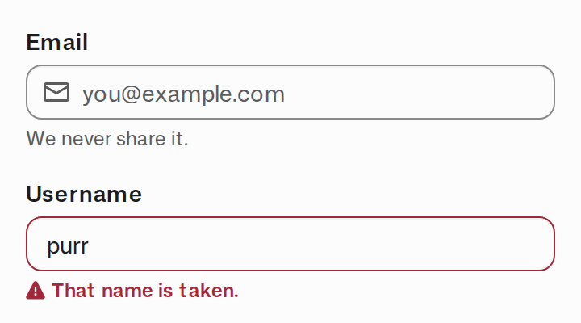 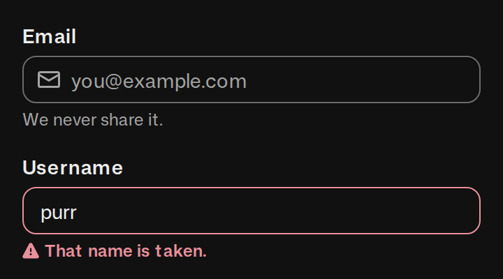

```html
<div style="display: grid; gap: 16px">
  <div class="pm-field">
    <label class="pm-field__label" for="email">Email</label>
    <div class="pm-field__control">
      <svg class="pm-icon" width="16" height="16" viewBox="0 0 16 16" aria-hidden="true"><path d="M1.75 2h12.5c.966 0 1.75.784 1.75 1.75v8.5A1.75 1.75 0 0 1 14.25 14H1.75A1.75 1.75 0 0 1 0 12.25v-8.5C0 2.784.784 2 1.75 2ZM1.5 12.251c0 .138.112.25.25.25h12.5a.25.25 0 0 0 .25-.25V5.809L8.38 9.397a.75.75 0 0 1-.76 0L1.5 5.809v6.442Zm13-8.181v-.32a.25.25 0 0 0-.25-.25H1.75a.25.25 0 0 0-.25.25v.32L8 7.88Z"/></svg>
      <input id="email" class="pm-field__input" type="email" placeholder="you@example.com" aria-describedby="email-note" />
    </div>
    <span class="pm-field__caption" id="email-note">We never share it.</span>
  </div>
  <div class="pm-field pm-field--invalid">
    <label class="pm-field__label" for="user">Username</label>
    <div class="pm-field__control">
      <input id="user" class="pm-field__input" value="purr" aria-invalid="true" aria-describedby="user-note" />
    </div>
    <span class="pm-field__error" id="user-note"><svg class="pm-icon" width="16" height="16" viewBox="0 0 16 16" aria-hidden="true"><path d="M6.457 1.047c.659-1.234 2.427-1.234 3.086 0l6.082 11.378A1.75 1.75 0 0 1 14.082 15H1.918a1.75 1.75 0 0 1-1.543-2.575ZM8 5a.75.75 0 0 0-.75.75v2.5a.75.75 0 0 0 1.5 0v-2.5A.75.75 0 0 0 8 5Zm1 6a1 1 0 1 0-2 0 1 1 0 0 0 2 0Z"/></svg>That name is taken.</span>
  </div>
</div>
```

### CSS, classless

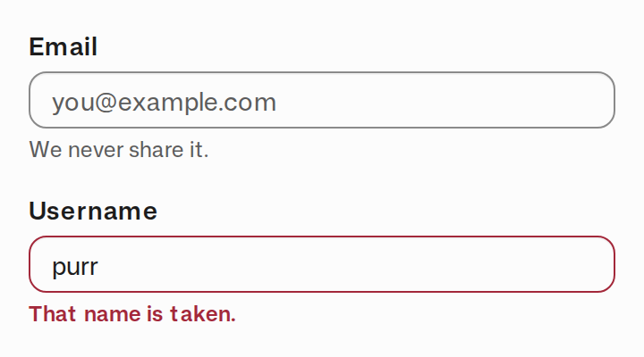 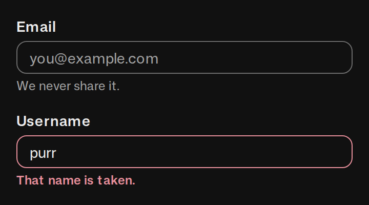

```html
<label>
  Email
  <input type="email" placeholder="you@example.com" aria-describedby="email-note" />
  <small id="email-note">We never share it.</small>
</label>
<label>
  Username
  <input value="purr" aria-invalid="true" aria-describedby="user-note" />
  <small id="user-note">That name is taken.</small>
</label>
```

### Svelte

 

```svelte
<script lang="ts">
  import { TextField } from "$lib/purrimer";

  let email = $state("");
  let username = $state("purr");
</script>

<div style="display: grid; gap: 16px">
  <TextField
    label="Email"
    type="email"
    leadingIcon="mail"
    placeholder="you@example.com"
    caption="We never share it."
    bind:value={email}
  />
  <TextField label="Username" error={username === "purr" ? "That name is taken." : ""} bind:value={username} />
</div>
```

### Solid

 

```tsx
import { createSignal } from "solid-js";
import { TextField } from "~/purrimer";

export default function Example() {
  const [email, setEmail] = createSignal("");
  const [username, setUsername] = createSignal("purr");
  return (
    <div style={{ display: "grid", gap: "16px" }}>
      <TextField
        label="Email"
        type="email"
        leadingIcon="mail"
        placeholder="you@example.com"
        caption="We never share it."
        value={email()}
        onValue={setEmail}
      />
      <TextField
        label="Username"
        error={username() === "purr" ? "That name is taken." : ""}
        value={username()}
        onValue={setUsername}
      />
    </div>
  );
}
```

### Qt Widgets (PySide6)

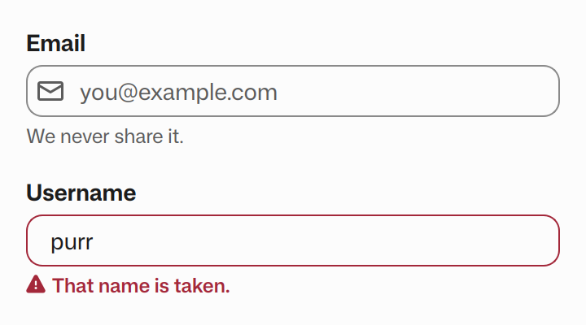 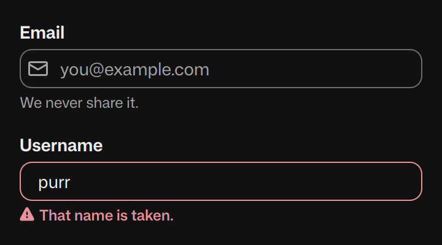

```python
from purrimer_qt.components import TextField
from PySide6.QtWidgets import QVBoxLayout, QWidget


def example() -> QWidget:
    column = QWidget()
    layout = QVBoxLayout(column)
    layout.setContentsMargins(0, 0, 0, 0)
    layout.setSpacing(16)
    email = TextField("Email", placeholder="you@example.com", caption="We never share it.", leading_icon="mail")
    username = TextField("Username", "purr", error="That name is taken.")
    username.textChanged.connect(lambda text: username.set_error("That name is taken." if text == "purr" else ""))
    layout.addWidget(email)
    layout.addWidget(username)
    return column
```

### Qt Quick

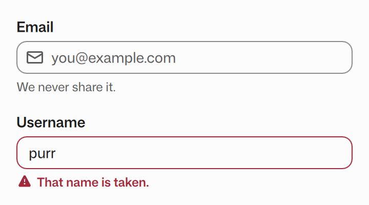 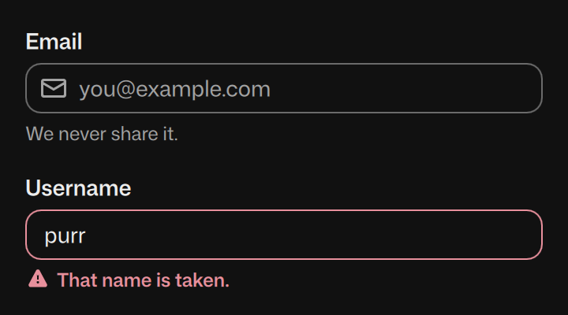

```qml
import QtQuick
import Purrimer

Column {
    spacing: 16
    TextField {
        width: 328
        label: "Email"
        placeholder: "you@example.com"
        caption: "We never share it."
        leadingIcon: "mail"
        inputMethodHints: Qt.ImhEmailCharactersOnly
    }
    TextField {
        width: 328
        label: "Username"
        text: "purr"
        error: text === "purr" ? "That name is taken." : ""
    }
}
```

### Avalonia

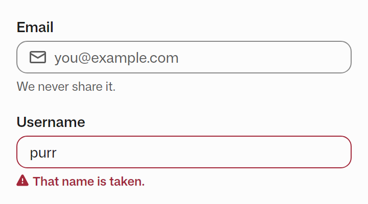 

```xml
<UserControl xmlns="https://github.com/avaloniaui"
             xmlns:pm="using:Purrimer.Avalonia">
  <StackPanel Spacing="16">
    <pm:TextField Label="Email" PlaceholderText="you@example.com" Caption="We never share it." LeadingIcon="mail" />
    <pm:TextField Label="Username" Text="purr" Error="That name is taken." />
  </StackPanel>
</UserControl>
```

### Slint

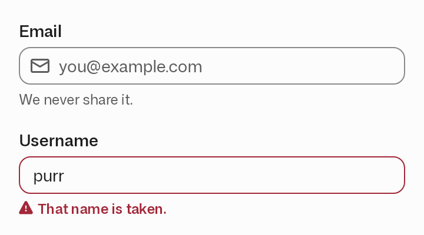 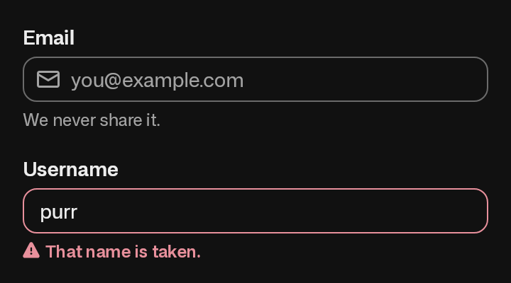

```slint
import { TextField, PurrimerIcons } from "purrimer-components.slint";

export component Example inherits VerticalLayout {
    spacing: 16px;
    alignment: start;
    TextField {
        label: "Email";
        placeholder: "you@example.com";
        caption: "We never share it.";
        leading-icon: PurrimerIcons.mail-16;
    }
    TextField {
        label: "Username";
        text: "purr";
        error: self.text == "purr" ? "That name is taken." : "";
    }
}
```

