<!-- Generated by scripts/showcase.py from examples/ and component.toml. Do not edit by hand. -->

# Textarea

A multi-line input with the same label, caption and validation rules as TextField.

Forms · [All components](README.md)

## Props

| Prop | Type | Default | Values | Description |
| --- | --- | --- | --- | --- |
| `label` | string |  |  | Label above the field. |
| `value` | string |  |  | Current text. |
| `placeholder` | string |  |  | Hint shown while empty. |
| `caption` | string |  |  | Helper text under the field. |
| `error` | string |  |  | Validation message; marks the field invalid. |
| `rows` | int | `3` |  | Visible lines; the field is never shorter than 80px. |
| `disabled` | bool | `false` |  | Read-only and greyed. |

Names follow the web targets. Qt Widgets takes `snake_case` arguments, Qt Quick `camelCase` properties, Avalonia `PascalCase` properties and Slint `kebab-case` properties; each example below shows the spelling for its target.

## Examples

Each example is run as it is shown here, on every push, and the screenshots are taken from that run (left Blanc, right Noir).

### CSS

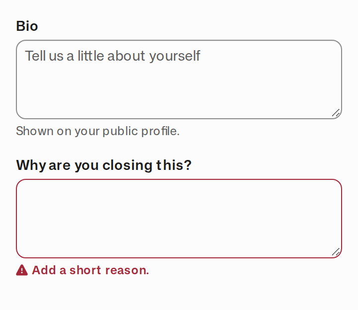 

```html
<div style="display: grid; gap: 16px">
  <div class="pm-textarea">
    <label class="pm-textarea__label" for="bio">Bio</label>
    <textarea id="bio" class="pm-textarea__input" rows="3" placeholder="Tell us a little about yourself" aria-describedby="bio-note"></textarea>
    <span class="pm-textarea__caption" id="bio-note">Shown on your public profile.</span>
  </div>
  <div class="pm-textarea pm-textarea--invalid">
    <label class="pm-textarea__label" for="why">Why are you closing this?</label>
    <textarea id="why" class="pm-textarea__input" rows="2" aria-invalid="true" aria-describedby="why-note"></textarea>
    <span class="pm-textarea__error" id="why-note"><svg viewBox="0 0 16 16" aria-hidden="true"><path d="M6.457 1.047c.659-1.234 2.427-1.234 3.086 0l6.082 11.378A1.75 1.75 0 0 1 14.082 15H1.918a1.75 1.75 0 0 1-1.543-2.575ZM8 5a.75.75 0 0 0-.75.75v2.5a.75.75 0 0 0 1.5 0v-2.5A.75.75 0 0 0 8 5Zm1 6a1 1 0 1 0-2 0 1 1 0 0 0 2 0Z"></path></svg>Add a short reason.</span>
  </div>
</div>
```

### CSS, classless

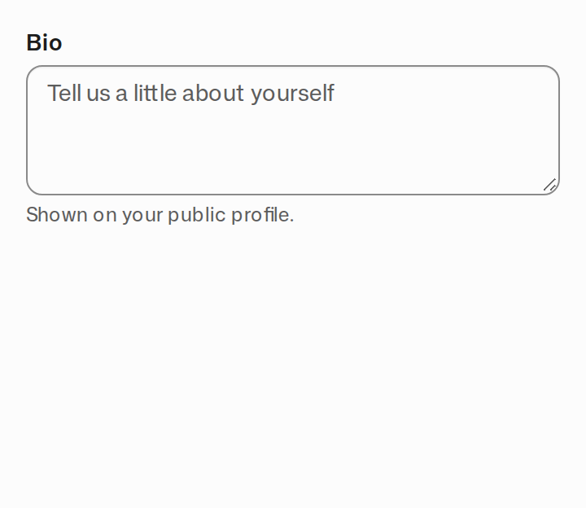 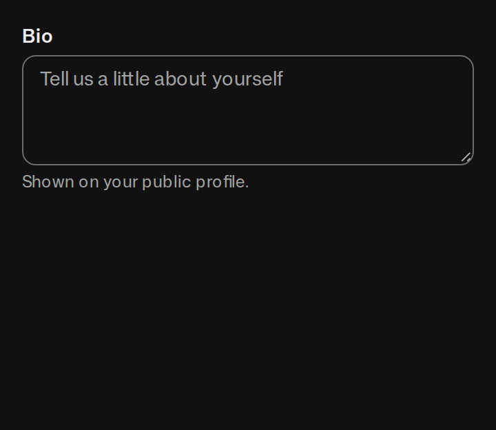

```html
<label>
  Bio
  <textarea rows="3" placeholder="Tell us a little about yourself"></textarea>
  <small>Shown on your public profile.</small>
</label>
```

### Svelte

 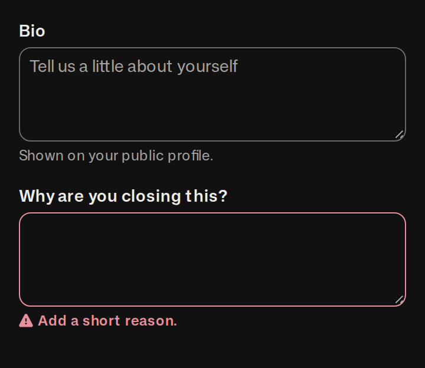

```svelte
<script lang="ts">
  import { Textarea } from "$lib/purrimer";

  let bio = $state("");
</script>

<div style="display: grid; gap: 16px">
  <Textarea label="Bio" bind:value={bio} placeholder="Tell us a little about yourself" caption="Shown on your public profile." />
  <Textarea label="Why are you closing this?" rows={2} error="Add a short reason." />
</div>
```

### Solid

 

```tsx
import { createSignal } from "solid-js";
import { Textarea } from "~/purrimer";

export default function Example() {
  const [bio, setBio] = createSignal("");
  return (
    <div style={{ display: "grid", gap: "16px" }}>
      <Textarea
        label="Bio"
        value={bio()}
        onValue={setBio}
        placeholder="Tell us a little about yourself"
        caption="Shown on your public profile."
      />
      <Textarea label="Why are you closing this?" rows={2} error="Add a short reason." />
    </div>
  );
}
```

### Qt Widgets (PySide6)

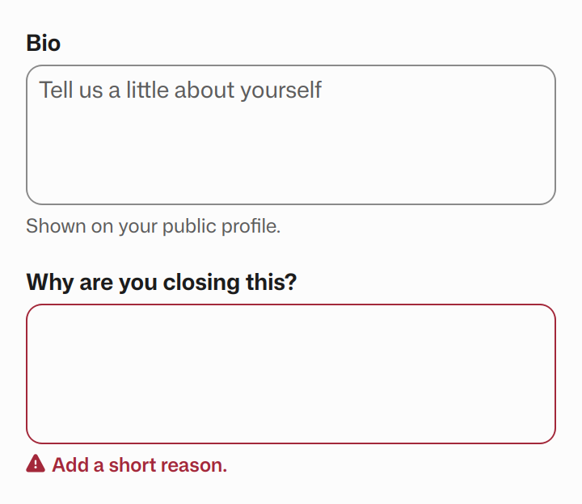 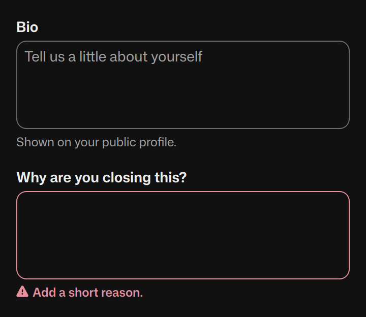

```python
from purrimer_qt.components import Textarea
from PySide6.QtWidgets import QVBoxLayout, QWidget


def example() -> QWidget:
    column = QWidget()
    layout = QVBoxLayout(column)
    layout.setContentsMargins(0, 0, 0, 0)
    layout.setSpacing(16)
    layout.addWidget(
        Textarea("Bio", placeholder="Tell us a little about yourself", caption="Shown on your public profile.")
    )
    layout.addWidget(Textarea("Why are you closing this?", rows=2, error="Add a short reason."))
    return column
```

### Qt Quick

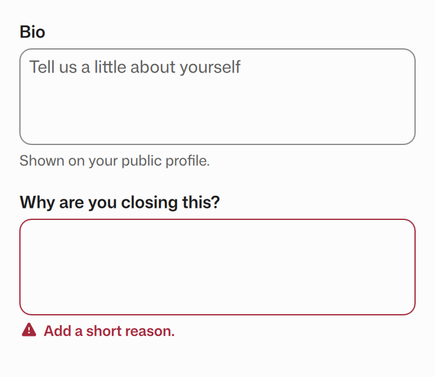 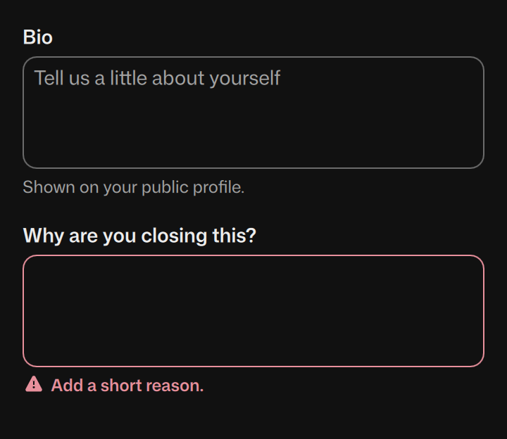

```qml
import QtQuick
import Purrimer

Column {
    width: 328
    spacing: 16
    Textarea {
        width: parent.width
        label: "Bio"
        placeholder: "Tell us a little about yourself"
        caption: "Shown on your public profile."
    }
    Textarea {
        width: parent.width
        label: "Why are you closing this?"
        rows: 2
        error: "Add a short reason."
    }
}
```

### Avalonia

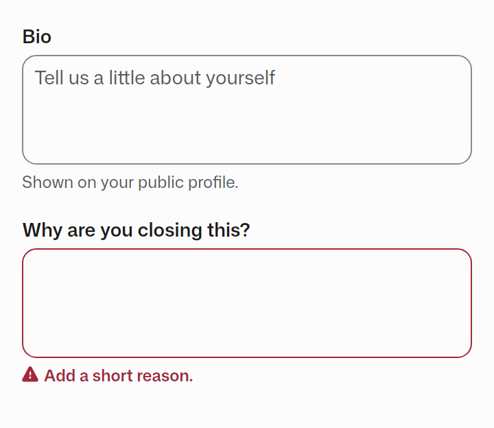 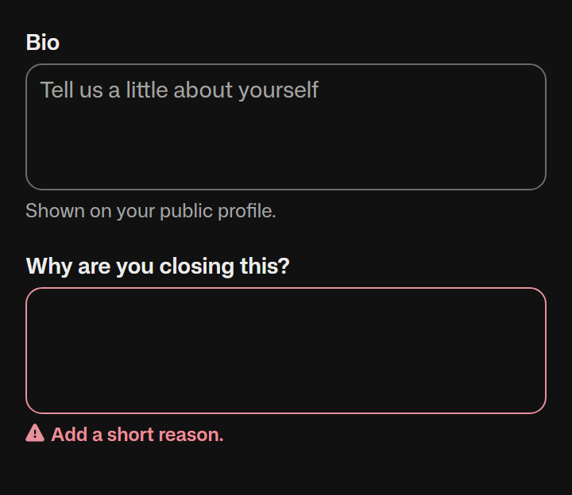

```xml
<UserControl xmlns="https://github.com/avaloniaui"
             xmlns:pm="using:Purrimer.Avalonia">
  <StackPanel Spacing="16">
    <pm:Textarea Label="Bio" PlaceholderText="Tell us a little about yourself" Caption="Shown on your public profile." />
    <pm:Textarea Label="Why are you closing this?" Rows="2" Error="Add a short reason." />
  </StackPanel>
</UserControl>
```

### Slint

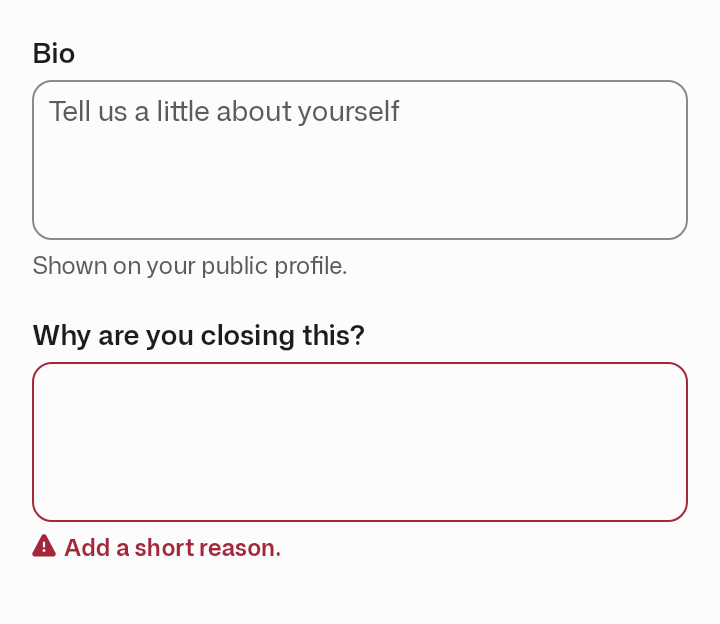 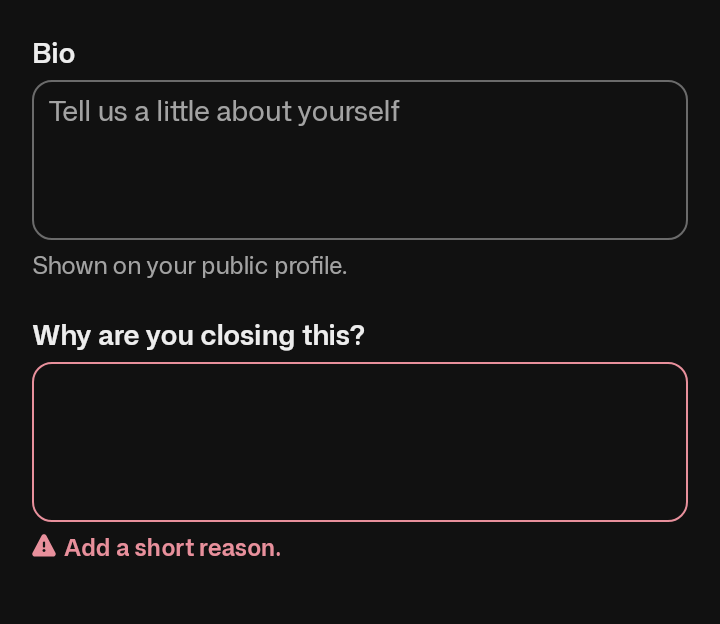

```slint
import { Textarea } from "purrimer-components.slint";

export component Example inherits VerticalLayout {
    spacing: 16px;
    alignment: start;
    Textarea {
        label: "Bio";
        placeholder: "Tell us a little about yourself";
        caption: "Shown on your public profile.";
    }
    Textarea {
        label: "Why are you closing this?";
        rows: 2;
        error: "Add a short reason.";
    }
}
```

