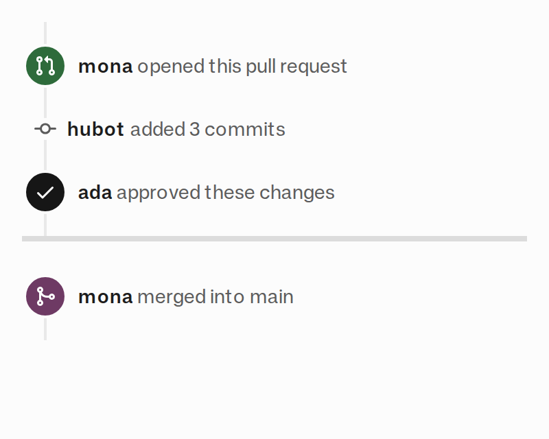
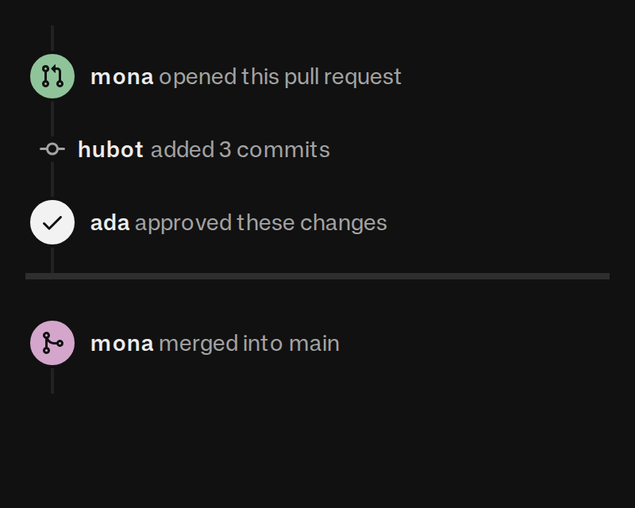
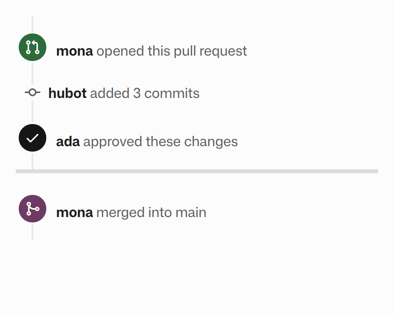
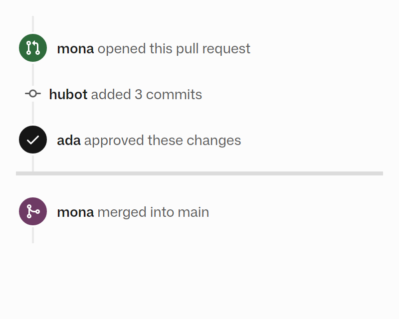
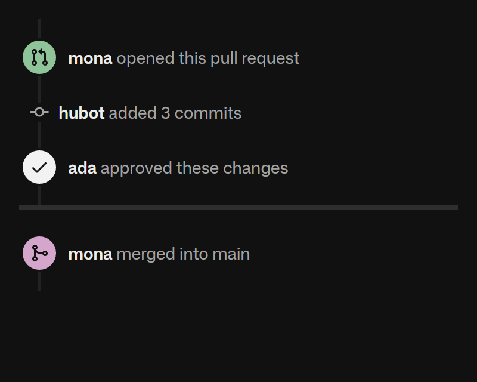

<!-- Generated by scripts/showcase.py from examples/ and component.toml. Do not edit by hand. -->

# Timeline

A vertical history of events on an item: commits, reviews, state changes.

Status · [All components](README.md)

## Props

| Prop | Type | Default | Values | Description |
| --- | --- | --- | --- | --- |
| `items` | list |  |  | Events: { content, actor?, icon?, tone?, condensed? }, or { break: true } for a gap between eras. |

Names follow the web targets. Qt Widgets takes `snake_case` arguments, Qt Quick `camelCase` properties, Avalonia `PascalCase` properties and Slint `kebab-case` properties; each example below shows the spelling for its target.

## Examples

Each example is run as it is shown here, on every push, and the screenshots are taken from that run (left Blanc, right Noir).

### CSS

 

```html
<div class="pm-timeline">
  <div class="pm-timeline__item"><div class="pm-timeline__badge pm-timeline__badge--success"><svg viewBox="0 0 16 16" aria-hidden="true"><path d="M1.5 3.25a2.25 2.25 0 1 1 3 2.122v5.256a2.251 2.251 0 1 1-1.5 0V5.372A2.25 2.25 0 0 1 1.5 3.25Zm5.677-.177L9.573.677A.25.25 0 0 1 10 .854V2.5h1A2.5 2.5 0 0 1 13.5 5v5.628a2.251 2.251 0 1 1-1.5 0V5a1 1 0 0 0-1-1h-1v1.646a.25.25 0 0 1-.427.177L7.177 3.427a.25.25 0 0 1 0-.354ZM3.75 2.5a.75.75 0 1 0 0 1.5.75.75 0 0 0 0-1.5Zm0 9.5a.75.75 0 1 0 0 1.5.75.75 0 0 0 0-1.5Zm8.25.75a.75.75 0 1 0 1.5 0 .75.75 0 0 0-1.5 0Z"></path></svg></div><div class="pm-timeline__body"><strong>mona</strong> opened this pull request</div></div>
  <div class="pm-timeline__item pm-timeline__item--condensed"><div class="pm-timeline__badge"><svg viewBox="0 0 16 16" aria-hidden="true"><path d="M11.93 8.5a4.002 4.002 0 0 1-7.86 0H.75a.75.75 0 0 1 0-1.5h3.32a4.002 4.002 0 0 1 7.86 0h3.32a.75.75 0 0 1 0 1.5Zm-1.43-.75a2.5 2.5 0 1 0-5 0 2.5 2.5 0 0 0 5 0Z"></path></svg></div><div class="pm-timeline__body"><strong>hubot</strong> added 3 commits</div></div>
  <div class="pm-timeline__item"><div class="pm-timeline__badge pm-timeline__badge--accent"><svg viewBox="0 0 16 16" aria-hidden="true"><path d="M13.78 4.22a.75.75 0 0 1 0 1.06l-7.25 7.25a.75.75 0 0 1-1.06 0L2.22 9.28a.751.751 0 0 1 .018-1.042.751.751 0 0 1 1.042-.018L6 10.94l6.72-6.72a.75.75 0 0 1 1.06 0Z"></path></svg></div><div class="pm-timeline__body"><strong>ada</strong> approved these changes</div></div>
  <div class="pm-timeline__break" role="separator"></div>
  <div class="pm-timeline__item"><div class="pm-timeline__badge pm-timeline__badge--done"><svg viewBox="0 0 16 16" aria-hidden="true"><path d="M5.45 5.154A4.25 4.25 0 0 0 9.25 7.5h1.378a2.251 2.251 0 1 1 0 1.5H9.25A5.734 5.734 0 0 1 5 7.123v3.505a2.25 2.25 0 1 1-1.5 0V5.372a2.25 2.25 0 1 1 1.95-.218ZM4.25 13.5a.75.75 0 1 0 0-1.5.75.75 0 0 0 0 1.5Zm8.5-4.5a.75.75 0 1 0 0-1.5.75.75 0 0 0 0 1.5ZM5 3.25a.75.75 0 1 0 0 .005V3.25Z"></path></svg></div><div class="pm-timeline__body"><strong>mona</strong> merged into main</div></div>
</div>
```

### Svelte

 

```svelte
<script lang="ts">
  import { Timeline } from "$lib/purrimer";
</script>

<Timeline
  items={[
    { actor: "mona", content: "opened this pull request", icon: "git-pull-request", tone: "success" },
    { actor: "hubot", content: "added 3 commits", icon: "git-commit", condensed: true },
    { actor: "ada", content: "approved these changes", icon: "check", tone: "accent" },
    { break: true },
    { actor: "mona", content: "merged into main", icon: "git-merge", tone: "done" },
  ]}
/>
```

### Solid

 

```tsx
import { Timeline } from "~/purrimer";

export default function Example() {
  return (
    <Timeline
      items={[
        { actor: "mona", content: "opened this pull request", icon: "git-pull-request", tone: "success" },
        { actor: "hubot", content: "added 3 commits", icon: "git-commit", condensed: true },
        { actor: "ada", content: "approved these changes", icon: "check", tone: "accent" },
        { break: true },
        { actor: "mona", content: "merged into main", icon: "git-merge", tone: "done" },
      ]}
    />
  );
}
```

### Qt Widgets (PySide6)

 

```python
from purrimer_qt.components import Timeline
from purrimer_qt.components.timeline import TimelineBreak, TimelineEvent
from PySide6.QtWidgets import QWidget


def example() -> QWidget:
    return Timeline(
        [
            TimelineEvent("opened this pull request", "mona", "git-pull-request", "success"),
            TimelineEvent("added 3 commits", "hubot", "git-commit", condensed=True),
            TimelineEvent("approved these changes", "ada", "check", "accent"),
            TimelineBreak(),
            TimelineEvent("merged into main", "mona", "git-merge", "done"),
        ]
    )
```

### Qt Quick

 

```qml
import QtQuick
import Purrimer

Timeline {
    width: 368
    items: [
        { actor: "mona", content: "opened this pull request", icon: "git-pull-request", tone: "success" },
        { actor: "hubot", content: "added 3 commits", icon: "git-commit", condensed: true },
        { actor: "ada", content: "approved these changes", icon: "check", tone: "accent" },
        { "break": true },
        { actor: "mona", content: "merged into main", icon: "git-merge", tone: "done" }
    ]
}
```

### Avalonia

 

```xml
<UserControl xmlns="https://github.com/avaloniaui"
             xmlns:pm="using:Purrimer.Avalonia">
  <pm:Timeline>
    <pm:TimelineItem Actor="mona" Content="opened this pull request" IconName="git-pull-request" Tone="success" />
    <pm:TimelineItem Actor="hubot" Content="added 3 commits" IconName="git-commit" IsCondensed="True" />
    <pm:TimelineItem Actor="ada" Content="approved these changes" IconName="check" Tone="accent" />
    <pm:TimelineItem IsBreak="True" />
    <pm:TimelineItem Actor="mona" Content="merged into main" IconName="git-merge" Tone="done" />
  </pm:Timeline>
</UserControl>
```

### Slint

 

```slint
import { Timeline, PurrimerIcons } from "purrimer-components.slint";

export component Example inherits VerticalLayout {
    alignment: start;
    Timeline {
        items: [
            { actor: "mona", content: "opened this pull request", icon: PurrimerIcons.git-pull-request-16, tone: "success" },
            { actor: "hubot", content: "added 3 commits", icon: PurrimerIcons.git-commit-16, condensed: true },
            { actor: "ada", content: "approved these changes", icon: PurrimerIcons.check-16, tone: "accent" },
            { is-break: true },
            { actor: "mona", content: "merged into main", icon: PurrimerIcons.git-merge-16, tone: "done" },
        ];
    }
}
```

