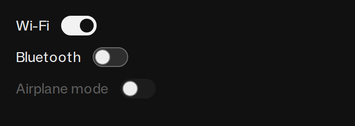
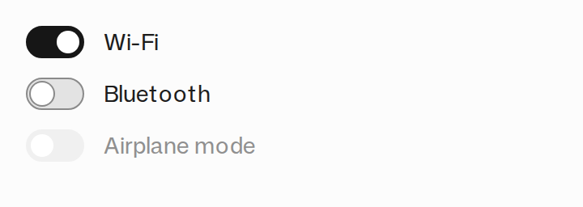
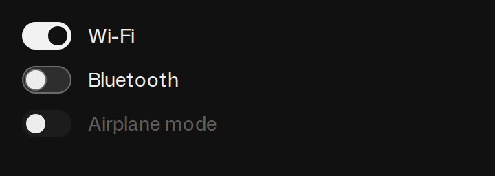
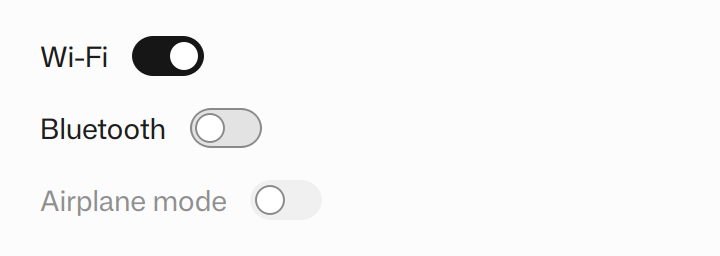
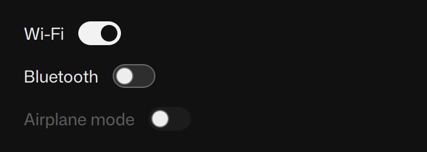
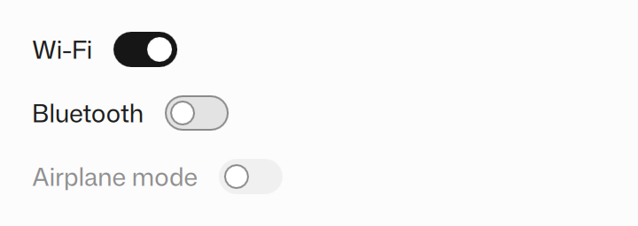
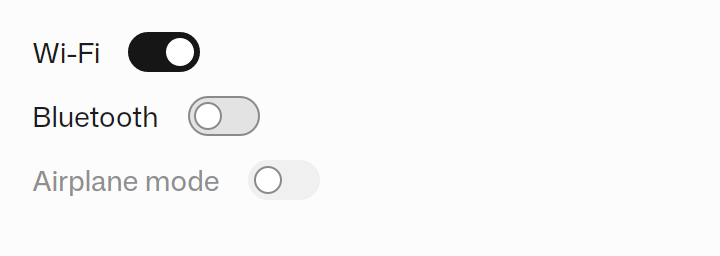
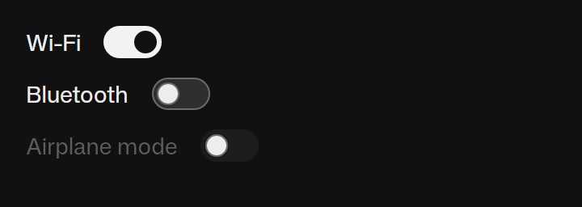
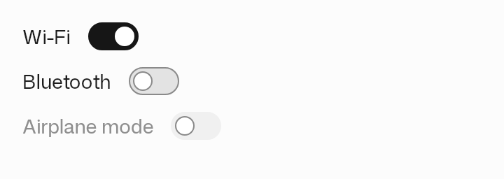
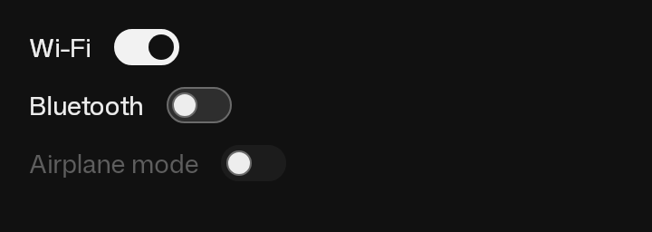

<!-- Generated by scripts/showcase.py from examples/ and component.toml. Do not edit by hand. -->

# Toggle

A switch for a setting that applies at once.

Forms · [All components](README.md)

## Props

| Prop | Type | Default | Values | Description |
| --- | --- | --- | --- | --- |
| `label` | string |  |  | Text before the switch. |
| `checked` | bool | `false` |  | On state. |
| `disabled` | bool | `false` |  | Greys the control. |

Names follow the web targets. Qt Widgets takes `snake_case` arguments, Qt Quick `camelCase` properties, Avalonia `PascalCase` properties and Slint `kebab-case` properties; each example below shows the spelling for its target.

## Examples

Each example is run as it is shown here, on every push, and the screenshots are taken from that run (left Blanc, right Noir).

### CSS

 

```html
<div style="display: grid; gap: 12px; justify-items: start">
  <label class="pm-toggle">
    <span>Wi-Fi</span>
    <button type="button" class="pm-toggle__track" role="switch" aria-checked="true" aria-label="Wi-Fi"><span class="pm-toggle__knob"></span></button>
  </label>
  <label class="pm-toggle">
    <span>Bluetooth</span>
    <button type="button" class="pm-toggle__track" role="switch" aria-checked="false" aria-label="Bluetooth"><span class="pm-toggle__knob"></span></button>
  </label>
  <label class="pm-toggle">
    <span>Airplane mode</span>
    <button type="button" class="pm-toggle__track" role="switch" aria-checked="false" aria-label="Airplane mode" disabled><span class="pm-toggle__knob"></span></button>
  </label>
</div>
```

### CSS, classless

 

```html
<!-- role="switch" turns a checkbox into a toggle. -->
<label><input type="checkbox" role="switch" checked /> Wi-Fi</label>
<label><input type="checkbox" role="switch" /> Bluetooth</label>
<label><input type="checkbox" role="switch" disabled /> Airplane mode</label>
```

### Svelte

 

```svelte
<script lang="ts">
  import { Toggle } from "$lib/purrimer";

  let wifi = $state(true);
  let bluetooth = $state(false);
</script>

<div style="display: grid; gap: 12px; justify-items: start">
  <Toggle label="Wi-Fi" bind:checked={wifi} />
  <Toggle label="Bluetooth" bind:checked={bluetooth} onchange={(on) => console.log("bluetooth", on)} />
  <Toggle label="Airplane mode" disabled />
</div>
```

### Solid

 

```tsx
import { createSignal } from "solid-js";
import { Toggle } from "~/purrimer";

export default function Example() {
  const [wifi, setWifi] = createSignal(true);
  const [bluetooth, setBluetooth] = createSignal(false);
  return (
    <div style={{ display: "grid", gap: "12px", "justify-items": "start" }}>
      <Toggle label="Wi-Fi" checked={wifi()} onChange={setWifi} />
      <Toggle label="Bluetooth" checked={bluetooth()} onChange={setBluetooth} />
      <Toggle label="Airplane mode" disabled />
    </div>
  );
}
```

### Qt Widgets (PySide6)

 

```python
from purrimer_qt.components import Toggle
from PySide6.QtWidgets import QVBoxLayout, QWidget


def example() -> QWidget:
    column = QWidget()
    layout = QVBoxLayout(column)
    layout.setContentsMargins(0, 0, 0, 0)
    layout.setSpacing(12)
    layout.addWidget(Toggle("Wi-Fi", checked=True))
    bluetooth = Toggle("Bluetooth")
    bluetooth.toggled.connect(lambda on: print("bluetooth", on))
    layout.addWidget(bluetooth)
    airplane = Toggle("Airplane mode")
    airplane.setEnabled(False)
    layout.addWidget(airplane)
    return column
```

### Qt Quick

 

```qml
import QtQuick
import Purrimer

Column {
    spacing: 12
    Toggle { text: "Wi-Fi"; checked: true }
    Toggle { text: "Bluetooth"; onToggled: console.log("bluetooth", checked) }
    Toggle { text: "Airplane mode"; enabled: false }
}
```

### Avalonia

 

```xml
<UserControl xmlns="https://github.com/avaloniaui"
             xmlns:pm="using:Purrimer.Avalonia">
  <StackPanel Spacing="12">
    <ToggleSwitch Content="Wi-Fi" IsChecked="True" />
    <ToggleSwitch Content="Bluetooth" />
    <ToggleSwitch Content="Airplane mode" IsEnabled="False" />
  </StackPanel>
</UserControl>
```

### Slint

 

```slint
import { Toggle } from "purrimer-components.slint";

export component Example inherits VerticalLayout {
    spacing: 12px;
    alignment: start;
    Toggle { text: "Wi-Fi"; checked: true; }
    Toggle { text: "Bluetooth"; toggled(on) => { debug("bluetooth", on); } }
    Toggle { text: "Airplane mode"; enabled: false; }
}
```

