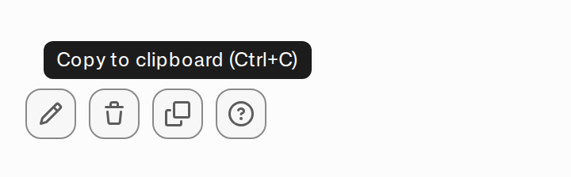
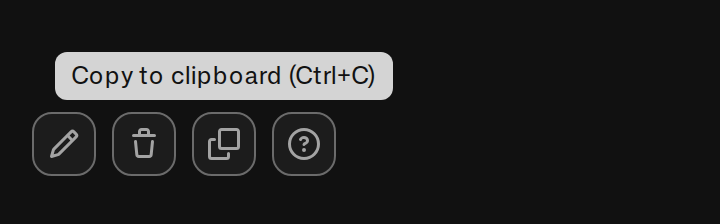
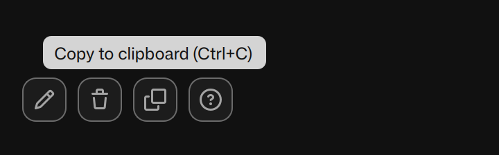
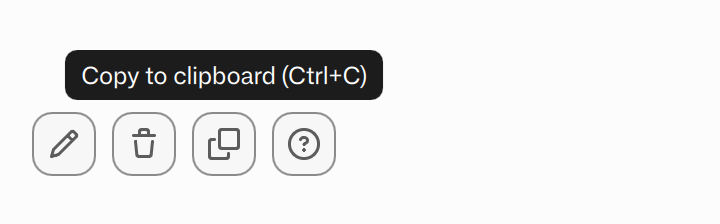
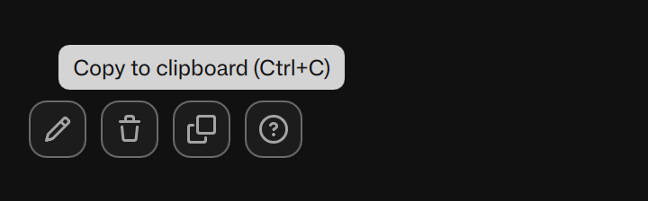
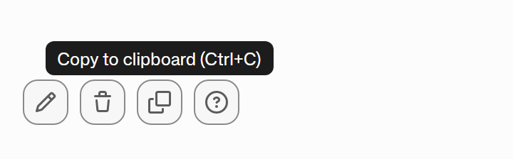
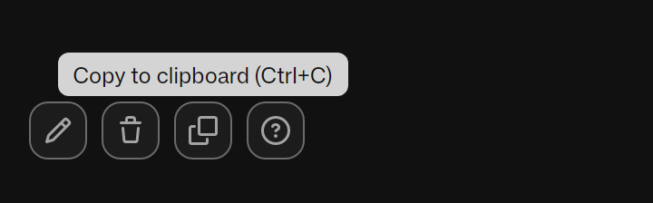
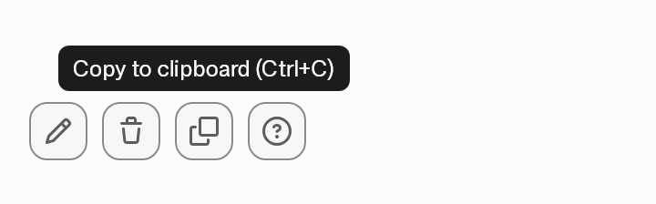
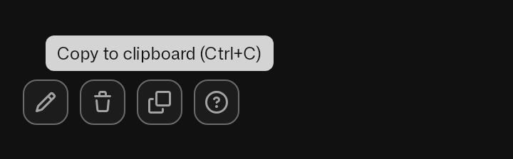

<!-- Generated by scripts/showcase.py from examples/ and component.toml. Do not edit by hand. -->

# ToolTip

A short label on hover and focus; with whatsThis, a click-to-open explanation.

Overlays · [All components](README.md)

## Props

| Prop | Type | Default | Values | Description |
| --- | --- | --- | --- | --- |
| `text` | string |  |  | What the tip says. |
| `placement` | enum | `"top"` | `top`, `bottom`, `left`, `right` | Side of the trigger the tip appears on. |
| `delay` | int | `500` |  | Hover delay in ms; keyboard focus shows it at once. |
| `whatsThis` | bool | `false` |  | A click on the trigger opens an explanation bubble instead (QWhatsThis). |
| `disabled` | bool | `false` |  | Never shows. |
| `open` | bool | `false` |  | Shows the tip from the start, for documentation. |

Names follow the web targets. Qt Widgets takes `snake_case` arguments, Qt Quick `camelCase` properties, Avalonia `PascalCase` properties and Slint `kebab-case` properties; each example below shows the spelling for its target.

## Examples

Each example is run as it is shown here, on every push, and the screenshots are taken from that run (left Blanc, right Noir).

### CSS

 

```html
<div style="display: flex; gap: 8px; margin-top: 40px">
  <span class="pm-tooltip"><button type="button" class="pm-icon-button" aria-label="Edit"><svg viewBox="0 0 16 16" aria-hidden="true"><path d="M11.013 1.427a1.75 1.75 0 0 1 2.474 0l1.086 1.086a1.75 1.75 0 0 1 0 2.474l-8.61 8.61c-.21.21-.47.364-.756.445l-3.251.93a.75.75 0 0 1-.927-.928l.929-3.25c.081-.286.235-.547.445-.758l8.61-8.61Zm.176 4.823L9.75 4.81l-6.286 6.287a.253.253 0 0 0-.064.108l-.558 1.953 1.953-.558a.253.253 0 0 0 .108-.064Zm1.238-3.763a.25.25 0 0 0-.354 0L10.811 3.75l1.439 1.44 1.263-1.263a.25.25 0 0 0 0-.354Z"></path></svg></button></span>
  <span class="pm-tooltip"><button type="button" class="pm-icon-button" aria-label="Delete"><svg viewBox="0 0 16 16" aria-hidden="true"><path d="M11 1.75V3h2.25a.75.75 0 0 1 0 1.5H2.75a.75.75 0 0 1 0-1.5H5V1.75C5 .784 5.784 0 6.75 0h2.5C10.216 0 11 .784 11 1.75ZM4.496 6.675l.66 6.6a.25.25 0 0 0 .249.225h5.19a.25.25 0 0 0 .249-.225l.66-6.6a.75.75 0 0 1 1.492.149l-.66 6.6A1.748 1.748 0 0 1 10.595 15h-5.19a1.75 1.75 0 0 1-1.741-1.575l-.66-6.6a.75.75 0 1 1 1.492-.15ZM6.5 1.75V3h3V1.75a.25.25 0 0 0-.25-.25h-2.5a.25.25 0 0 0-.25.25Z"></path></svg></button></span>
  <span class="pm-tooltip"><button type="button" class="pm-icon-button" aria-label="Copy" aria-describedby="tip-copy"><svg viewBox="0 0 16 16" aria-hidden="true"><path d="M0 6.75C0 5.784.784 5 1.75 5h1.5a.75.75 0 0 1 0 1.5h-1.5a.25.25 0 0 0-.25.25v7.5c0 .138.112.25.25.25h7.5a.25.25 0 0 0 .25-.25v-1.5a.75.75 0 0 1 1.5 0v1.5A1.75 1.75 0 0 1 9.25 16h-7.5A1.75 1.75 0 0 1 0 14.25Z M5 1.75C5 .784 5.784 0 6.75 0h7.5C15.216 0 16 .784 16 1.75v7.5A1.75 1.75 0 0 1 14.25 11h-7.5A1.75 1.75 0 0 1 5 9.25Zm1.75-.25a.25.25 0 0 0-.25.25v7.5c0 .138.112.25.25.25h7.5a.25.25 0 0 0 .25-.25v-7.5a.25.25 0 0 0-.25-.25Z"></path></svg></button><span id="tip-copy" role="tooltip" class="pm-tooltip__bubble pm-tooltip--top">Copy to clipboard (Ctrl+C)</span></span>
  <span class="pm-tooltip"><button type="button" class="pm-icon-button" aria-label="What is this?"><svg viewBox="0 0 16 16" aria-hidden="true"><path d="M0 8a8 8 0 1 1 16 0A8 8 0 0 1 0 8Zm8-6.5a6.5 6.5 0 1 0 0 13 6.5 6.5 0 0 0 0-13ZM6.92 6.085h.001a.749.749 0 1 1-1.342-.67c.169-.339.436-.701.849-.977C6.845 4.16 7.369 4 8 4a2.756 2.756 0 0 1 1.637.525c.503.377.863.965.863 1.725 0 .448-.115.83-.329 1.15-.205.307-.47.513-.692.662-.109.072-.22.138-.313.195l-.006.004a6.24 6.24 0 0 0-.26.16.952.952 0 0 0-.276.245.75.75 0 0 1-1.248-.832c.184-.264.42-.489.692-.661.103-.067.207-.132.313-.195l.007-.004c.1-.061.182-.11.258-.161a.969.969 0 0 0 .277-.245C8.96 6.514 9 6.427 9 6.25a.612.612 0 0 0-.262-.525A1.27 1.27 0 0 0 8 5.5c-.369 0-.595.09-.74.187a1.01 1.01 0 0 0-.34.398ZM9 11a1 1 0 1 1-2 0 1 1 0 0 1 2 0Z"></path></svg></button></span>
</div>
```

### Svelte

 

```svelte
<script lang="ts">
  import { IconButton, ToolTip } from "$lib/purrimer";
</script>

<div style="display: flex; gap: 8px; margin-top: 40px">
  <ToolTip text="Edit"><IconButton icon="pencil" label="Edit" /></ToolTip>
  <ToolTip text="Delete"><IconButton icon="trash" label="Delete" /></ToolTip>
  <ToolTip text="Copy to clipboard (Ctrl+C)" open><IconButton icon="copy" label="Copy" /></ToolTip>
  <ToolTip text="Tokens are named design decisions that every target reads." whatsThis placement="bottom">
    <IconButton icon="question" label="What is this?" />
  </ToolTip>
</div>
```

### Solid

 

```tsx
import { IconButton, ToolTip } from "~/purrimer";

export default function Example() {
  return (
    <div style={{ display: "flex", gap: "8px", "margin-top": "40px" }}>
      <ToolTip text="Edit"><IconButton icon="pencil" label="Edit" /></ToolTip>
      <ToolTip text="Delete"><IconButton icon="trash" label="Delete" /></ToolTip>
      <ToolTip text="Copy to clipboard (Ctrl+C)" open><IconButton icon="copy" label="Copy" /></ToolTip>
      <ToolTip text="Tokens are named design decisions that every target reads." whatsThis placement="bottom">
        <IconButton icon="question" label="What is this?" />
      </ToolTip>
    </div>
  );
}
```

### Qt Widgets (PySide6)

 

```python
from purrimer_qt.components import IconButton, ToolTip
from PySide6.QtWidgets import QHBoxLayout, QWidget


def example() -> QWidget:
    row = QWidget()
    layout = QHBoxLayout(row)
    layout.setContentsMargins(0, 40, 0, 0)
    layout.setSpacing(8)
    edit = IconButton("pencil", "Edit")
    copy = IconButton("copy", "Copy")
    delete = IconButton("trash", "Delete")
    help_button = IconButton("question", "What is this?")
    for button in (edit, delete, copy, help_button):
        layout.addWidget(button)
    layout.addStretch()
    # The tips stay attached to their buttons; keep a reference only if you need to change them later.
    ToolTip(edit, "Edit")
    ToolTip(copy, "Copy to clipboard (Ctrl+C)", open=True)
    ToolTip(delete, "Delete")
    ToolTip(help_button, "Tokens are named design decisions that every target reads.", "bottom", whats_this=True)
    return row
```

### Qt Quick

 

```qml
import QtQuick
import Purrimer

Row {
    spacing: 8
    topPadding: 40
    ToolTip { text: "Edit"; IconButton { iconName: "pencil"; label: "Edit" } }
    ToolTip { text: "Delete"; IconButton { iconName: "trash"; label: "Delete" } }
    ToolTip { text: "Copy to clipboard (Ctrl+C)"; open: true; IconButton { iconName: "copy"; label: "Copy" } }
    ToolTip {
        text: "Tokens are named design decisions that every target reads."
        whatsThis: true
        placement: "bottom"
        IconButton { iconName: "question"; label: "What is this?" }
    }
}
```

### Avalonia

 

```xml
<UserControl xmlns="https://github.com/avaloniaui"
             xmlns:pm="using:Purrimer.Avalonia">
  <StackPanel Orientation="Horizontal" Spacing="8" Margin="0,40,0,0">
    <pm:ToolTip Text="Edit"><pm:IconButton IconName="pencil" Label="Edit" /></pm:ToolTip>
    <pm:ToolTip Text="Delete"><pm:IconButton IconName="trash" Label="Delete" /></pm:ToolTip>
    <pm:ToolTip Text="Copy to clipboard (Ctrl+C)" IsOpen="True"><pm:IconButton IconName="copy" Label="Copy" /></pm:ToolTip>
    <pm:ToolTip Text="Tokens are named design decisions that every target reads." WhatsThis="True" Placement="bottom">
      <pm:IconButton IconName="question" Label="What is this?" />
    </pm:ToolTip>
  </StackPanel>
</UserControl>
```

### Slint

 

```slint
import { IconButton, PurrimerIcons, ToolTip } from "purrimer-components.slint";

export component Example inherits HorizontalLayout {
    spacing: 8px;
    padding-top: 40px;
    alignment: start;
    ToolTip { text: "Edit"; IconButton { icon: PurrimerIcons.pencil-16; label: "Edit"; } }
    ToolTip { text: "Delete"; IconButton { icon: PurrimerIcons.trash-16; label: "Delete"; } }
    ToolTip { text: "Copy to clipboard (Ctrl+C)"; open-on-start: true; IconButton { icon: PurrimerIcons.copy-16; label: "Copy"; } }
    help := ToolTip {
        text: "Tokens are named design decisions that every target reads.";
        whats-this: true;
        placement: "bottom";
        IconButton { icon: PurrimerIcons.question-16; label: "What is this?"; clicked => { help.show(); } }
    }
}
```

