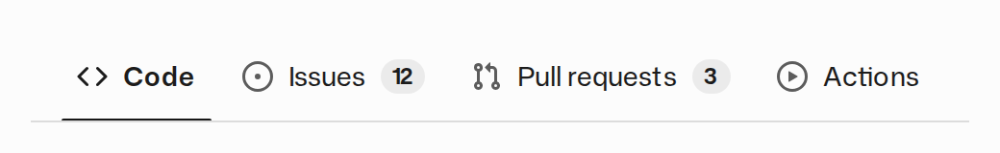
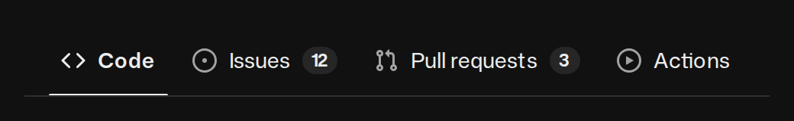
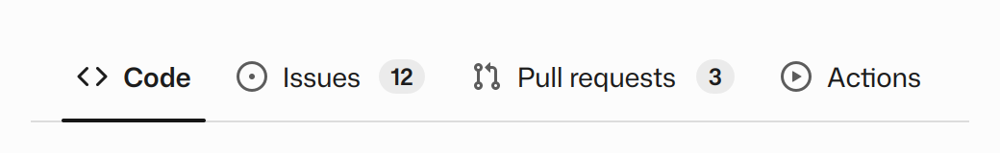
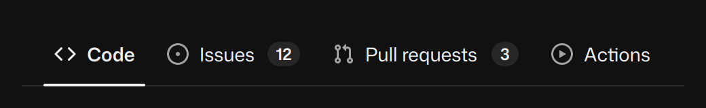
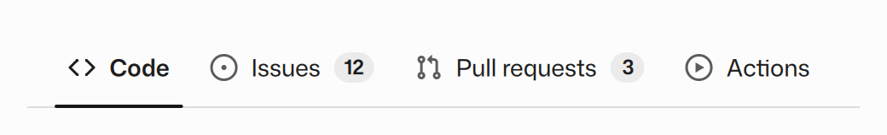
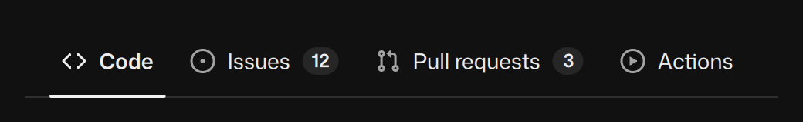
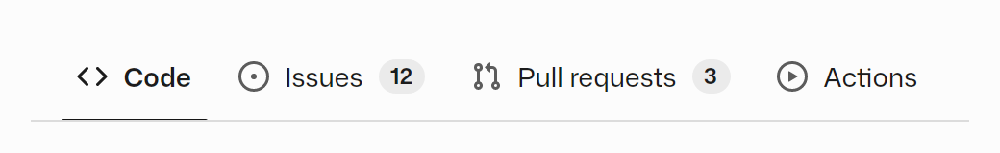
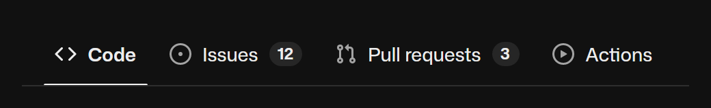
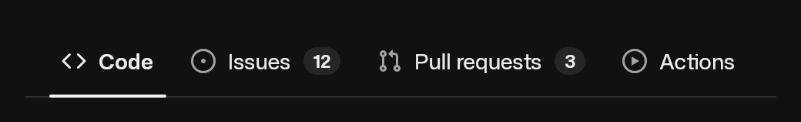

<!-- Generated by scripts/showcase.py from examples/ and component.toml. Do not edit by hand. -->

# UnderlineNav

Page-level navigation between sibling views, with an underline on the current one.

Navigation · [All components](README.md)

## Props

| Prop | Type | Default | Values | Description |
| --- | --- | --- | --- | --- |
| `items` | list |  |  | Items: { label, href?, icon?, count? }. |
| `current` | int | `0` |  | Index of the current item. |
| `ariaLabel` | string |  |  | Accessible name of the navigation landmark. |

Names follow the web targets. Qt Widgets takes `snake_case` arguments, Qt Quick `camelCase` properties, Avalonia `PascalCase` properties and Slint `kebab-case` properties; each example below shows the spelling for its target.

## Examples

Each example is run as it is shown here, on every push, and the screenshots are taken from that run (left Blanc, right Noir).

### CSS

 

```html
<nav class="pm-underline-nav" aria-label="Repository">
  <a class="pm-underline-nav__item" href="#" aria-current="page"><span class="pm-underline-nav__label"><svg viewBox="0 0 16 16" aria-hidden="true"><path d="m11.28 3.22 4.25 4.25a.75.75 0 0 1 0 1.06l-4.25 4.25a.749.749 0 0 1-1.275-.326.749.749 0 0 1 .215-.734L13.94 8l-3.72-3.72a.749.749 0 0 1 .326-1.275.749.749 0 0 1 .734.215Zm-6.56 0a.751.751 0 0 1 1.042.018.751.751 0 0 1 .018 1.042L2.06 8l3.72 3.72a.749.749 0 0 1-.326 1.275.749.749 0 0 1-.734-.215L.47 8.53a.75.75 0 0 1 0-1.06Z"></path></svg>Code</span></a>
  <a class="pm-underline-nav__item" href="#"><span class="pm-underline-nav__label"><svg viewBox="0 0 16 16" aria-hidden="true"><path d="M8 9.5a1.5 1.5 0 1 0 0-3 1.5 1.5 0 0 0 0 3Z M8 0a8 8 0 1 1 0 16A8 8 0 0 1 8 0ZM1.5 8a6.5 6.5 0 1 0 13 0 6.5 6.5 0 0 0-13 0Z"></path></svg>Issues<span class="pm-underline-nav__count">12</span></span></a>
  <a class="pm-underline-nav__item" href="#"><span class="pm-underline-nav__label"><svg viewBox="0 0 16 16" aria-hidden="true"><path d="M1.5 3.25a2.25 2.25 0 1 1 3 2.122v5.256a2.251 2.251 0 1 1-1.5 0V5.372A2.25 2.25 0 0 1 1.5 3.25Zm5.677-.177L9.573.677A.25.25 0 0 1 10 .854V2.5h1A2.5 2.5 0 0 1 13.5 5v5.628a2.251 2.251 0 1 1-1.5 0V5a1 1 0 0 0-1-1h-1v1.646a.25.25 0 0 1-.427.177L7.177 3.427a.25.25 0 0 1 0-.354ZM3.75 2.5a.75.75 0 1 0 0 1.5.75.75 0 0 0 0-1.5Zm0 9.5a.75.75 0 1 0 0 1.5.75.75 0 0 0 0-1.5Zm8.25.75a.75.75 0 1 0 1.5 0 .75.75 0 0 0-1.5 0Z"></path></svg>Pull requests<span class="pm-underline-nav__count">3</span></span></a>
  <a class="pm-underline-nav__item" href="#"><span class="pm-underline-nav__label"><svg viewBox="0 0 16 16" aria-hidden="true"><path d="M8 0a8 8 0 1 1 0 16A8 8 0 0 1 8 0ZM1.5 8a6.5 6.5 0 1 0 13 0 6.5 6.5 0 0 0-13 0Zm4.879-2.773 4.264 2.559a.25.25 0 0 1 0 .428l-4.264 2.559A.25.25 0 0 1 6 10.559V5.442a.25.25 0 0 1 .379-.215Z"></path></svg>Actions</span></a>
</nav>
```

### Svelte

 

```svelte
<script lang="ts">
  import { UnderlineNav } from "$lib/purrimer";

  const items = [
    { label: "Code", icon: "code" },
    { label: "Issues", icon: "issue-opened", count: 12 },
    { label: "Pull requests", icon: "git-pull-request", count: 3 },
    { label: "Actions", icon: "play" },
  ];
  let current = $state(0);
</script>

<UnderlineNav ariaLabel="Repository" {items} bind:current />
```

### Solid

 

```tsx
import { UnderlineNav } from "~/purrimer";

const items = [
  { label: "Code", icon: "code" },
  { label: "Issues", icon: "issue-opened", count: 12 },
  { label: "Pull requests", icon: "git-pull-request", count: 3 },
  { label: "Actions", icon: "play" },
];

export default function Example() {
  return <UnderlineNav ariaLabel="Repository" items={items} current={0} onSelect={(i) => console.log("page", i)} />;
}
```

### Qt Widgets (PySide6)

 

```python
from purrimer_qt.components import UnderlineNav
from purrimer_qt.components.underline_nav import NavItem
from PySide6.QtWidgets import QWidget


def example() -> QWidget:
    nav = UnderlineNav(
        [
            NavItem("Code", "code"),
            NavItem("Issues", "issue-opened", 12),
            NavItem("Pull requests", "git-pull-request", 3),
            NavItem("Actions", "play"),
        ]
    )
    nav.currentChanged.connect(lambda index: print("page", index))
    return nav
```

### Qt Quick

 

```qml
import QtQuick
import Purrimer

UnderlineNav {
    width: 488
    items: [
        { label: "Code", icon: "code" },
        { label: "Issues", icon: "issue-opened", count: 12 },
        { label: "Pull requests", icon: "git-pull-request", count: 3 },
        { label: "Actions", icon: "play" }
    ]
    onSelected: (index) => console.log("page", index)
}
```

### Avalonia

 

```xml
<UserControl xmlns="https://github.com/avaloniaui"
             xmlns:pm="using:Purrimer.Avalonia">
  <pm:UnderlineNav SelectedIndex="0">
    <pm:UnderlineNavItem Label="Code" IconName="code" />
    <pm:UnderlineNavItem Label="Issues" IconName="issue-opened" Count="12" />
    <pm:UnderlineNavItem Label="Pull requests" IconName="git-pull-request" Count="3" />
    <pm:UnderlineNavItem Label="Actions" IconName="play" />
  </pm:UnderlineNav>
</UserControl>
```

### Slint

 

```slint
import { UnderlineNav, PurrimerIcons } from "purrimer-components.slint";

export component Example inherits VerticalLayout {
    alignment: start;
    UnderlineNav {
        items: [
            { label: "Code", icon: PurrimerIcons.code-16 },
            { label: "Issues", icon: PurrimerIcons.issue-opened-16, count: "12" },
            { label: "Pull requests", icon: PurrimerIcons.git-pull-request-16, count: "3" },
            { label: "Actions", icon: PurrimerIcons.play-16 },
        ];
        selected(index) => { debug("page", index); }
    }
}
```

