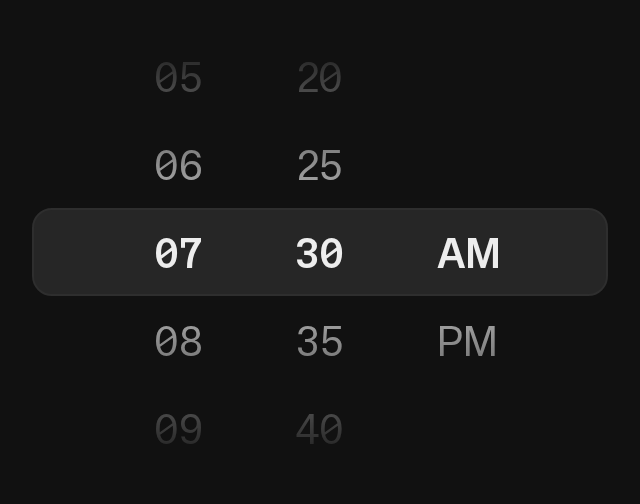
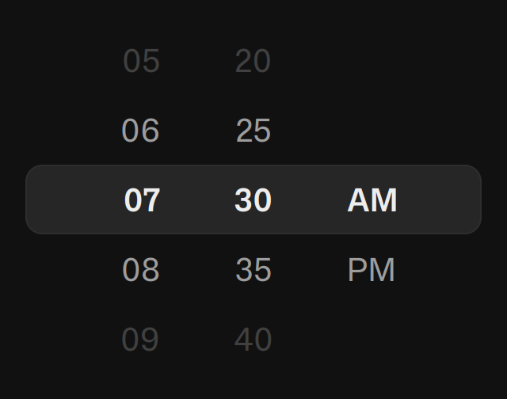
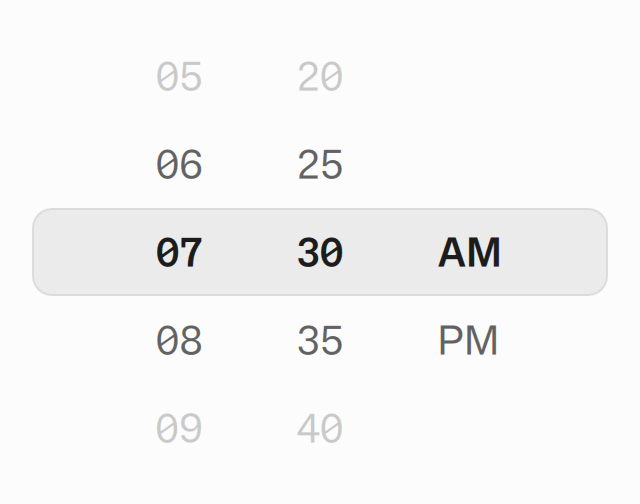
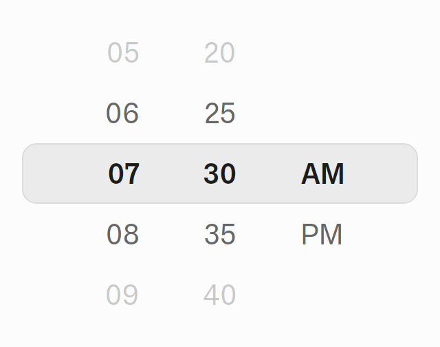
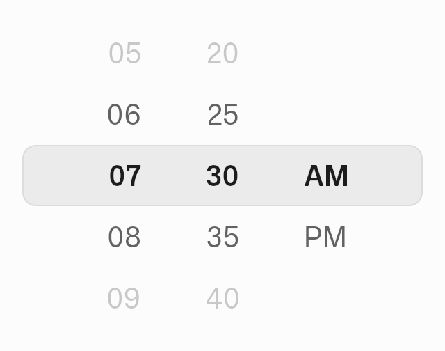
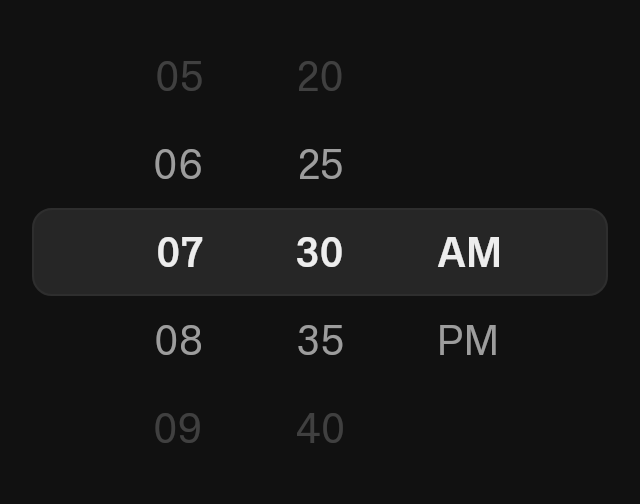

<!-- Generated by scripts/showcase.py from examples/ and component.toml. Do not edit by hand. -->

# WheelPicker

Scroll-snap wheels for picking from an ordered set on a phone: one column for a list, several for a time or date.

Mobile · [All components](README.md)

## Props

| Prop | Type | Default | Values | Description |
| --- | --- | --- | --- | --- |
| `columns` | list |  |  | Columns: { options, value, label, width?, align? }. Options are strings or { value, label }. |

Names follow the web targets. Qt Widgets takes `snake_case` arguments, Qt Quick `camelCase` properties, Avalonia `PascalCase` properties and Slint `kebab-case` properties; each example below shows the spelling for its target.

## Examples

Each example is run as it is shown here, on every push, and the screenshots are taken from that run (left Blanc, right Noir).

### CSS

 

```html
<div class="pm-wheel">
  <div class="pm-wheel__band" aria-hidden="true"></div>
  <div class="pm-wheel__column" role="spinbutton" tabindex="0" aria-label="Hour" aria-valuenow="6" aria-valuemin="0" aria-valuemax="11" aria-valuetext="07">
    <div style="margin-top: -264px"></div>
    <div class="pm-wheel__item pm-wheel__item--end">01</div>
    <div class="pm-wheel__item pm-wheel__item--end">02</div>
    <div class="pm-wheel__item pm-wheel__item--end">03</div>
    <div class="pm-wheel__item pm-wheel__item--end">04</div>
    <div class="pm-wheel__item pm-wheel__item--end">05</div>
    <div class="pm-wheel__item pm-wheel__item--end">06</div>
    <div class="pm-wheel__item pm-wheel__item--end pm-wheel__item--on">07</div>
    <div class="pm-wheel__item pm-wheel__item--end">08</div>
    <div class="pm-wheel__item pm-wheel__item--end">09</div>
    <div class="pm-wheel__item pm-wheel__item--end">10</div>
    <div class="pm-wheel__item pm-wheel__item--end">11</div>
    <div class="pm-wheel__item pm-wheel__item--end">12</div>
  </div>
  <div class="pm-wheel__column" role="spinbutton" tabindex="0" aria-label="Minute" aria-valuenow="6" aria-valuemin="0" aria-valuemax="11" aria-valuetext="30">
    <div style="margin-top: -264px"></div>
    <div class="pm-wheel__item">00</div>
    <div class="pm-wheel__item">05</div>
    <div class="pm-wheel__item">10</div>
    <div class="pm-wheel__item">15</div>
    <div class="pm-wheel__item">20</div>
    <div class="pm-wheel__item">25</div>
    <div class="pm-wheel__item pm-wheel__item--on">30</div>
    <div class="pm-wheel__item">35</div>
    <div class="pm-wheel__item">40</div>
    <div class="pm-wheel__item">45</div>
    <div class="pm-wheel__item">50</div>
    <div class="pm-wheel__item">55</div>
  </div>
  <div class="pm-wheel__column" role="spinbutton" tabindex="0" aria-label="AM or PM" aria-valuenow="0" aria-valuemin="0" aria-valuemax="1" aria-valuetext="AM">
    <div style="margin-top: -0px"></div>
    <div class="pm-wheel__item pm-wheel__item--start pm-wheel__item--on">AM</div>
    <div class="pm-wheel__item pm-wheel__item--start">PM</div>
  </div>
</div>
```

### Svelte

 

```svelte
<script lang="ts">
  import { WheelPicker, type WheelColumn } from "$lib/purrimer";

  const pad = (n: number) => String(n).padStart(2, "0");
  let time = $state({ hour: "07", minute: "30", half: "AM" });
  const columns: WheelColumn[] = $derived([
    { label: "Hour", options: Array.from({ length: 12 }, (_, i) => pad(i + 1)), value: time.hour, align: "end" },
    { label: "Minute", options: Array.from({ length: 12 }, (_, i) => pad(i * 5)), value: time.minute },
    { label: "AM or PM", options: ["AM", "PM"], value: time.half, align: "start" },
  ]);
  const keys = ["hour", "minute", "half"] as const;
</script>

<WheelPicker {columns} onchange={(c, v) => (time[keys[c]] = v)} />
```

### Solid

 

```tsx
import { createSignal } from "solid-js";
import { WheelPicker } from "~/purrimer";

const pad = (n: number) => String(n).padStart(2, "0");

export default function Example() {
  const [time, setTime] = createSignal({ hour: "07", minute: "30", half: "AM" });
  const keys = ["hour", "minute", "half"] as const;
  return (
    <WheelPicker
      columns={[
        { label: "Hour", options: Array.from({ length: 12 }, (_, i) => pad(i + 1)), value: time().hour, align: "end" },
        { label: "Minute", options: Array.from({ length: 12 }, (_, i) => pad(i * 5)), value: time().minute },
        { label: "AM or PM", options: ["AM", "PM"], value: time().half, align: "start" },
      ]}
      onChange={(c, v) => setTime({ ...time(), [keys[c]]: v })}
    />
  );
}
```

### Qt Widgets (PySide6)

 

```python
from purrimer_qt.components import WheelPicker
from purrimer_qt.components.wheel_picker import WheelColumn
from PySide6.QtWidgets import QWidget


def example() -> QWidget:
    hours = [f"{h:02d}" for h in range(1, 13)]
    minutes = [f"{m:02d}" for m in range(0, 60, 5)]
    picker = WheelPicker(
        [
            WheelColumn("Hour", hours, "07", align="end"),
            WheelColumn("Minute", minutes, "30"),
            WheelColumn("AM or PM", ["AM", "PM"], "AM", align="start"),
        ]
    )
    picker.changed.connect(lambda column, value: print("column", column, value))
    return picker
```

### Qt Quick

 

```qml
import QtQuick
import Purrimer

WheelPicker {
    width: 288
    columns: [
        { label: "Hour", options: ["01", "02", "03", "04", "05", "06", "07", "08", "09", "10", "11", "12"], value: "07", align: "end" },
        { label: "Minute", options: ["00", "05", "10", "15", "20", "25", "30", "35", "40", "45", "50", "55"], value: "30" },
        { label: "AM or PM", options: ["AM", "PM"], value: "AM", align: "start" }
    ]
    onChanged: (column, value) => console.log("column", column, value)
}
```

### Avalonia

 

```xml
<UserControl xmlns="https://github.com/avaloniaui"
             xmlns:pm="using:Purrimer.Avalonia">
  <pm:WheelPicker VerticalAlignment="Top">
    <pm:WheelColumn Label="Hour" Options="01,02,03,04,05,06,07,08,09,10,11,12" Value="07" Align="end" />
    <pm:WheelColumn Label="Minute" Options="00,05,10,15,20,25,30,35,40,45,50,55" Value="30" />
    <pm:WheelColumn Label="AM or PM" Options="AM,PM" Value="AM" Align="start" />
  </pm:WheelPicker>
</UserControl>
```

### Slint

 

```slint
import { WheelPicker } from "purrimer-components.slint";

export component Example inherits VerticalLayout {
    alignment: start;
    WheelPicker {
        columns: [
            { label: "Hour", options: ["01", "02", "03", "04", "05", "06", "07", "08", "09", "10", "11", "12"], index: 6, align: "end" },
            { label: "Minute", options: ["00", "05", "10", "15", "20", "25", "30", "35", "40", "45", "50", "55"], index: 6 },
            { label: "AM or PM", options: ["AM", "PM"], index: 0, align: "start" },
        ];
        changed(column, index) => { debug("column", column, index); }
    }
}
```

